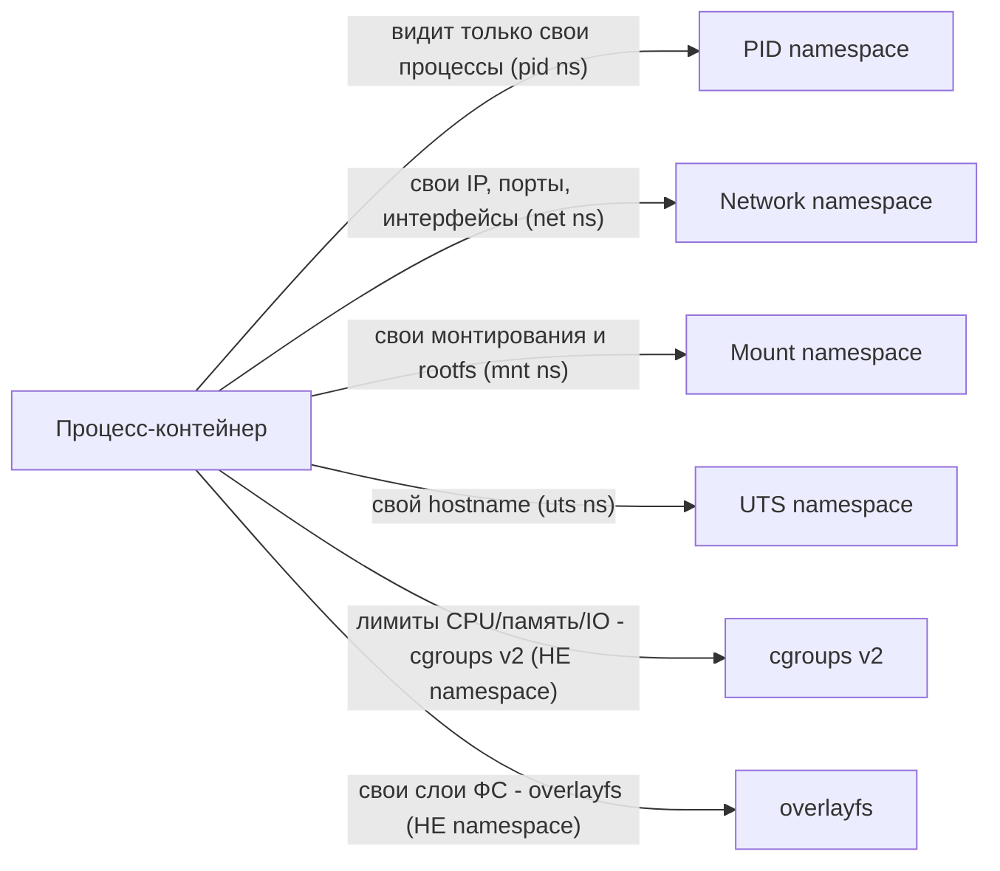

# Namespaces

> [!note] Добавлено агентом
> Mermaid-схема, раздел «Безопасность», ответы в «Проверка себя» и блок «Проверено» добавлены или переписаны агентом. Лабораторные блоки — выводы пользователя, сведённые агентом. Новые ссылки агента — только в блоке «Проверено».

## Зачем это нужно

Namespaces - нужны для того, чтобы ограничивать видимость процессов по отношению друг к другу, чтобы один процесс мог запускать что-либо не видя другой. Такая искусственная площадка для процесса, где снаружи он может быть непривилегированным юзером, а внутри у него будут все полномочия.
## Ключевая идея

Самый новый - это time namespace (since Linux 5.6), он позволяет контролировать временной namespace процесса (виртуализирует два такта: CLOCK_MONOTONIC и CLOCK_BOOTTIME, смещения задаются через /proc/[pid]/timens_offsets - time_namespaces(7))
А так, есть у нас разные типы пространств имен.
- [Mount namespaces](http://lwn.net/2001/0301/a/namespaces.php3) (CLONE_NEWNS, Linux 2.4.19) isolate the set of filesystem mount points seen by a group of processes. Он просто берет и изолирует видимость точек монтирования для разных процессов, тоесть для одного процесса файловая иерархия может выглядеть абсолютно различно тому что видит другой
```bash
❯ unshare --user --map-root-user --mount --fork bash
[root@Pimerroc ~]# mkdir /tmp/new_tmp
[root@Pimerroc ~]# mount -t tmpfs tmpfs /tmp/new_tmp/
[root@Pimerroc ~]# mount
[root@Pimerroc ~]# mount | grep new
tmpfs on /tmp/new_tmp type tmpfs (rw,relatime,uid=1000,gid=1000,inode64,huge=advise)
# Снаружи
❯ mount | grep new  # ничего
```
- [UTS namespaces](https://lwn.net/Articles/179345/) (CLONE_NEWUTS, Linux 2.6.19) isolate two system identifiers—nodename and domainname—returned by the [uname()](http://man7.org/linux/man-pages/man2/uname.2.html) system call; the names are set using the sethostname() and setdomainname() system calls. По сути вещь для контейнеров, которая позволяет разным контейнерам меня их доменное имя, а также NIS (Network Information Service) domain
```bash
❯ unshare --user --map-root-user --uts --fork bash
[root@Pimerroc ~]# python3 -c 'import socket; socket.sethostname("ns1"); print(socket.gethostname())'
ns1
[root@Pimerroc ~]# uname -n
ns1
# Через hostname, но потребуется утилита inetutils (arch)
[root@Pimerroc ~]# hostname bro-bachu
[root@Pimerroc ~]# hostname
bro-bachu
```
- [IPC namespaces](https://lwn.net/Articles/187274/) (CLONE_NEWIPC, Linux 2.6.19) isolate certain interprocess communication (IPC) resources, namely, [System V IPC](http://www.kernel.org/doc/man-pages/online/pages/man7/svipc.7.html) objects and (since Linux 2.6.30) [POSIX message queues](http://www.kernel.org/doc/man-pages/online/pages/man7/mq_overview.7.html). Пока не совсем понимаю, что это такое (просто ограничивает межпроцессорную коммуникацию (ну я так себе это представляю)). Понять бы что это такое...
```bash
[root@Pimerroc ~]# ipcs -q

------ Message Queues --------
key        msqid      owner      perms      used-bytes   messages

[root@Pimerroc ~]# ipcmk -Q
Message queue id: 0
[root@Pimerroc ~]# ipcs -q

------ Message Queues --------
key        msqid      owner      perms      used-bytes   messages
0x27773eb3 0          root       644        0            0
# Опять же снаружи:
❯ ipcs -q

------ Message Queues --------
key        msqid      owner      perms      used-bytes   messages
```
- [PID namespaces](https://lwn.net/Articles/259217/) (CLONE_NEWPID, Linux 2.6.24) isolate the process ID number space. Позволяет иметь кучу процессов с одним и тем же ID. Также  для каждого уровня иерархии свой pid (снаружи для этого pid, и внутри как 1).
- [Network namespaces](https://lwn.net/Articles/219794/) (CLONE_NEWNET, флаг since Linux 2.6.24 - man 2 clone; первая частичная реализация была в 2.4.19, в основном завершена к ~2.6.29; в самой LWN part 1 тут опечатка «2.4.19 2.6.24», я скопировал её дословно) provide isolation of the system resources associated with networking. Сильно не углублялся (ну тоесть пока не читал [Part 7: network namespaces](https://lwn.net/Articles/580893/)), но понятно, что эти ограничения нужны для того, чтобы у каждого процесса были свои порты и IP, как пример можно было бы расположить на порту 80 одновременно на двух контейнерах веб-приложение.
- [User namespaces](https://lwn.net/Articles/528078/) (CLONE_NEWUSER, started in Linux 2.6.23 and completed in Linux 3.8) isolate the user and group ID number spaces. Как раз то, про что я писал выше, можно от лица непривилегированного юзера создать пространство, где он будет привилегированным.
```bash
❯ unshare --user --map-root-user --fork bash -c 'id -u; cat /proc/self/uid_map'
0
         0       1000          1
```
---
```text
     Namespace   Flag              Page                    Isolates
     ─────────────────────────────────────────────────────────────────────────────────
     Cgroup      CLONE_NEWCGROUP   cgroup_namespaces(7)    Cgroup root directory
     IPC         CLONE_NEWIPC      ipc_namespaces(7)       System V IPC, POSIX message queues
     Network     CLONE_NEWNET      network_namespaces(7)   Network devices, stacks, ports, etc.
     Mount       CLONE_NEWNS       mount_namespaces(7)     Mount points
     PID         CLONE_NEWPID      pid_namespaces(7)       Process IDs
     Time        CLONE_NEWTIME     time_namespaces(7)      Boot and monotonic clocks
     User        CLONE_NEWUSER     user_namespaces(7)      User and group IDs
     UTS         CLONE_NEWUTS      uts_namespaces(7)       Hostname and NIS domain name
```
---
Контейнер - это не виртуалка, а обычный процесс + набор изоляций:



> Источник схемы: man 7 namespaces, man 7 pid_namespaces, man 7 network_namespaces, man 7 mount_namespaces; cgroups v2 и overlayfs — см. блок «Проверено». Это три разных механизма: namespaces изолируют видимость, cgroups ограничивают ресурсы, overlayfs даёт слоёную ФС образа.

## Как работает

```
unshare(CLONE_NEWUSER | CLONE_NEWNS | CLONE_NEWPID) // 1
write("/proc/self/uid_map", "0 1000 1") // 2 (--map-root-user)
fork() // 3 (--fork)
└─ child: mount("proc", "/proc", ...) // 4 (--mount-proc)
└─ child: execvp("bash") // → этот bash = PID 1
```
1 -  аллокация нового неймспейса.
2 - записать то что user внутри контейнера имеет id 0 (root)
3 - Форкнуть текущий процесс и выдать ему pid 1 аллоцируемого места
4 - Примонтировать /proc тем самым изолировав систему процессов, чтобы ps правильно отображалось
## Практика

1. Ну мне видны mnt, net, time, cgroup, pid, user, uts, ipc (ну тоесть все), bash process - 133546,
readlink /proc/\$\$/ns/pid /proc/\$\$/ns/net /proc/\$\$/ns/mnt
'pid:[4026531836]'
'net:[4026531833]'
'mnt:[4026531832]'
348 - процессов.
2.
- pid 1! причина - связка --pid + --fork: после unshare(CLONE_NEWPID) сам процесс НЕ перемещается в новый namespace (man 2 unshare: «The calling process is not moved into the new namespace»), а первый его потомок становится PID 1 нового пространства. --user / --map-root-user тут ни при чём - они лишь дают root внутри нового user namespace.
- Здесь только 2 процесса, видит он только bash и запущенный ps aux
- Разная группа процессов, 'pid:[4026532710]'
- Без fork команда запустилась бы, но процесс не перемещается в новый PID namespace (остаётся в старом - man 2 unshare), поэтому смонтировать свежий /proc нельзя:
unshare: mount /proc failed: Operation not permitted
- А без mount-proc (но с --fork) оно запустится: echo \$\$ покажет 1 (корневой процесс), но /proc останется старым - все процессы будут видны. Если убрать ещё и --fork, \$\$ вообще останется хостовым pid
1. 354, при этом других процессов я не запускал
2. Изнутри чужого неймспейса видно только то, что может быть видно в самом неймспейсе, полезно для захода внутрь контейнера к примеру командой docker exec -it bash. Опасно тем, что из контейнера можно сбежать (не знаю как именно реализуется, нужна ссылка на статью; примеры и ссылки с CVE - в разделе «Безопасность» ниже) , а также тем, что если завершить процесс 1 в неймспейсе упадет весь неймспейс ( If the "init" process of a PID namespace terminates, the kernel terminates all of the  processes  in the  namespace via a SIGKILL signal.  This behavior reflects the fact that the "init" process is essential for the correct operation of a PID namespace.)

## Ошибки и подводные камни
 sysctl kernel.unprivileged_userns_clone 2>/dev/null; cat /proc/sys/user/max_user_namespaces
kernel.unprivileged_userns_clone = 1
─────┬──────────────────────────────────────────────────────────────────
     │ File: /proc/sys/user/max_user_namespaces
─────┼──────────────────────────────────────────────────────────────────
   1 │ 63073
─────┴──────────────────────────────────────────────────────────────────

## Безопасность

> [!note] Добавлено агентом
> Обзор CVE и митигаций; ссылки на источники — в блоке «Проверено».

Расширение поверхности атаки ядра через unprivileged user namespaces: непривилегированный юзер получает CAP_SYS_ADMIN внутри ns и доступ к коду ядра, который раньше был достижим только root. Кейс 2016 года: патч Kees Cook'а с sysctl для ограничения userns, спор с автором userns Eric Biederman'ом — «unexpected side-effects and security exposures via CLONE_NEWUSER».

Эскалация привилегий через баги ядра, достижимые из userns: CVE-2022-0185 — heap overflow в legacy_parse_param (fs_context). NVD: «An unprivileged (in case of unprivileged user namespaces enabled, otherwise needs namespaced CAP_SYS_ADMIN privilege) local user ... could use this flaw to escalate their privileges on the system».

Ещё пример той же категории: CVE-2024-1086 — use-after-free в netfilter nf_tables, локальная эскалация привилегий (kernel 5.14–6.6); публичный эксплойт требует непривилегированные user namespaces: «The exploits requires user namespaces (kconfig CONFIG_USER_NS=y), that those user namespaces are unprivileged».

Сбежать из контейнера можно и через общие kernel-баги, без всякого userns: Dirty COW (CVE-2016-5195) — race condition в mm/gup.c, запись в read-only mapping через COW, «local users to gain privileges», эксплуатировался in the wild в 2016.

Митигации Docker: контейнер по умолчанию «unprivileged» — из capabilities оставлен ограниченный набор, CAP_SYS_ADMIN сброшен; default seccomp-профиль (allowlist с defaultAction SCMP_ACT_ERRNO, ~44 заблокированных syscall'а) разрешает clone/unshare/clone3 только с CAP_SYS_ADMIN — без неё clone с namespace-флагами запрещён маской 0x7E020000, в которую входит и CLONE_NEWUSER, т.е. создать user namespace изнутри контейнера нельзя. Прямо в docs видно по io_uring: «Blocked due to security vulnerabilities that can be exploited to break out of containers» (moby/moby#46762).

## Проверка себя

> [!note] Добавлено агентом
> Ответы переписаны по man-страницам; исходные формулировки пользователя приоритетны.

1. Чем namespace отличается от cgroup — что изолирует каждый? → man 7 namespaces, man 7 cgroups, docs.kernel.org cgroup-v2
Namespace изолирует видимость класса ресурсов (mount points, PID, сеть, UTS, IPC, user/group IDs, cgroup root, time) — man 7 namespaces, таблица «Namespace types». Cgroups ограничивают и учитывают потребление ресурсов (CPU, memory, I/O) для группы процессов; пример — `memory.max` в non-root cgroup v2 (docs.kernel.org cgroup-v2), в `man 7 cgroups` этого файла нет.

2. Почему `unshare --pid` без `--fork` не делает процесс PID 1? → man 2 unshare (CLONE_NEWPID), man 1 unshare (--fork)
`unshare(CLONE_NEWPID)` создаёт новый PID ns для потомков, но вызывающий процесс остаётся в старом (man 2 unshare: «The calling process is not moved into the new namespace»). PID 1 становится первый потомок; `--fork` нужен, чтобы им стала сама запускаемая программа.

3. Что будет со всеми процессами ns, если PID 1 умрёт? → man 7 pid_namespaces
Ядро завершит все процессы namespace через SIGKILL: init критичен для PID ns (man 7 pid_namespaces: «If the "init" process ... terminates, the kernel terminates all of the processes in the namespace via a SIGKILL signal»). Изнутри ns послать init можно только сигнал, на который у него есть обработчик; SIGKILL/SIGSTOP доставляются из ancestor ns.

4. Зачем user namespace для unprivileged-контейнеров и что пишут в uid_map? → man 7 user_namespaces (uid_map), proc_pid_uid_map(5)
User ns даёт контейнеру root и полный набор capabilities **внутри** ns, но только над ресурсами, которыми владеет этот userns; снаружи процесс остаётся непривилегированным. Глобальные операции (время, модули, устройства, произвольные ФС) недоступны — man 7 user_namespaces, «Capabilities».
`uid_map` — три числа: (1) start UID в userns процесса `pid`, (2) start UID, в который отображается поле 1, (3) длина диапазона. Пример `0 1000 1`: UID 0 внутри ↔ UID 1000 снаружи, диапазон 1. Поле 2 зависит от того, в одном ли userns открыватель файла и процесс `pid`: (a) разные userns → поле 2 задано в userns **открывателя** `uid_map`; (b) один и тот же userns → поле 2 задано в **родительском** userns процесса `pid` (man 7 user_namespaces, «User and group ID mappings»).

5. Почему без `--mount-proc` в новом PID ns видны хостовые процессы? → man 7 pid_namespaces («/proc and PID namespaces»), man 1 unshare
`/proc` — procfs, смонтированный в PID ns того, кто его смонтировал. Если не монтировать новый procfs, `ps` читает унаследованный `/proc` родителя и видит хостовые PID. `--mount-proc` монтирует новый procfs, соответствующий новому PID ns (man 1 unshare).
## Связи

> [!check] Проверено
> - Дата: 2026-11-09 (повторный фактчек: Q2/Q4 исправлены; лабы mnt/uts/ipc/user проверены)
> - Окружение: Arch Linux, kernel 7.2.14-arch1-1; unshare из util-linux 2.42.4; man-pages 6.20 (man 2.13.1)
> - Источники: man 7 namespaces, man 7 cgroups, pid_namespaces(7), network_namespaces(7), time_namespaces(7), user_namespaces(7), mount_namespaces(7), ipc_namespaces(7), uts_namespaces(7); man 1 unshare; man 2 clone / unshare; man 5 proc_pid_uid_map; kernel docs cgroup-v2 (https://docs.kernel.org/admin-guide/cgroup-v2.html — `memory.max`); Kerrisk, LWN «Namespaces in operation» part 1 (https://lwn.net/Articles/531114/ — сверено вебом, в нём опечатка «2.4.19 2.6.24» про net ns); part 7 (https://lwn.net/Articles/580893/ — сверено вебом, Jake Edge, 2014-01-22); Docker docs seccomp (https://docs.docker.com/engine/security/seccomp/) + профиль moby (https://github.com/moby/profiles/blob/master/seccomp/default.json) + capabilities (https://docs.docker.com/engine/containers/run/); NVD CVE-2022-0185 / CVE-2024-1086 / CVE-2016-5195; LWN https://lwn.net/Articles/673597/; kernel docs overlayfs (docs.kernel.org)
> - Проверенные команды (лабы 2026-11-09): (1) `unshare --user --map-root-user --mount --fork` + `mount -t tmpfs`; (2) `unshare --user --map-root-user --uts --fork` + `hostname`; (3) `unshare --user --map-root-user --ipc --fork` + `ipcmk -Q` / `ipcs -q`; (4) `unshare --user --map-root-user --pid --fork [--mount-proc]` + `ps`/`readlink /proc/$$/ns/pid`; вариант без `--mount` + ручной `mount -t proc` → EPERM, с `--mount` → успех; плюс `cat /proc/self/uid_map`, `readlink /proc/$$/ns/{pid,net,mnt}`, `sysctl kernel.unprivileged_userns_clone`, `cat /proc/sys/user/max_user_namespaces`
> - EPERM: `unshare --user --map-root-user --pid --fork` **без** `--mount`, затем вручную `mount -t proc proc /proc` → EPERM (проверено, rc=32). Причина: для монтирования `/proc` нужен CAP_SYS_ADMIN в userns, который владеет **и** mount ns, **и** PID ns (man 7 user_namespaces, «Effect of capabilities within a user namespace»: «Holding CAP_SYS_ADMIN within the user namespace that owns a process's mount namespace… mount /proc» + «Holding CAP_SYS_ADMIN within the user namespace that owns a process's PID namespace… mount /proc filesystems»). Без `--mount` mount ns остаётся родительским; без `--pid` — родительский PID ns; в обоих случаях root нового userns не имеет нужной capability → EPERM. `--mount-proc` создаёт mount ns и монтирует proc в новом PID ns (man 1 unshare: «It also implies creating a new mount namespace»), поэтому с `--pid --fork --mount-proc` ошибки нет.
> - Не проверено: LWN part 2–6 и статьи 2001–2012 из списка типов ns вебом; `kernel.unprivileged_userns_clone` не документирован в man 5 proc (6.20) и не задаётся в sysctl.d — вероятно, патч дистрибутива, исходники ядра не смотрел; поведение на других ядрах/дистрибутивах; детали механизма escape из контейнера (пока только ссылки на CVE и митигации); POSIX message queues внутри IPC ns (проверен только SysV через `ipcs`)
