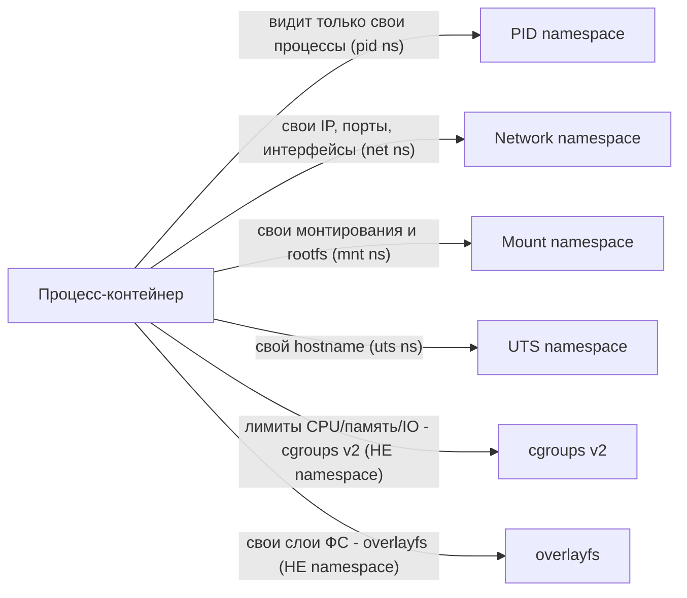

# Namespaces 
## Зачем это нужно

Namespaces - нужны для того, чтобы ограничивать видимость процессов по отношению друг к другу, чтобы один процесс мог запускать что-либо не видя другой. Такая искусственная площадка для процесса, где снаружи он может быть непривилегированным юзером, а внутри у него будут все полномочия. 
## Ключевая идея

Самый новый - это time namespace (since Linux 5.6), он позволяет контролировать временной namespace процесса (виртуализирует два такта: CLOCK_MONOTONIC и CLOCK_BOOTTIME, смещения задаются через /proc/[pid]/timens_offsets - time_namespaces(7))
А так, есть у нас разные типы пространств имен.
- [Mount namespaces](http://lwn.net/2001/0301/a/namespaces.php3) (CLONE_NEWNS, Linux 2.4.19) isolate the set of filesystem mount points seen by a group of processes. Он просто берет и изолирует видимость точек монтирования для разных процессов, тоесть для одного процесса файловая иерархия может выглядеть абсолютно различно тому что видит другой 
- [UTS namespaces](https://lwn.net/Articles/179345/) (CLONE_NEWUTS, Linux 2.6.19) isolate two system identifiers—nodename and domainname—returned by the [uname()](http://man7.org/linux/man-pages/man2/uname.2.html) system call; the names are set using the sethostname() and setdomainname() system calls. По сути вещь для контейнеров, которая позволяет разным контейнерам меня их доменное имя, а также NIS (Network Information Service) domain 
- [IPC namespaces](https://lwn.net/Articles/187274/) (CLONE_NEWIPC, Linux 2.6.19) isolate certain interprocess communication (IPC) resources, namely, [System V IPC](http://www.kernel.org/doc/man-pages/online/pages/man7/svipc.7.html) objects and (since Linux 2.6.30) [POSIX message queues](http://www.kernel.org/doc/man-pages/online/pages/man7/mq_overview.7.html). Пока не совсем понимаю, что это такое (просто ограничивает межпроцессорную коммуникацию (ну я так себе это представляю)). 
- [PID namespaces](https://lwn.net/Articles/259217/) (CLONE_NEWPID, Linux 2.6.24) isolate the process ID number space. Позволяет иметь кучу процессов с одним и тем же ID. Также  для каждого уровня иерархии свой pid (снаружи для этого pid, и внутри как 1).
- [Network namespaces](https://lwn.net/Articles/219794/) (CLONE_NEWNET, флаг since Linux 2.6.24 - man 2 clone; первая частичная реализация была в 2.4.19, в основном завершена к ~2.6.29; в самой LWN part 1 тут опечатка «2.4.19 2.6.24», я скопировал её дословно) provide isolation of the system resources associated with networking. Сильно не углублялся (ну тоесть пока не читал [Part 7: network namespaces](https://lwn.net/Articles/580893/)), но понятно, что эти ограничения нужны для того, чтобы у каждого процесса были свои порты и IP, как пример можно было бы расположить на порту 80 одновременно на двух контейнерах веб-приложение. 
- [User namespaces](https://lwn.net/Articles/528078/) (CLONE_NEWUSER, started in Linux 2.6.23 and completed in Linux 3.8) isolate the user and group ID number spaces. Как раз то, про что я писал выше, можно от лица непривилегированного юзера создать пространство, где он будет привилегированным.
```text
     Namespace   Flag              Page                    Isolates
     ─────────────────────────────────────────────────────────────────────────────────
     Cgroup      CLONE_NEWCGROUP   cgroup_namespaces(7)    Cgroup root directory
     IPC         CLONE_NEWIPC      ipc_namespaces(7)       System V IPC, POSIX message queues
     Network     CLONE_NEWNET      network_namespaces(7)   Network devices, stacks, ports, etc.
     Mount       CLONE_NEWNS       mount_namespaces(7)     Mount points
     PID         CLONE_NEWPID      pid_namespaces(7)       Process IDs
     Time        CLONE_NEWTIME     time_namespaces(7)      Boot and monotonic clocks
     User        CLONE_NEWUSER     user_namespaces(7)      User and group IDs
     UTS         CLONE_NEWUTS      uts_namespaces(7)       Hostname and NIS domain name
```

Контейнер - это не виртуалка, а обычный процесс + набор изоляций:



> Источник схемы: man 7 namespaces, man 7 pid_namespaces, man 7 network_namespaces, man 7 mount_namespaces; cgroups v2 — https://docs.kernel.org/admin-guide/cgroup-v2.html; overlayfs — https://docs.kernel.org/filesystems/overlayfs.html. Это три разных механизма: namespaces изолируют видимость, cgroups ограничивают ресурсы, overlayfs даёт слоёную ФС образа.

## Как работает

```
unshare(CLONE_NEWUSER | CLONE_NEWNS | CLONE_NEWPID) // 1
write("/proc/self/uid_map", "0 1000 1") // 2 (--map-root-user)
fork() // 3 (--fork)
└─ child: mount("proc", "/proc", ...) // 4 (--mount-proc)
└─ child: execvp("bash") // → этот bash = PID 1
```
1 -  аллокация нового неймспейса.
2 - записать то что user внутри контейнера имеет id 0 (root)
3 - Форкнуть текущий процесс и выдать ему pid 1 аллоцируемого места
4 - Примонтировать /proc тем самым изолировав систему процессов, чтобы ps правильно отображалось 
## Практика 

1. Ну мне видны mnt, net, time, cgroup, pid, user, uts, ipc (ну тоесть все), bash process - 133546, 
readlink /proc/\$\$/ns/pid /proc/\$\$/ns/net /proc/\$\$/ns/mnt
'pid:[4026531836]'
'net:[4026531833]'
'mnt:[4026531832]'
348 - процессов.
2.
- pid 1! причина - связка --pid + --fork: после unshare(CLONE_NEWPID) сам процесс НЕ перемещается в новый namespace (man 2 unshare: «The calling process is not moved into the new namespace»), а первый его потомок становится PID 1 нового пространства. --user / --map-root-user тут ни при чём - они лишь дают root внутри нового user namespace.
- Здесь только 2 процесса, видит он только bash и запущенный ps aux
- Разная группа процессов, 'pid:[4026532710]'
- Без fork команда запустилась бы, но процесс не перемещается в новый PID namespace (остаётся в старом - man 2 unshare), поэтому смонтировать свежий /proc нельзя:
unshare: mount /proc failed: Operation not permitted
- А без mount-proc (но с --fork) оно запустится: echo \$\$ покажет 1 (корневой процесс), но /proc останется старым - все процессы будут видны. Если убрать ещё и --fork, \$\$ вообще останется хостовым pid
1. 354, при этом других процессов я не запускал 
2. Изнутри чужого неймспейса видно только то, что может быть видно в самом неймспейсе, полезно для захода внутрь контейнера к примеру командой docker exec -it bash. Опасно тем, что из контейнера можно сбежать (не знаю как именно реализуется, нужна ссылка на статью; примеры и ссылки с CVE - в разделе «Безопасность» ниже) , а также тем, что если завершить процесс 1 в неймспейсе упадет весь неймспейс ( If the "init" process of a PID namespace terminates, the kernel terminates all of the  processes  in the  namespace via a SIGKILL signal.  This behavior reflects the fact that the "init" process is essential for the correct operation of a PID namespace.)
 
## Ошибки и подводные камни
 sysctl kernel.unprivileged_userns_clone 2>/dev/null; cat /proc/sys/user/max_user_namespaces
kernel.unprivileged_userns_clone = 1
─────┬──────────────────────────────────────────────────────────────────
     │ File: /proc/sys/user/max_user_namespaces
─────┼──────────────────────────────────────────────────────────────────
   1 │ 63073
─────┴──────────────────────────────────────────────────────────────────

## Безопасность

Расширение поверхности атаки ядра через unprivileged user namespaces: непривилегированный юзер получает CAP_SYS_ADMIN внутри ns и доступ к коду ядра, который раньше был достижим только root. Кейс 2016 года: патч Kees Cook'а с sysctl для ограничения userns, спор с автором userns Eric Biederman'ом — «unexpected side-effects and security exposures via CLONE_NEWUSER» (https://lwn.net/Articles/673597/)

Эскалация привилегий через баги ядра, достижимые из userns: CVE-2022-0185 — heap overflow в legacy_parse_param (fs_context). NVD: «An unprivileged (in case of unprivileged user namespaces enabled, otherwise needs namespaced CAP_SYS_ADMIN privilege) local user ... could use this flaw to escalate their privileges on the system» (https://nvd.nist.gov/vuln/detail/CVE-2022-0185)

Ещё пример той же категории: CVE-2024-1086 — use-after-free в netfilter nf_tables, локальная эскалация привилегий (kernel 5.14–6.6); публичный эксплойт требует непривилегированные user namespaces: «The exploits requires user namespaces (kconfig CONFIG_USER_NS=y), that those user namespaces are unprivileged» (https://nvd.nist.gov/vuln/detail/CVE-2024-1086, https://github.com/Notselwyn/CVE-2024-1086)

Сбежать из контейнера можно и через общие kernel-баги, без всякого userns: Dirty COW (CVE-2016-5195) — race condition в mm/gup.c, запись в read-only mapping через COW, «local users to gain privileges», эксплуатировался in the wild в 2016 (https://nvd.nist.gov/vuln/detail/CVE-2016-5195)

Митигации Docker: контейнер по умолчанию «unprivileged» — из capabilities оставлен ограниченный набор, CAP_SYS_ADMIN сброшен; default seccomp-профиль (allowlist с defaultAction SCMP_ACT_ERRNO, ~44 заблокированных syscall'а) разрешает clone/unshare/clone3 только с CAP_SYS_ADMIN — без неё clone с namespace-флагами запрещён маской 0x7E020000, в которую входит и CLONE_NEWUSER, т.е. создать user namespace изнутри контейнера нельзя. Прямо в docs видно по io_uring: «Blocked due to security vulnerabilities that can be exploited to break out of containers» (moby/moby#46762) (https://docs.docker.com/engine/security/seccomp/, профиль: https://github.com/moby/profiles/blob/master/seccomp/default.json, capabilities: https://docs.docker.com/engine/containers/run/)

## Проверка себя

Я себе верю.

## Связи

> [!check] Проверено
> - Дата: 2026-11-08 (повторный фактчек)
> - Окружение: Arch Linux, kernel 7.2.14-arch1-1; unshare из util-linux 2.42.4; man-pages 6.20 (man 2.13.1)
> - Источники: man 7 namespaces, pid_namespaces(7), network_namespaces(7), time_namespaces(7), user_namespaces(7), mount_namespaces(7); man 1 unshare; man 2 clone / unshare; Kerrisk, LWN «Namespaces in operation» part 1 (https://lwn.net/Articles/531114/ — сверено вебом, в нём опечатка «2.4.19 2.6.24» про net ns); part 7 (https://lwn.net/Articles/580893/ — ссылка автора, вебом не проверена); Docker docs seccomp (https://docs.docker.com/engine/security/seccomp/) + профиль moby (https://github.com/moby/profiles/blob/master/seccomp/default.json) + capabilities (https://docs.docker.com/engine/containers/run/); NVD CVE-2022-0185 / CVE-2024-1086 / CVE-2016-5195; LWN https://lwn.net/Articles/673597/; kernel docs cgroup-v2 и overlayfs (docs.kernel.org)
> - Проверенные команды: unshare --user --map-root-user --pid --fork --mount-proc (плюс вариации: без --fork, без --mount-proc, без обоих); readlink /proc/$$/ns/{pid,net,mnt}; sysctl kernel.unprivileged_userns_clone; cat /proc/sys/user/max_user_namespaces; ps aux | wc -l
> - Не проверено: остальные LWN-ссылки из списка типов ns (part 2/7 и статьи 2001–2012) вебом; является ли sysctl kernel.unprivileged_userns_clone mainline или патчем дистрибутива; точная причина EPERM у mount /proc без --fork (в man не описана — только эмпирия); поведение на других ядрах/дистрибутивах; детали механизма escape из контейнера (пока только ссылки на CVE и митигации)
