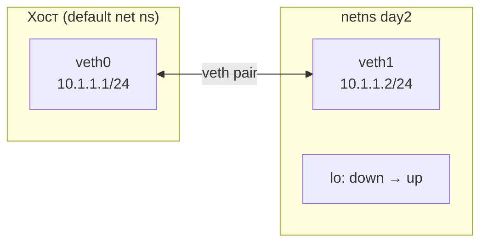

# Network namespace

## Зачем это нужно
Network namespace - нужен для того, чтобы ограничить некоторую группу процессов от нашего сетевого стека, а не только от «интернета»: в ns свои network devices, IPv4/IPv6 stack, IP routing tables, firewall rules, порты (man 7 network_namespaces). К примеру, у нас есть некоторый веб сервер, то после установки соединения, мы можем положить это соединение в некоторый неймспейс (если у нас есть какой-то файл и мы его читаем, то файловый дескриптор передается дальше в child process и уже он может им управлять) и да именно так и работают сокеты.

Уточнение формулировки (идея была верная): сокет принадлежит network namespace создавшего его процесса, а fd сокета наследуется дочерними процессами, как и любой fd. По умолчанию процесс наследует net ns от родителя (man 8 ip-netns).
## Ключевая идея
`ip netns add netns1` -- создает новый namespace и дает ему ИМЯ: bind mount /var/run/netns/netns1. Пока имя (bind mount или открытый fd) существует, namespace жив, даже если у него не будет подпроцессов! (man 8 ip-netns, man 7 namespaces: Namespace lifetime)
## Как работает
Аналогично созданию всех других пространств имен, тоесть через clone процесса.
Если использовать unshare --net bash - то это создаст новый namespace с bash.
Кстати, ограниченной видимости по процессам у него НЕ будет — за это отвечает pid namespace (см. [[Namespaces]]). Network namespace изолирует только сеть: network devices, IPv4/IPv6 stacks, IP routing tables, firewall rules, /proc/net, /sys/class/net, /proc/sys/net, порты (man 7 network_namespaces, первый абзац DESCRIPTION). *(поправлено на фактчеке 2026-11-08: раньше здесь стояло «ограниченная видимость по процессам» — это про pid ns, не про net ns)*
## Практика
Создаю новый namespace и выполняю в нем bash:
```bash
sudo ip netns add day2
sudo ip netns exec day2 bash
```
Пока не поднят lo ping на него не будет работать, а также все что вне сети будет недоступно!
```bash
ip l set lo up
ping 127.0.0.1
```
Далее создаю veth-пару и один конец переношу в namespace (строго говоря, это не мост, а «pipe-like» туннель между ns — man 4 veth).
```bash
sudo ip link add veth0 type veth peer name veth1
sudo ip link set veth1 netns day2
```
Задаю адреса для хоста/нашего виртуального пространства имен:
```bash
# day2 bash
sudo ip a add 10.1.1.2/24 dev veth1
sudo ip l set veth1 up
# host 
sudo ip a add 10.1.1.1/24 dev veth0
sudo ip l set veth0 up
```
После необходимо убедится написав ip a для каждой стороны veth-пары должно быть написано UP, после этого ping будет проходить через заданные адреса. И кстати в ip route это тоже все появится.
```bash
# Со стороны хоста
ping -c2 10.1.1.2
# Со стороны неймспейса (пингуем хост!)
ping -c2 10.1.1.1
```
После удалить этот неймспейс:
```bash
sudo ip netns del day2
```
*(поправлено на фактчеке 2026-11-08 — было «вместе с ним удалится весь наш бридж»)*

На самом деле `ip netns del day2` удаляет только ИМЯ: umount и удаление точки монтирования /var/run/netns/day2 (man 8 ip-netns). Сам namespace живёт, пока есть последний пользователь — процесс (наш bash внутри day2) или открытый fd. Когда namespace освобождается, уничтожается **вся veth-пара**: veth1 внутри ns и veth0 на хосте (man 7 network_namespaces: «veth devices that it contains are destroyed»; в ядре `veth_dellink` снимает оба конца). Отдельный `ip link del veth0` не нужен — после смерти ns такого интерфейса уже нет.

Пока namespace ещё жив после `ip netns del`, veth0 остаётся на хосте. Carrier требует UP на обоих концах: если veth0 UP, то при veth1 UP он UP/LOWER_UP, при veth1 DOWN — DOWN/NO-CARRIER; если сам veth0 DOWN, он остаётся DOWN без LOWER_UP (man 4 veth: «When either device is down, the link state of the pair is down»). `docker0` здесь не аналогия: это bridge, он остаётся и без контейнеров.
*(поправлено на повторном фактчеке 2026-11-09: раньше здесь утверждалось, что veth0 остаётся без пира — неверно, пара удаляется целиком; проверено живым прогоном)*
## Ошибки и подводные камни

Цитата (адаптация: в оригинале netns1): «namespaces do not share routing tables or firewall rules, as running route and iptables -L in day2 will attest» — Jake Edge, «Namespaces in operation, part 7: Network namespaces», LWN.net, 2014-01-22, https://lwn.net/Articles/580893/.
Своими словами по man 7 network_namespaces: у каждого ns свои IP routing tables и firewall rules, поэтому внутри day2 `route` и `iptables -L` показывают не то, что на хосте (команды рабочие, man 8 ip-netns: `ip netns exec`):
```bash
ip netns exec day2 route
ip netns exec day2 iptables -L
```
## Проверка себя

**1. Почему `lo` в новом namespace создаётся без UP и что это меняет для `ping 127.0.0.1`?**
Новый net ns получает loopback без флага UP. Пока интерфейс не поднят, `127.0.0.1` в этом ns не работает, и `ping` падает с `connect: Network is unreachable`. После `ip link set lo up` — проходит.
Проверено 2026-11-09: `unshare --user --map-root-user --net --fork` → `lo DOWN`, ping unreachable, после `ip link set lo up` — 0% packet loss.

**2. Что именно уедет в ns при `ip link set veth1 netns day2` — и что будет с адресом, если он был назначен ДО переноса?**
Переезжает сам netdev, но не вся конфигурация: L2-параметры (имя, MAC, MTU) сохраняются, а L3-адреса и флаг UP сбрасываются — интерфейс появляется в целевом ns в состоянии DOWN и без адресов.
Проверено 2026-11-09 на veth и dummy: `10.9.9.2/24` и `10.9.9.3/24` после переноса отсутствуют, имя/MAC/MTU не изменились.
Оговорка: переносить можно не всё. `lo`, bridge и wireless — netns-local: `ip link set lo netns ...` → `Error: The interface netns is immutable.` (сообщение iproute2 7.3.0; man 8 ip-link: «Invalid argument»). Для физической NIC механизм тот же (`netif_close` → `NETDEV_UNREGISTER` → удаление адресов), но на реальном устройстве не проверялось.
*(В квизе 2026-11-08 было сказано «адрес едет с интерфейсом» — это неверно, исправлено.)*

**3. Что произойдёт с veth-парой после `ip netns del day2`?**
`ip netns del` удаляет только имя: umount и удаление точки монтирования `/var/run/netns/day2` (man 8 ip-netns). Namespace живёт, пока есть процесс или fd. Когда последний пользователь уходит, уничтожается вся veth-пара — veth1 внутри ns и veth0 на хосте (man 7 network_namespaces: «veth devices that it contains are destroyed»; `veth_dellink` снимает peer). Проверено 2026-11-09: после `ip netns del` при живом holder veth0 ещё есть (UP/LOWER_UP), после kill holder — `Device "veth0" does not exist`; `ip link del veth0` не нужен.
Пока ns жив, veth0 остаётся; carrier требует UP на обоих концах (man 4 veth). `docker0` — bridge, а не veth: он остаётся без контейнеров, это другая история.

**4. Чем `ip netns exec day2 cmd` отличается от `nsenter --net=/var/run/netns/day2 cmd`?**
`ip netns exec` делает `setns` в net ns **и** создаёт mount namespace, bind-mount'я конфиги из `/etc/netns/NAME/` поверх `/etc/` (`resolv.conf`, `hosts` и т.д.) — man 8 ip-netns: «creating a mount namespace and bind mounting all of the per network namespace configure files into their traditional location in /etc». `nsenter --net=...` только переключает net ns, файлы `/etc` остаются хостовыми.

## В дикой природе

`lsns -t net` на моей машине (снимок 2026-11-08): у контентных процессов Firefox (`firefox -contentproc ... tab`) — отдельные net ns, не общий с системой. Живой пример network namespace вне контейнеров. *(живое наблюдение, внешний источник не прикреплен)*

## Схема: хост ↔ ns через veth-пару



> Источник схемы: man 4 veth, man 7 network_namespaces + лаба выше.

## Безопасность

- Физический интерфейс можно потерять при удалении ns с живым процессом: если перенести физическое устройство в ns, а потом сделать `ip netns del`, устройство вернется в default net ns только после смерти процесса внутри. (man 8 ip-netns, раздел `ip netns delete`, пример с eth0 и SOME_PROCESS_IN_BACKGROUND)
- Net namespace — это не разграничение доступа: net ns изолирует только сеть, а процессы остаются общими (видимость процессов — pid ns), один process tree видит все ns и может переключаться между ними. Удобно для администрирования, опасно путать с изоляцией. (man 7 namespaces; man 7 network_namespaces)
- Абстрактные UNIX-сокеты — скрытая общая точка: они изолируются вместе с net ns, но внутри одного ns видны всем процессам без проверки прав (даже из других pid/user ns). (man 7 network_namespaces, последняя фраза первого абзаца; man 7 unix, «Abstract sockets»)

## Связи

- [[Namespaces]]

> [!check] Проверено
> - Дата: 2026-11-09 (повторный фактчек: Q3 исправлен — veth-пара удаляется целиком, а не остаётся veth0; Q2 — оговорка про netns-immutable)
> - Окружение: Arch Linux, kernel 7.2.14-arch1-1, iproute2 7.3.0 (`ip -V`), man-pages 6.20
> - Источники: man 7 network_namespaces; man 8 ip-netns; man 8 ip-link; man 4 veth; man 1 nsenter; man 7 namespaces (Namespace lifetime); man 7 unix; Jake Edge, «Namespaces in operation, part 7: Network namespaces», LWN.net, 2014-01-22 — https://lwn.net/Articles/580893/
> - Проверенные команды: `unshare --user --map-root-user --net --fork` (lo DOWN → `Network is unreachable` → `ip link set lo up` → ping ok); `unshare ... --mount` + tmpfs на `/run` и `/etc`: `ip netns add/del`, перенос veth/dummy (адреса и UP сбрасываются; MAC/MTU/имя сохраняются), после освобождения ns veth-пара исчезает целиком (`Device "veth0" does not exist`), `ip link set lo netns` → `netns is immutable`, `ip netns exec` vs `nsenter` и `/etc/netns/NAME/resolv.conf`; `ip -V`; `lsns -t net`; чтение man-страниц
> - Не проверено: перенос реальной физической NIC и wireless (по man/kernel — тот же сброс адресов и UP, живьём не запускалось); `ip netns del` при mountpoint, занятом в другом mount ns; наблюдение Firefox-contentproc в `lsns -t net` — живое, без внешнего источника
