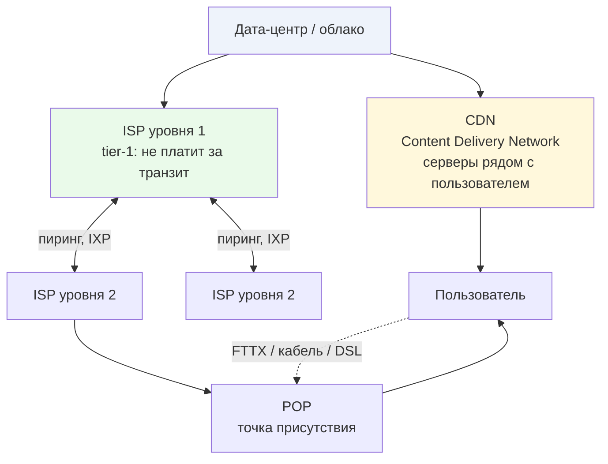
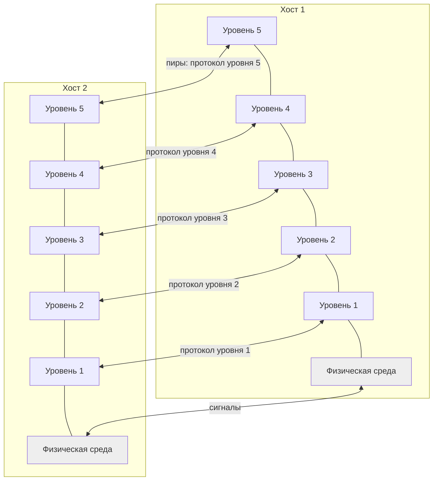

# Глава 1. Введение

> Источник: Таненбаум, Фимстер, Кузеролл. *Компьютерные сети*, 6-е изд. — **страницы 26–120**.
> PDF: ![[Tanenbaum_E_Fimster_N_Uezeroll_D_Kompyuternye_seti_6_e_izd_Klassika.pdf]]
> Все сокращения с расшифровками — в [[Словарь сокращений]].

**Связано:** [[Глава 2]] · [[Глава 3]] · [[Глава 4]] · [[Главы 1–3 — Тест и терминология]]

---

## ⚠️ Главное предупреждение о 6-м издании

Глава 1 в шестом издании **сильно отличается** от пятого. Если ты сверяешься с другим
переводом или с лекциями по 5-му изданию — расхождения будут не в деталях, а в структуре.

**В главе 1 НЕТ:**
- разделов о физическом уровне (FDM/TDM/CDMA, биты/боды/несущие/тактирование) — это глава 2;
- определений одноадресной / многоадресной / широковещательной рассылки — это главы 2–4;
- определений моста, концентратора (хаба) и повторителя — это главы 3–4;
- подробных описаний видов DSL — это глава 2.

Определены в главе 1 только: **коммутатор**, **маршрутизатор**, **шлюз**, **точка доступа**.

---

## О чём глава

1. Зачем нужны сети: доступ к информации, общение, электронная коммерция, развлечения, IoT.
2. Типы сетей по масштабу: PAN → LAN → MAN → WAN, интерсеть.
3. Примеры сетей: интернет, мобильные, беспроводные.
4. Сетевые технологии: клиент-сервер против P2P, устройства, подсеть, сокеты.
5. Сетевые протоколы: цели проектирования, **разделение на уровни**, соединения и надёжность, примитивы, службы и протоколы.
6. **Эталонные модели**: OSI, TCP/IP, модель книги.
7. Стандартизация.
8. Политика, право, приватность.
9. Единицы измерения.
10. Краткий обзор следующих глав.

---

## 1.1–1.2 Зачем сети и клиент-сервер

Компьютерная сеть — «набор взаимосвязанных автономных вычислительных устройств»
(стр. 27). Строгое определение сети: **набор вычислительных устройств, соединённых
при помощи одной и той же технологии** (стр. 53).

Модель «клиент-сервер»: клиент явно запрашивает информацию; участвуют **два процесса**
(илл. 1.2). Противоположность — **P2P**: «никакого чёткого деления на клиенты и серверы нет»;
в BitTorrent нет централизованной базы контента.


Виды электронной коммерции (илл. 1.4) строятся на одинаковом чтении «to»/«2»:
**B2C, B2B, G2C, C2C, P2P**.

---

## 1.3 Типы сетей по масштабу

![[ch1-network-scales.png]]

| Тип | Расшифровка | Масштаб | Ключевое свойство |
|---|---|---|---|
| **PAN** | Personal Area Network — персональная сеть | Комната, один человек | Обмен между устройствами одного человека; Bluetooth — парадигма «главный — подчинённые» |
| **LAN** | Local Area Network — локальная сеть | Здание + прилегающая территория | Размеры ограниченны ⇒ **время прохождения сигнала имеет предел и известно заранее** — это упрощает проектирование протоколов |
| **MAN** | Metropolitan Area Network — городская сеть | Город | Эволюция сетей кабельного ТВ; головная станция **CMTS** |
| **WAN** | Wide Area Network — глобальная сеть | Страна, континент | Либо частная корпоративная, либо продаётся как услуга |
| **Интернет** | — | Планета | «Обширное собрание сетей, использующих некоторые общие протоколы»; **не задуман и не контролируется какой-либо одной организацией** |

**Домашняя сеть** — разновидность LAN с особыми требованиями: чрезвычайная лёгкость
управления, безопасность, органичное развитие, отсутствие «войн интерфейсов».

**VPN** — «попытка освободиться от тирании географии» (стр. 40).

---

## 1.4 Устройства, подсеть и маршрутизация

Ключевые определения главы (единственное место, где они даны в первых четырёх главах):

- **Хост** — компьютер, выполняющий прикладные программы.
- **Подсеть связи** — «оставшаяся часть сети, соединяющая хосты». Состоит из
  **двух** компонентов: *линий передачи* и *коммутирующих элементов*.
- **Коммутатор** — «устройство, соединяющее две или более линии передачи».
- **Маршрутизатор** — «каждая линия передачи связывает пару маршрутизаторов».
- **Шлюз** — «устройство, реализующее соединение между двумя или более сетями»
  и обеспечивающее преобразования.

Два разных алгоритма, которые автор настойчиво разделяет:

|                 | Алгоритм маршрутизации         | Алгоритм пересылки                                               |
| --------------- | ------------------------------ | ---------------------------------------------------------------- |
| Что делает      | Ищет наилучший путь **в сети** | Каждый маршрутизатор решает «куда дальше» для конкретного пакета |
| Где обсуждается | Глава 5                        | Глава 5                                                          |

> [!warning]- Слово «подсеть» двусмысленно
> В главе 1 используется **исходное** значение: маршрутизаторы + линии передачи, перемещающие
> пакеты. Второе значение (подсеть в смысле адресации) появляется в главе 5.

> [!warning]- Слово «сеть» тоже применяется нестрого
> Автор признаёт: «сетью можно считать подсеть… Интерсеть можно также считать сетью».
> Отсюда путаница «подсеть = сеть = интерсеть».

---

## 1.4.1 Архитектура интернета сегодня



- **Транзитная сеть** = **опорная, магистральная сеть (backbone)** — берёт плату
  за сквозную передачу.
- **tier-1** — операторы, которые **не платят** за транзит; все остальные подключаются к ним.
- **IXP** — здание с маршрутизаторами, по минимуму одному от каждого ISP.
- **Пиринг** — ISP соединяются напрямую. «Парадокс интернета: провайдеры, публично
  конкурирующие, тайно сотрудничают».
- **POP** — место входа пакетов пользователя в сеть ISP.
- **NAP** — историческая (1990-е) инфраструктура NSFNET: 4 оператора.
- **«Последняя миля»** — последний участок, он и ограничивает всю скорость.

Тенденция, отмеченная в книге: крупные сети **всё меньше полагаются на транзитные сети**,
предпочитая прямое соединение, и оставляют транзит как резерв. Отсюда «схлопывание»
иерархии (илл. 1.18).

---

## 1.5 Сетевые протоколы

### Уровень — центральное понятие

> Уровень — «каждая из которых построена на основе нижележащего»; задача —
> «предоставление определённых служб вышележащим уровням при одновременном сокрытии
> от них деталей фактической реализации служб». Каждый уровень — «некая виртуальная машина».



**Правило, которое надо помнить дословно** (стр. 81):

> На уровень `n` не попадает **ни один** заголовок расположенных ниже `n` уровней.

Три центральных понятия, которые автор считает ключевыми:

| Понятие       | Определение                                                                           | Аналогия из илл. 1.26              |
| ------------- | ------------------------------------------------------------------------------------- | ---------------------------------- |
| **Служба**    | Набор примитивов, которые нижележащий уровень делает для вышележащего                 | Услуги секретаря                   |
| **Интерфейс** | Какие операции и службы предоставляет нижний уровень верхнему                         | Что именно секретарь умеет         |
| **Протокол**  | Правила формата и смысла пакетов между **пирами одного уровня** на разных компьютерах | Как секретари переводят друг другу |

> [!danger]- Служба ≠ протокол — их нельзя путать
> Автор подчёркивает это дважды и называет «ключевой концепцией, которую должен хорошо
> понимать любой архитектор сетей». Историческая ошибка `SEND PACKET` — когда пользователю
> показывали пакеты, и **любые изменения протокола сразу становились видны пользователям**.
> Автор: «Большинство разработчиков сетей считают подобную архитектуру серьёзной ошибкой».

### Соединения и надёжность

| | С установлением соединения | Без установления соединения |
|---|---|---|
| Принцип | телефонная система: установить → использовать → освободить | почта: каждое сообщение с полным адресом |
| Поведение | «подобно трубе» | проходит через узлы независимо |
| Согласование | макс. размер сообщения, требуемое QoS | нет |
| Сообщение на сетевом уровне | — | **пакет** |
| Два вида надёжной службы | 1) **последовательность сообщений** — границы сохраняются; 2) **байтовый поток** — соединение просто поток байтов | — |

**Шесть типов служб** (илл. 1.28) — это сводная таблица 2 × 3:

| | Без установления соединения | С установлением соединения |
|---|---|---|
| **Ненадёжная** | ненадёжное соединение; дейтаграмма | надёжный байтовый поток; надёжная последовательность сообщений |
| **Надёжная** | дейтаграмма с подтверждением | — (не комбинируется) |

**Два варианта коммутации:**

- **store-and-forward** (с промежуточным хранением) — узел получает сообщение полностью,
  прежде чем отправлять следующему.
- **cut-through** (сквозная) — узел начинает передачу, не дожидаясь полного получения.

**Шесть примитивов** (илл. 1.29) — упрощённый вариант сокетов Беркли:
`LISTEN, CONNECT, ACCEPT, RECEIVE, SEND, DISCONNECT`.

Один цикл «клиент-сервер» с подтверждением — **6 пакетов** (илл. 1.30).

### Цели проектирования протоколов

Надёжность · маршрутизация · масштабируемость · **статистическое мультиплексирование** ·
управление потоком · перегрузка · **QoS** · разделение на уровни · адресация и именование ·
межсетевое взаимодействие · безопасность (конфиденциальность, аутентификация, целостность).

**Два способа борьбы с ошибками:**

| Способ | Что происходит |
|---|---|
| Коды **обнаружения** | Искажённая информация отправляется заново до принятия в правильном виде |
| Коды **исправления** | «Правильное сообщение восстанавливается на основе полученных (возможно, неправильных) битов» |

> [!tip]- Про QoS
> QoS — «способ согласования подобных **разнонаправленных** требований»:
> своевременность доставки против высокой пропускной способности. Поэтому термин
> нельзя переводить как «качество обслуживания, которое всегда высокое».

---

## 1.6 Эталонные модели — главный раздел главы

### Три модели, три числа

```mermaid
flowchart TB
    subgraph osi["OSI — 7 уровней (ISO)"]
        O7["7 прикладной<br/>APDU"] --- O6["6 представительский<br/>PPDU"] --- O5["5 сеансовый<br/>SPDU"] --- O4["4 транспортный<br/>TPDU"] --- O3["3 сетевой<br/>пакет"] --- O2["2 передачи данных<br/>фрейм"] --- O1["1 физический<br/>бит"]
    end
    subgraph tcpip["TCP/IP — 4 уровня (илл. 1.33)"]
        T4["прикладной<br/>7+6+5 объединены"] --- T3["транспортный"] --- T2["межсетевой"] --- T1["канальный<br/>(физический провален)"]
    end
    subgraph book["Модель книги — 5 уровней (илл. 1.36)"]
        B5["5 прикладной"] --- B4["4 транспортный"] --- B3["3 сетевой"] --- B2["2 канальный"] --- B1["1 физический"]
    end
    style osi fill:#fff8dc
    style tcpip fill:#eafaea
    style book fill:#eef3fb
```



| Модель | Уровней | Физический выделен? |
|---|---|---|
| OSI | **7** | да |
| TCP/IP | **4** | **нет** — «отсутствует в этой модели» |
| Книга | **5** | да |

**Книга сознательно гибридна**: берёт **модель** OSI за вычетом сеансового и
представительского уровней и **протоколы** TCP/IP.

### Единицы обмена OSI (илл. 1.32)

| Уровень | Единица |
|---|---|
| 7 прикладной | APDU |
| 6 представительский | PPDU |
| 5 сеансовый | SPDU |
| 4 транспортный | TPDU |
| 3 сетевой | пакет |
| 2 передачи данных | фрейм |
| 1 физический | бит |

> [!note]- Внимание
> В илл. 1.32 колонка «протоколы» содержит только **родовые** названия
> («прикладной протокол», «сеансовый протокол»). Примеры конкретных протоколов даны
> для TCP/IP (илл. 1.34). **Примеров протоколов OSI в главе нет** — не выдумывай их.

**Примеры протоколов TCP/IP (илл. 1.34):**

| Уровень | Протоколы |
|---|---|
| Прикладной | HTTP, SMTP, DNS, RTP, TELNET, FTP |
| Транспортный | **TCP**, **UDP** |
| Межсетевой | **IP**, ICMP |
| Канальный | DSL, SONET, 802.11, Ethernet |

**Граница подсети связи** проходит между уровнем 3 и 4.

### Критика OSI — четыре причины провала

1. **Неподходящий момент времени** — «апокалипсис двух слонов» Дэвида Кларка:
   стандарты пишутся в промежутке между всплеском исследований и миллиардными
   инвестициями; слишком рано — плохой стандарт, слишком поздно — проигнорируют.
2. **Плохая архитектура** — семь уровней выбраны «скорее политически, чем технически»;
   сеансовый и представительский уровни **пусты**, сетевой и передачи данных
   **переполнены**. Стандарты — «стопка бумаги высотой почти в метр».
3. **Неудачная реализация** — первые реализации громоздкие и медленные.
4. **Неудачная политика** — восприятие OSI как детища европейских министерств;
   аналогия с ПЛ/1 и Ada.

Ещё одна проблема: адресация, управление потоком и обработка ошибок встречаются
**на всех** уровнях — дублирование функций.

**Критика TCP/IP:**

1. Нет чёткого разграничения служб / интерфейсов / протоколов.
2. Не универсальна: «описать Bluetooth с помощью модели TCP/IP невозможно».
3. Канальный уровень — «даже не уровень в обычном смысле, а скорее **интерфейс**
   между хостами и линиями передачи».
4. Физический и канальный уровни **не разделены**.
5. Ранние протоколы «сделаны на скорую руку парой аспирантов» и плохо заменяемы:
   TELNET проектировался для терминала Teletype на 10 символов/с — и **спустя 53 года**
   всё ещё используется.

---

## 1.7 Стандартизация

**Главное из раздела:** стандарт описывает **только совместимость** — «ни больше ни меньше».
Пример из текста: 802.11 описывает несколько скоростей, но **не указывает, когда
использовать какую** — это решение остаётся за создателем продукта. Отсюда все
проблемы совместимости и появление Wi-Fi Alliance и ONF.

| | Стандарты **де-факто** | Стандарты **де-юре** |
|---|---|---|
| Происхождение | «просто возникают сами собой» | по правилам официального комитета |
| Примеры | HTTP (Тим Бернерс-Ли, ЦЕРН), Bluetooth (Ericsson) | ITU, ISO, IETF, IEEE |

На практике де-факто часто **превращаются** в де-юре: HTTP был подхвачен IETF.

### Кто есть кто

**МСЭ / ITU** (с 1865 г., с 1947 — агентство ООН, почти 200 государств):
- **МСЭ-T** — телефония и передача данных; >3000 рекомендаций (до 1993 — CCITT).
  Рекомендации **формально лишь предложения** — правительства могут игнорировать.
- **МСЭ-R** — радиочастоты, ISM-полосы.
- **МСЭ-D** — сокращение цифровых барьеров.

**ISO** (1946, неправительственная, 161 страна, 24 316 стандартов, >200 технических
комитетов). Процесс стандарта: **CD** (6 месяцев на критические замечания) → **DIS** →
**IS**. При жарких спорах бывает несколько версий DIS, и процесс занимает годы.

> [!anecdote]- Стандарты ISO бывают абсурдными
> ISO 2451 — какао-бобы, ISO 1530 — рыболовные сети, ISO 4416 — женское бельё.
> Это не ирония автора, а его подлинные примеры из текста.

**IEEE** — крупнейшее профессиональное объединение; комитет **802** стандартизирует LAN.
«Присвоение стандарту номера 802.x **не гарантирует успеха**» — 802.13 назван
«несчастливым номером».

**IETF** — краткосрочные инженерные проекты; **IAB** — высший орган (~10 человек,
срок полномочий 2 года); **IRTF** — долгосрочные исследования; **RFC** — технические
отчёты, >8000 документов. Стадии: RFC → Proposed Standard → Draft Standard
(≥2 независимые площадки, ≥4 месяца) → Internet Standard. Часть стандартов стала
**MIL-STD** (стандарты Министерства обороны США).

Знаменитая формула Дэвида Кларка: стандартизация интернета — это
**«приблизительный консенсус и работающий код»**. Отсюда и разница в культуре:
в ITU и ISO приходят в костюмах, в IETF — в джинсах.

**W3C** — 1994, под руководством Тима Бернерса-Ли, ~500 организаций, >100 рекомендаций.

---

## 1.9 Единицы измерения

**Две системы, и граница между ними проходит по признаку «степень двойки или нет»:**

| Что | Какая система | Почему |
|---|---|---|
| **Объёмы** (диски, файлы, память) | Двоичная: `2¹⁰, 2²⁰, 2³⁰, 2⁴⁰` | «объём памяти всегда кратен степени двойки» |
| **Скорости** (Кбит/с, Мбит/с, Гбит/с) | Десятичная: `10³, 10⁶, 10⁹, 10¹²` | «эти скорости **не являются** степенями двойки» |

Итоговое правило книги:

```
Кбайт = 2¹⁰ = 1024 байт      Кбит/с = 10³ = 1000 бит/с
Мбайт = 2²⁰ = 1 048 576      Мбит/с = 10⁶ = 1 000 000 бит/с
Гбайт = 2³⁰                   Гбит/с = 10⁹
Тбайт = 2⁴⁰                   Тбит/с = 10¹²
```

![[ch1-units.png]]

> [!warning]- «Милли» и «микро» начинаются с одинаковой буквы «м»
> Поэтому книга использует сокращения **«м»** (милли) и **«мк»** (микро).
> В международных обозначениях вместо «мк» используется греческая **µ**.

**Чего в разделе 1.9 нет:** бод, такт, несущая частота, биты/с против бодов,
дуплекс, биты на символ, кодирование. Всё это — материал [[Глава 2]].

---

## Пары, которые путают чаще всего

| Пара | Разница |
|---|---|
| **Уровень передачи данных** (OSI) ↔ **канальный уровень** (TCP/IP, книга) | Это **один и тот же** уровень 2. В OSI словосочетания «канальный уровень» **нет** |
| **Служба** ↔ **протокол** | Служба = интерфейс между уровнями. Протокол = пакеты между пирами одного уровня |
| **Маршрутизация** ↔ **пересылка** | Поиск пути в сети против решения «куда дальше» в конкретном маршрутизаторе |
| **Подсеть** | В главе 1 = маршрутизаторы + линии. Не путать с подсетью адресации (глава 5) |
| **Транзитная сеть** ↔ **опорная сеть** ↔ **IXP** ↔ **POP** ↔ **NAP** ↔ **tier-1** | Шесть разных сущностей: платный транзит = магистраль; IXP = точка обмена; POP = вход в сеть ISP; NAP = историческое 1990-х; tier-1 = не платит за транзит |
| **Шлюз** ↔ **маршрутизатор** | Шлюз работает на «некотором уровне». Маршрутизатор — частный случай: шлюз **сетевого** уровня |
| **Wi-Fi** ↔ **802.11** | Wi-Fi — профессиональный жаргон. 802.11 — официальное название, его и использует книга |
| **Беспроводная** ↔ **мобильная** сеть | Ноутбук в отеле — **беспроводная, но не мобильная** сеть (илл. 1.5) |

---

## Связь с прикладной частью курса

Материал главы — это теория уровня. Как он выглядит на живой Linux-машине,
разобрано в заметках курса (их не меняем, только ссылаемся):

- [[Сетевой стек и четыре сетевых уровня]] — где MAC сидит в стеке ядра
- [[Маршрутизация и шлюз по умолчанию]] — маршрутизация на практике
- [[Сетевые интерфейсы и настройка сети в Linux]] — интерфейсы и адреса
- [[Основы сети, хосты и пакеты]] — пакет глазами ОС