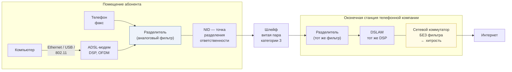

# Глава 2 — DSL, DOCSIS и SONET

> Разбор трёх тем, которые в [[Глава 2]] даны сжато: **xDSL**, **DOCSIS**, **SONET/SDH**.
> Источник — Таненбаум, Фимстер, Кузеролл. *Компьютерные сети*, 6-е изд. — **стр. 172–187** (DSL, SONET), **стр. 211–214** (DOCSIS), **стр. 384–386** (DOCSIS в главе 4).
> Сокращения — в [[Словарь сокращений]].

**Связано:** [[Глава 2]] · [[Глава 4]] · [[Глава 4 — Разбор пробелов]]

---

## Что объединяет все три темы

Все три — это ответ на **один и тот же вопрос: «последняя миля»**. Оператор хочет донести до дома мегабиты, а медь, коаксиал и оптоволокно требуют разных ответов.

Но важнее другое — **все три решают один и тот же набор из трёх задач**, и разница между ними в том, *как именно*:

| Задача | DSL | SONET | DOCSIS |
| --- | --- | --- | --- |
| **Как делить среду** | DMT — 256 каналов по 4312,5 Гц | TDM — слоты времени | FDM по частоте + **TDM по времени в исходящем** |
| **Кто главный** | нет: модем ↔ DSLAM симметрично | нет: synchronous TDM | **да: головная станция (CMTS) главнее всех** |
| **Как бороться с шумом** | QAM, бит на символ подбирается под SNR | нет — среда чистая, шум не важен | QAM-256 вниз, **QPSK** вверх (шум собирается от всех) |
| **Асимметрия** | из-за спроса (80–90 % вниз) | нет | **техническая** (шум вверху) |

> [!tip]- Главная мысль, из которой следует всё остальное
> **SONET — про синхронизацию. DSL — про обход фильтра. DOCSIS — про общую среду.**
> Если эти три слова запомнить, остальные детали выводятся сами.

---

# Часть 1. xDSL

## 1.1 Почему модем не мог быстро — и какой хитростью это починили

### Исходная проблема

Телефонная сеть проектировалась **под голос**, и под голос оптимизирована вся:

```
аналоговый голос  →  полоса 4 кГц  →  модем 56 Кбит/с
```

В точке, где шлейф входит в АТС, стоит **фильтр затухания**: он режет всё ниже **300 Гц** и выше **3400 Гц**. Срез плавный — это **3-дБ точки**, поэтому заявляют полосу **4000 Гц**, хотя между точками только **3100 Гц**.

> [!warning]- Ловушка
> **3100 Гц** — расстояние между 3-дБ точками. **4000 Гц** — то, что указано в спецификации как «полоса». Оба числа встречаются в книге, и это **не опечатка**.

### Хитрость: обойти фильтр

Вот весь секрет DSL, дословно:

> Входящий канал абонента подключают к сетевому коммутатору **без фильтра затухания**.

Фильтр — **искусственное** ограничение. Уберите его — и доступно не 3100 Гц, а примерно **1 МГц** (книга называет диапазон **1,1 МГц**). Дальше ограничивающим фактором становятся **физические** свойства линии.

```
телефон:   [фильтр 300–3400 Гц]  → 3100 Гц  →  56 Кбит/с
DSL:       [фильтр обойдён    ]  →  ~1 МГц   →  24 Мбит/с
```

### Что ограничивает на самом деле

Не фильтр, а **расстояние до АТС** и качество меди. Из илл. 2.28:

| Расстояние | Порядок скорости |
| --- | --- |
| ~0 м | 50 Мбит/с и выше |
| 1000 м | ~30 Мбит/с |
| 3000 м | ~10 Мбит/с |
| 5000 м | ~единицы Мбит/с |

Здесь рождается **коммерческое противоречие**, которое стоит понимать:

> Выбирая скорость тарифа, оператор автоматически задаёт **радиус услуги**.
> Кто живёт на 100 м дальше нужного — получает отказ. Чем ниже скорость, тем длиннее радиус и больше абонентов, но услуга менее привлекательна.

## 1.2 Четыре требования, из которых выросла вся технология

1. Работать на **уже имеющихся** шлейфах — витая пара **категории 3**.
2. **Не мешать** телефону и факсу.
3. Скорость **значительно выше 56 Кбит/с**.
4. **Постоянная доступность** и помесячная оплата, а не поминутная.

Пункт 2 — ключевой: голос должен продолжить работать **на тех же двух проводах**. Отсюда вся архитектура разделения.

## 1.3 DMT — разбиение на 256 каналов

Схема OFDM, но в DSL её называют **DMT** (Discrete MultiTone).

```
1,1 МГц  ÷  256  =  4312,5 Гц на канал
```

| Каналы | Назначение | Почему |
| --- | --- | --- |
| **0** | **POTS** — обычный телефон | голос должен работать всегда |
| **1–5** | **не используются** | «просадка», чтобы голос и данные не мешали друг другу |
| один | управление **входящим** трафиком |  |
| один | управление **исходящим** трафиком |  |
| **248** | **пользовательские данные** |  |

**Типовое распределение** по книге: **32 канала вверх**, остальные (216) вниз. Это 87 % вниз / 13 % вверх — и вот откуда берётся буква **A**.

### Почему каналов много, а не один широкий

Каждый канал — это **отдельный маленький QAM-модем**, живущий по своим правилам:

- скорость символов ≈ **4000 символов/с** в каждом канале;
- качество связи в каждом канале **измеряется непрерывно**;
- бит на символ подбирается **под SNR этого канала**: до **15 бит/символ** где SNR высокий, и **1–2 бит/символ** где низкий.

Это ровно то, что называется **битстаффингом** (rate adaptation). Кабель один, но «качество» на разных частотах разное — водосток в 4 кГц портит один канал и почти не трогает другой.

> [!question]- Посчитай сам
> Возьми 216 входящих каналов и 4000 символов/с. Чтобы получить заявленные **8 Мбит/с** (стандарт G.dmt), сколько бит на символ нужно в среднем?
>
> Ответ: `8 000 000 / 216 ≈ 37 037 бит/с` на канал, делим на 4000 символов ⇒ **≈ 9,3 бита на символ**. Это укладывается в диапазон «до 15», значит оценка сходится. А 24 Мбит/с у ADSL2+ — это те же каналы с большим числом бит на символ **плюс удвоенная полоса** (2,2 МГц вместо 1,1).

## 1.4 Оборудование: кто где стоит



**NID** (Network Interface Device) — маленькая коробочка, отмечающая, где заканчивается имущество телефонной компании и начинается имущество абонента.

**Разделитель** — аналоговый фильтр: полосу POTS (0–4000 Гц) отделяет от каналов данных. На стороне станции — **тот же** разделитель, всё, что выше 26 кГц, уходит в **DSLAM**.

> [!anecdote]- Почему это было выгодно оператору
> Голос и ADSL **полностью разделены**. Для развёртывания ADSL телефонной компании достаточно купить **DSLAM и разделители** — коммутационное оборудование менять не нужно. Сравните с ISDN, который требовал переделки самих АТС.

## 1.5 Поколения xDSL

| Стандарт | Год | Входящий | Исходящий | Что дало |
| --- | --- | --- | --- | --- |
| **G.dmt** | 1999 | 8 Мбит/с | 1 Мбит/с | базовый ADSL |
| **ADSL2** | 2002 | 12 | 1 | улучшены кодирование и QAM |
| **ADSL2+** | — | **24** | 1 | полоса **2,2 МГц** вместо 1,1 |
| **VDSL** | 2006 | 52 | 3 | только на **коротких** шлейфах |
| **VDSL2** | 2007–2011 | **200** | 100 | полоса **12 МГц** на хорошей меди |
| **Vplus** | 2015 | 300 | 100 | шлейфы **< 250 м** |
| **G.fast** | — | ~1000 | ~1000 | **100 м**, симметрично |

**Закономерность, которую стоит увидеть:** скорость растёт ровно тогда, когда **сокращается расстояние** или **расширяется полоса**. ADSL2+ удвоил скорость удвоением полосы; Vplus требует 250 м; G.fast — 100 м.

> [!warning]- Осторожно с названиями
> Книга перечисляет **RADSL / HDSL / SDSL** в словаре, но **в тексте главы их не разбирает**. Не приписывай главе то, чего в ней нет.
> И ещё: **асимметрия ADSL — не физическое ограничение**. 50/50 технически возможно; операторы отдают 80–90 % вниз, потому что люди **качают**, а не заливают.

## 1.6 Как DSL дойти до 1 Гбит/с

Два приёма:

- **Связывание (bonding)** — несколько физических DSL-соединений объединяются в одно виртуальное. Две витые пары ⇒ скорость удваивается. Отсюда, кстати, и название FTTdp: оптика до точки распределения, а дальше — спаренные пары.
- **FTTdp** (Fiber to the Distribution Point) — оптика подходит **ближе**, а медь работает на укороченном участке. Это общий вектор всех FTTX.

---

# Часть 2. SONET и SDH

## 2.1 Зачем понадобился стандарт

История — важная часть понимания, потому что она объясняет всю конструкцию:

```
до 1984:  у каждой телефонной компании своя оптическая TDM-система, всё запатентовано
1984:     правительство разделило AT&T
          → местным компаниям пришлось подключаться к линиям
            ОТ РАЗНЫХ производителей
          → «без стандартизации не обойдёшься»
1985:     Bellcore (подразделение RBOC) начинает стандарт SONET
1989:     подключается МСЭ → рекомендации G.707, G.708, G.709 = SDH
```

> [!tip]- Запомнить разницу одной фразой
> **SONET — американский стандарт, придуманный в Bellcore. SDH — рекомендации МСЭ, которые от SONET отличаются мелкими нюансами.**

## 2.2 Четыре цели создания

1. **Совместимость систем** — общий стандарт обмена служебными сигналами, с учётом длин волн, распределения интервалов времени и структуры фреймов.
2. **Унификация для разных стран** — США, Европа и Япония все строили на каналах PCM по 64 Кбит/с, но группировали их **несовместимыми** способами.
3. **Мультиплексирование** — на момент создания быстрейшая система в США была **T3 = 44,736 Мбит/с**. T4 существовала на бумаге, но почти не использовалась, а стандарта быстрее T4 **не было описано вообще**. Задача — дотянуть иерархию до гигабит.
4. **Управление системой** — OAM (operations, administration and maintenance). Предыдущие системы с этим справлялись плохо.

## 2.3 Ключевое слово — синхронный

Сделали **обычный TDM** и всю полосу отдали одному каналу, вырезая слоты для подканалов. Отсюда «синхронная»: **все отправители и получатели привязаны к единому синхросигналу**.

```
Точность главного генератора синхроимпульсов ≈ 1 на 10⁹
```

Фреймы передаются **без промежутков, даже если данных нет** — тогда отправляются фиктивные данные. С точки зрения приёмника это непрерывный поток битов.

> [!question]- А как приёмник находит границы фреймов?
> **Первые два байта каждого фрейма содержат фиксированный паттерн.**
> Если приёмник находит его в одном и том же месте в большом числе фреймов подряд — он синхронизирован.
> Теоретически пользователь мог бы вставлять этот паттерн в данные, но на практике невозможно, особенно при мультиплексировании от нескольких пользователей в один фрейм.

## 2.4 Фрейм STS-1 — арифметика, которую надо уметь воспроизвести

```
810 байт каждые 125 мкс  →  90 столбцов × 9 строк
8 · 810 = 6480 бит в фрейме
6480 · 8000 = 51,84 Мбит/с   ← это STS-1
```

**Почему 8000 фреймов в секунду — не произвольное число:** ровно столько же, сколько сэмплов в секунду даёт телефонная система PCM. Это тот же корень 125 мкс, что и в T1, и в PCM. Всё в телефонной иерархии кратно **125 мкс**.

### Три скорости, которые путают

Одна скорость — и три разных числа:

```
Общая (gross)      6480 бит/фрейм · 8000 = 51,840 Мбит/с
SPE (полезная)     87 столбцов · 9 · 8 · 8000 = 50,112 Мбит/с
Пользовательские   86 столбцов · 9 · 8 · 8000 = 49,536 Мбит/с
```

Проверка разницы: `50,112 − 49,536 = 0,576 Мбит/с = 72 000 бит/с = 9 байт/фрейм` — это ровно **один столбец служебных данных пути** внутри SPE.

> [!warning]- Три ошибки подряд
> - SONET — это **просто контейнер для передачи битов**. Голос или пакеты — ему всё равно.
> - Служебные данные занимают **первые 3 столбца**: из них **3 строки — секция** (генерируются и проверяются в начале каждой секции), **6 строк — линия** (в начале и в конце каждой линии).
> - SPE **не обязано** начинаться в столбце 4 ряда 1. Оно может начаться **в любом месте** фрейма и даже **пересечь границу двух фреймов**. Указатель на первый байт SPE лежит в первой строке служебных данных линии. Благодаря этому данные вставляются **в текущий** фрейм, не дожидаясь следующего.

## 2.5 Иерархия и почему SDH начинается с другого числа

| SONET | SDH | Общая | SPE | Пользовательских |
| --- | --- | --- | --- | --- |
| STS-1 / OC-1 | — | 51,84 | 50,112 | 49,536 |
| STS-3 / OC-3 | **STM-1** | 155,52 | 150,336 | 148,608 |
| STS-12 / OC-12 | **STM-4** | 622,08 | 601,344 | 594,432 |
| STS-48 / OC-48 | **STM-16** | 2488,32 | 2405,376 | 2377,728 |
| STS-192 / OC-192 | **STM-64** | 9953,28 | 9621,504 | 9510,912 |
| STS-768 / OC-768 | **STM-256** | 39813,12 | 38486,016 | 38043,648 |

Все линии SONET **кратны STS-1**.

**Почему SDH начинается со STM-1 = 155,52 Мбит/с?** Прямо в книге:
> В системах на основе стандартов МСЭ **нет скорости, близкой к 51,84 Мбит/с**.

То есть отсутствие STM-0 — это не дефект, а следствие того, что у МСЭ такой скорости просто не существовало. Отсюда правило соответствия: **OC-3 ↔ STM-1**.

### STS-n против OC-n и буква «c»

- **OC-n** — оптическая система, соответствующая STS-n. Совпадает **с точностью до бита**, разница — в перестановке битов для синхронизации.
- **OC-3c** — «c» от **concatenated**. Если канал несёт данные **от одного источника**, а не мультиплексирован из трёх OC-1, в название добавляют **c**.

```
OC-3  = три независимых потока OC-1 по 51,84 Мбит/с
OC-3c = ОДИН поток 155,52 Мбит/с
        три потока чередуются ПО СТОЛБЦАМ:
        столбец 1 потока 1, столбец 1 потока 2, столбец 1 потока 3,
        столбец 2 потока 1, ...
        → фрейм 270 столбцов × 9 строк
```

## 2.6 Сводка по SONET

| Вопрос | Ответ |
| --- | --- |
| Кто придумал | Bellcore, 1985, стандарт — 1989 |
| Что такое по сути | **синхронный TDM-контейнер** в оптоволокне |
| Базовый блок | **810 байт / 125 мкс / 51,84 Мбит/с** |
| Откуда 125 мкс | частота сэмплов PCM, **8000 Гц** |
| Точность синхроимпульсов | **1 на 10⁹** |
| Служебные данные | **3 столбца**: 3 строки секция + 6 строк линия |
| Почему SDH с 155,52 | в стандартах МСЭ **нет** скорости рядом с 51,84 |

---

# Часть 3. DOCSIS

## 3.1 Главное отличие от телефона — среда общая

Это стоит понять **до** всех деталей, потому что из него следует всё остальное.

|  | Телефон (DSL) | Кабель (DOCSIS) |
| --- | --- | --- |
| Сколько домов на линии | **один** | **много** — весь микрорайон на одном коаксиале |
| Скачал большой файл — соседям? | **нет**, у него свой шлейф | **да**, полоса делится |
| Природа деления | выделенная полоса **на абонента** | полоса **делится** между всеми |

Книга формулирует контраст прямо: совместное использование кабеля для ТВ выглядит естественно — все программы идут по кабелю, и неважно, 10 зрителей или 10 000. Но для **интернета** число пользователей становится важным.

**Отсюда разница в надёжности:** DSL даёт «**две девятки**», кабель — тоже, а телефонная сеть — «**пять девяток**». И ADSL **безопаснее кабеля**: любой пользователь кабеля технически читает чужие пакеты, поэтому у оператора нужно двойное шифрование.

### Что с этим делают: разделение узлов

Кабельные ISP делят длинные кабели и подключают каждый прямо к оптоволоконному узлу:

| Когда | Домов на узел |
| --- | --- |
| 10–15 лет назад | **500–2000** |
| 2019 | **300–500** |
| архитектура **N+0 HFC** («Fiber Deep») | ~**70** |

При малом числе домов на узле коаксиального сегмента хватает на нужный объём. Оптика при этом всё ближе к дому — на последнем участке HFC иногда заменяется на «оптоволокно в дом».

## 3.2 Разделение каналов — FDM, не TDM

Модем работает по **одному входящему и одному исходящему** каналу, выделение — **по частоте**. В DOCSIS 3.0 каналов несколько.

**Входящий (downstream):** канал 6 или 8 МГц (в Европе — шире, примерно на треть больше), модуляция **QAM-64**, для качественного кабеля — **QAM-256**.

```
6 МГц + QAM-64  →  ~36 Мбит/с сырой скорости
                 →  ~27 Мбит/с с учётом служебных сигналов
QAM-256         →  полезных ~39 Мбит/с
```

**Исходящий (upstream):** шума **больше**, потому что кабельная система изначально **не проектировалась под передачу данных** — помехи от множества абонентов **собираются** к головной станции. Поэтому здесь применяют **консервативные** схемы: от **QPSK до QAM-128**, часть символов отдаётся под треллис-модуляцию.

> [!tip]- Отсюда асимметрия
> В кабеле асимметрия **техническая**: вверху шумнее, поэтому вверху меньше бит на символ. В ADSL асимметрия **экономическая**: физически возможно 50/50, но операторы отдают 80–90 % вниз по спросу. **Разные причины — не путать.**

## 3.3 Входящий канал: 204 байта — почему именно столько

Здесь **нет конкуренции**: данные отправляет **только головная станция**. Никто больше ничего не ждёт, поэтому мини-слотов не нужно.

```
фиксированный пакет 204 байта
  ├── код Рида–Соломона + служебные данные  →  20 байт
  └── ПОЛЕЗНАЯ НАГРУЗКА                       → 184 байта
```

Книга прямо называет причину: **совместимость с цифровым телевидением, использующим MPEG-2**. Числа 204/184 выбраны не по красоте, а под уже существующий стандарт ТВ.

## 3.4 Исходящий канал: мини-слоты и конкуренция

Здесь всё наоборот — **все модемы говорят одновременно**, поэтому:

1. Время делится на **мини-слоты**; каждый абонент обменивается данными **в свой** мини-слот. Полезная нагрузка — обычно **8 байт**.
2. Шаг мини-слота — **6,25 мкс**. В первых версиях размер должен был быть кратен этому шагу, в последних ограничение сняли.
3. Периодически головная станция объявляет **начало нового цикла мини-слотов**. Но модемы получают это оповещение **в разное время** — сигнал распространяется по кабелю с конечной скоростью.

### Проблема расстояния и решение — пристрелка

Модем должен знать своё расстояние до станции, чтобы правильно посчитать **начало первого мини-слота**. Для этого он отправляет специальный пакет и засекает время ответа:

```
модем ──► запрос пристрелки ──► CMTS
модем ◄── ответ: поправь мощность и синхронизацию ◄── CMTS

По умолчанию повторяется раз в 30 с; обычно ставят 10–20 с.
```

Это не только измерение расстояния: заодно настраиваются **мощность** и **синхронизация**. Книга называет пристрелку *периодической настройкой параметров передачи*.

### Запрос полосы — от модема к станции

```
1. модем: «хочу передать, нужно N мини-слотов»   (фрейм запроса)
2. модем ждёт ответа о выделении полосы            ← ЗДЕСЬ ЗАДЕРЖКА
3. CMTS по входящему каналу сообщает: «слоты твои»
4. модем передаёт данные в выделенном мини-слоте
   └─ служебное поле в заголовке позволяет запросить
      передачу ДОПОЛНИТЕЛЬНЫХ пакетов
```

**Несколько модемов часто назначают один и тот же мини-слот** — и возникает конфликт. Дальше развилка:

| Способ | Что происходит |
| --- | --- |
| **Не использовать CDMA** | подтверждение запроса не дойдёт из-за конфликта ⇒ модем **ждёт и повторяет**, а после каждой неудачи **время ожидания удваивается** |
| **Использовать CDMA** | несколько абонентов делят один мини-слот, но скорость **на каждого падает** |

> [!tip]- Опознание алгоритма
> Книга прямо говорит: это **слотированная версия ALOHA с двоичной экспоненциальной задержкой**. А Ethernet здесь не работает, потому что станции **не могут прослушивать** среду. Разбор — в [[Глава 4]].

**Именно на этом шаге появляется LLD** (Low-Latency DOCSIS): он сокращает планирование с **2–4 мс до 1 мс**, заводит **две очереди** (задержкочувствительная и нет) и переходит к **проактивному** планированию через маркировку поля дифференцированного обслуживания прямо в кадре DOCSIS.

## 3.5 Версии DOCSIS

| Версия | Год | Что принесла |
| --- | --- | --- |
| **1.0** | 1997 | базовая, предел 38 / 9 Мбит/с |
| **1.1** | — | уточнение ограничений |
| **2.0** | 2001 | исходящая пропускная способность **втрое** |
| **3.0** | 2006 | **IPv6** + склейка каналов ⇒ сотни Мбит/с на абонента |
| **3.1** | 2013 | **OFDM**, входящая **> 1 Гбит/с**; полный дуплекс (2017) |
| **LLD** | 2018 | снижение задержки |

## 3.6 Сводка по DOCSIS

| Вопрос | Ответ |
| --- | --- |
| Что это | MAC для передачи данных по коаксиалу, стандарты **CableLabs** |
| Разделение каналов | **FDM** по частоте |
| Входящий конкурентный? | **нет** — передаёт только станция ⇒ **TDM не нужен** |
| Входящий размер пакета | **204 байта**, полезных **184** — под **MPEG-2** |
| Исходящий конкурентный? | **да** ⇒ **мини-слоты**, шаг **6,25 мкс**, полезных **8 байт** |
| При конфликте | **слотированная ALOHA с двоичной экспоненциальной задержкой** |
| Как учитывается расстояние | **пристрелка** (ranging) |
| Модуляция | вниз **QAM-64/256**, вверх **QPSK…QAM-128** |

---

# Часть 4. Сводная таблица трёх технологий

|  | **DSL** | **DOCSIS** | **SONET** |
| --- | --- | --- | --- |
| Среда | витая пара **кат. 3** | коаксиал (HFC) | оптоволокно |
| Что упёрлось в потолок | расстояние до АТС | число домов на узле | ничего — среда чистая |
| Ключевое слово | **обход фильтра** | **общая среда** | **синхронизация** |
| Разделение | DMT, 256 × 4312,5 Гц | FDM + TDM | TDM |
| Модуляция | QAM, 1–15 бит/символ | QAM-64/256 вниз, QPSK вверх | не важна |
| Базовая единица | канал 4312,5 Гц | пакет 204 Б / мини-слот 6,25 мкс | фрейм 810 Б / 125 мкс |
| Есть конкуренция | нет (точка-точка) | **да**, в исходящем | нет |
| Асимметрия | экономическая | **техническая** | нет |
| Год появления | 1999 (G.dmt) | 1997 (1.0) | 1989 |

---

# Часть 5. Тестик

> [!info]- Как пользоваться
> Ответы свёрнуты. **Сначала ответь сам**, потом раскрывай.
> Ошибся — это нормально: в конце файла есть разбор, где по каждому пункту сказано, в чём именно была ловушка.

---

### Блок A. DSL

**A1.** Почему модем в телефонной сети ограничен 4 кГц, а ADSL — нет?

> [!answer]- Ответ
> Обе среды одна и та же. Разница — в том, **через что подключён канал**.
> Телефонный канал проходит через **фильтр затухания 300–3400 Гц** на входе в АТС.
> ADSL подключают к сетевому коммутатору **без этого фильтра**, и доступно около **1 МГц** вместо искусственных 3100 Гц. Фильтр был нужен, чтобы голос не «шумел» в трубке — для данных он бессмыслен.

**A2.** Абонентский шлейф делится на 256 каналов по 4312,5 Гц. Что достаётся пользователю?

> [!answer]- Ответ
> **248 каналов.** Канал **0** — POTS, каналы **1–5** не используются (защита от взаимных помех голоса и данных), **один** на управление входящим и **один** на управление исходящим. Итого `256 − 6 − 2 = 248`.
> Типовое распределение: **32 вверх, 216 вниз**.

**A3.** Почему в ADSL один канал несёт 15 бит на символ, а соседний — 1?

> [!answer]- Ответ
> Каналы неравноценны по качеству — attenuation зависит от частоты, и помехи тоже распределены неравномерно. В каждом канале **непрерывно измеряется SNR** и подбирается число бит на символ **под него** (от 1–2 до 15). Это **подстройка скорости** (rate adaptation / битстаффинг), а не фиксированная настройка модема.

**A4.** ADSL асимметричен — почему?

> [!answer]- Ответ
> **Технически 50/50 возможно.** Асимметрия — **экономическое** решение:
> операторы отдают **80–90 %** каналов входящему направлению, потому что люди скачивают больше, чем заливают. Отсюда буква «A».
> ⚠️ Не путать с DOCSIS, где асимметрия **техническая** — из-за шума в исходящем направлении.

**A5.** Зачем телефонной компании при развёртывании ADSL менять коммутационное оборудование?

> [!answer]- Ответ
> **Не нужно.** Голос и ADSL полностью разделены разделителями, а данные уходят в **DSLAM**, который подключается к отдельному сетевому коммутатору.
> Достаточно купить **DSLAM и разделители**. Именно поэтому ADSL победил ISDN, для которого пришлось бы переделывать сами АТС.

---

### Блок B. SONET

**B6.** Фрейм STS-1 — сколько байт, как часто, и сколько это Мбит/с?

> [!answer]- Ответ
> **810 байт каждые 125 мкс** ⇒ `8 · 810 = 6480` бит/фрейм, `6480 · 8000 =` **51,84 Мбит/с**. Фрейм представим как **90 столбцов × 9 строк**.
> 8000 фреймов/с — это ровно частота сэмплов PCM; отсюда и 125 мкс.

**B7.** Назови три скорости STS-1. Почему они разные?

> [!answer]- Ответ
> **51,84** (общая) · **50,112** (SPE, 87 столбцов) · **49,536** (пользовательские, 86 столбцов). Разница — служебные данные: сначала **3 столбца** секции и линии, потом ещё **один столбец** служебных данных пути внутри самого SPE.
> Проверка: `50,112 − 49,536 = 0,576 Мбит/с = 9 байт/фрейм = 1 столбец`.

**B8.** Как приёмник SONET понимает, где начинается фрейм?

> [!answer]- Ответ
> **Первые два байта каждого фрейма содержат фиксированный паттерн.**
> Приёмник ищет его в одном и том же месте в большом числе фреймов подряд и делает вывод о синхронизации. Отправляет фреймы он без промежутков, даже когда данных нет (тогда идут фиктивные данные).

**B9.** Почему в стандартах МСЭ нет STM-0?

> [!answer]- Ответ
> Потому что в них **нет скорости, близкой к 51,84 Мбит/с** — такая скорость просто не была стандартизована на международном уровне. Поэтому SDH начинается с **STM-1 = 155,52 Мбит/с**, что соответствует **OC-3**.
> Соответствие: OC-3 ↔ STM-1, OC-12 ↔ STM-4, OC-48 ↔ STM-16.

**B10.** Чем OC-3 отличается от OC-3c?

> [!answer]- Ответ
> **OC-3** — три **отдельных** канала OC-1 по 51,84 Мбит/с (мультиплексирование).
> **OC-3c** — буква «c» от **concatenated**: **один** источник на 155,52 Мбит/с.
> Три потока чередуются **по столбцам**, фрейм получается **270 столбцов × 9 строк**.

**B11.** Почему SPE может начинаться не с четвёртого столбца?

> [!answer]- Ответ
> Так сделано ради гибкости: SPE может начинаться **в любом месте** фрейма и даже **охватывать два фрейма**. Тогда пользовательские данные вставляются **в текущий** фрейм, а не ждут начала следующего. Указатель на первый байт SPE хранится в первой строке служебных данных линии.

---

### Блок C. DOCSIS

**C12.** Почему в DOCSIS входящий канал не делится на мини-слоты, а исходящий делится?

> [!answer]- Ответ
> Входящий канал **односторонний**: данные отправляет **только головная станция**, конкуренции нет — терять время на разбиение не зачем.
> В исходящем **все модемы говорят одновременно**, поэтому время делится на **мини-слоты** (шаг **6,25 мкс**, полезных **8 байт**) и нужен арбитраж.

**C13.** Во входящем пакете 184 байта полезных данных. Почему именно 184?

> [!answer]- Ответ
> Размер пакета фиксирован — **204 байта**, из них 20 уходит на код Рида–Соломона и служебные данные, остаётся **184**. Это значение выбрано **из соображений совместимости с MPEG-2** в цифровом телевидении — то есть под уже существующий стандарт, а не «красиво».

**C14.** Модем опаздывает со своим мини-слотом. Что это и как решается?

> [!answer]- Ответ
> Сигнал идёт по кабелю конечное время, и оповещение о начале цикла мини-слотов модемы получают **в разное время**. Решение — **пристрелка (ranging)**: модем отправляет специальный запрос и засекает время ответа, измеряя расстояние до станции. Заодно настраиваются **мощность и синхронизация**.
> По умолчанию повторяется раз в **30 с**, обычно ставят **10–20 с**.

**C15.** Два модема получили один мини-слот. Дальше?

> [!answer]- Ответ
> Возможны **два пути**:
> - **Без CDMA** — конфликт, подтверждение запроса не дойдёт, модем ждёт и повторяет, **время ожидания удваивается** после каждой неудачи. Книга называет это **слотированной версией ALOHA с двоичной экспоненциальной задержкой**.
> - **С CDMA** — несколько абонентов делят мини-слот, но скорость **на каждого падает**.

**C16.** Почему вверх применяют QPSK, а вниз QAM-64?

> [!answer]- Ответ
> В исходящем направлении **шум больше**: кабельная система изначально не проектировалась под передачу данных, и помехи от множества модемов **собираются** к головной станции. Поэтому вверх идут консервативные схемы **QPSK … QAM-128** с треллис-модуляцией, а вниз — **QAM-64**, на хорошем кабеле **QAM-256**. Мало бит на символ вверху и создаёт асимметрию.

---

## Разбор

Считай балл за **полностью верный** ответ: 1 балл.

### Где были ловушки

| № | Тема | Типичная ошибка |
| --- | --- | --- |
| A1 | DSL | сказать «медь не даёт 1 МГц» — ограничение **искусственное**, снимается обходом фильтра |
| A2 | DSL | ответить «256» — забыть про канал POTS, 5 неиспользуемых и 2 служебных |
| A4 | DSL | назвать асимметрию «физическим ограничением» — в ADSL она **экономическая** |
| B7 | SONET | назвать только 51,84 — SPE и пользовательских скоростей **три** |
| B9 | SONET | сказать «STM-0 не нужен» вместо «в стандартах МСЭ **нет такой скорости**» |
| B10 | SONET | не поставить «c» / не сказать про чередование **по столбцам** |
| C12 | DOCSIS | приписать мини-слоты входящему каналу — там **нет конкуренции** |
| C13 | DOCSIS | назвать 184 «просто так» — причина **MPEG-2** |
| C15 | DOCSIS | сказать «повторяет» без **удвоения** ожидания |

### Три пары, которые стоит запомнить

| Пара | Разница |
| --- | --- |
| **DSL** ↔ **DOCSIS** | ADSL — обход фильтра + **нет конкуренции**; DOCSIS — **общая среда**, конкуренция вверху |
| **DOCSIS вниз** ↔ **вверх** | вниз: только станция, **204 Б пакеты**, QAM-64. Вверх: все модемы, **8 Б мини-слоты**, QPSK, пристрелка |
| **SONET** ↔ **PCM** | 125 мкс и 8000 Гц — **одно и то же** число, только из разных слоёв иерархии |

### Шкала

| Балл | Что делать |
| --- | --- |
| **16** | тема чистая, иди дальше |
| **15–14** | перечитать сводные таблицы в конце частей 1–3 |
| **13–11** | пройти части заново, особенно арифметику `810 Б → 51,84` и `204 − 20 = 184` |
| **≤ 10** | вернуться к [[Глава 2]] и разобрать разделы 2.5 и 2.7 |

> [!anecdote]- Напоследок
> Самое частое наблюдение по этим трём темам: почти все ошибки — не в забытых числах, а в **неразведённых похожих вещах**. Числа помнятся лучше, чем разница между «вверх/вниз», «OC-3/OC-3c» и «SONET/SDH».
