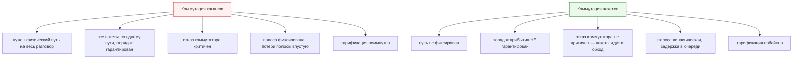

# Глава 2. Физический уровень

> Источник: Таненбаум, Фимстер, Кузеролл. *Компьютерные сети*, 6-е изд. — **страницы 121–241**.
> Все сокращения с расшифровками — в [[Словарь сокращений]].

**Связано:** [[Глава 1]] · [[Глава 3]] · [[Глава 4]] · [[Главы 1–3 — Тест и терминология]] · [[Глава 2 — DSL, DOCSIS и SONET]] — подробный разбор xDSL, DOCSIS и SONET/SDH с тестом.

---

## О чём глава

2.1 Проводные среды · 2.2 Беспроводная передача · 2.3 Применение спектра · 2.4 **От форм волн к битам** (теория → линейные коды → модуляция → мультиплексирование) · 2.5 Коммутируемая телефонная сеть · 2.6 Сотовые сети · 2.7 Кабельные сети · 2.8 Спутники · 2.9 Сравнение сетей доступа · 2.10 Регулирование

Главное, что надо понять про структуру: **раздел 2.4 — математическое ядро главы.** Без него остальное — перечисление технологий.

---

## 2.1 Проводные среды

### Сводная таблица

| Среда | Полоса | Затухание | Помехи | Применение |
| --- | --- | --- | --- | --- |
| **Витая пара** | Сотни Мбит/с на несколько км | 20 дБ за 100 м; растёт с частотой и расстоянием | Шум одинаково действует на оба провода ⇒ передаётся **разность потенциалов**; скрутка гасит излучение и перекрёстные помехи | Телефонные линии, ADSL, LAN |
| **Коаксиал** | До 6 ГГц у современных | Зависит от качества и длины | Хорошо экранирован (сетка + оболочка) | Цифровая передача, кабельное ТВ, HFC |
| **ЛЭП / электропроводка** | 50–60 Гц — сеть; сигнал **от 1 МГц**; до 500 Мбит/с | Высокочастотные сигналы затухают; переходные токи при включении приборов | Проводка ведёт себя как антенна | Домашние LAN, smart grid |
| **Оптоволокно** | Один диапазон 1,3 мкм ≈ **30 000 ГГц**; при SNR 10 дБ — 300 Тбит/с | < **5 % на км**; повторитель раз в **50 км** (у меди — раз в 5 км) | Не боится скачков напряжения, ЭМИ, коррозии | Магистрали, LAN, FTTH, WDM |

### Категории витой пары

| Категория | Особенность |
| --- | --- |
| **Cat. 3** | 4 пары. Именно она в шлейфах домов в США; ADSL работает на расстоянии до ~6 км |
| **Cat. 5e** | 4 пары в ПВХ-оболочке. 100 Мбит/с Ethernet — 2 пары, 1 Гбит/с — все 4 пары в обоих направлениях |
| **Cat. 5** | Больше скруток на метр → меньше перекрёстные помехи |
| **Cat. 6 / 6A** | До 10 Гбит/с |
| **Cat. 7** | Экранирована **каждая** пара и весь пучок |
| **Cat. 8** | Только ~30 м, для датацентров. Класс I (совместим с 6A), Класс II (с 7A) |

### Оптоволокно подробно

- Три компонента: источник света → среда → приёмник. Импульс = 1, отсутствие = 0. Система **симплексная** (однонаправленная).
- **Полное внутреннее отражение** — луч под критическим углом «пойман» в волокне.

|  | Многомодовое | Одномодовое |
| --- | --- | --- |
| Диаметр сердечника | **> 50 мкм** (толщина волоса) | **8–10 мкм** |
| Режим | несколько мод под разными углами | только по прямой, без отражений |
| Дальность | до 15 км | примерно в **50 раз** больше |
| Скорость | полоса падает с расстоянием | 100 Гбит/с на 100 км без усиления |

**Спектральные окна:** центры **0,85 / 1,30 / 1,55 мкм**, ширина каждого 25 000–30 000 ГГц. 0,85 мкм — бо́льшее затухание, малые расстояния, лазеры и электроника из одного материала. 1,3 и 1,55 мкм — потери < 5 %/км. На 1,55 мкм — усилители, легированные **ионами эрбия**.

**Хроматическая дисперсия:** импульсы растягиваются. Лечится либо увеличением интервалов (падает частота), либо приданием формы, обратной гиперболическому косинусу — тогда получаются **солитоны**, передающиеся на тысячи км.

**Соединения:** разъёмы (потеря 10–20 % света), сращивание (~10 % потерь, 5 минут работы), **сварка** (почти как целый).

**Источники света:**

|  | LED | Полупроводниковый лазер |
| --- | --- | --- |
| Скорость | низкая | высокая |
| Тип волокна | только многомодовое | многомодовое **или** одномодовое |
| Расстояние | короткие | длинные |
| Срок службы | долгий | короткий |
| Чувствительность к температуре | нет | есть |
| Цена | дешёвый | дорогой |

**Приёмник** — фотодиод; время реакции ограничивает скорость примерно **100 Гбит/с**.

> [!anecdote]- Оптика легче меди в 80 раз
> 1000 витых пар по 1 км — **8000 кг**. Пара оптоволоконных кабелей с большей пропускной способностью — **100 кг**.

---

## 2.2–2.3 Беспроводная передача

### Базовое соотношение

```
λ · f = c ≈ 3 · 10⁸ м/с                    (2.1)
```

В медном проводе и оптоволокне скорость падает до **2/3** этого значения.

> [!tip]- Практическое правило
> Если λ в метрах, f в МГц, то **λ · f ≈ 300**.
> 100 МГц → 3 м · 1000 МГц → 0,3 м · 3000 МГц → 0,1 м

### Спектральный диапазон (илл. 2.8)
![[Pasted image 20261009112528.png]]

НЧ (1–10 км волны) · СЧ · ВЧ · ОВЧ · УВЧ · СВЧ · КВЧ · ГВЧ. Выше 10¹² Гц — инфракрасное.

- **Низкие частоты** идут вдоль земной поверхности, проходят сквозь здания, приём до 1000 км — но полоса **низкая**, это главная проблема.
- **ВЧ и выше** отражаются от **ионосферы** (слой 100–500 км) и возвращаются на Землю.
- **Потери в тракте** (path loss): мощность падает минимум как `1/r²`, в вакууме — **6 дБ при удвоении расстояния**.
- **Микроволны** (>100 МГц): направленные, фокусируются параболической антенной. Расстояние между повторителями **примерно пропорционально корню квадратному высоты вышек** (вышка 100 м → 80 км). Плохо проходят через здания. **Многолучевое замирание** — отражения от нижних слоёв атмосферы гасят прямой сигнал, поэтому операторы держат **~10 % каналов в резерве**. Около 4 ГГц — поглощение водой (дождь).
- **Инфракрасный**: относительно направленный, дешёвый, не проходит сквозь плотные объекты, поэтому **не нужна лицензия**.
- **Видимый свет / FSO**: лазеры на крышах, между спутниками. Луч миллиметровой ширины на 500 м; искажается ветром, температурой, дождём и **конвекционными потоками воздуха**.

### Три метода расширения спектра

|  | FHSS | DSSS | UWB |
| --- | --- | --- | --- |
| Расшифровка | Frequency Hopping Spread Spectrum — псевдослучайная **перестройка** частоты | Direct Sequence Spread Spectrum — **прямая последовательность** | Ultra-Wideband — **сверхширокополосная** |
| Принцип | Передатчик **прыгает** по частотам сотни раз/с | Сигнал **размазывается** кодовой последовательностью | Ряд сверхкоротких низкомощных импульсов |
| Помехи | Устойчив к **узкополосным** (приёмник не задерживается на плохой частоте) | Устойчив к **широкополосным** | Не боится узкополосных |
| Прочее | Почти невозможно заглушить | Позволяет **совместно** использовать полосу ⇒ основа CDMA | Полоса **≥ 500 МГц** или **≥ 20 %** от средней частоты; **не создаёт помех** другим |
| Применение | Bluetooth, старые 802.11, военная связь | Основы 3G, GPS, 802.11b | Короткие расстояния, позиционирование, просвечивание |

> [!anecdote]- Кто изобрёл FHSS
> **Хеди Ламарр** — частота, частота, частота: 88 частот, как клавиши фортепиано.
> Патент US 2292387, 1941. Идея у неё возникла из системы радиоуправления торпедами.

---

## 2.4 От форм волн к битам — ядро главы

### Ряд Фурье

Любая периодическая функция `g(t)` с периодом `T` раскладывается в сумму синусов и косинусов; `f = 1/T` — частота основной гармоники:

```
g(t) = a₀/2 + Σₙ [aₙ·sin(2πnft) + bₙ·cos(2πnft)]      (2.2)
```

Если уменьшить все гармоники одинаково, сигнал ослабляется, но **не искажается**; реальное оборудование режет гармоники неодинаково → искажение.

### Полоса пропускания

- **Аналоговая полоса** — частота среза `f_c` в Гц; на практике указывают диапазон до точки, где мощность падает **вдвое** (3 дБ).
- **Цифровая полоса** — максимальный битрейт, производная от аналоговой.

**Две полосы, которые нельзя путать:** аналоговая (Гц) и цифровая (бит/с).

### Теорема Найквиста

```
Максимальная скорость = 2·B·log₂V бит/с      (2.3)
```

`B` — полоса в Гц, `V` — число дискретных уровней. Если произвольный сигнал проходит через фильтр с полосой `B`, для полного восстановления нужно **2B** измерений в секунду.

> Пример: по каналу **3 кГц** без шума нельзя передавать двоичные сигналы быстрее **6000 бит/с**.

### Шум и децибелы

`SNR = S/N`. Логарифмическая шкала: `10·log₁₀(S/N)` в дБ. `S/N = 10` → 10 дБ · `100` → 20 дБ · `1000` → 30 дБ.

### Теорема Шеннона

```
Максимальная скорость = B · log₂(1 + S/N) бит/с      (2.4)
```

> Пример: ADSL — полоса ≈ 1 МГц, SNR ≈ 40 дБ ⇒ предел **13 Мбит/с**, **независимо** от числа уровней и частоты измерений.

![[ch2-capacity.png]]

> [!tip]- Ключевая мысль
> Найквист — потолок из-за **самой системы** передачи. Шеннон — потолок из-за **шума**.
> Реальный канал берёт минимум из двух ограничений.

### Линейные коды (передача в базовой полосе)
![[Pasted image 20261009112738.png]]

| Код                 | 1 выражен                                                 | Зачем                                                  | Цена                                                                                                                           |
| ------------------- | --------------------------------------------------------- | ------------------------------------------------------ | ------------------------------------------------------------------------------------------------------------------------------ |
| **NRZ**             | «без возврата к нулю»                                     | Самое дешёвое                                          | Не даёт тактовой синхронизации: при длинной серии единиц сигнал «залипает». Для `B` бит/с нужна полоса ≥ `B/2` Гц              |
| **NRZI**            | Инверсия при единице                                      | Длинные единицы не проблема                            | Как NRZ. Применяется в **USB**                                                                                                 |
|                     | Переход в середине бита: 1 — сверху вниз, 0 — снизу вверх | Синхронизация **гарантирована**                        | Тактовая частота = 2 × битрейт ⇒ **полоса вдвое больше**. Классический Ethernet                                                |
| **4B/5B**           | 4 бита → 5 бит                                            | Не более 3 нулей подряд                                | Избыточность **25 %**. 16 входов, 32 выхода ⇒ часть кодов не используется (`11111` — свободная линия, `11000` — начало фрейма) |
| **8B/10B**          | 8 бит → 10 бит                                            | Не более 5 одинаковых бит подряд                       | КПД **80 %**. Симметричный код, макс. дисбаланс 2 бита. Из **Fibre Channel**                                                   |
| **AMI**             | Чередование +1 В / −1 В                                   | **Среднее = 0**                                        | Биполярное кодирование телефонных сетей                                                                                        |
| **Скремблирование** | XOR с псевдослучайной последовательностью                 | Данные становятся «белыми», энергия по всем гармоникам | Не требует ни полосы, ни времени. **Не гарантирует** отсутствия длинных цепочек                                                |

### Цифровая модуляция

- **ASK** (Amplitude Shift Keying) — «0» и «1» соответствуют две или более **амплитуды**.
- **FSK** (Frequency Shift Keying) — две или более **частоты**.
- **PSK** (Phase Shift Keying) — сдвиг фазы на 0 или 180°.
- **BPSK** — «двоичный» относится к **двум символам**, а не к двум битам на символ. **1 бит**.
- **QPSK** — четыре сдвига: 45/135/225/315°. **2 бита**.
- **QAM** (Quadrature Amplitude Modulation) — **совместно** амплитуда и фаза. Частоту и фазу модулировать одновременно **нельзя** — они связаны.

![[ch2-constellations.png]]

**Созвездие:** точки — допустимые сочетания амплитуды и фазы. Фаза = угол от оси x, амплитуда = расстояние от начала координат. Узоры **квадратные**, а не круглые.

**Код Грея:** соседние символы должны отличаться **только одним битом**, иначе всплеск шума портит все биты. Без кода Грея ошибка = несколько бит.

### Бод — центральное понятие

```
битрейт = бодрейт × бит на символ
```

| Метод   | Бит/символ | При 2400 бод                |
| ------- | ---------- | --------------------------- |
| BPSK    | 1          | 2400 бит/с                  |
| QPSK    | 2          | 4800 бит/с                  |
| QAM-16  | 4          | **9600** бит/с (модем V.32) |
| QAM-64  | 6          | 14 400 бит/с (V.32bis)      |
| QAM-256 | 8          | 19 200 бит/с                |

> [!warning]- Главная путаница главы 2
> **Бод ≠ бит/с.** Бод — единица СИ, это **символы в секунду**.
> Модем V.32 при 2400 бод тянет 9600 бит/с, потому что `2400 × 4 = 9600`.
> «Битрейт» и «бодрейт» в литературе путают постоянно.

### Мультиплексирование

![[ch2-multiplexing.png]]

| Способ       | Разделяем по          | Что такое «канал»          | Защита от пересечения                                         |
| ------------ | --------------------- | -------------------------- | ------------------------------------------------------------- |
| **FDM**      | Частоте               | Полоса частот              | **Защитные полосы**: голосовой канал 3100 Гц → полоса 4000 Гц |
| **TDM**      | Времени               | Временной слот             | **Защитные интервалы времени** + синхронизация потоков        |
| **STDM**     | Статистике            | —                          | Слоты по потребности ⇒ **это уже коммутация пакетов**         |
| **OFDM**     | Ортогональным несущим | Вспомогательная несущая    | **Защитный интервал времени** вместо множества полос          |
| **WDM**      | Длине волны           | Длина волны (цвет)         | Полностью **пассивная** дифракционная решётка                 |
| **CDM/CDMA** | Кодам                 | Чиповая последовательность | Ортогональность кодов                                         |

**CDM** подробно: бит делится на `m` чипов (обычно **64 или 128**). Все станции получают уникальные `m`-битные коды из −1 и +1. Передача бита 1 — свой код, бита 0 — **инвертированный** код, «промолчать» — ничего. Полоса для CDMA в `m` раз больше, чем у станции без CDMA.

Условие ортогональности: `S · T = 0` для различных последовательностей, `S · S = 1`, `S · S̄ = −1`. Код **Уолша** даёт `2ⁿ` ортогональных последовательностей длины `2ⁿ`.

> [!anecdote]- Аналогия из книги
> Зал ожидания в аэропорту. **TDM** — пары говорят по очереди. **FDM** — на разных высотах голоса. **CDMA** — все одновременно, но на **разных языках**.

**WDM** — FDM на очень высоких частотах. Полоса оптоволокна ≈ 25 000 ГГц ⇒ теоретически **2500** каналов по 10 Гбит/с даже при 1 бит/Гц. Рост: 8 каналов (1990) → 40 (1998) → 192×10 Гбит/с (2006) → 160 каналов >16 Тбит/с (2019).

---

## 2.5 Коммутируемая телефонная сеть

### Структура

Абонентский **шлейф** (local loop, «последняя миля»): два провода от телефона до станции; в городах — витая пара **категории 3**. Вытянутые в линию, они покрыли бы Луну туда-обратно **1000 раз**. Около **80 % капитала** AT&T — медь в шлейфах.

Три компонента: 1) абонентские шлейфы (аналог), 2) соединительные линии (цифровое оптоволокно), 3) коммутаторы.

### Модем и пределы

- Полоса телефонного канала **3100 Гц**.
- По Найквисту в идеальном канале 3000 Гц нет смысла кодировать быстрее **6000 бод**.
- Предел **Шеннона** для абонентских шлейфов ≈ **35 Кбит/с**. Убрав один шлейф (цифровой поток высокого качества от ближайшей станции) — можно удвоить до **70 Кбит/с**.

**Почему именно 56 Кбит/с** — счёт, который стоит уметь воспроизвести:

```
телефонный канал 4000 Гц с защитными полосами
  → 8000 измерений/с
  → в Северной Америке 8 бит на измерение, из них 1 — для контроля (stealing bit)
  → 8000 × 7 = 56 000 бит/с
  → в Европе все 8 бит: теоретически 64 000, но выбрано 56 000 ради единого стандарта
```

**«Украденный бит»** (stealing bit): в каждом шестом фрейме наименее значимый бит из 8 сэмплов каждого канала отдаётся под служебные сигналы. Для голоса безразлично, для данных — недопустимо, отсюда 7 из 8 бит.

### xDSL

**Хитрость, без которой DSL не работает:** абонентский шлейф на входе в АТС проходит через фильтр затухания с 3-дБ точками **300 Гц и 3400 Гц**. Но входящий канал абонента подключают к сетевому коммутатору **без этого фильтра** ⇒ доступно ~**1 МГц** вместо искусственного предела 3100 Гц. Далее ограничивают физические характеристики линии.

**Архитектура:** диапазон **1,1 МГц разбит на 256 независимых каналов по 4312,5 Гц**. Схема — OFDM, в DSL названа **DMT** (дискретная многотональная модуляция). **Канал 0 — POTS**; каналы 1–5 не используются; один — управление, один — исходящим; 250 остальных — данные пользователя.

| Стандарт | Год       | Входящий                   | Исходящий            |
| -------- | --------- | -------------------------- | -------------------- |
| G.dmt    | 1999      | 8 Мбит/с                   | 1 Мбит/с             |
| ADSL2    | 2002      | 12                         | 1                    |
| ADSL2+   | —         | **24** (полоса 2,2 МГц)    | 1                    |
| VDSL     | 2006      | 52                         | 3                    |
| VDSL2    | 2007–2011 | **200** (полоса 12 МГц)    | 100                  |
| Vplus    | 2015      | 300                        | 100 (шлейфы < 250 м) |
| G.fast   | —         | ~1000 симметрично на 100 м |                      |

> [!warning]- Асимметрия ADSL — не физическое ограничение
> Технически возможно 50/50. Операторы отдают **80–90 %** каналов входящему направлению, потому что пользователи скачивают больше. Отсюда и буква «A».
> И наоборот: RADSL / HDSL / SDSL в тексте главы **не упоминаются** — не приписывай их книге.

### FTTX и PON

**X** в FTTH / FTTN / FTTC / FTTdp / FTTB: подвал, бордюр, микрорайон, точка распределения. Смысл — провести оптику как можно ближе к дому.

**PON** (Passive Optical Network): кабели от ~100 зданий объединены в один оптоволоконный кабель. В исходящем направлении **оптические разделители** дробят сигнал по домам (для одного адресата — **шифрование**), во входящем — **сумматоры**. Работает до **20 км**.

Типы: **GPON** (мир электросвязи, стандарт МСЭ, 2,4 Гбит/с вниз) и **EPON** (стандарт IEEE).

### PCM, T-carrier, E-carrier

**PCM** (Pulse Code Modulation) — основа телефонной системы. Кодек создаёт **8000 сэмплов в секунду (по 125 мкс на сэмпл)** — ровно достаточно для канала 4 кГц по Найквисту. Каждый сэмпл квантуется до 8 бит, **неравномерно**: µ-закон (Северная Америка, Япония) или A-закон (Европа), стандарт МСЭ **G.711**.

```
8 бит каждые 125 мкс = 64 000 бит/с на голосовой звонок
```

Это и есть **компандирование** — сжатие динамического диапазона перед квантованием и расширение после восстановления.

**T1** (возник 1962, Северная Америка и Япония; строгий формат линии — **DS1**):

```
24 голосовых канала × 8 бит + 1 контрольный = 193 бита каждые 125 мкс
  → 193 / 0,000125 = 1,544 Мбит/с,  из них 8 Кбит/с — вспомогательные
```

Иерархия: `4 × T1 = T2 = 6,312` · `7 × T2 = T3 = 44,736` · `6 × T3 = T4 = 274,176 Мбит/с`. T1 и T3 используются абонентами, T2 и T4 — внутри телефонной системы.

**E1** (за пределами Северной Америки и Японии): 32 8-битных сэмпла в 125-мкс фрейме ⇒ **2048 Кбит/с**; 30 каналов данных + 1–2 служебных; каждые 4 фрейма — 64 бита служебных.

> [!bug]- Ошибка в тексте книги
> На стр. 181 E1 описана как «2048 Мбит/с». Это опечатка в единицах:
> `32 · 8 / 0,000125 = 2 048 000 бит/с` = **2,048 Мбит/с**, а не 2,048 Гбит/с.

> [!tip]- Почему 125 мкс — не произвольное число
> Это период сэмплирования телефонного канала по Найквисту: `2 × 4000 Гц = 8000 сэмплов/с`.
> Практически все интервалы в телефонной системе кратны 125 мкс — отсюда и фрейм T1 (193 бита), и PCM (64 Кбит/с), и фрейм SONET (810 байт × 8000 раз/с = 51,84 Мбит/с).

### SONET и SDH

|             | SONET                                                    | SDH                                                          |
| ----------- | -------------------------------------------------------- | ------------------------------------------------------------ |
| Расшифровка | Synchronous Optical NETwork — синхронные оптические сети | Synchronous Digital Hierarchy — синхронная цифровая иерархия |
| Кто         | Bellcore, 1985; стандарт 1989                            | рекомендации МСЭ **G.707, G.708, G.709**                     |
| Уровни      | STS-1…STS-768 и OC-1…OC-768                              | **STM-1…STM-256**, начинаются с OC-3                         |

Почему SDH начинается с STM-1 = 155,52 Мбит/с: в стандартах ITU **нет скорости**, близкой к 51,84 Мбит/с.

**Фрейм STS-1:**

```
810 байт каждые 125 мкс  →  90 столбцов × 9 строк
8 × 810 = 6480 бит в фрейме
6480 × 8000 = 51,84 Мбит/с  ← это STS-1 (электрическое) = OC-1 (оптическое)
```

Все линии SONET кратны STS-1. Служебные данные: первые **3 столбца** — управление; первые **3 строки** — служебные данные **секции**, следующие **6 строк** — **линии**. Остальные 87 столбцов дают **50,112 Мбит/с** SPE, из них пользовательские данные **49,536 Мбит/с**.

| SONET            | SDH         | Общая    | SPE       | Пользовательских |
| ---------------- | ----------- | -------- | --------- | ---------------- |
| STS-1 / OC-1     | —           | 51,84    | 50,112    | 49,536           |
| STS-3 / OC-3     | **STM-1**   | 155,52   | 150,336   | 148,608          |
| STS-12 / OC-12   | **STM-4**   | 622,08   | 601,344   | 594,432          |
| STS-48 / OC-48   | **STM-16**  | 2488,32  | 2405,376  | 2377,728         |
| STS-192 / OC-192 | **STM-64**  | 9953,28  | 9621,504  | 9510,912         |
| STS-768 / OC-768 | **STM-256** | 39813,12 | 38486,016 | 38043,648        |

**OC-3c** — буква **c** от concatenated: **один** источник на 155,52 Мбит/с, фрейм 270 столбцов. Три OC-1 в OC-3c чередуются **по столбцам**.

Точность синхросигнала — около **1 на 10⁹**.

---

## 2.5.4 Коммутация каналов против коммутации пакетов



Ключевой довод: при коммутации каналов между окончанием набора и звонком проходит **10 с и более** — сигнал запроса должен пройти весь путь и быть подтверждён. После установления задержка = только распространение: **1000 км за 5 мс**.

Автоматизацию изобрёл **Элмон Б. Строуджер** — владелец похоронного бюро; декадно-шаговый искатель. Почти 100 лет применялся по всему миру.

Тарификация при пакетной коммутации: длительность соединения не играет роли. Типовая модель — **95-й процентиль пятиминутных измерений**: 30 дней содержат 8640 интервалов по 5 минут, счёт выставляется по 95-му процентилю.

---

## 2.6 Сотовые сети

**Соты:** смежные соты используют **разные** наборы частот. Каждый набор окружён буфером **в две соты толщиной** с другими частотами. Меньше соты → выше пропускная способность.

**Поколения:**

|          | Технологии                                                        | Отличительный признак                                                                                                                                                  |
| -------- | ----------------------------------------------------------------- | ---------------------------------------------------------------------------------------------------------------------------------------------------------------------- |
| **1G**   | AMPS (США), TACS (Великобритания), MCS-L1 (Япония)                | **Аналоговый** голос. 832 полнодуплексных канала по 30 кГц, разделение **FDM** + **FDD**. Соты 10–20 км                                                                |
| **2G**   | GSM, D-AMPS, CDMA (IS-95)                                         | **Цифровой** голос. GSM: FDM + TDM, канал **200 кГц**, 8 слотов, теоретически **992** канала на соту. Полезных **24,7 Кбит/с** на пользователя, на голос **13 Кбит/с** |
| **2.5G** | EDGE                                                              | GSM с бо́льшим числом бит на символ; 9 схем модуляции                                                                                                                  |
| **3G**   | WCDMA (Европа, = **UMTS**, канал 5 МГц), CDMA2000 (США, 1,25 МГц) | Голос **и данные**. Синхронный и асинхронный CDMA. Управление мощностью **1500 раз в секунду**. Секторные антенны, **мягкая передача обслуживания**                    |
| **4G**   | LTE, IMT Advanced                                                 | **Коммутация пакетов вместо каналов**. **EPC**. 100 Мбит/с вниз, 50 вверх. Спектральная эффективность **15 / 6,75 бит/с/Гц**                                           |
| **5G**   | —                                                                 | 20 Гбит/с. **Area capacity ×1000**. Пикосоты <100 м, мм-волны **20–300 ГГц**, Massive MIMO                                                                             |

**Компоненты EPC:** **S-GW** (перенаправляет пакеты при переключении eNodeB) · **MME** (следит за устройством, пейджинг, выбор SGW, аутентификация) · **P-GW** (интерфейс к сети пакетной коммутации: выделение адресов, ограничение скорости, фильтрация, **lawful intercept**) · **HSS** (сервер абонентов).

**GSM — разбор фрейма, который стоит запомнить:**

```
фрейм данных 148 бит (547 мкс данных + 30 мкс защитного интервала = 577 мкс)
  3 бита нулей | 57 бит «Информация» | 26 бит «Синхронизация» | 57 бит | 3 бита нулей
8 фреймов = фрейм TDM 1250 бит каждые 4,615 мс
скорость канала 270 833 бит/с делится между 8 пользователями
  → 24,7 Кбит/с полезных до коррекции, 13 Кбит/с на голос
```

**Передача обслуживания (handover):** базовая станция замечает ослабление сигнала и «спрашивает» соседние станции. **Мягкая** — подключение к новой станции **прежде**, чем отключение от старой (перерыва нет). **Жёсткая** — сначала отключение, потом подключение; новая может не принять ⇒ обрыв. В GSM это **MAHO** — телефон сам в неиспользуемых слотах измеряет сигнал соседних станций и сообщает BSC.

---

## 2.7–2.8 Кабельные сети и спутники

### HFC и распределение частот

**HFC** (Hybrid Fiber-Coax): оптоволокно на длинных расстояниях, коаксиал к домам. Истоки — **CATV** (Community Antenna Television), конец 1940-х.

| Диапазон                | МГц                 |
| ----------------------- | ------------------- |
| Исходящий (от абонента) | **5–42**            |
| FM-радио                | 88–108              |
| Телевидение             | **54–550** (до 750) |
| Входящий (к абоненту)   | от 54 вверх         |

Асимметрия возникает **технически** из-за раздельных усилителей, хотя физических причин для неё у кабеля нет — операторы ею довольны.

**DOCSIS:** модем работает по одному входящему и одному исходящему каналу; выделение — **FDM**. Входящий пакет **204 байта**, из них 184 — пользовательские (код Рида — Соломона и служебные). Значения выбраны для совместимости с MPEG-2.

|           | Входящий      | Исходящий            |
| --------- | ------------- | -------------------- |
| Скорость  | **27 Мбит/с** | **9 Мбит/с**         |
| Модуляция | QAM-64        | QPSK                 |
| Единица   | 184 байта     | мини-слот **8 байт** |

Подробно DOCSIS разбирается в [[Глава 4]] — здесь только анонс.

### Спутники

Спутник — «большой повторитель микроволн, висящий в небе». Режим **прямой ретрансляции** (bent pipe): приём своей доли спектра, усиление, ретрансляция на другой частоте.

![[ch2-satellites.png]]

**Ключевой вывод таблицы:** задержка растёт пропорционально высоте. **GEO даёт 270 мс** (с концентратором VSAT — до **540 мс**) и потому непригоден для онлайн-игр и голоса. **LEO даёт 40–150 мс** — ниже, но не на порядок, поэтому выигрыш не столь драматичен; зато спутников нужно много: **Iridium — 66** (изначально разрешали 77), **Globalstar — 48**.

| Полоса | Входящий | Исходящий | Ширина   | Проблемы                     |
| ------ | -------- | --------- | -------- | ---------------------------- |
| L      | 1,5 ГГц  | 1,6 ГГц   | 15 МГц   | малая полоса, переполнена    |
| S      | 1,9      | 2,2       | 70 МГц   | малая полоса, переполнена    |
| C      | 4,0      | 6,0       | 500 МГц  | помехи от приземной связи    |
| Ku     | 11       | 14        | 500 МГц  | **дожди**                    |
| Ka     | 20       | 30        | 3500 МГц | дожди + дорогое оборудование |

**Для сравнения:** приземные микроволны дают ~**3 мкс/км**, коаксиал и оптоволокно ~**5 мкс/км**. Спутники по сути **широковещательные** и **крайне небезопасны** — слышно всё, нужна шифрация.

---

## Пары, которые путают чаще всего

| Пара                                             | Разница                                                                            |
| ------------------------------------------------ | ---------------------------------------------------------------------------------- |
| **Бод** ↔ **бит/с**                              | бод = символы/с; бит/с = бод × бит на символ                                       |
| **ASK / FSK / PSK / QAM**                        | Сдвигают разное: амплитуду / частоту / фазу / амплитуду+фазу                       |
| **FDM** ↔ **TDM** ↔ **WDM** ↔ **OFDM** ↔ **CDM** | по частоте / времени / длине волны / ортогональным несущим / кодам                 |
| **FHSS** ↔ **DSSS** ↔ **UWB**                    | прыгает по частотам / размазывает кодом / сверхкороткие импульсы                   |
| **TDM** ↔ **STDM** ↔ **FDD**                     | по расписанию / по статистике (= пакетная коммутация) / дуплекс по разным частотам |
| **SONET** ↔ **SDH**                              | SONET начинается с 51,84 Мбит/с, SDH — со 155,52 (STM-1)                           |
| **OC-3** ↔ **OC-3c**                             | три канала чередуются ↔ один поток                                                 |
| **T1** ↔ **E1**                                  | 24 канала / 1,544 Мбит/с ↔ 32 канала / 2,048 Мбит/с                                |
| **1G** ↔ **2G** ↔ **3G**                         | аналоговый голос / цифровой голос / голос + данные                                 |
| **Спутник** ↔ **провод**                         | задержка 270 мс против ~5 мкс/км; но спутник не требует прокладки                  |

---

## Связь с прикладной частью курса

- [[Сетевые интерфейсы и настройка сети в Linux]] — интерфейсы, кабели, типы
- [[Маршрутизаторы, NAT, ARP и Wi-Fi]] — беспроводной уровень и маршрутизация
- [[DHCP, автоматическая настройка и менеджеры сети]] — как клиент получает адрес по среде
- [[Основы сети, хосты и пакеты]] — биты и байты на интерфейсе
