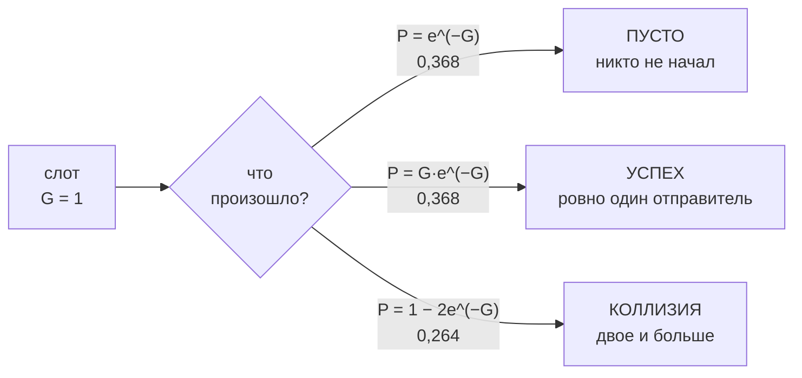
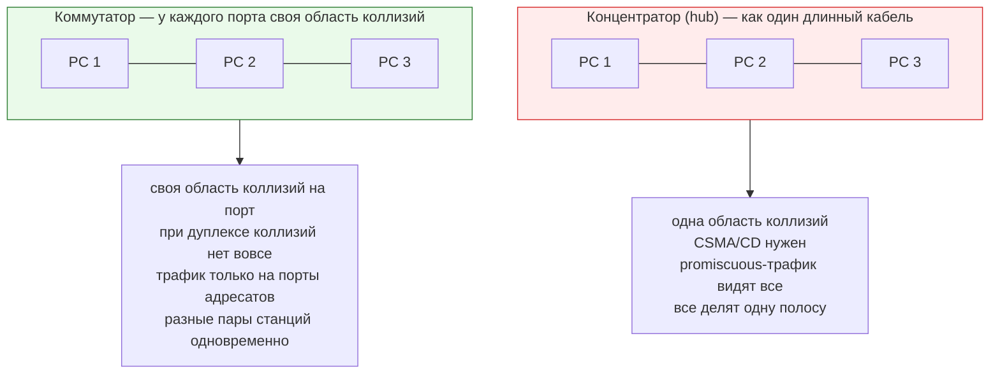
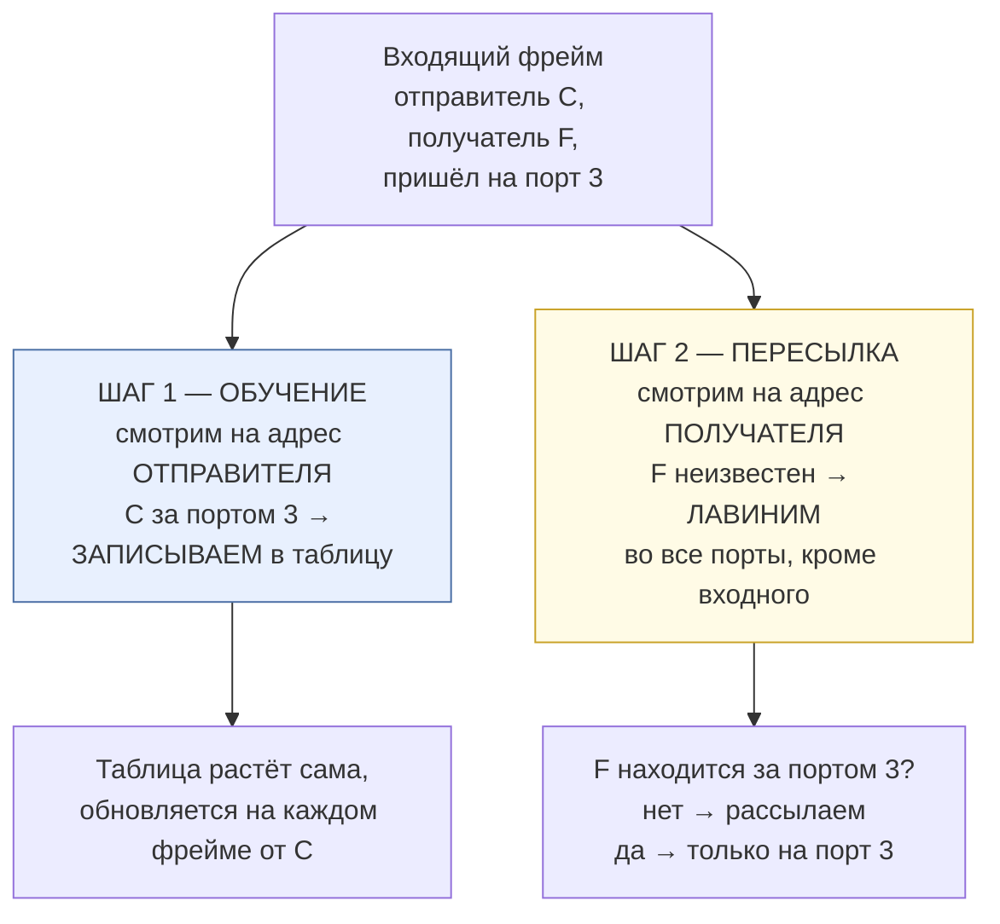
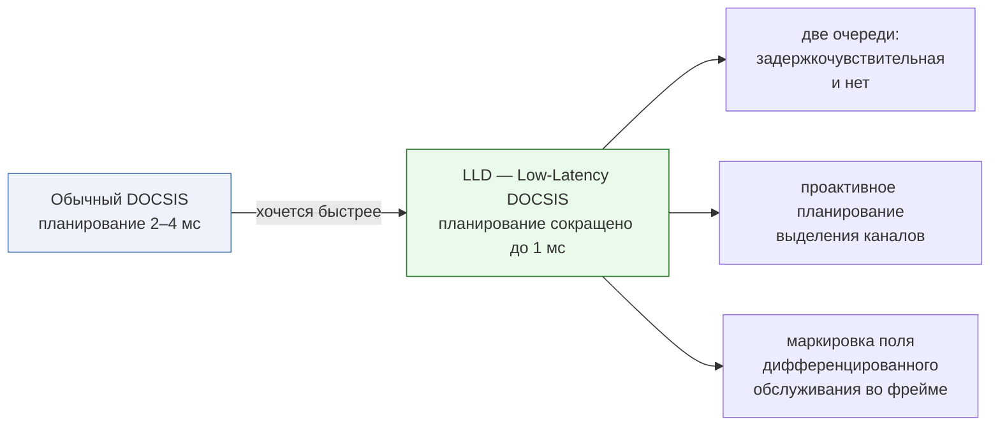

# Глава 4 — Разбор пробелов

> По результатам теста из [[Глава 4 — Тест и практика]]: **тест — 30 из 39 (77 %)**, **задания — 7 из 10**.
> Разобраны только реальные ошибки — по каждой теме видно, чего именно не хватило.

**Связано:** [[Глава 4]] · [[Глава 4 — Тест и практика]]

---

## Сводка

| № | Тема | Что не так | Тип ошибки |
| --- | --- | --- | --- |
| 1 | ALOHA | `e^(−G)` — это **успех**, а коллизия `1 − e^(−G)` | пробел в понятии |
| 2 | Двоичный отсчёт | накладные `log₂N`, а не `1` | пробел в понятии |
| 3 | Маркерные протоколы | отменён **802.4**, а не 802.5 | пробел в фактах |
| 4 | Hub vs switch | promiscuous-трафик и область коллизий перепутаны | пробел в понятии |
| 5 | CSMA/CA | назван неверный механизм выбора вместо CD | пробел в понятии |
| 6 | Bluetooth | переставлены статьи расхода 41/20/26 | ошибка в числах |
| 7 | Обратное обучение | отправитель перепутан с получателем | пробел в понятии |
| 8 | Связующее дерево | корень по номеру порта вместо MAC | пробел в фактах |
| 9 | Type/Length | граница 1536 названа как 1500 | ошибка в числах |
| 10 | DOCSIS | планирование 2–4 мс перепутано с результатом LLD | пробел в понятии |
| 11 | Связующее дерево | путь построен в обход единственной связи узла | пробел в понятии |
| 12 | Формула (4.3) | потерян перевод байт → биты при подстановке | ошибка в единицах |

Из двенадцати **одиннадцать** — это не забытые числа, а **неразведённые похожие вещи**. Единственные настоящие ошибки в числах — № 6 и № 9, и обе сводятся к перестановке двух значений местами.

---

## 1. Успех и коллизия — это разные числа

Самая частая ошибка: `P₀ = e^(−G)` почти все помнят как «вероятность коллизии». Но это вероятность того, что в слоте **никто не мешает**.

В дискретной ALOHA в слоте происходит **ровно одно** из трёх, и сумма вероятностей даёт 1:



Запомнить проще через **вычитание из единицы**: станция избегает коллизии тогда и только тогда, когда все остальные молчат. Значит

```
P₀ = e^(−G)            вероятность УСПЕХА (тихо)
P_колл = 1 − e^(−G)    вероятность КОЛЛИЗИИ
```

Отсюда две формулы, которые нельзя путать:

```
чистая ALOHA      S = G·e^(−2G)        максимум 1/2e ≈ 0,184
дискретная ALOHA  S = G·e^(−G)         максимум 1/e  ≈ 0,368
```

Разница только в показателе экспоненты — `2G` против `G`, — и она целиком определяется длиной уязвимого периода.

![[ch4-aloha-slots.png]]

**Как не ошибиться:** если спрашивают «сколько слотов приходится на коллизии» — это `1 − 2e^(−G)`, а не `e^(−G)`. Если «сколько пустых» — `e^(−G)`. Ключ в слове: пусто и успех дают **одинаковые** числа при G = 1, но это совпадение, а не тождество.

---

## 2. Накладные расходы у каждого протокола свои

Все три протокола «без коллизий» устроены с разными накладными, и их легко спутать, потому что формула выглядит одинаково: `d / (d + что-то)`.

| Протокол | Что-то | При слабой нагрузке | При сильной |
| --- | --- | --- | --- |
| Битовая карта | `N` бит — по биту на станцию | `d/(d + N)` | `d/(d + 1)` |
| Двоичный отсчёт | `log₂N` бит — размер адреса | то же | то же |
| Маркер | ~`1` бит | — | `d/(d + 1)` |

Ошибка была именно здесь: `d/(d+1)` — это результат **битовой карты при сильной загрузке**, а не двоичного отсчёта.

Двоичный отсчёт выигрывает у битовой карты потому, что битовая карта тратит **целый бит на каждую станцию** — при тысяче станций это 1000 бит на фрейм, то есть полезная нагрузка просто тонет. Двоичный отсчёт объявляет **адрес**, а адрес — это `log₂N` бит, и при 1000 станций всего 10 бит.

![[ch4-binary-countdown.png]]

Кстати, книга отмечает, что даже эти `log₂N` бит можно не потерять: если первым полем фрейма сделать адрес отправителя, то объявленный адрес будет одновременно и служебной информацией, и данными — эффективность станет **100 %**.

---

## 3. Token Bus отменён, Token Ring — просто проиграл рынок

Это два разных стандарта, и судьбы у них разные.

|  | 802.4 Token Bus | 802.5 Token Ring |
| --- | --- | --- |
| Топология | **шина**, кольцо логическое | настоящее **кольцо** |
| Стандарт | **отменён институтом IEEE** как неудачный | жил долго, умер рыночно |
| Исход | провал | сначала альтернатива классическому Ethernet, в 1980-е popularity; затем FDDI (оптика) проиграла коммутируемому Ethernet, и кольцо умерло |

Ключевая деталь про Token Bus: **физическое кольцо не требуется**. Достаточно логического — станции соединяются общей шиной и передают маркер соседям в предопределённом порядке. Именно поэтому маркер по шине и возможен.

Позже появились ещё: FDDI (оптическое кольцо) и **RPR** — отказоустойчивое пакетное кольцо, IEEE **802.17**, 2000-е, для городских сетей провайдеров. Номер 802.17 — не путать с 802.4 и 802.5.

---

## 4. Концентратор и коммутатор — наоборот

Здесь важна одна фраза из книги: концентратор **логически эквивалентен одному длинному кабелю** классического Ethernet.



Словарь, который всё путает:

- **promiscuous mode** («неразборчивый режим») — когда адаптер принимает **все** фреймы, а не только адресованные ему;
- **область коллизий** (collision domain) — множество станций, чьи передачи могут столкнуться.

Значит: promiscuous-трафик видят все ⇒ это **концентратор**. У каждого порта своя область коллизий ⇒ это **коммутатор**.

Оба утверждения — характеристики **разных** устройств, и совместить их в один ответ нельзя. Заодно: коммутатор даёт и **безопасность** — promiscuous-трафик через него не распространяется, чужие кадры не попадают в чужие порты.

![[ch4-hub-vs-switch.png]]

---

## 5. Почему 802.11 не использует CSMA/CD

Направление мысли было верным — коллизию в радио действительно трудно заметить. Но причина в книге сформулирована конкретно, и она физическая:

> Радиопередатчики почти всегда работают в **полудуплексном** режиме. Они не могут одновременно передавать сигналы и прослушивать всплески шума на одной и той же частоте. Получаемый сигнал может быть **в миллион раз слабее** передаваемого.

Из этого следует, что трюк Ethernet не работает. В Ethernet станция ждёт тишины, начинает передачу и **продолжает слушать канал во время передачи**. Если за время отправки 64 байт шум не вернулся — значит, коллизии не было, фрейм доставлен.

В радио так не выйдет: станция физически не слышит эфир, пока передаёт, а если бы слышала — то услышала бы не «шум», а чужой передатчик, от которого её отличает сигнал в миллион раз более слабый. Эфир нужно слушать **до** начала передачи, а не во время.

Отсюда два изменения, и оба принципиальные:

1. **Предотвращение** вместо обнаружения — станция начинает с периода молчания и случайной выдержки, коллизия в идеале не возникает вовсе.
2. **Подтверждение** — без него невозможно узнать, что фрейм дошёл: не услышал ACK значит «считаем, что было плохо» и удваиваем паузу.

Именно поэтому CSMA/CA расширяют через **NAV**: виртуальное прослушивание позволяет станции, которая не слышала физический сигнал, всё равно знать, что канал занят.

> Побочная деталь: «переключать частоту» — это динамический выбор частоты (служба 802.11, уход из диапазона 5 ГГц, где работают радары). К коллизиям отношения не имеет.

![[ch4-80211-intervals.png]]

---

## 6. Bluetooth: куда делись 87 % ёмкости

Цифры запоминаются легко, но перестановка мест — классика. Правильная раскладка:

| Статья расхода | Доля | За что |
| --- | --- | --- |
| Стабилизация сигнала | **41 %** | 250–260 мкс на установку сигнала при каждом скачке частоты |
| Заголовки | **20 %** | 126 служебных бит в каждом фрейме, плюс заголовок 54 бита |
| Повторное кодирование | **26 %** | самая надёжная версия SCO повторяет полезную нагрузку трижды |
| **Итого полезных** | **13 %** |  |

Ключ к пониманию: **41 % — это не заголовки, а время на то, чтобы дешёвое радиоустройство (2,5 мВт) успело перестроиться на новую частоту.** Это плата за минимализм аппаратуры, и именно её Bluetooth в первую очередь и покупал.

Повторное кодирование — это не контрольные суммы. В SCO-фрейме базовой скорости поле данных всегда 240 бит, из которых полезных может быть 80, 160 или 240. В самой надёжной версии (80 бит) одно и то же содержимое повторяется три раза — ровно так же, как заголовок повторяется трижды.

Забавная деталь оттуда же: несмотря на номинальные 1 Мбит/с радиолинии, **полнодуплексный несжатый голос перегружает пикосеть**. Подчинённый использует только нечётные слоты — их 800 в секунду, по 80 бит полезных на фрейм = 64 000 бит/с на каждый канал PCM. Именно поэтому 1600 скачков в секунду и было выбрано как минимальная скорость перестройки.

![[ch4-bluetooth-frame.png]]

---

## 7. Обратное обучение — по отправителю, лавинная адресация — по получателю

Это две разные операции, и путать их опасно: одна **наполняет** таблицу, другая её **использует**.



Правило целиком: **то, что видно в кадре отправки, записывается; то, что видно в кадре назначения, используется для решения о пересылке.**

|  | по какому адресу | что делает |
| --- | --- | --- |
| Обратное обучение | **отправителя** | заполняет таблицу «кто за каким портом» |
| Лавинная адресация | **получателя** | если нет записи — шлёт во все порты, кроме входного |

Три правила пересылки, которые нужно помнить дословно:

1. Порт-источник и порт назначения **совпадают** → фрейм игнорируется.
2. Порты **различаются** → фрейм уходит на порт назначения.
3. Порт назначения **неизвестен** → лавинная адресация во все порты, кроме источника.

Пункт 1 возможен даже на двухточечных линиях: станции E и F сидят за концентратором, фрейм E→F доходит и до F, и до моста — уже на «правильном» порту, и мост его отбросит.

Записи стареют: сканер удаляет то, что не обновлялось несколько минут. Если станция помолчала, её адрес снова становится неизвестным и к ней опять пойдёт лавинная адресация.

---

## 8. Корень связующего дерева — по MAC, а не по номеру порта

Корень выбирает мост с **наименьшим идентификатором**, и идентификатор строится на основе **MAC-адреса**.

Причина в том, что MAC-адреса выдаются производителем и **гарантированно уникальны**. Из уникальности MAC следует уникальность идентификатора, а значит — однозначность выбора без всякого вмешательства администратора. Это часть требования «мост должен быть полностью прозрачен».

Алгоритм целиком:

1. Каждый мост рассылает конфигурационные сообщения, вклюняя собственный идентификатор и кандидатуру на корень.
2. Все сходятся к решению: **корень — наименьший идентификатор**.
3. От корня строится дерево кратчайших путей. Каждый мост считает свой кратчайший путь до корня и **отключает порты, не входящие в него**.
4. Дерево **не обязано покрывать все соединения** — часть отключается намеренно, и это не отказ, а защита от циклов.

Номер порта в выборе не участвует. В книге он используется в другом сюжете — в правилах пересылки фрейма, и там он как раз определяет, отбросить кадр или переслать.

Автор алгоритма — **Радья Перлман**. На решение задачи ей выделили неделю, но идея нашлась в первый же день, и остаток времени она потратила на то, чтобы изложить её в стихотворении (в книге оно напечатано).

![[ch4-spanning-tree.png]]

---

## 9. Граница Type/Length — 1536, а не 1500

Число, которое почти всегда называют неверно. Правило:

```
значение <  0x600 (1536)  →  поле читается как Length
значение >  0x600 (1536)  →  поле читается как Type
```

Именно **1536**, а не 1500. Откуда вообще взялось разделение — из истории:

- DIX Ethernet придумал поле **Type**: «что делать с этими данными» (`0x0800` = IPv4). Но для этого надо **заглянуть внутрь** данных, а это нарушает правила многоуровневых моделей.
- IEEE 802.3 решил, что в поле должна быть **Length**: «сколько байт идёт дальше». Но получатель тогда не понимает, что делать с фреймом. Решение добавили заголовком **LLC** (8 байт, 2 байта с типом протокола).
- К 1997 году оборудования под DIX было слишком много, и IEEE **признал поражение**, разрешив оба варианта в одном поле.

Разделение оказалось безопасным как раз потому, что максимум данных — 1500 байт, а все существовавшие значения Type были **больше 1500**. Порог 1536 выбрали с запасом, чтобы ни одно значение Type не могло быть спутано с длиной.

Полезные значения, которые стоит помнить:

| Значение | Что |
| --- | --- |
| `0x0800` | в данных пакет IPv4 |
| `0x0806` | ARP |
| `0x8100` | тег VLAN (802.1Q) |
| `0x8808` | служебный фрейм PAUSE (управление потоком Gigabit Ethernet) |

`0x8100` работает по тому же правилу: он больше 1500, поэтому любая карта читает его как Type, а не Length. Старая карта не поймёт, что с таким кадром делать, но такие кадры ей и не передают — тег вставляет мост и удаляет тоже мост.

![[ch4-ethernet-frame.png]]

---

## Что это значит для повторения

Восемь пробелов из девяти — **не пробелы в памяти, а в разграничении похожих вещей**. Пять пар, которые стоит противопоставить друг другу:

| Пара | Разница |
| --- | --- |
| Успех ↔ коллизия | `e^(−G)` ↔ `1 − e^(−G)` |
| `log₂N` ↔ `N` | двоичный отсчёт ↔ битовая карта |
| 802.4 ↔ 802.5 | Token Bus отменён ↔ Token Ring проиграл рынок |
| Hub ↔ switch | одна область коллизий ↔ своя на порт |
| Отправитель ↔ получатель | обучение ↔ лавинная адресация |

Как только эта пара разведена, перечисленные вопросы закрываются сами. Практика на эти места — в [[Глава 4 — Тест и практика]], раздел «Задания».

---

## 10. Обычный DOCSIS против LLD

Ошибка была в том, что характеристика LLD была приписана базовому стандарту.



Логика LLD ровно такая: во многих интерактивных приложениях — играх, видеоконференциях — **низкая задержка важнее пропускной способности**. Игра не качает много данных, но не терпит, когда пакет ждёт 4 мс в очереди CMTS.

Сокращение достигается тремя способами сразу:

- планирование с **2–4 мс до 1 мс**;
- **две очереди** вместо одной — для трафика, чувствительного к задержкам, и для остального;
- **проактивное планирование** — приложение сообщает, есть ли у него пакеты, которые нельзя ставить в очередь, через маркировку поля дифференцированного обслуживания прямо в кадре DOCSIS.

Сам механизм мини-слотов общий для обоих: CMTS раздаёт потокам разное количество мини-слотов, и это и есть инструмент QoS. Шаг мини-слота — **6,25 мкс**.

---

## 11. Кратчайший путь не может обходить существующие связи

Ошибка была чисто топологическая: путь `B4 → B1 → B2` невозможен, потому что **соединения B1–B4 не существует**. Кратчайший путь выбирается **только по тем рёбрам, что есть в графе**.

Разбор той задачи:

```
Идентификаторы:  B1 = 0x05,  B2 = 0x02,  B3 = 0x09,  B4 = 0x07
Рёбра графа:     B1–B2,  B1–B3,  B2–B3,  B3–B4
```

**Шаг 1 — корень.** Наименьший идентификатор — `0x02`, значит корень **B2**. Эта часть была сделана верно.

**Шаг 2 — расстояния от корня.**

| Мост | Путь | Число шагов |
| --- | --- | --- |
| B2 | — | 0 (корень) |
| B1 | B2 → B1 | 1 |
| B3 | B2 → B3 | 1 |
| B4 | B2 → B3 → B4 | 2 |

**Шаг 3 — отключаемые порты.** У B1 связь с B3 не входит в кратчайший путь к корню → этот порт блокируется. То же у B3: связь с B1 блокируется.

Проверка на «обход»: путь до B4 обязан идти через B3, потому что у B4 в графе единственное ребро — `B3–B4`. Никакой другой маршрут физически невозможен.

Полезная привычка: перед подсчётом пути посмотри на **степень** вершины. Степень 1 у B4 означает, что у неё ровно один выход, и это сразу определяет путь.

---

## 12. Единицы в формуле (4.3)

Здесь ошибка не в понимании, а в подстановке — потерялось превращение байт в биты.

Формула (4.3) выводится из `S = P / (P + 2τe)`, где `P` — **время передачи фрейма**. Чтобы работать с размерами кадра, кника переписывает её через `P = F/B`, и `F` здесь — **длина фрейма в битах**:

```
S = F / (F + 2·e·B·τ) = F / (F + 2·e·B·L/c)
```

`B` — бит/с, `τ` и `L/c` — секунды, значит произведение `B·τ` даёт **биты**. Следовательно `F` обязано быть в битах. Подстановка `F = 512` вместо `4096` занижает эффективность примерно вчетверо.

Разбор контрольного примера:

```
F = 512 байт  =  4096 бит          ← перевод обязателен
B = 100 Мбит/с =  10⁸ бит/с
L = 100 м,  c = 2·10⁸ м/с
τ = L/c      =  0,5 мкс
2τ           =  1 мкс
накладные    =  B · 2τ · e  =  10⁸ · 10⁻⁶ · 2,718  =  272 бита
S            =  4096 / (4096 + 272)  =  0,938
```

Полезно сравнить с числами книги, чтобы почувствовать масштаб:

| Скорость | Кабель | Слот | Накладные | F = 1024 Б | S |
| --- | --- | --- | --- | --- | --- |
| 10 Мбит/с | 2500 м | 51,2 мкс | ≈ 1392 бита | 85,5 % | совпадает с книгой |
| 100 Мбит/с | 100 м | 1 мкс | 272 бита | 93,8 % | заметно лучше |

Главный вывод: накладные **пропорциональны произведению полосы на задержку** (`B·τ`), то есть растут от скорости и длины кабеля. Удваиваем скорость — удваиваем накладные. Именно поэтому Ethernet пришлось ограничить, а GigE — прекратить CSMA/CD вовсе.
