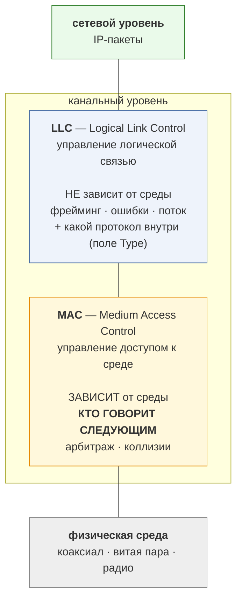
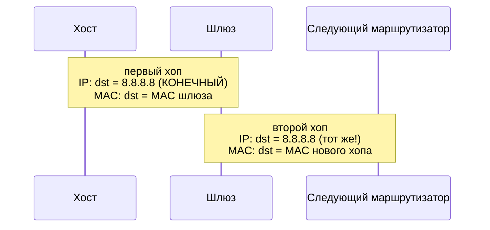
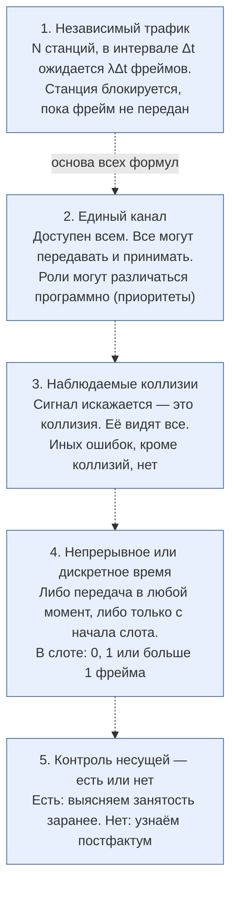
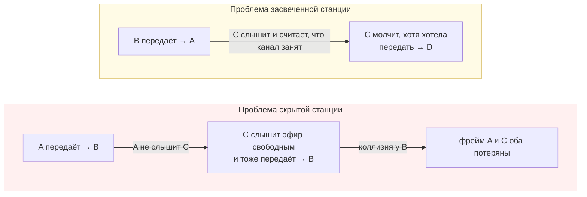
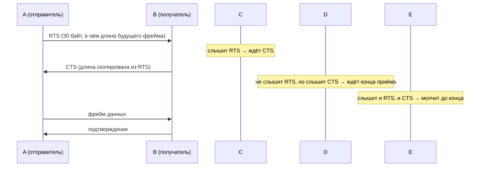
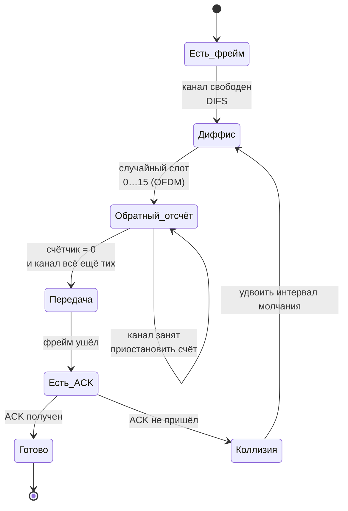
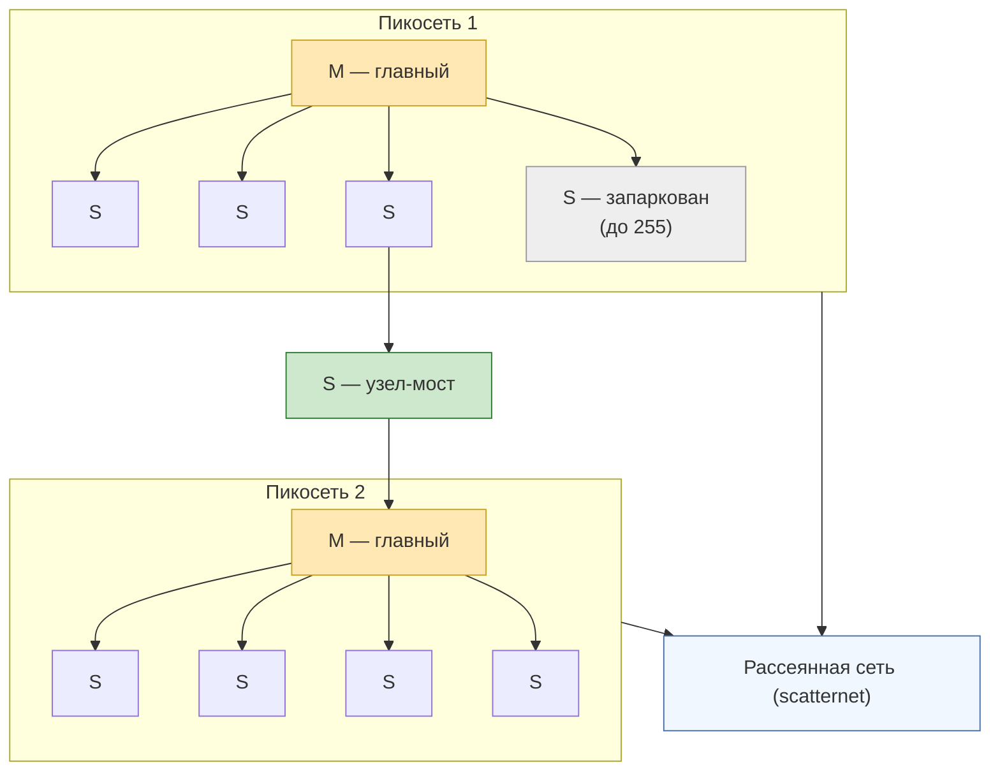
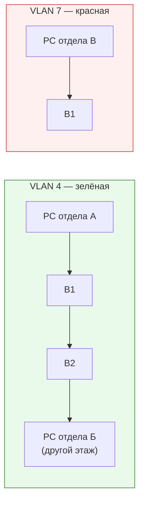

# Глава 4. Подуровень управления доступом к среде

> Источник: Таненбаум, Фимстер, Кузеролл. *Компьютерные сети*, 6-е изд. — главы 4, страницы **312–411**.
> PDF: ![[Tanenbaum_E_Fimster_N_Uezeroll_D_Kompyuternye_seti_6_e_izd_Klassika.pdf]]
> Все графики и схемы в этой заметке построены по тексту главы и лежат в `Images/`
> (перегенерировать: `bash Images/gen-ch4-graphs.sh`).

**Связано:** [[Глава 4 — Тест и практика]] · [[Глава 4 — Разбор пробелов]]

---

## О чём глава

Протоколы канального уровня из главы 3 рассчитаны на широковещательную среду. Проблема одна:
**канал один, а желающих его много.** Кому отдать? Это и есть подуровень управления доступом
к среде — MAC (Medium Access Control).

MAC важен прежде всего в LAN, особенно в беспроводных: они по природе широковещательные.
В WAN встречаются двухточечные участки, но есть и компоненты с совместным использованием
(например, кабельный доступ у провайдера).

> [!tip]- Если непонятно, при чём тут «подуровень» и почему не про адреса
> Раздел **«Что такое MAC на самом деле»** ниже отвечает на оба вопроса: почему
> подуровень назван «управлением доступом», а не адресацией, и почему MAC — это
> **интерфейс**, а не устройство. Начни с него.

---

## Что такое MAC на самом деле

Прежде чем читать главу дальше, стоит ответить на вопрос, который вытекает из её названия:
**почему подуровень называется «управление доступом к среде», а не «адресация»?**

### Определение из книги — одна фраза

> «Протоколы, **определяющие очередность использования линии**, относятся к канальному
> уровню, точнее, к подуровню управления доступом к среде (MAC, Medium Access Control)»
> (стр. 313).

Ключевое слово — **очередность**. Вся глава — ALOHA, CSMA/CD, CSMA/CA, передача маркера,
двоичный счёт вниз, дерево состязания — это восемь вариантов ответа на один вопрос:
**«кто сейчас имеет право говорить?»**

### Почему «под**уровень**»

Канальный уровень разделён надвое. Граница проходит по одному признаку — **зависит ли
функция от физической среды**:



Книга: «канальный уровень во всех протоколах 802.х разбит на два или более подуровня»
(стр. 359), «MAC является нижней частью канального уровня».

**Глава 3 разбирает верхний подуровень** (фрейминг, ошибки, поток — всё, что одинаково
работает на любой среде), **глава 4 — нижний** (то, что приходится переписывать для
каждой новой среды: для коаксиала одно, для радио другое).

### Адресация — побочный продукт, а не назначение MAC

Здесь и рождается смешение, которого стоит избежать.

Историческая причина: Ethernet начинался как **коаксиальная шина** — один кабель, много
станций, **все слышат всё**. В такой среде вопрос «кому этот кадр?» не стоял: он и так был
слышен всем. Стоял вопрос «кто заговорит?».

Когда понадобился формат кадра, кто-то предложил вписать поле адреса — и взяли
**аппаратный** адрес, MAC. То есть адресация приклеилась к подуровню, чьей работой
она не была. **Название осталось за MAC, а задача ушла в LLC.**

### Что на самом деле делает LLC

Книга проговаривает это прямо (стр. 360):

> «Выше находится LLC… помимо этого, LLC сегодня является **связующим уровнем,
> отвечающим за идентификацию протокола** (например, IP), информация о котором
> передается во фрейме 802.11».

То есть **«какой протокол лежит внутри кадра» — работа LLC**, а не MAC. Поле
`Type` / `Length` в заголовке кадра — это как раз LLC. Граница между ними — та величина,
которую мы разбирали в разделе 4.3: **`0x600 = 1536`**, ниже — длина, выше — тип протокола.

| Задача | Чей это подуровень |
|---|---|
| Кто говорит следующим | **MAC**, глава 4 |
| Как найти границы фрейма | **LLC**, глава 3 |
| Ошибки и повторы | **LLC**, глава 3 |
| Какой протокол внутри (IP, ARP) | **LLC** (поле `Type`, граница 1536) |

### Две поправки, которые чаще всего искажают

**1. MAC идентифицирует интерфейс, а не устройство.**

Структурно 48 бит = **24 бита OUI** (производитель, присваивает IEEE) +
**24 бита NIC**. Ноутбук с Ethernet, Wi-Fi и Bluetooth — это **три** MAC-адреса.
У виртуальной машины свой MAC, отличный от хостового.

Интуиция «это серийный номер» верна и полезна: первая половина адреса говорит о
производителе. Но это серийный номер **порта**, а не коробки. И он не годится на роль
идентичности: адреса **рандомизируются** (privacy MAC в телефонах — новый адрес на каждую
сеть) и **подделываются** без труда.

**2. ARP — канальный протокол, и он работает только для следующего хопа.**

Это не «сетевой уровень переводит в MAC». ARP (Address Resolution Protocol) определён
**на канальном уровне**, хотя и оперирует адресом сетевого. И он разрешает адрес
**только для соседа в том же широковещательном домене**.

Вот как меняются заголовки на пути к удалённому серверу:



- **IP-адрес не меняется нигде на всём пути** — он всегда конечный получатель.
- **MAC меняется на каждом хопе** — это адрес *следующего* узла.
- Отправить кадр на удалённый MAC **нельзя**: такого адреса в вашей сети нет.
  Для этого и нужен шлюз по умолчанию.

> [!note]- В IPv6 ARP нет вообще
> Там соседей ищет **Neighbor Discovery Protocol** поверх ICMPv6. Тот же смысл
> (найти MAC соседа), другой механизм.

### Хаб против Wi-Fi — самая чистая проверка понимания

Два устройства с **одной и той же** задачей, два диаметрально противоположных решения:

| | Проводной хаб | Wi-Fi 802.11 |
|---|---|---|
| Все слышат все? | да | да |
| Можно слушать во время передачи? | **да** | **нет** — приёмник оглох |
| Как узнать о конфликте? | **сравнить напряжение со своим сигналом** | **невозможно физически** |
| Решение | CSMA/**CD** — обнаружение | CSMA/**CA** — предотвращение |
| Что нужно сверх этого | — | RTS/CTS, интервалы SIFS/DIFS, backoff |

Одна задача — «кто говорит следующим». Различие в **одной** физической способности среды:
можно ли слушать, пока говоришь. Из неё следует вся разница между Ethernet и Wi-Fi.

> **Как запомнить:** если в описании решения меняется *кто* получает пакет — это не MAC.
> Если меняется *когда* — это MAC. Адресация в кадре неизменна; расписание передач
> — единственное, о чём этот подуровень.

---

## 4.1 Проблема распределения канала

### Статическое распределение не работает

Классический способ — FDM (или TDM): полосу делят на N равных частей, каждой станции по части.
Конфликтов нет, но полоса простаивает, когда владелец молчит.

Количественно это видно через очередь M/M/1:

```
T = 1 / (μC − λ)
```

Пример из книги: `C = 100 Мбит/с`, средняя длина фрейма `1/μ = 10 000 бит`,
`λ = 5000 фреймов/с` → **T = 200 мкс**.

- Без учёта очереди вышло бы `10 000 / 100 000 000 = 100 мкс` — но это верно только
  при отсутствии конкуренции.
- Разбить канал на N подканалов по `C/N` → входная скорость в каждом `λ/N`,
  и задержка становится **в N раз хуже**.
- Тот же пример в числах: 100-мегабитный канал разрезать на десять 10-мегабитных →
  средняя задержка растёт с **200 мкс до 2 мс**.

Аналогия из книги: банкоматы в холле банка лучше ставить в **одну общую очередь**.
Отдельные очереди = часть машин простаивает, у другой скопится народ.

Компьютерный трафик к тому же крайне неравномерный — отношение пика к среднему
вполне обычное **1000:1**, поэтому статические схемы не годятся.

### Пять допущений, на которых стоит весь анализ



Оговорки из текста:

- **Пуассоновская модель** удобна математически, но реальный трафик ею не описывается:
  пакеты приходят пачками (Paxson & Floyd, 1995; Fontugne et al., 2017). Практика всё же
  подтверждает работоспособность расчётов — Boggs et al. показали, что Ethernet хорош
  и при высокой нагрузке.
- **Ни один** протокол коллективного доступа **не гарантирует** надёжную доставку.
  Надёжность обеспечивают другие уровни.
- В беспроводной среде коллизии **не видны в момент возникновения** (сигнал в миллион раз
  слабее) — о них узнают по отсутствию подтверждения.

---

## 4.2 Протоколы коллективного доступа

### 4.2.1 ALOHA

Абрамсон, Гавайский университет, 1970-е: связать острова с Гонолулу без прокладки кабеля
по дну Тихого океана. Идея: передавать, как только есть данные.

**Чистая ALOHA** (время непрерывно). Фрейм длится `t`.
> [!figure]- Илл. 4.1 и 4.2 — из книги (стр. 318)
> ![[4.1.png]]
> ![[4.2.png]]
> Слева: пять станций A–E в чистой ALOHA, видны две коллизии.
> Справа: уязвимый период затенённого фрейма — ровно `2t`.
 Коллизия возникает, если чужой фрейм
начался в интервале от `t₀` до `t₀ + t` (накрыл начало) или от `t₀ + t` до `t₀ + 2t`
(накрыл конец). Итого **уязвимый период 2t**.

```
P₀ = e^(−2G)          S = G·e^(−2G)          S_max = 1/2e ≈ 0,184  при G = 0,5
```

Даже в оптимуме канал занят на **18 %**. Почему так мало: достаточно перекрыть
**один бит** — контрольные суммы всё равно не сойдутся.

**Дискретная ALOHA** (Робертс, 1972). Время делится на слоты длиной `t`, передача только
с начала слота. Уязвимый период вдвое короче:

```
P₀ = e^(−G)           S = G·e^(−G)           S_max = 1/e ≈ 0,368   при G = 1
```

В оптимуме **37 % слотов пусты, 37 % успешны, 26 % — коллизии**.
Вероятность коллизии `1 − e^(−G)`, поэтому небольшой рост нагрузки обрушивает
производительность: `E` (ожидаемое число попыток) экспоненциально зависит от `G`.

![[ch4-aloha-throughput.png]]

![[ch4-aloha-slots.png]]

Историческая ирония: ALOHA забыли на десятилетия и вернули только с приходом
кабельного интернета — в составе DOCSIS.

### 4.2.2 Контроль несущей

Станции начинают **слушать**, а не просто говорить.

| Протокол | Поведение при свободном канале | При занятом |
|---|---|---|
| CSMA, настойчивость **1** | передаю **сразу**, p = 1 | жду освобождения |
| CSMA, ненастойчивый | передаю сразу | жду **случайный** интервал, потом снова слушаю |
| CSMA, настойчивость **p** | передаю с вероятностью **p**, иначе жду следующего слота | жду следующего слота |
| CSMA/CD | настойчивость 1 + обнаружение коллизии и немедленный обрыв | двоичная экспоненциальная выдержка |

Коллизии у CSMA возникают из-за **задержки распространения**: станция может услышать
свободный канал, пока сигнал другой ещё не дошёл. Чем больше произведение
«полоса × задержка», тем выше вероятность коллизии.

**CSMA/CD** — основа классического Ethernet. Распознавание коллизии — процесс **аналоговый**:
станция слушает канал во время передачи и сравнивает сигнал с тем, что шлёт.
Отсюда ограничение: коллизия двух 0-вольтовых сигналов неразличима, а в радио
принятый сигнал слишком слаб — там CD **не работает**.

Протокол находится в одном из трёх состояний: **передача**, **конкуренция**, **простой**.
> [!figure]- Илл. 4.5 — из книги (стр. 324)
> ![[4.5.png]]
> Слоты конкуренции чередуются с периодами передачи и простоя.


#### Откуда берётся 2τ

Пусть время прохождения сигнала между самыми дальними станциями равно `τ`.
Станция A начинает передачу в момент `t₀`, и за `τ − ε` (буквально за мгновение до
прихода к дальней станции) та станция тоже начинает. Коллизия мгновенно распознаётся
у обоих, но всплеск шума доходит до A только к моменту `2τ − ε`.

Значит, станция **не может считать канал захваченным раньше 2τ**.

```
Конкуренция CSMA/CD ≈ дискретная ALOHA с шириной слота 2τ
Разница: после успешного захвата передаётся остаток фрейма — отсюда рост эффективности
```

В коаксиальном кабеле 1 км `τ ≈ 5 мкс`.

### 4.2.3 Протоколы без коллизий

Коллизии ломают и производительность, и постоянство задержки — а для голоса по IP
это особенно плохо. Отсюда протоколы, которые коллизии **устраняют**.

**Битовая карта.** Период конкуренции = N слотов
> [!figure]- Илл. 4.6 — из книги (стр. 326)
> ![[4.6.png]]
> Станции 3, 5 и 7 заявили о себе в свои слоты и передают по номеру.
, в слоте `j` станция `j` сигналит единицей,
если у неё есть фрейм. Все узнают, кто хочет передавать, и передают по номеру. Коллизий нет.
- Слабая загрузка: эффективность `d / (d + N)`.
- Сильная загрузка: `d / (d + 1)` — накладные всего 1 бит.
- Станции с малыми номерами ждут `1,5N` слотов, с большими — `N/2`, среднее `N`.

**Передача маркера.** Маркер — разрешение на отправку, ходит по предопределённому порядку.
- **Кольцо** (802.5 Token Ring) — станции соединены в кольцо; фрейм извлекает
  отправитель или получатель.
- **Шина** (802.4 Token Bus) — кольцо **логическое**, физически шина.
  Стандарт 802.4 отменён IEEE как неудачный.
- FDDI (оптика, 1990-е) проиграла коммутируемому Ethernet; RPR — IEEE 802.17, 2000-е.

**Двоичный обратный отсчёт** (Datakit, Фрейзер, 1983). Станция объявляет свой адрес
побитно, начиная со старшего бита; биты складываются по ИЛИ прямо в канале.
Станция, у которой стоял 0, а сумма дала 1, **сдаётся**. Выигрывает **наибольший адрес**.

![[ch4-binary-countdown.png]]

Накладные `log₂N` бит вместо `N`. Можно даже не потерять: если первым полем фрейма
сделать адрес отправителя, эффективность станет 100 %.

### 4.2.4 Ограниченная конкуренция

Компромисс: у конкурентных протоколов мала задержка при низкой нагрузке и плохая
эффективность при высокой; у протоколов без коллизий — наоборот.

**Симметричный случай.** `k` станций, каждая передаёт с вероятностью `p`:

```
P(успех в слоте) = k·p·(1 − p)^(k−1)
оптимум:          p = 1/k
при k → ∞        вероятность стремится к 1/e
```

**Групповой арбитраж.** Станции делят на группы: за слот 0 состязаются члены группы 0,
за слот 1 — группы 1, и так далее. Чем больше станций, тем мельче группы.

**Адаптивный проход по дереву** (Капетанакис, 1979; идея — из army 1943 г. по сифилису).
Станции = листья двоичного дерева, каждый однобитный слот = узел дерева.
Стартовать следует с уровня, где ожидаемое число готовых станций равно 1:

```
i = log₂q,   где q — число готовых станций
```

![[ch4-contention-tree.png]]

> [!figure]- Илл. 4.10 — из книги (стр. 331–332)
> ![[4.10.png]]
> Дерево из восьми станций A–H, каждый однобитный слот — узел дерева.

### 4.2.5 Скрытая и засвеченная станция

В проводной сети все слышат всех. В радио — нет, и появляются две проблемы:



- **Скрытая станция** не слышит конкурента — тот слишком далеко, но помешает приёмнику.
- **Засвеченная станция** слышит передачу, которая ей не помешает, и молчит впустую.
> [!figure]- Илл. 4.11 — из книги (стр. 334)
> ![[4.11.png]]
> (а) A и C — скрытые станции при пересылке на B. (б) B и C — засвеченные.


**MACA** (Карн, 1990) — решение через запрет говорить:



MACA заменяет контроль несущей: контролируется не «свободен ли канал», а «не мешает ли
кто-то **у получателя**».
> [!figure]- Илл. 4.12 — из книги (стр. 335–336)
> ![[4.12.png]]
> (а) A посылает RTS станции B. (б) B отвечает CTS. Показано, какие станции
> обязаны молчать, а какие — нет.


---

## 4.3 Ethernet

Два разных Ethernet с похожими именами:

- **Классический** — 3–10 Мбит/с, один длинный кабель, CSMA/CD. Исторический.
- **Коммутируемый** — 100 / 1000 / 10 000 / 40 000 / 100 000 Мбит/с через коммутаторы.
  **Именно он используется сегодня.**

### 4.3.1 Физика

Меткалф и Боггс, Xerox, 1976: толстый коаксиал, 3 Мбит/с. 1978 — стандарт DIX на 10 Мбит/с,
1983 — IEEE 802.3. После ухода Xerox из проекта Меткалф основал 3Com.

| | Толстый Ethernet | Тонкий Ethernet |
|---|---|---|
| Длина сегмента | 500 м | 185 м |
| Станций на сегмент | до 100 | до 30 |

Повторители — устройство **физического** уровня, усиливают сигнал в обе стороны;
для ПО ряд кабелей неотличим от одного сплошного.
Ограничения 802.3: не более **2500 м** между трансиверами и не более **4 повторителей**.
Кодирование — **манчестерское**.

### 4.3.2 Формат фрейма

![[ch4-ethernet-frame.png]]

Адреса по 6 байт. Первый бит адреса получателя: `0` — обычный, `1` — групповой.
Только единицы — широковещание. Первые 3 байта адреса — **OUI**, уникальный идентификатор
организации, выдаётся IEEE (блок из 224 адресов на производителя).

**Почему минимум 64 байта** — не для красоты: время передачи должно превышать `2τ`,
иначе отправитель закончит раньше, чем вернётся шумовой всплеск от коллизии,
и ошибочно решит, что коллизии не было. Расчёт: `5000 бит = 50 мкс` по времени,
при 10 Мбит/с один бит = 100 нс → нужно 500 бит; **округлили вверх до 512 бит = 64 байта**,
и добавили запас надёжности.

Checksum — 32-битный CRC, тот же порождающий многочлен, что в PPP и ADSL.
> [!figure]- Илл. 4.15 — из книги (стр. 340–341)
> ![[4.15.png]]
> Обнаружение коллизии занимает `2τ`: станция B посылает 48-битный шумовой сигнал,
> и только на `2τ` станция A понимает, что произошла коллизия.

Ошибки только **обнаруживаются**, фрейм отбрасывается — исправления нет.

### 4.3.3 Двоичная экспоненциальная выдержка

![[ch4-backoff.png]]

Смысл: интервал растёт вместе с числом конкурентов. Мало станций — задержка мала
и коллизии быстро гаснут. Много станций — интервал большой, иначе сотня станций
выбирала бы 0 или 1 годцами, пока 99 не выберут 1, а одна — 0.

После 10-й коллизии диапазон замирает на **1023**, после **16-й** контроллер
сдаётся и возвращает ошибку в ОС — дальше разбираются верхние уровни.

Подтверждений в Ethernet нет: кабель надёжен, ошибки ловит CRC.
В шумном беспроводном канале подтверждения обязательны.

### 4.3.4 Производительность

При `k` всегда готовых станциях и оптимальном `p = 1/k` среднее число слотов конкуренции
не превышает `e`, значит период конкуренции `w = 2τe ≈ 5,4τ`:

```
Эффективность = P / (P + 2τe)                     (4.2)
С учётом P = F/B и τ = L/c:
Эффективность = 1 / (1 + 2e·B·L / (c·F))          (4.3)
```

Именно поэтому Ethernet ограничивает длину кабеля: чем длиннее кабель, тем дольше
конкуренция.

![[ch4-ethernet-efficiency.png]]

Для 10 Мбит/с и слота `2τ = 51,2 мкс` слот равен **64 байтам**, а накладные
`e · 64 ≈ 174 байта` на каждый фрейм. Короткие фреймы проигрывают: накладные не масштабируются.

Книга приводит цифру: при фреймах **1024 байта** эффективность **85 %** — против
37 % у дискретной ALOHA.

### 4.3.5 Концентратор против коммутатора

![[ch4-hub-vs-switch.png]]

Внешне одинаковые коробки с разъёмами RJ-45. Разница внутри:

- **Концентратор** соединяет порты электрически — это один длинный кабель,
  одна область коллизий, CSMA/CD нужен, promiscuous-трафик видят все.
- **Коммутатор** отдаёт фрейм только на нужный порт: у каждого порта своя область
  коллизий. При полном дуплексе коллизий не бывает вовсе, CSMA/CD не нужен,
  разные пары станций работают одновременно.

Порт коммутатора можно подключить к концентратору — тогда внутри этой группы
действует обычная конкуренция.

### 4.3.6 Fast / Gigabit / 10G / 40–100G

**Fast Ethernet** (802.3u, 1995) — тот же формат фрейма, те же интерфейсы,
просто в 10 раз короче время передачи бита. Обратная совместимость — «священная корова».

| Название | Тип | Длина сегмента | Особенность |
|---|---|---|---|
| 100Base-T4 | витая пара | 100 м | 4 пары, троичные уровни, 25 МГц — для кабелей категории 3 |
| 100Base-TX | витая пара | 100 м | 4B/5B на 125 МГц, полный дуплекс, 2 пары |
| 100Base-FX | оптоволокно | 2000 м | полный дуплекс, 2 многомодовых кабеля |

100Base-T4 проиграл рынок 100Base-TX. Ограничение коллизии при росте скорости:
либо увеличивать минимальный фрейм, либо в 10 раз уменьшать длину кабеля —
проще второе, отсюда 100 м вместо 2500 м.

**Gigabit Ethernet** (802.3ab, 1999). Полный дуплекс — норма, CSMA/CD там нет,
и максимальная длина кабеля определяется только затуханием. В полудуплексе
64-байтный фрейм улетает в 100 раз быстрее, поэтому кабель урезают до 25 м;
добавлены два механизма, чтобы вернуть 200 м:

- **расширение носителя** — дополнять фрейм до 512 байт. Эффективность отдачи 46 байт
  полезных — всего **9 %**;
- **пакетная передача фреймов** — склеивать несколько фреймов до 512 байт; эффективно.

Плюс управление потоком (служебный фрейм **PAUSE**, тип `0x8808`, пауза до 33,6 мс)
и **джамбо-фреймы** до 9 КБ — не в стандарте, запатентованы, но поддержаны всеми.

Кодирование `8B/10B` (заимствовано из Fibre Channel); для `1000Base-T` — все 4 пары,
по 125 Мбит/с в обе стороны, 5 уровней напряжения по 2 бита.

| Название | Тип | Длина сегмента |
|---|---|---|
| 1000Base-SX | многомод 0,85 мкм | 550 м |
| 1000Base-LX | одномод 10 мкм | 5000 м |
| 1000Base-CX | экранированная витая пара | 25 м |
| 1000Base-T | витая пара категории 5, 4 пары | 100 м |

**10-гигабитный Ethernet** — **только полный дуплекс**, CSMA/CD исключён из архитектуры.
Кодирование `64B/66B`.

| Название | Тип | Длина сегмента |
|---|---|---|
| 10GBase-SR | многомод 0,85 мкм | до 300 м |
| 10GBase-LR | одномод 1,3 мкм | 10 км |
| 10GBase-ER | одномод 1,5 мкм | 40 км |
| 10GBase-CX4 | 4 пары биаксиального | 15 м |
| 10GBase-T | витая пара категории 6а | 100 м |

**40 и 100 Гбит/с** (802.3ba, 802.3bj, 802.3cd) — для дата-центров и магистралей;
до 10 параллельных полос по 10 Гбит/с. Дальше — 400GbE (802.3cn и др.);
4K-фильм на 400 Гбит/с скачивается примерно за 2 секунды.

![[ch4-line-coding.png]]

### 4.3.7 Ретроспектива

Почему Ethernet выжил при гибели ATM, FDDI и Fibre Channel — все три были в момент
появления **быстрее** его. Причины:

1. **Простота** = надёжность, цена и лёгкость обслуживания.
2. **Низкая цена** — витая пара и комплектующие дёшевы, переход = дополнение, а не замена.
3. **Хорошее взаимодействие с TCP/IP** — IP без установления соединения, как и Ethernet.
   С ATM (ориентированным на соединение) он несовместим — и это убило ATM.
4. **Растущая производительность при неизменном ПО** — скорости выросли на порядки,
   а софт не трогали.
5. **KISS** — уроки соперников Ethernet усвоил, заимствовав `4B/5B` у FDDI
   и `8B/10B` у Fibre Channel.

---

## 4.4 Беспроводные локальные сети — 802.11

### 4.4.1 Архитектура

- **Инфраструктурный режим** — клиенты через точку доступа (AP). AP соединяются
  проводной «распределительной сетью» (distribution system). Самый популярный.
- **Ad hoc** — станции говорят напрямую, AP не нужен.

Стек: физический → **MAC** (кто следующий передаёт) → **LLC** (скрыть различия 802.x
от сетевого уровня и указать протокол, например IP).

### 4.4.2 Физический уровень

Диапазоны **2,4 ГГц** и **5 ГГц** — нелицензируемые (ISM), мощность до 1 Вт
(на практике около 50 мВт). Полоса 2,4 ГГц забита: микроволновки, автомобильные
гаражные двери, беспроводные телефоны. 5 ГГц чище, но короче волна и хуже пробивает стены.

| Стандарт | Диапазон | Скорость | Особенности |
|---|---|---|---|
| 802.11b | 2,4 ГГц | 1, 2, 5,5, 11 Мбит/с | расширенный спектр, последовательность Баркера, CCK на высоких скоростях |
| 802.11a | 5 ГГц | 6–54 Мбит/с | OFDM, 52 поднесущих (48 данных + 4 синхронизации), символ 4 мкс |
| 802.11g | 2,4 ГГц | 6–54 Мбит/с | OFDM из `a`, но в 2,4 ГГц — совместим с `b` |
| 802.11n | 2,4 и 5 ГГц | ≥ 100 Мбит/с | каналы 20→40 МГц, **MIMO** до 4 антенн и 4 потоков |
| 802.11ac | 5 ГГц | до 7 Гбит/с | каналы 80/160 МГц, 256-QAM, MU-MIMO до 8 потоков |
| 802.11ad | 60 ГГц | — | волна 5 мм, только внутри одного помещения |
| 802.11ax (Wi-Fi 6) | до 7 ГГц | до 11 Гбит/с | **OFDMA**, 1024-QAM, «окрашивание» спектра, TWT |

Радиус 802.11b примерно в **7 раз** больше, чем у 802.11a. Адаптация скорости
(в разы) важнее самой скорости, поэтому стандарт и не задаёт алгоритм её выбора.

### 4.4.3 MAC: почему CSMA/CA, а не CSMA/CD

Две фундаментальные причины:

1. Радиопередатчики **полудуплексные** — нельзя слушать на своей частоте, пока передаёшь.
   Сигнал в миллион раз слабее, не услышать. Значит, механизм Ethernet
   «не услышал шум за 64 байта → всё доставлено» **не работает**.
2. Области покрытия станций **не совпадают** — отсюда скрытая и засвеченная станции.

**DCF** (распределённая координация) — все действуют независимо, центра нет.



Отличия от Ethernet, по книге:
> [!figure]- Илл. 4.25 — из книги (стр. 364–365)
> ![[4.25.png]]
> Таймлайн трёх станций. C выбрала короткий период молчания и передала первой;
> B приостановила отсчёт, пока канал занят, и передала следом.


- **раннее начало** периода молчания — коллизии не происходит вовсе, а не обнаруживается;
- **подтверждения** — иначе о коллизии узнать нельзя.

Есть также **PCF** (сосредоточенная координация), где всё контролирует точка доступа,
но на практике **не применяется**: соседней сети нельзя запретить передавать конкурирующий трафик.

#### Виртуальное прослушивание и NAV

Станции ведут **журнал использования канала** — вектор распределения сети (**NAV**).
Каждый фрейм несёт поле Duration: сколько времени займёт вся последовательность,
**включая подтверждение**. Услышавшие фрейм молчат даже при отсутствии сигнала.
В 802.11ax введено **два** поля NAV — отдельно для станций своей сети
и для перекрывающихся соседних сетей.

#### RTS/CTS> [!figure]- Илл. 4.27 — из книги (стр. 366–367)
> ![[4.27.png]]
> Станция D не слышит RTS, но слышит CTS — поэтому она всё равно молчит.
> Так RTS/CTS лечит скрытую станцию.

#### RTS/CTS

```
A → B : RTS      (запрос разрешения, в нём длина фрейма)
B → A : CTS      (канал чист, длина скопирована из RTS)
A → B : Data
B → A : ACK
```

Станция **C** слышит RTS, но не CTS → не мешает приёму, молчать не обязана.
Станция **D** не слышит RTS, но слышит CTS → молчит до конца приёма у B.

Почему в 802.11 это работает хуже, чем в MACA: каждый, услышавший RTS **или** CTS,
выдерживает паузу, чтобы ACK прошёл без коллизий. Поэтому проблема засвеченной станции
**не решается** — устраняется только скрытая. А скрытых станций обычно немного,
и CSMA/CA с ними и так справляется. Отсюда RTS/CTS применяют редко:
он не рассчитан на короткие фреймы, мешает при работе через точку доступа
и замедляет станции, у которых и так не получается отправить.

#### Ещё три механизма 802.11

**Надёжность.** При ощутимых потерях станция понижает скорость. И шлёт **короткие**
фреймы: при вероятности ошибки в бите `p` вероятность корректного приёма `n`-битного
фрейма равна `(1 − p)^n`. При `p = 10⁻⁴` фрейм Ethernet в 12 144 бита проходит
с вероятностью **менее 30 %**; сократив его до 4048 бит, получаем, что две трети
фреймов приходят целыми. Плюс **фрагментация** — каждый фрагмент со своей контрольной
суммой, нумерация и подтверждение по порядку.

**Энергия.** Периодические **фреймы-маяки** (обычно каждые 100 мс) сообщают о AP
и несут карту трафика. Клиент «дремает», AP буферизует трафик; клиент просыпается
на маяке и забирает буфер. Механизм **APSD** (2005): AP отдаёт буфер сразу после того,
как клиент что-то передал, — хорошо работает в VoIP, где трафик идёт в обе стороны.

**QoS** (расширение **802.11e**, 2005) — набор разных межфреймовых интервалов.

![[ch4-80211-intervals.png]]

**TXOP.** При 6 и 54 Мбит/с станция передаёт по одному фрейму — быстрой нужно
в 9 раз больше времени, и быстрая **замедляется до скорости медленной**:
обе получают 5,4 Мбит/с. Это **аномалия скорости**. С TXOP все получают
**равное время**, а не равное число фреймов: 3 и 27 Мбит/с.

### 4.4.4 Фрейм 802.11

Фреймы трёх классов: информационные (данные), служебные, управляющие.

Фрейм данных:

| Поле | Размер | Содержимое |
|---|---|---|
| Frame Control | 2 Б | 11 вложенных полей: Version, Type, Subtype, To DS, From DS, More Fragments, Retry, Power Management, More Data, Protected Frame, Order |
| Duration | 2 Б | время всей последовательности **включая ACK**, в микросекундах — по нему ставят NAV |
| Address 1 / 2 / 3 | по 6 Б | получатель, отправитель и **третий** — удалённая конечная точка за AP |
| Sequence Control | 2 Б | 4 бита — фрагмент, 12 бит — счётчик последовательности |
| Data | 0–2312 Б | полезная нагрузка, начинается с LLC |
| FCS | 4 Б | 32-битный CRC |

Служебные фреймы (RTS, CTS, ACK) могут иметь **один** адрес и не иметь поля Data.
> [!figure]- Илл. 4.29 — из книги (стр. 371–372)
> ![[4.29.png]]
> Формат фрейма данных 802.11 с разбивкой по битам.


### 4.4.5 Службы

- **Сопоставление** (association) — подключение к AP; станция узнаёт параметры и SSID
  из маяков. SSID — «имя сети», и его можно **не** передавать.
- **Пересопоставление** (reassociation) — смена AP при переходе по сети, по аналогии
  с сотой связью.
- **Снятие сопоставления** (disassociate) — разрыв.
- **Распределение** (distribution) — маршрутизация фрейма, локальный адрес → сразу по радио,
  иначе по проводной сети.
- **Интеграция** — передача за пределы сети 802.11, например в интернет.
- **Безопасность:** WEP взломан ещё в 2002; WPA2 (802.11i, AES) — тоже взломан
  в 2017 (ван хоф, Писсенс); слабое место — **управление ключами**, а не алгоритмы.
  В примечании редактора — **WPA3** (2018). Корпоративный вариант — **802.1X**
  с централизованной аутентификацией через EAP (EAP-TLS, PEAP, EAP-SIM, более 50 методов).
- **Планирование QoS**, **регулирование мощности**, **динамический выбор частоты**
  (уход из диапазона 5 ГГц, где радары).

---

## 4.5 Bluetooth

Истоки: Ericsson, 1994; SIG из пяти компаний (Ericsson, IBM, Intel, Nokia, Toshiba), 1998.
Имя — в честь Харяля Синезубого. Bluetooth 1.0 — июль 1999.

### 4.5.1 Архитектура



![[ch4-bluetooth-piconet.png]]> [!figure]- Илл. 4.30 — из книги (стр. 376–377)
> ![[4.30.png]]
> Две пикосети, объединённые в рассеянную сеть через узел-мост.


Пикосеть — это **централизованный TDM**: главный контролирует слоты и распределяет их.
Главный передаёт в **чётные** слоты, подчинённые — в **нечётные**.
**Прямой связи между подчинёнными нет.** Микросхема стоила меньше $5 — простота была целью.

Помимо 7 активных подчинённых — до **255 запаркованных** (режим низкого потребления).
Есть и промежуточные режимы: приостановленный и анализирующий.

### 4.5.2 Профили

Bluetooth SIG, в отличие от 802.11, задаёт не просто канал, а **сценарии применения** —
на момент написания их было **25**: HSP, HFP, HID, PAN, DUN (изначальная цель всего
проекта — ноутбук через модем телефона), синхронизация, и другие.
Цена — усложнение; авторы иронично называют это законом Конвея в действии.
Все профили строятся на **общем доступе**, который и создаёт защищённые соединения.

### 4.5.3 Стек

Не соответствует ни OSI, ни TCP/IP, ни 802.

| Уровень | Содержимое |
|---|---|
| приложения | профили |
| прикладной | **L2CAP** (Logical Link Control and Adaptation) — сообщения переменной длины, надёжность; обнаружение служб; **RFcomm** (эмуляция COM-порта) |
| управление соединениями | логические каналы, энергосбережение, сопряжение, шифрование, QoS — **ниже** линии HCI |
| канальный (управление базовой передачей) | ближайший аналог MAC: слоты, фреймы |
| физический (радио) | передача и модуляция |

Линия **хост-контроллер (HCI)** — граница реализации: ниже неё работает чип,
выше — устройство, где чип установлен.

### 4.5.4 Радио и канальный уровень

- ISM **2,4 ГГц**, как у 802.11 — **79 каналов по 1 МГц**.
- Расширенный спектр со скачкообразной перестройкой: до **1600 скачков/с**,
  минимальный слот передачи **625 мкс**.
- Все узлы перестраиваются синхронно по псевдослучайной последовательности,
  которую генерирует главный.
- **Адаптивная перестройка** — исключать каналы, занятые посторонним радио.
- Модуляция: базовая — сдвиг частоты, 1 бит на символ = 1 Мбит/с;
  с версии 2.0 — сдвиг фазы, 2 или 3 бита на символ = 2 или 3 Мбит/с.
- Слот главного — чётные, слоты подчинённых — нечётные. Фреймы длиной **1, 3 или 5 слотов**.
- В каждом фрейме **126 служебных бит** на код доступа и заголовок.
- Установка сигнала занимает **250–260 мкс** на скачок частоты.

**Два типа соединений:**

| | SCO (синхронное) | ACL (асинхронное) |
|---|---|---|
| Назначение | трафик реального времени, голос | коммутация пакетов |
| Слот | фиксированный в каждом направлении | по запросу |
| Сколько у подчинённого | до **3** соединений | только **1** |
| Повторы | **не повторяются** — применяется FEC | повторяются, доставка «по максимальным усилиям» |

Одно SCO-соединение — это аудиоканал PCM **64 000 бит/с**.

### 4.5.5 Фрейм

![[ch4-bluetooth-frame.png]]> [!figure]- Илл. 4.32 — из книги (стр. 382–383)
> ![[4.32.png]]
> (а) фреймы базовой скорости, (б) увеличенной — с полями Guard/Sync и Trailer.


Функции L2CAP: принять пакеты до **64 КБ** и разбить на фреймы (и обратно собрать);
мультиплексировать и демультиплексировать потоки; контроль ошибок и повтор;
следить за QoS между соединениями.

### 4.5.6 Bluetooth 5

Июнь 2016 (5.0), январь 2019 (5.1). Изменения небольшие, обратная совместимость важнее:
IoT, скорость 1 → 2 Мбит/с, размер сообщений 31 → 255 байт, радиус в помещении
10 → 40 м, чуть меньше потребление, выше безопасность.

---

## 4.6 DOCSIS

Кабельный интернет: «подуровень MAC» DOCSIS не так явно отделён от канального уровня,
но решает три стандартные задачи MAC: **распределение канала через удовлетворение
запросов**, настройку **QoS** и уникальную модель пересылки.

- **Пристрелка (ranging).** Модем шлёт запрос, CMTS измеряет сетевую задержку
  и задаёт мощность. Запрос по умолчанию раз в **30 с**, обычно 10–20 с.
- **Служебные потоки (service flow).** Каждому модему при регистрации назначаются
  идентификаторы; на поток накладываются ограничения по размеру пакетов или по
  приложениям. Минимум — по одному исходящему и входящем «основном» потоке.
- **Мини-слоты.** Исходящая передача делится на интервалы с шагом **6,25 мкс**.
  CMTS регулирует размер мини-слотов, выдаваемых потоку, — это и есть QoS.
- **LLD** (Low-Latency DOCSIS). Для игр и видеоконференций задержка важнее
  пропускной способности. Две очереди — задержкочувствительная и нет.
  Планирование сокращается с **2–4 мс до 1 мс**, плюс проактивное планирование
  и маркировка поля дифференцированного обслуживания.

---

## 4.7 Коммутация на канальном уровне

**Мост = коммутатор.** Термины используются как синонимы.
Мосты работают на канальном уровне и смотрят только на **MAC-адреса**, не заглядывая
в поле Payload — поэтому им безразлично, IP там или AppleTalk.
Маршрутизатор смотрит глубже, поэтому работает только с теми протоколами,
для которых предназначен.

### Три причины появляться нескольким LAN

1. Отдельные LAN у подразделений — потом возникает потребность в общении.
2. Здания далеко друг от друга: тянуть все кабели к одному центру дорого и невозможно
   (витая пара Gigabit Ethernet — максимум 200 м).
3. Одна большая LAN не масштабируется: станций больше, чем портов, и все делят
   одну фиксированную полосу. Две отдельные LAN дают вдвое большую ёмкость.

> Мост должен быть **прозрачен**: купил, подключил кабели — работает.
> Никаких адресов, никаких таблиц маршрутизации вручную.

### 4.7.1 Обратное обучение

При включении таблицы пусты, поэтому применяется **лавиная адресация (flooding)**:
фрейм с неизвестным адресом уходит во все порты, кроме входного. Со временем
мосты выясняют, кто где.

**Обратное обучение**: мост смотрит **адрес отправителя**. Увидел фрейм от C
на порту 3 — значит C за портом 3, записывает в таблицу.
Записи стареют: сканер удаляет то, что не обновлялось несколько минут.
Станция «помолчала» — её адрес снова станет неизвестным, и к ней опять
пойдёт лавинная адресация, пока она сама не отправит фрейм.

**Алгоритм пересылки** (зависит от порта-источника и порта назначения):

1. Порты совпадают → фрейм **игнорируется**.
2. Порты различаются → фрейм уходит на порт назначения.
3. Порт назначения **неизвестен** → лавинная адресация во все порты, кроме входного.

Пункт 1 возможен и на двухточечных линиях — когда станции сидят за концентратором:
фрейм E→F дойдёт до F и до моста, уже на «правильном» порту, и мост его отбросит.

Порты изолированы, каждый со своей областью коллизий; на полном дуплексе CSMA/CD не нужен.
> [!figure]- Илл. 4.33 — из книги (стр. 388–389)
> ![[4.33.png]]
> (а) мост как обычная станция двух многоточечных LAN. (б) мосты на двухточечных
> линиях плюс концентратор H1. Именно эта схема лежит в основе задания 7.

Мост с портами на разные скорости обязан **буферизовать** — иначе Gigabit Ethernet,
залитый в 10-мегабитный порт, переполнит буфер.

Быстрый путь — **коммутация без буферизации** (cut-through, wormhole routing):
отправлять можно, как только прочитан заголовок адреса, не дожидаясь остального фрейма.

### 4.7.2 Связующее дерево

Резервные соединения между мостами дают отказоустойчивость, но создают **циклы**.
При лавинной адресации цикл зацикливается навсегда: A → B1 → (две копии) → B2 → (две копии) → B1 → …

![[ch4-spanning-tree.png]]> [!figure]- Илл. 4.36 — из книги (стр. 392–393)
> ![[4.36.png]]
> Пять мостов; пунктиром показаны соединения, не вошедшие в связующее дерево.


Алгоритм (Радья Перлман, предложила его за неделю работы — и успела изложить идею
в стихотворении, которое перепечатано в книге):

1. Каждый мост рассылает конфигурационные сообщения с идентификатором
   (на основе **MAC-адреса**) и кандидатом на корень.
2. Корнем становится мост с **наименьшим** идентификатором.
3. Каждый считает кратчайший путь до корня и **отключает** порты, не входящие в него.
4. Дерево не обязано покрывать все соединения — часть отключается намеренно.

Стандарт — **IEEE 802.1D**; в 2001 году переработан, чтобы дерево после изменения
топологии находилось быстрее.

### 4.7.3 Кто на каком уровне

![[ch4-devices-layers.png]]

| Устройство | Уровень | На что смотрит | Следствие |
|---|---|---|---|
| Повторитель | физический | ничего; только усиливает сигнал | 4 повторителя поднимают 500 → 2500 м |
| Концентратор | физический | ничего; соединяет порты электрически | все линии одной скорости; две передачи сталкиваются |
| Мост / коммутатор | канальный | MAC-адрес (48 бит) | изолированные порты, разные скорости |
| Маршрутизатор | сетевой | заголовок пакета: IP 32/128 бит | снимает заголовок и трейлер фрейма, отдаёт пакет ПО |
| Транспортный шлюз | транспортный | TCP ↔ SCTP | переводит формат соединений |
| Шлюз приложений | прикладной | содержимое сообщений | email → SMS |

Мосты изначально проектировались, чтобы соединять **разные** LAN (Ethernet и Token Ring),
но это не сработало: нужны переформатирование и пересчёт контрольной суммы, а главное —
разная максимальная длина фрейма, длинные пришлось бы отбрасывать. Прозрачность рушится.
Сейчас мосты соединяют сети **одного типа**, а разные типы соединяют маршрутизаторы.

### 4.7.4 VLAN и 802.1Q

Зачем: логическая структура должна следовать **организации**, а не расположению
компьютеров в здании. Три причины:

1. **Безопасность** — веб-серверы в одной LAN, кадры отдела в другой.
2. **Нагрузка** — перегруженную сеть надо разделить, а не отдавать её полосу видеоконференциям.
3. **Широковещание** — каждая рассылка потребляет ресурсы у всех; чем LAN меньше,
   тем меньше широковещательного мусора. Плюс защита от **широковещательного шторма**,
   когда сломанный интерфейс генерирует бесконечный поток фреймов.

Разделить мостами нельзя: прозрачность требует пересылать широковещание дальше.



Порту присваивается **метка** (цвет); один порт может нести метки нескольких VLAN.
Фрейм из серой VLAN отправляется на все порты, помеченные «С», — и ни на один другой.
Поэтому порт между B1 и B2 не имеет метки «Б»: белой VLAN туда фрейм не пойдёт,
ведь за B1 белых станций нет.

**802.1Q** (1998) — то решение, которое делает всё возможным:

- Изменить формат заголовка Ethernet. Проблем было три: выбрасывать сотни миллионов
  существующих карт? кто вообще вставит новое поле? что делать с уже максимальными фреймами?
- Ответ: **поля VLAN реально используют только мосты, не компьютеры.**
  Первый VLAN-совместимый мост на пути **вставляет** тег, последний **удаляет**.
  Поэтому менять формат фрейма для пользователей не потребовалось.
- Первый VLAN-совместимый мост может «окрасивать» фрейм **по порту**: все станции
  одного порта принадлежат одной VLAN — это снижает гибкость, но работает.
  Мост может выбирать цвет и по содержимому, используя протокол верхнего уровня.
  По MAC-адресу — применяется для фреймов из соседних 802.11 LAN, где ноутбуки
  переходят между портами; этот метод 802.1Q **не поддерживает**.
- Лимит фрейма поднят с **1518 до 1522** байт.

Формат тега — **4 байта** в двух полях:

| Поле | Размер | Назначение |
|---|---|---|
| VLAN protocol ID | 2 Б | всегда **0x8100**; больше 1500, поэтому все карты читают это как Type, а не Length |
| VLAN Identifier | **12 бит** | собственно номер VLAN — ради этого всё затевалось |
| Priority | 3 бита | к VLAN отношения не имеет; различает жёсткий и мягкий real-time (улучшает QoS) |
| CFI | 1 бит | должен был показывать порядок битов в MAC-адресе; в суете забыли, что он значит |

![[ch4-vlan-tagging.png]]> [!figure]- Илл. 4.39 и 4.40 — из книги (стр. 400–401)
> ![[4.39.png]]
> ![[4.40.png]]
> На 4.39 видно, что порт между B1 и B2 не имеет метки «Б».
> 4.40 показывает смешанную сеть: часть узлов поддерживает VLAN, часть — нет.


Существенная деталь, которую стоит запомнить: **VLAN работает как с установлением соединения.**
Маршрут определяется не адресом назначения, а **идентификатором** в каждом фрейме,
который служит индексом таблицы в коммутаторе. Многие сторонники сетей без соединения
(и сам интернет, и Ethernet) этому прямо возражают.

---

## Связь с прикладной частью курса

Материал главы — это теория уровня. Как он выглядит на живой Linux-машине,
разобрано в заметках курса (их не меняем, только ссылаемся):

- [[Сетевой стек и четыре сетевых уровня]] — где MAC сидит в стеке ядра
- [[Маршрутизаторы, NAT, ARP и Wi-Fi]] — коммутатор, маршрутизатор, точка доступа
- [[Сетевые интерфейсы и настройка сети в Linux]] — интерфейсы, `ip link`, мосты и VLAN на практике
- [[DHCP, автоматическая настройка и менеджеры сети]] — как клиент получает адрес
- [[Основы сети, хосты и пакеты]] — кадр глазами ОС

---

## Числа главы, которые стоит помнить наизусть

| Величина | Значение |
|---|---|
| Чистая ALOHA, максимум | `1/2e` ≈ **0,184** при `G = 0,5` |
| Дискретная ALOHA, максимум | `1/e` ≈ **0,368** при `G = 1` |
| Слот дискретной ALOHA | 37 % пусто / 37 % успех / 26 % коллизии |
| Слот конкуренции CSMA/CD | `2τ`, в Ethernet = **512 бит = 51,2 мкс** |
| Минимальный фрейм Ethernet | **64 байта** (минимум 500 бит округлили до 512) |
| Максимум данных | 1500 байт; тип поля — **Type/Length** |
| Правило Type vs Length | < **0x600** (1536) — Length, больше — Type |
| Backoff после i коллизий | 0 … `2^i − 1`; потолок **1023** после 10; отказ после **16** |
| Накладные Ethernet | `e·64 ≈ 174` байта на фрейм; при F = 1024 Б → **85 %** |
| Концентратор vs коммутатор | 1 область коллизий против «по одной на порт» |
| 802.11 CSMA/CA | ACK обязателен, механизм **предотвращает** коллизии, а не ловит |
| Порядок интервалов 802.11 | **SIFS < AIFS1 < DIFS < AIFS4** |
| 802.11ac / ax | до 7 Гбит/с / до 11 Гбит/с; 256-QAM → **1024-QAM** |
| Пикосеть | 1 главный + до **7** активных + до **255** запаркованных |
| Bluetooth-слот | **625 мкс**, **1600** скачков/с, **79** каналов по 1 МГц |
| Bluetooth-заголовок | 18 бит × **3** = **54 бит** |
| Bluetooth SCO | до **3** соединений по **64 000 бит/с**; ACL — только **1** |
| Эффективность Bluetooth | **13 %**: 41 % стабилизация + 20 % заголовки + 26 % кодирование |
| Мини-слот DOCSIS | **6,25 мкс** |
| Тег 802.1Q | **4 байта**, `0x8100`, VID **12 бит**, лимит фрейма **1522 байта** |