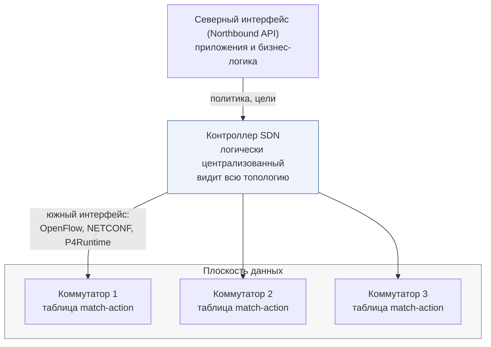

# Глава 5 — Дополнение: SDN и NDP

> Дополнение к главе 5 «Сетевой уровень». Tanenbaum, 6-е изд. рассматривает SDN кратко (раздел 5.6) и **не раскрывает NDP вообще** — в IPv6 ARP заменён на ICMPv6-сообщения, но учебник об этом молчит. Здесь teoria, которая закрывает эти пробелы.

**Связано:** [[Глава 5]] · [[Словарь сокращений]]

---

## Часть 1. SDN — программно-конфигурируемые сети

### 1.1 Почему появился SDN

Классический маршрутизатор — монолит: плоскость управления и плоскость данных находятся в одной коробке, у каждого вендора свой CLI, своя таблица переадресации, своя логика принятия решений. Изменение политики требует обхода каждого устройства вручную.

SDN разделяет эти функции. Контроллер видит всю топологию и диктует коммутаторам правила, а коммутаторы только исполняют их.

### 1.2 Три плоскости

| Плоскость            | Задача                            | Где находится                 |
| -------------------- | --------------------------------- | ----------------------------- |
| Плоскость управления | вычисляет пути, задаёт политику   | контроллер (централизованно)  |
| Плоскость данных     | пересылает пакеты по таблицам     | коммутаторы (распределённо)   |
| Плоскость приложений | балансировка, фаервол, мониторинг | приложения поверх контроллера |

> [!tip]- «Логически централизованный»
> Контроллер может быть кластером из нескольких серверов, но для плоскости данных он выглядит как одна точка управления. Это не отказ от распределённости, а абстракция над ней.

### 1.3 Южный интерфейс: OpenFlow и таблица match-action

Таблица коммутатора в SDN — это набор правил «совпадение → действие → счётчик». Совпадение идёт по полям заголовка пакета: MAC-адреса, IP-адреса, TCP/UDP-порты, DSCP. Действие: переслать в порт, отбросить, изменить поле, отправить контроллеру.

| Компонент | Смысл                                                         |
| --------- | ------------------------------------------------------------- |
| Match     | поля заголовка пакета (src/dst IP, порт, протокол, DSCP)      |
| Action    | что сделать: forward, drop, modify, packet-in (к контроллеру) |
| Counter   | статистика срабатываний правила                               |

OpenFlow — первый массовый протокол южного интерфейса. Позже появились NETCONF/YANG (конфигурация устройств) и P4 (программирование конвейера обработки пакетов, а не только заполнение таблиц).

> [!danger]- Проблема OpenFlow
> В классической реализации коммутатор не умеет сам принимать решение по новому потоку: если совпадения нет, пакет шлётся контроллеру. При большом числе новых потоков контроллер становится бутылочным горлышком. Именно поэтому в дата-центрах использовали ограниченный набор действий, а в глобальных сетях OpenFlow не прижился.

### 1.4 P4 и программируемая плоскость данных

P4 — язык для описания конвейера обработки пакетов: парсер, таблицы match-action, депарезер. Он позволяет изменить саму логику переадресации, а не только заполнить таблицу уже существующего коммутатора.

| OpenFlow                               | P4                                           |
| -------------------------------------- | -------------------------------------------- |
| Заполняет таблицы готового коммутатора | Описывает, как коммутатор обрабатывает пакет |
| Ограничен набором действий вендора     | Можно определить новые поля и действия       |
| Стандарт южного API                    | Язык описания плоскости данных               |

### 1.5 Где применяется SDN

- Дата-центры: виртуализация сети, миграция виртуальных машин, микросегментация
- Трафик-инженерия: перенос потоков между ссылками в обход shortest-path
- Безопасность: централизованный фаервол, изоляция сегментов
- Telemetry: INT (In-band Network Telemetry) — задержка на каждом транзитном участке

> [!note]- Что в учебнике, а что нет
> Учебник (раздел 5.6) даёт SDN примерно на одну страницу: разделение плоскостей, OpenFlow, RMT, P4, телеметрию. Ниже — то, чего в учебнике нет: проблемы масштабируемости контроллера, southern/northern API, match-action, P4 как язык, реальные области применения.

### 1.6 Недостатки и границы SDN

- Контроллер — единая точка отказа (если не кластеризован)
- Задержка реакции: пакет нового потока ждёт решения контроллера
- Сложность миграции: существующая сеть работает на распределённых протоколах (OSPF, BGP)
- Не всё оборудование поддерживает OpenFlow или P4

---

## Часть 2. NDP — Neighbor Discovery Protocol (IPv6)

> [!bug]- В учебнике нет NDP
> Tanenbaum 6-е изд. в разделе 5.7.3 (IPv6) описывает заголовок, адресацию, MTU, расширенные заголовки, но **не раскрывает NDP**. В IPv4 роль NDP выполняет ARP (раздел 5.7.1), а в IPv6 ARP удалён — вместо него ICMPv6-сообщения NDP. Это осознанное упрощение учебника, а не ошибка.

### 2.1 Зачем нужен NDP

В IPv4 хост узнаёт MAC-адрес шлюза через ARP: широковещательный запрос «кто имеет IP X?». В IPv6 нет широковещания как такого (есть многоадресная рассылка), и ARP удалён из-за проблем с масштабируемостью и безопасностью. NDP делает то же самое и больше.

| Функция                                 | IPv4                 | IPv6 (NDP)                            |
| --------------------------------------- | -------------------- | ------------------------------------- |
| Разрешение адресов (IP → MAC)           | ARP                  | Neighbor Solicitation / Advertisement |
| Поиск маршрутизатора                    | не стандартизировано | Router Solicitation / Advertisement   |
| Автоконфигурация адреса                 | DHCP (или вручную)   | SLAAC через RA                        |
| Обнаружение дубликатов адреса           | нет                  | Duplicate Address Detection           |
| Достижимость соседа                     | нет                  | Neighbor Unreachability Detection     |
| Перенаправление (лучший следующий узел) | ICMP Redirect        | ICMPv6 Redirect                       |

NDP использует **ICMPv6** (типы 133–137) и **многоадресные адреса** вместо широковещания — это снижает нагрузку на хосты, не участвующие в обмене.

### 2.2 Сообщения NDP

| Сообщение | Тип ICMPv6 | Кто шлёт | Зачем |
| --- | --- | --- | --- |
| Router Solicitation (RS) | 133 | Хост | «Маршрутизаторы, пришлите RA» |
| Router Advertisement (RA) | 134 | Маршрутизатор | Префиксы, флаги, MTU, шлюз по умолчанию |
| Neighbor Solicitation (NS) | 135 | Хост или маршрутизатор | «Кто имеет этот IPv6? пришли MAC» |
| Neighbor Advertisement (NA) | 136 | Хост или маршрутизатор | Ответ на NS: «Я, мой MAC — Y» |
| Redirect | 137 | Маршрутизатор | «Используйте другого next-hop для этого адреса» |

NS и NA отправляются на **многоадресный адрес solicited-node** (`ff02::1:ff00:0/104` плюс последние 24 бита целевого IPv6-адреса), а не широковещанием — получает пакет только заинтересованный узел.

### 2.3 Как хост получает адрес (SLAAC)

1. Хост генерирует **link-local адрес** `fe80::/10` + идентификатор интерфейса (например, из MAC через EUI-64 или стабильный приватный адрес).
2. Хост шлёт **Neighbor Solicitation** со своим link-local адресом — **DAD**: проверяет, не занят ли адрес. Если приходит NA — адрес занят, выбирает другой.
3. Хост шлёт **Router Solicitation** — просит RA от маршрутизаторов.
4. Маршрутизатор отвечает **RA** с префиксом сети (например, `2001:db8:1::/64`), флагами и временем жизни.
5. Хост складывает префикс + идентификатор интерфейса → **глобальный уникальный адрес**. Это и есть SLAAC (Stateless Address Autoconfiguration).
6. Если в RA флаг **M** (Managed) — адрес получает также через DHCPv6 (stateful).

### 2.4 Разрешение адресов (IPv6 → MAC)

Аналогично ARP, но без широковещания:

1. Хост А хочет отправить пакет на IPv6 B, не знает MAC B.
2. А шлёт **Neighbor Solicitation** на многоадресный solicited-node адрес B.
3. Только B (или узел, замещающий за B) получает NS и отвечает **Neighbor Advertisement** со своим MAC unicast обратно А.
4. А кэширует пару IPv6 → MAC в **neighbor cache** (IPv6-аналог ARP-кэша).
5. Если соседа нет в сети долго — кэш устаревает, применяется **NUD** (Neighbor Unreachability Detection): повторные NS до подтверждения достижимости.

### 2.5 Сравнение ARP и NDP

| Характеристика | ARP (IPv4) | NDP (IPv6) |
| --- | --- | --- |
| Протокол | отдельный протокол | часть ICMPv6 |
| Способ доставки | широковещание | многоадресная рассылка solicited-node |
| Кто обрабатывает | все хосты в LAN | только заинтересованные узлы |
| Автоконфигурация | нет | SLAAC + DAD |
| Поиск маршрутизатора | нет | RS / RA |
| Проверка достижимости | нет | NUD |
| Перенаправление | ICMP Redirect | ICMPv6 Redirect |

> [!danger]- Уязвимость NDP
> Как и ARP, NDP не защищен криптографически по умолчанию. Атака **NDP spoofing**: злоумышленник шлёт поддельные NA и перехватывает трафик. Защита: **SEND** (SEcure Neighbor Discovery, RFC 3971) с криптографически подписанными сообщениями, но на практике SEND редко внедряется.

---

## Часть 3. Что взять с собой в главу 5

| Что добавили | Где пригодится в главе 5 |
| --- | --- |
| SDN — разделение плоскостей | 5.6 SDN, 5.7.5 MPLS (общая идея абстракции пересылки) |
| OpenFlow match-action | 5.6, таблица переадресации коммутатора |
| NDP вместо ARP | 5.7.1 (ARP), 5.7.3 (IPv6) — замена ARP в IPv6 |
| SLAAC / DAD | 5.7.3 — как хост получает IPv6-адрес без DHCP |
| NUD и neighbor cache | 5.3 — потеря пакетов и достижимость соседей |

---

> [!info]- Теория, которой нет в учебнике
> NDP полностью отсутствует в Tanenbaum 6-е изд. SDN представлен кратко (раздел 5.6). Всё остальное выше — общая сетевая теория, которая помогает понять, почему в IPv6 нет ARP и зачем нужен контроллер вместо разрозненных таблиц маршрутизации.

---

## Mini-тест (без ответов)

**1.** Какие две плоскости разделяет SDN?

- A) плоскость сигнализации и плоскость пользовательских данных
- B) плоскость управления и плоскость данных
- C) плоскость маршрутизации и плоскость пересылки
- D) плоскость доступа и плоскость ядра

**2.** Что делает коммутатор OpenFlow, если пакет не совпал ни с одним правилом таблицы?

- A) выбрасывает пакет
- B) пересылает по кратчайшему пути сам
- C) отправляет пакет контроллеру (packet-in)
- D) запрашивает путь у соседнего коммутатора

**3.** Какой протокол использует NDP для своих сообщений?

- A) UDP
- B) TCP
- C) ICMPv6
- D) IGMP

**4.** Как IPv6-хост узнаёт, не занят ли выбранный им link-local адрес?

- A) ARP-запросом
- B) Neighbor Solicitation (DAD)
- C) DHCPv6 REQUEST
- D) Router Advertisement

**5.** На какой адрес отправляется Neighbor Solicitation?

- A) широковещательный IPv6
- B) solicited-node multicast адрес цели
- C) адрес маршрутизатора по умолчанию
- D) адрес всех узлов (ff02::1)

**6.** Что делает маршрутизатор в Router Advertisement?

- A) запрашивает адреса у хостов
- B) раздаёт префиксы сети, флаги и MTU
- C) проверяет дубликаты адресов
- D) перенаправляет трафик на лучший next-hop

**7.** Чем NDP отличается от ARP по способу доставки запроса?

- A) NDP использует широковещание, ARP — многоадресную рассылку
- B) ARP использует широковещание, NDP — многоадресную рассылку solicited-node
- C) оба используют широковещание
- D) оба используют многоадресную рассылку

**8.** За что отвечает флаг M в RA?

- A) адрес можно получить через DHCPv6
- B) адрес можно получить только через SLAAC
- C) маршрутизатор является шлюзом по умолчанию
- D) MTU сети больше 1500

---

## Разбор ошибок микро-теста

В тесте один вопрос с ошибкой — **Вопрос 2**.

### Вопрос 2 — packet-in: коммутатор не выбрасывает неизвестный пакет

Ты выбрал вариант A — «выбрасывает пакет». В OpenFlow это не так: если пакет не совпал ни с одним правилом таблицы match-action, коммутатор использует механизм **packet-in** — оборачивает пакет и отправляет контроллеру. Контроллер решает, куда переслать пакет, и устанавливает новое правило в таблицу коммутатора. Так SDN «обучает» коммутатор на лету.

| Вариант | Что происходит | Почему не так |
| --- | --- | --- |
| A — выбросить пакет | пакет теряется | поведение «глупого» коммутатора без контроллера, не OpenFlow SDN |
| C — packet-in | пакет шлётся контроллеру | контроллер принимает решение и пишет правило в таблицу |

> [!tip]- Как запомнить
> В классическом коммутаторе таблица заполняется автономно (обратное обучение по MAC). В SDN таблица может быть пустой на старте — первый пакет нового потока всегда идёт к контроллеру за инструкцией.

Остальные семь вопросов зачтёны верно: SDN разделяет плоскость управления и данные (B), NDP работает поверх ICMPv6 (C), проверка занятости link-local адреса через Neighbor Solicitation / DAD (B), solicitation уходит на solicited-node multicast цели (B), Router Advertisement раздаёт префиксы и флаги (B), ARP использует широковещание, а NDP — solicited-node multicast (B), флаг M в RA означает, что адрес можно получить через DHCPv6 (A).
