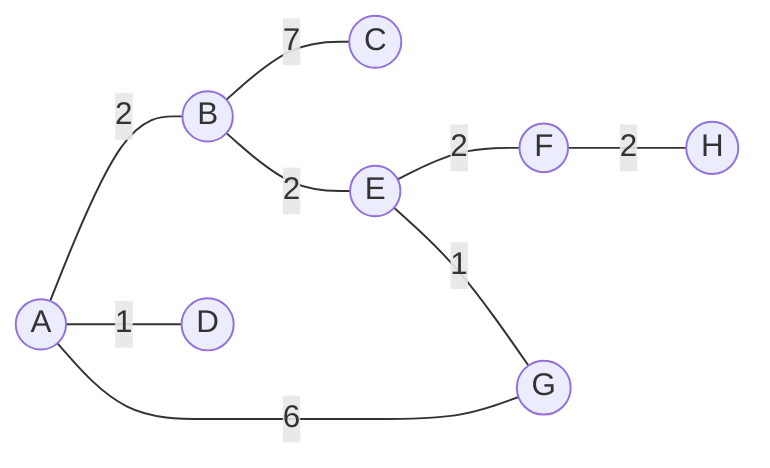

# Глава 5 — Маршрутизация, перегрузка и QoS

> Подробный разбор вычислительного ядра главы 5: разделы **5.1–5.4**.
> Здесь собраны алгоритмы, которые надо уметь считать, и числа, которые надо помнить.
> Обзор всей главы — IP, IPv6, OSPF, BGP, MPLS — в [[Глава 5]].

**Связано:** [[Глава 5]] · [[Глава 5 — Разбор пробелов]]

---

## Как устроен разбор

Глава 5 выглядит как набор несвязанных тем: алгоритмы маршрутизации, перегрузка, QoS, IP-адреса, BGP. На самом деле у неё есть один стержень.

Сначала сеть должна решить, **где хранить состояние**: на концах или внутри. Это развилка «дейтаграммы или виртуальные каналы». От неё зависят адресация, поведение при отказе и то, насколько легко дать гарантии качества.

Потом сеть должна решить две задачи:

1. **Куда отправить пакет** — это маршрутизация.
2. **Что делать, если пакетов слишком много** — это управление перегрузкой и QoS.

Дальше начинается инженерия: как алгоритмы превращаются в OSPF, BGP и MPLS и почему политика оказывается сильнее техники.

---

# Часть 1. Развилка: дейтаграммы или виртуальные каналы

## 1.1 Один вопрос — четыре следствия

Сетевой уровень может предложить транспорту две разные службы.

| Вопрос | Дейтаграммы | Виртуальные каналы |
| --- | --- | --- |
| Где хранится состояние | на концах | в маршрутизаторах |
| Что в пакете | полный адрес получателя | короткий номер канала |
| Кто выбирает путь | каждый маршрутизатор для каждого пакета | один раз при установлении |
| Что при отказе | пакеты идут в обход | все каналы через узел рвутся |
| Как дать QoS | трудно, нужны классы или резервирование | легче, ресурсы уже закреплены |
| Цена | глобальные адреса и поиск по таблице | установка и память на каждый канал |

Это не спор о вкусах. Это выбор, который определяет всю архитектуру сети.

> [!tip]- Почему в виртуальном канале номер короткий
> В дейтаграммной сети адрес должен быть глобально уникальным: иначе маршрутизатор не поймёт, куда отправлять пакет. В сети виртуальных каналов номер уникален только **в пределах одной линии**. На каждом шаге он заменяется — и это не ошибка, а экономия.
>
> Представьте три участка: A → R1, R1 → R2, R2 → R3. На первом участке канал может называться 1, на втором — 2, на третьем — 3. Маршрутизатор R1 хранит пару «вход: порт 1, VC 1» → «выход: порт 2, VC 2». На другом порту номер 1 может принадлежать совсем другому соединению. Полный адрес получателя во всех пакетах не нужен.

## 1.2 Что ломается при отказе

Разница в состоянии проявляется в самый неприятный момент — когда что-то падает.

| Сценарий | Дейтаграммы | Виртуальные каналы |
| --- | --- | --- |
| Узел выключился | маршрутизаторы соседей пересчитают пути, следующие пакеты пойдут в обход | все каналы через узел обрываются, нужна новая установка |
| Линия перегружена | можно временно пустить пакеты другим путём | канал привязан к пути, менять его на ходу сложно |
| Пакет потерян | транспортный уровень повторяет | транспортный уровень повторяет, но канал может быть уже разорван |
| Нужно срочное сообщение | каждое сообщение конкурирует со всеми | можно зарезервировать ресурсы |

Отсюда главный компромисс: **дейтаграммы устойчивее, виртуальные каналы предсказуемее**.

## 1.3 Почему интернет выбрал дейтаграммы

Причин три.

1. **Сквозной принцип.** Если хост умеет проверять ошибки и управлять потоком, не надо делать ту же работу в каждом маршрутизаторе. Сеть остаётся простой, а сложность уезжает на концы.
2. **Устойчивость.** ARPANET строился с расчётом на то, что часть сети может исчезнуть. Дейтаграммы переживают отказ узла без переустановки соединений.
3. **Гетерогенность.** Разные сети умеют разное. Общий «тонкий» сервис объединить проще, чем общий «толстый» с гарантиями.

ATM пытался предложить виртуальные каналы с гарантиями и проиграл IP. Но идея не умерла: MPLS и туннели — это снова виртуальные каналы, только не вместо IP, а под ним или рядом с ним.

> [!warning]- «Виртуальный канал» ≠ «коммутация каналов»
> В телефонной сети полоса физически выделена на весь разговор. Виртуальный канал — это запись в таблице, а не отдельная физическая линия: по той же линии могут идти и другие соединения. Ресурсы при установке можно зарезервировать, но сам по себе VC телефонных гарантий не даёт.

---

# Часть 2. Маршрутизация: как выбрать путь

## 2.1 Принцип оптимальности: почему путь — это дерево

**Принцип оптимальности:** если узел J лежит на оптимальном пути из I в K, то участок J → K тоже оптимален.

Доказательство от противного. Пусть J → K не оптимален. Тогда существует более короткий путь J → K. Заменим им участок исходного пути — получим путь I → K короче исходного. Противоречие.

Следствие: множество оптимальных маршрутов от всех узлов к одному получателю образует **входное дерево (sink tree)** с корнем в получателе. В дереве нет циклов, поэтому пакет гарантированно дойдёт за конечное число шагов.

Если оптимальных путей несколько, получается **направленный ациклический граф (DAG)** — дерево с «перемычками», но всё ещё без циклов.

В этой сети входное дерево к A — это A–B, A–D, B–C, B–E, E–F, E–G, F–H. Именно его мы получим алгоритмом Дейкстры.

> [!note]- Зачем это нужно на практике
> Принцип оптимальности — эталон. Реальные маршрутизаторы видят топологию по-разному и узнают об изменениях с задержкой, поэтому их деревья временно расходятся. Но если алгоритм строит пути, которые **не** являются деревом, где-то обязательно появится петля или лишний переход.

## 2.2 Дейкстра руками: граф из книги

Возьмём граф из раздела 5.2.2. Рёбра и веса:

| Ребро | Вес |
| --- | --- |
| A–B | 2 |
| A–D | 1 |
| A–G | 6 |
| B–C | 7 |
| B–E | 2 |
| E–F | 2 |
| E–G | 1 |
| F–H | 2 |

Нужны кратчайшие пути от A до всех остальных. Работаем так: постоянные метки — окончательные, временные — лучшие из известных. На каждом шаге выбираем временную метку с наименьшим значением и делаем её постоянной.

| Шаг | Постоянный узел | Что обновили | Временные метки после шага |
| --- | --- | --- | --- |
| 0 | A = 0 | B = 2, D = 1, G = 6 | B 2, D 1, G 6 |
| 1 | D = 1 | ничего | B 2, G 6 |
| 2 | B = 2 | C = 9, E = 4 | C 9, E 4, G 6 |
| 3 | E = 4 | F = 6, G = 5 | C 9, F 6, G 5 |
| 4 | G = 5 | ничего | C 9, F 6 |
| 5 | F = 6 | H = 8 | C 9, H 8 |
| 6 | H = 8 | ничего | C 9 |
| 7 | C = 9 | готово | — |

Итоговая таблица:

| Узел | Кратчайшее расстояние | Предыдущий узел |
| --- | --- | --- |
| B | 2 | A |
| C | 9 | B |
| D | 1 | A |
| E | 4 | B |
| F | 6 | E |
| G | 5 | E |
| H | 8 | F |

Проверим самый длинный путь: A → B → E → F → H = 2 + 2 + 2 + 2 = **8**. Через G было бы 2 + 2 + 1 + ? — из G в H ребра нет, пришлось бы возвращаться, и путь всё равно оказался бы длиннее.

> [!danger]- Почему Дейкстра не любит отрицательные веса
> Алгоритм объявляет метку постоянной, когда выбирает минимум. Если дальше найдётся ребро с отрицательным весом, «постоянная» метка может стать меньше — и алгоритм ошибётся. Для отрицательных весов нужен Беллман — Форд, но в сетях отрицательных задержек не бывает.

Сложность книжной реализации — `O(n²)` по числу узлов. Для больших сетей это дорого, поэтому на практике используют двоичные кучи и другие структуры, но идея та же.

## 2.3 Лавина: дорого, зато без таблиц

Лавинная адресация отправляет пакет по **всем линиям, кроме той, по которой он пришёл**. Без ограничений это катастрофа: число копий растёт экспоненциально.

Три способа укротить лавину:

| Способ | Как работает | Ограничение |
| --- | --- | --- |
| Счётчик переходов | пакет умирает через N шагов | не отличает дубликат от новой копии |
| Порядковые номера | узел помнит, какие пакеты уже видел | нужна память на источник |
| Возраст | пакет удаляется по достижении нуля | нужен общий источник времени |

В сети с 32-битными порядковыми номерами при отправке раз в секунду переполнение наступит через **137 лет**. Поэтому о нём можно не думать.

Лавина полезна там, где нет доверия к таблицам: в военных сетях, при широковещании и при распространении LSP в протоколах состояния линий. Она не требует, чтобы маршрутизатор знал топологию, — только чтобы умел принимать и пересылать.

## 2.4 Вектор расстояний: считаем вместе с J

Каждый маршрутизатор хранит вектор «до каждого адресата — расстояние и выходная линия». Раз в T миллисекунд он отправляет вектор соседям. Получив вектор соседа X, маршрутизатор прибавляет стоимость линии до X и выбирает минимум. **Своя старая таблица в расчёте не участвует** — это важно.

Книжный пример. Маршрутизатор J измерял задержки до соседей:

| Сосед | Задержка J → сосед |
| --- | --- |
| A | 8 мс |
| I | 10 мс |
| H | 12 мс |
| K | 6 мс |

Соседи прислали свои задержки до G:

| Сосед | Задержка соседа до G | Итог для J |
| --- | --- | --- |
| A | 18 мс | 18 + 8 = 26 мс |
| I | 31 мс | 31 + 10 = 41 мс |
| H | 6 мс | 6 + 12 = **18 мс** |
| K | 31 мс | 31 + 6 = 37 мс |

Победил H: **18 мс**. J записывает в таблицу «G — через H, 18 мс».

> [!tip]- Почему нельзя использовать свою старую таблицу
> Старая запись J могла быть «G через H, 18 мс». Если H пришлёт новый вектор, J должен пересчитать всё заново от соседей. Если же J будет цепляться за старую запись, он может «подтвердить» устаревший путь и застрять в петле.

### Счёт до бесконечности

Хорошие новости распространяются за один обмен. Плохие — медленно. Рассмотрим линейную сеть A–B–C–D–E, где расстояние измеряется числом переходов. Изначально A работает, и расстояния до него: B = 1, C = 2, D = 3, E = 4. Затем A выключается.

| Момент | B | C | D | E |
| --- | --- | --- | --- | --- |
| Изначально | 1 | 2 | 3 | 4 |
| После 1 обмена | 3 | 2 | 3 | 4 |
| После 2 обменов | 3 | 4 | 3 | 4 |
| После 3 обменов | 5 | 4 | 5 | 4 |
| После 4 обменов | 5 | 6 | 5 | 6 |
| После 5 обменов | 7 | 8 | 7 | 8 |
| После 6 обменов | … | … | … | … |

Почему B решил, что до A стало 3? C сказал «у меня 2». B прибавил переход до C и получил 3. Беда в том, что путь C к A идёт **через B**. C не может этого знать: в векторе расстояний нет информации о пути, только число.

Расстояние растёт, пока не упрётся в «бесконечность» — длину самого длинного пути плюс один.

Лекарства:

- **расщепление горизонта** — не сообщать соседу путь, который узнал от него;
- **отравленный ответ (poisoned reverse)** — сообщать такой путь с бесконечностью;
- **ограничение бесконечности** — маленькое число вместо настоящей бесконечности.

По книге все эти эвристики с красивыми названиями на практике оказались почти бесполезными. Корень проблемы — отсутствие информации о пути. Радикальное решение — перейти к состоянию линий.

## 2.5 Состояние линий: пять шагов

Маршрутизатор должен:

1. **Обнаружить соседей** — пакет HELLO по каждой линии.
2. **Измерить стоимость** — обычно обратно пропорциональна пропускной способности; можно через ECHO.
3. **Создать LSP** — идентификатор, порядковый номер, возраст, список соседей со стоимостями.
4. **Разослать LSP** — лавиной, с контролем дубликатов.
5. **Вычислить пути** — локально алгоритмом Дейкстры.

Тонкости:

- порядковый номер **32 бита** — переполнение через 137 лет;
- если маршрутизатор перезагрузился и начал с нуля, его пакеты примут за старые — спасает **возраст**, который уменьшается каждую секунду;
- широковещательная LAN представляется отдельным узлом графа, а роль этого узла играет **назначенный маршрутизатор (designated router)**;
- LSP рассылается не сразу, а ненадолго буферизуется: если за это время придёт более свежий, старый удаляется.

| Свойство | Вектор расстояний | Состояние линий |
| --- | --- | --- |
| Что знает маршрутизатор | расстояния от соседей | полную топологию |
| Что рассылает | весь вектор | LSP об изменениях |
| Скорость сходимости | медленная | быстрая |
| Память | меньше | `kn` |
| CPU | меньше | больше |
| Петли | счёт до бесконечности | петель нет |
| Примеры | RIP | OSPF, IS-IS |

## 2.6 Иерархия: 720 → 53 → 25

Большая сеть делится на области. Маршрутизатор знает детали своей области, а про чужие — только адреса и стоимость выхода.

Книжный расчёт для **720 маршрутизаторов**:

| Схема | Расчёт | Записей |
| --- | --- | --- |
| Без иерархии | 720 | 720 |
| 24 региона по 30 | 30 локальных + 23 удалённых | **53** |
| 8 кластеров × 9 регионов × 10 | 10 + 8 + 7 | **25** |

Проверим третий уровень: 8 × 9 × 10 = 720. Внутри своего региона — 10 записей. Другие регионы своего кластера — ещё 8. Остальные кластеры — 7. Итого 25.

Камоун и Клейнрок в 1979 году показали: оптимальное число уровней — `ln N`, а таблица занимает около `e ln N` записей. Для 720 это `ln 720 ≈ 6,6` уровня и `e · 6,6 ≈ 18` записей. Книжные 25 — близко к этой оценке.

Плата за экономию — **удлинение пути**. В книжном примере с пятью регионами полная таблица маршрутизатора 1A содержит 17 записей, иерархическая — 7. Но лучший путь от 1A до 5C идёт через регион 2, а иерархическая маршрутизация отправляет весь трафик в регион 5 через регион 3: так лучше для большинства адресатов региона.

> [!warning]- Иерархия — это не только экономия памяти
> Она ещё и политика. Разбиение на области может быть выбрано так, чтобы трафик не проходил через неудобную сеть. Поэтому «оптимальный» путь в иерархической сети — это оптимальный путь **при данных границах областей**, а не глобально оптимальный.

## 2.7 Широковещание: 23 против 14

| Метод | Идея | Цена |
| --- | --- | --- |
| Рассылка копий | отдельный пакет каждому | нужен список всех |
| Многоадресная маршрутизация | в пакете список адресатов или битовая карта | нужен список, но линии делятся |
| Лавина | всем, кроме входной линии | дубликаты |
| RPF | принять, только если пакет пришёл по линии к источнику | нужен маршрут к источнику |
| Связующее дерево | заранее выбрать дерево без циклов | нужно знать дерево |

**RPF (reverse path forwarding)** работает так. Пришёл широковещательный пакет — маршрутизатор смотрит, по той ли линии он пришёл, которая ведёт **к источнику** при обычной передаче. Если да, пакет, скорее всего, первый и пришёл по лучшему пути — рассылаем дальше по всем линиям, кроме входной. Если пакет пришёл по другой линии, это вероятный дубликат — выбрасываем.

Книжный пример от маршрутизатора I:

| Метод | Пакетов | Переходов |
| --- | --- | --- |
| RPF | **23** | **5** |
| Входное дерево | **14** | **4** |

RPF проигрывает дереву, потому что не все принятые пакеты оказываются полезными: часть дубликатов отсеивается только на следующих шагах. Зато RPF не требует хранить дерево — достаточно знать путь к источнику.

## 2.8 Многоадресная и произвольная рассылка

**Multicast.** Группа — это набор получателей. Для плотных групп подходит лавина с отсечением ветвей, где нет членов группы (MOSPF, DVMRP, сообщения PRUNE). Для разреженных — дерево с корнем в ядре (core-based tree): все члены шлют пакеты в ядро, дерево строится из пройденных путей. Так работает PIM.

Книжный пример: связующее дерево использует 10 соединений. Для группы 1 после отсечения остаётся 7, для группы 2 — 5.

Почему не всегда используют дерево с корнем в отправителе? Потому что для каждой пары «отправитель — группа» нужно своё дерево. Если групп `n`, а членов в среднем `m`, получается `mn` деревьев. Дерево с корнем в ядре одно на группу, но путь может быть длиннее.

**Anycast.** Пакет идёт **ближайшему** члену группы. Все члены получают один и тот же адрес, и протокол маршрутизации просто выбирает кратчайший путь к этому адресу. Ему не важно, что физически экземпляров несколько. Примеры: корневые DNS-серверы, CDN, NTP.

---

# Часть 3. Перегрузка

## 3.1 Что происходит с очередью

Перегрузка — это когда нагрузка временно превышает возможности сети. Пакеты встают в очередь, задержка растёт, буферы переполняются, пакеты теряются. Потери запускают повторные передачи, те добавляют трафик — и сеть загружается ещё сильнее. В пределе наступает **обвал перегрузки**: полезная пропускная способность падает почти до нуля.

Простейшая модель — очередь M/M/1. Средняя задержка:

`T = (1/μ) / (1 − ρ) = 1 / (μ − λ)`, где `ρ = λ/μ`.

Книжный пример:

| Параметр | Значение |
| --- | --- |
| λ | 950 000 пакетов/с |
| μ | 1 000 000 пакетов/с |
| ρ | 0,95 |
| Задержка без конкуренции | 1 мкс |
| Средняя задержка | **20 мкс** |
| 30 маршрутизаторов | **600 мкс** |

Почему 20? `1 / (1 000 000 − 950 000) = 1 / 50 000 = 20 мкс`. Множитель `1/(1 − ρ)` при ρ = 0,95 равен 20.

| Загрузка ρ | Множитель задержки | Задержка при 1 мкс |
| --- | --- | --- |
| 0,5 | 2 | 2 мкс |
| 0,9 | 10 | 10 мкс |
| 0,95 | 20 | 20 мкс |
| 0,99 | 100 | 100 мкс |

> [!danger]- Главная ловушка
> При загрузке 95 % очередь не «немного растёт», а взрывается: множитель 20. При 99 % — 100. Поэтому сети проектируют с запасом, а не «под 100 %».
>
> И ещё: бесконечный буфер не спасает. Нейгл в 1987 году показал, что при бесконечной памяти маршрутизаторов перегрузка часто **ухудшается**. Пакеты ждут так долго, что отправители считают их потерянными и шлют копии. Сегодня это называют **bufferbloat** — излишней буферизацией.

## 3.2 Методы по времени реакции

| Когда действует | Метод | Суть |
| --- | --- | --- |
| Задолго | избыточная пропускная способность | построить сеть с запасом |
| Медленно | маршрутизация с учётом нагрузки | увести трафик с загруженных линий |
| При установке | управление допуском | не пускать поток, если ресурсов не хватит |
| При перегрузке | сброс нагрузки | отбрасывать часть пакетов |
| Постоянно | формирование трафика | сглаживать всплески |
| Раньше времени | RED | отбрасывать пакеты до заполнения буфера |
| Быстро | сдерживающие пакеты, ECN | сообщить источнику |
| На каждом шаге | обратное давление | притормозить предыдущий узел |

### Маршрутизация с учётом нагрузки и её качели

Идея простая: сделать вес линии функцией не только пропускной способности, но и текущей загрузки. Проблема — колебания.

Книжный пример: сеть разделена на запад и восток, соединённые линиями CF и EI. Основной трафик идёт по CF, она перегружена. Алгоритм видит задержку, переключает трафик на EI. Теперь перегружена EI. Следующее обновление возвращает трафик на CF. Таблицы начинают колебаться.

Лекарства:

- **несколько путей** — распределять трафик по обеим линиям;
- **медленная сходимость** — менять маршруты постепенно, чтобы система успевала стабилизироваться;
- **ручная настройка** — оператор меняет веса редко и осмысленно.

Именно поэтому интернет-протоколы обычно **не** корректируют пути по текущей нагрузке. Этим занимаются MPLS-туннели и SDN, где оператор может позволить себе более сложное управление.

### Управление допуском

В сети виртуальных каналов можно просто не создавать новый канал, если ресурсов не хватает. Это лучше, чем пустить всех и получить перегрузку.

Книжный пример: линия 100 Мбит/с, каждый канал обещает до 10 Мбит/с. Гарантированно можно пустить 10 каналов. Но если каналы редко работают на полную, статистическое мультиплексирование позволяет пустить больше — с некоторым риском.

### Сброс нагрузки: вино или молоко

| Стратегия | Кого выбрасывать | Для чего |
| --- | --- | --- |
| **Винная (wine)** | новые пакеты, старые сохранять | передача файлов: старые данные ещё нужны |
| **Молочная (milk)** | старые пакеты, новые сохранять | реальное время: опоздавший пакет бесполезен |

Маршрутизатор может сначала выбрасывать менее важные пакеты, если приложение их пометило. Но без стимула все помечают всё как «очень важное», поэтому метки приходится проверять и ограничивать.

## 3.3 Маркерное ведро: откуда 94 мс

**Дырявое ведро** пропускает пакеты с постоянной скоростью. Всплеск оно сглаживает, но свободную полосу не использует.

**Маркерное ведро** копит разрешения — маркеры. Пока ведро полно, можно отправить всплеск. Когда маркеры кончились, скорость падает до скорости их поступления.

Вывод формулы. За время всплеска `S` ведро отдаёт `B` байт запаса и получает `R·S` новых маркеров. Всего уходит `B + R·S`. С другой стороны, за то же время на максимальной скорости `M` уходит `M·S`. Приравниваем:

`B + R·S = M·S` → `S = B / (M − R)`.

Книжные числа:

| Параметр | Значение |
| --- | --- |
| B | 9600 Кбайт |
| M | 125 Мбайт/с |
| R | 25 Мбайт/с |
| S | **≈ 94 мс** |

> [!tip]- Почему не 96 мс
> Если считать в десятичных единицах: 9600 / (125 − 25) = 96 мс. Если в двоичных: 9600 КиБ / 100 МиБ/с = 9 830 400 / 104 857 600 = 0,09375 с = **93,75 мс**. Книга округляет до 94 мс, значит, использует двоичные единицы. На экзамене безопаснее помнить формулу, а не одно число.

Тот же расчёт в задаче 23 в конце главы: `B = 1 Мбайт`, `M = 50 Мбайт/с`, `R = 10 Мбайт/с`. Тогда `S = 1 / 40 с = 25 мс`.

Два ведра подряд дают более гладкий трафик: первое задаёт среднюю скорость и разрешает всплеск, второе ограничивает пиковую скорость этого всплеска.

## 3.4 RED, ECN и сдерживающие пакеты

**RED (Random Early Detection).** Маршрутизатор считает скользящее среднее длины очереди. Когда оно превышает порог, он **случайно** выбрасывает небольшую часть пакетов — до того, как буфер заполнится. Случайность важна: быстрые отправители с большей вероятностью заметят потерю и сбавят темп.

**ECN (Explicit Congestion Notification).** Вместо потери маршрутизатор ставит в заголовке IP бит «перегрузка». Получатель возвращает эту информацию отправителю в подтверждении, и тот снижает скорость. Пакет не теряется — сигнал доходит явно. В заголовке на это отведено **два бита**.

**Сдерживающие пакеты (choke packets).** Маршрутизатор отправляет источнику пакет «сбавь темп». Проблема: в перегруженной сети такие пакеты сами добавляют нагрузку. Поэтому их шлют только на низкой скорости и не чаще фиксированного интервала.

| Метод | Что делает | Плюс | Минус |
| --- | --- | --- | --- |
| RED | случайно выбрасывает до заполнения буфера | ранний сигнал, без дополнительных пакетов | нужна настройка порогов |
| ECN | помечает пакет | нет потери | нужна поддержка на концах |
| Choke packet | шлёт отдельный пакет | прямой сигнал | сам добавляет нагрузку |

---

# Часть 4. QoS

## 4.1 Чего хотят приложения

У приложений четыре параметра: пропускная способность, задержка, джиттер и потери. Строгость требований по книге:

| Приложение | Пропускная способность | Задержка | Джиттер | Потери |
| --- | --- | --- | --- | --- |
| Электронная почта | низкая | низкая | низкая | средняя |
| Передача файлов | высокая | низкая | низкая | средняя |
| Веб-доступ | средняя | средняя | низкая | средняя |
| Удалённый доступ | низкая | средняя | средняя | средняя |
| Аудио по запросу | низкая | низкая | высокая | низкая |
| Видео по запросу | высокая | низкая | высокая | низкая |
| Телефония | низкая | высокая | высокая | низкая |
| Видеоконференции | высокая | высокая | высокая | низкая |

Важно: требования приложения **строже**, чем требования к сети. Потери можно исправить повторной передачей, джиттер — буфером у получателя. Но низкую пропускную способность и большую задержку приложение исправить не может.

QoE (Quality of Experience) — то, что в итоге почувствовал пользователь. Сеть может выполнить формальные SLA и всё равно дать плохой опыт, если приложение плохо адаптируется.

## 4.2 Планировщики пакетов

| Алгоритм | Как выбирает | Проблема |
| --- | --- | --- |
| FIFO | в порядке прихода | один поток может захватить всё |
| Приоритетный | сначала высокий приоритет | низкий может голодать |
| Циклический (RR) | по одному пакету из каждой очереди | зависит от размера пакета |
| WFQ | по времени окончания отправки | `O(log N)` на пакет |
| DRR | с дефицитом, `O(1)` | приближение WFQ |

**WFQ** даёт каждому потоку вес `W`. Время окончания отправки:

`F_i = max(A_i, F_{i−1}) + L_i / W`,

где `A_i` — время прибытия, `L_i` — длина пакета. Пакеты сортируются по `F_i`; пакет с меньшим `F_i` уходит раньше, даже если пришёл позже.

Учебный пример, чтобы увидеть формулу. Поток 1 имеет вес 1, поток 2 — вес 2.

| Пакет | Поток | Прибытие | Длина | Время окончания |
| --- | --- | --- | --- | --- |
| Q1 | 2 | 0 | 1000 | 500 |
| P1 | 1 | 0 | 1000 | 1000 |
| P2 | 1 | 500 | 500 | 1500 |

Порядок отправки: Q1 → P1 → P2. Поток с весом 2 получил вдвое больше ресурса, хотя пакеты одного размера.

Книжный пример показывает то же самое качественно: пакет D приходит раньше F, но F имеет меньшее время окончания (16 против 20), поэтому F может уйти первым — если передача D ещё не началась. WFQ не прерывает уже начатую передачу, поэтому это приближение к идеальной побайтовой схеме.

Гарантия: если суммарная полоса `C`, а веса всех потоков `Σw`, потоку достанется не меньше `R = W·C / Σw` — при условии, что он сам не превышает эту скорость. Задержка в очереди при этом ограничена размером маркерного ведра и **не зависит от числа маршрутизаторов на пути**. Это сильное свойство: можно добавить ещё десять узлов, и гарантия останется.

## 4.3 IntServ и RSVP

Идея: перед передачей поток **резервирует** ресурсы на всём пути. Архитектура называлась **Integrated Services**; сигнальный протокол — **RSVP**. Стандарты появились в 1995–1997 годах (RFC 2205–2212).

Как это работает:

1. Получатель отправляет запрос на резервирование вверх по дереву.
2. Каждый маршрутизатор на пути резервирует полосу и буфер.
3. Если ресурсов не хватает, возвращается ошибка.
4. Состояние поддерживается периодическими сообщениями.

Плюс: настоящие гарантии на поток. Минусы:

- состояние **на каждый поток** — миллионы потоков не помещаются в маршрутизатор;
- установка каждого потока требует обмена;
- отказ маршрутизатора ломает все резервирования через него;
- сложно масштабировать на магистраль.

Поэтому IntServ/RSVP применяют редко.

## 4.4 DiffServ

Идея: не различать потоки, а различать **классы**. Пакет получает метку DSCP в поле Differentiated services, и каждый маршрутизатор обрабатывает его по классу — без состояния потока.

| Класс | Что даёт | Стандарт |
| --- | --- | --- |
| **EF** (Expedited Forwarding) | минимум задержки и потерь, «зелёная дорога» | RFC 3246 |
| **AF** (Assured Forwarding) | 4 класса приоритета × 3 класса сброса = **12 комбинаций** | RFC 2597 |
| **BE** (Best Effort) | обычный трафик | — |

Пограничный маршрутизатор проверяет, не превышает ли поток заявленный профиль, и при превышении понижает класс или выбрасывает пакеты. Внутри сети маршрутизаторы уже не считают потоки — только смотрят на метку. Для четырёх классов приоритетов часто используют WFQ: чем выше класс, тем выше вес. Внутри класса пакеты с высоким классом сброса удаляются первыми, например через RED.

| Свойство | IntServ | DiffServ |
| --- | --- | --- |
| Единица | поток | класс |
| Состояние | на каждый поток | нет |
| Установка | нужна | не нужна |
| Гарантии | точные | статистические |
| Масштабируемость | плохая | хорошая |
| Пример | RSVP | EF/AF |

> [!note]- Одним предложением
> IntServ резервирует **на каждый поток** и потому даёт точные гарантии, но не масштабируется. DiffServ делит трафик на **классы** и масштабируется, но гарантии у него статистические.

---

# Часть 5. Как теория стала протоколами

| Теория | Протокол | Что взял |
| --- | --- | --- |
| Дейкстра | OSPF, IS-IS | кратчайшие пути по полной топологии |
| Беллман — Форд | RIP | вектор расстояний |
| Вектор пути | BGP | AS path и политика |
| Виртуальные каналы | MPLS | короткая метка, LER/LSR |
| Иерархия | OSPF areas, BGP AS | области и автономные системы |
| Маркерное ведро | policing/shaping | проверка SLA |
| WFQ | DiffServ | взвешенные очереди |
| RED/ECN | TCP/IP | ранний сигнал перегрузки |

Полезно увидеть, что «скучные» алгоритмы из 5.2 — это не упражнение для экзамена. OSPF внутри области — это буквально Дейкстра по графу. BGP — это вектор расстояний, у которого вместо числа хранится путь и политика. MPLS — это виртуальные каналы, у которых номер канала называется меткой.

## Шпаргалка с числами

| Число | Что означает |
| --- | --- |
| **720 → 53 → 25** | записей в таблице при иерархии |
| **23 / 5** | пакетов / переходов у RPF |
| **14 / 4** | пакетов / переходов у входного дерева |
| **94 мс** | всплеск маркерного ведра в книжном примере |
| **20 мкс** | задержка M/M/1 при ρ = 0,95 вместо 1 мкс |
| **600 мкс** | то же на 30 маршрутизаторах |
| **12** | классов AF (4 × 3) |
| **137 лет** | переполнение 32-битного порядкового номера |
| **2 бита** | поле ECN в заголовке IP |
| **5** | шагов алгоритма состояния линий |

---

# Часть 6. Тест

> [!info]- Как проходить
> Вопросы и варианты — ниже. Ответы в файле не спрятаны: сначала ответь сам, потом мы разберём результаты в чате. Разбор ошибок попадёт в [[Глава 5 — Разбор пробелов]].

### Блок A. Маршрутизация

**1.** Маршрутизатор в сети виртуальных каналов вышел из строя. Что произойдёт с соединениями, проходящими через него?

- A) Ничего, пакеты пойдут в обход по альтернативному пути
- B) Все виртуальные каналы через него обрываются, их нужно устанавливать заново
- C) Теряются только пакеты, которые были в пути; следующие пойдут по другому маршруту
- D) Соединения сохранятся, но изменятся идентификаторы каналов

**2.** Что такое входное дерево (sink tree)?

- A) Дерево всех возможных путей между всеми парами узлов
- B) Объединение оптимальных маршрутов от всех узлов к одному получателю
- C) Дерево, построенное только алгоритмом Дейкстры
- D) Граф, в котором разрешены циклы

**3.** В графе книги (A–B 2, A–D 1, A–G 6, B–C 7, B–E 2, E–F 2, E–G 1, F–H 2) чему равен кратчайший путь A → C?

- A) 7
- B) 8
- C) 9
- D) 13

**4.** Зачем в пакете состояния линий (LSP) нужно поле возраста, если есть 32-битный порядковый номер?

- A) Чтобы ускорить алгоритм Дейкстры
- B) Чтобы удалить устаревшие сведения о выключенном маршрутизаторе
- C) Чтобы заменить порядковый номер при переполнении
- D) Чтобы выбирать designated router

**5.** Маршрутизатор J имеет четырёх соседей: A, I, H и K. Задержка линии от J до каждого соседа равна: J→A = 8 мс, J→I = 10 мс, J→H = 12 мс, J→K = 6 мс. Каждый сосед прислал J свой вектор расстояний; в нём расстояние **от этого соседа до G** составляет: A→G = 18 мс, I→G = 31 мс, H→G = 6 мс, K→G = 31 мс. J выбирает маршрут к G по алгоритму вектора расстояний. Через какого соседа пойдёт трафик и какова суммарная задержка?

- A) Через A, 26 мс
- B) Через I, 41 мс
- C) Через H, 18 мс
- D) Через K, 37 мс

**6.** Почему возникает счёт до бесконечности?

- A) Порядковые номера переполняются
- B) Маршрутизатор не знает, что предложенный соседом путь проходит через него самого
- C) Алгоритм Дейкстры требует неотрицательных весов
- D) Таблица маршрутизации слишком велика

**7.** Сеть из 720 маршрутизаторов разбили на 24 региона по 30. Сколько записей в таблице одного маршрутизатора?

- A) 30
- B) 53
- C) 720
- D) 25

**8.** Сколько пакетов и переходов требует широковещание от I методом RPF по сравнению с входным деревом?

- A) 23 пакета / 5 переходов против 14 / 4
- B) 14 / 4 против 23 / 5
- C) 23 / 4 против 14 / 5
- D) 10 / 4 против 7 / 5

### Блок B. Перегрузка и QoS

**9.** Маркерное ведро: B = 9600 Кбайт, M = 125 Мбайт/с, R = 25 Мбайт/с. Сколько примерно длится максимальный всплеск?

- A) 38 мс
- B) 77 мс
- C) 94 мс
- D) 192 мс

**10.** При λ = 950 000 пакетов/с и μ = 1 000 000 пакетов/с средняя задержка в очереди M/M/1 равна…

- A) 1 мкс
- B) 5 мкс
- C) 20 мкс
- D) 100 мкс

**11.** Чем ECN отличается от RED?

- A) ECN отбрасывает пакеты раньше, чем RED
- B) ECN помечает пакет вместо отбрасывания, а получатель сообщает отправителю
- C) ECN работает только в сетях виртуальных каналов
- D) ECN не использует заголовок IP

**12.** Пакет D пришёл раньше пакета F, но F имеет меньшее время окончания отправки. Что сделает WFQ?

- A) Отправит D первым, потому что он пришёл раньше
- B) Отправит F первым, если передача D ещё не началась
- C) Отбросит F
- D) Отправит оба одновременно

**13.** Сколько классов обслуживания даёт AF (Assured Forwarding)?

- A) 3
- B) 4
- C) 8
- D) 12

**14.** Главная проблема IntServ/RSVP?

- A) Не поддерживает multicast
- B) Требует состояния на каждый поток и плохо масштабируется
- C) Не умеет резервировать пропускную способность
- D) Работает только в дейтаграммных сетях

**15.** Какой протокол внутри автономной системы использует алгоритм Дейкстры?

- A) RIP
- B) BGP
- C) OSPF
- D) DHCP

---

> Дальше: ответы разбираются в чате, а ошибки — в [[Глава 5 — Разбор пробелов]].
