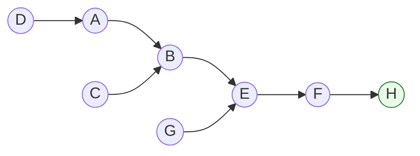
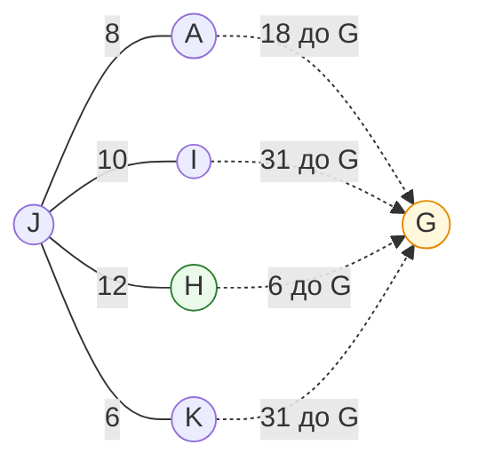
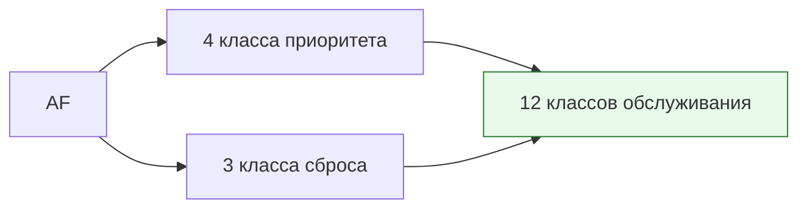

# Глава 5 — Разбор пробелов

> По результатам теста из [[Глава 5 — Маршрутизация, перегрузка и QoS]]: **12 верных из 14 отвеченных**.
> Вопрос № 5 не был понят — он разобран отдельно, как и две реальные ошибки: № 2 и № 13.

**Связано:** [[Глава 5]] · [[Глава 5 — Маршрутизация, перегрузка и QoS]]

---

## Сводка

| № | Тема | Что не так | Тип ошибки |
| --- | --- | --- | --- |
| 2 | Входное дерево | выбрано «все пути между всеми парами» вместо «все оптимальные пути к одному получателю» | пробел в понятии |
| 5 | Вектор расстояний | не разобрана запись «задержка до соседа + вектор соседа» | пробел в понятии |
| 13 | AF | запомнены 4 класса приоритета, потеряны 3 класса сброса | ошибка в числах |

Обе реальные ошибки — из одного корня: **похожие вещи не разведены**. Входное дерево похоже на «все пути», а четыре класса приоритета — на «четыре класса обслуживания». Стоит запомнить не числа, а границу между понятиями.

---

## 1. Входное дерево — это дерево к одному получателю

Ты выбрал вариант «дерево всех возможных путей между всеми парами узлов». Это не дерево, а скорее полный набор всех маршрутов сети: в нём есть циклы, и он описывает сразу все пары «источник — получатель».

**Входное дерево (sink tree)** — это множество оптимальных маршрутов **от всех узлов к одному получателю**. Корень дерева — получатель. Все стрелки сходятся к нему, как вода в сток.

В этой сети корень — H. Дерево содержит ровно `n − 1` рёбер (семь узлов — шесть рёбер) и не содержит циклов. Каждый узел имеет ровно один исходящий маршрут к H: например, A идёт через B, D — через A, G — через E.

Почему циклов быть не может? Если бы в оптимальном маршруте к H был цикл, его можно было бы вырезать и получить путь короче. А путь короче противоречит оптимальности. Это то же доказательство, что и у принципа оптимальности.

> [!tip]- Как проверить себя за пять секунд
> Задай три вопроса.
> 1. **Куда смотрят стрелки?** Если к одному корню — это входное дерево. Если в разные стороны — это что-то другое.
> 2. **Сколько рёбер?** В дереве на `n` узлов ровно `n − 1` ребро. Больше — уже граф с циклами.
> 3. **Для скольких получателей?** У входного дерева один получатель. Для каждого получателя — своё дерево.

Отдельно стоит запомнить: если оптимальных путей несколько, получается **DAG** — направленный ациклический граф. Он шире дерева, но всё ещё без циклов. DAG — это «дерево с перемычками», а не «все пути».

---

## 2. Вектор расстояний: что означают числа 8, 10, 12, 6

Вопрос № 5 был сформулирован слишком плотно. Разберём условие по частям.

Есть маршрутизатор J и четыре его соседа: A, I, H, K. J измерил задержки **до соседей**:

| Сосед | Задержка J → сосед |
| --- | --- |
| A | 8 мс |
| I | 10 мс |
| H | 12 мс |
| K | 6 мс |

Это стоимости линий. Они не имеют отношения к G.

От каждого соседа пришёл вектор — его собственные задержки **до всех адресатов**, в том числе до G:

| Сосед | Задержка соседа до G |
| --- | --- |
| A | 18 мс |
| I | 31 мс |
| H | 6 мс |
| K | 31 мс |

Теперь J считает стоимость маршрута через каждого соседа по формуле:

`D_J(G) = min по X [ c(J, X) + D_X(G) ]`

То есть «сколько стоит дойти до соседа» плюс «сколько сосед обещает идти от себя до G».

| Маршрут | Расчёт | Итог |
| --- | --- | --- |
| Через A | 8 + 18 | 26 мс |
| Через I | 10 + 31 | 41 мс |
| Через H | 12 + 6 | **18 мс** |
| Через K | 6 + 31 | 37 мс |

Победил H: **18 мс**. J записывает в таблицу «G — через H, 18 мс».

Две типичные ловушки:

- взять самого «близкого» соседа по вектору (H = 6) и забыть прибавить 12 мс до самого H;
- взять самую дешёвую линию (K = 6) и забыть, что K обещает 31 мс до G.

Правильный ответ — всегда **сумма**, а не минимум одного из слагаемых.

> [!warning]- Старая таблица J не участвует
> J не смотрит на свою прежнюю запись «G через H, 18 мс». Он строит новую таблицу только из векторов соседей и стоимостей линий. Иначе устаревший маршрут мог бы «подтвердить» сам себя, и network застряла бы в петле.

---

## 3. AF: четыре класса приоритета, но двенадцать классов обслуживания

Ты выбрал 4. Это правильное число **классов приоритета**, но не полное число классов AF.

В AF (Assured Forwarding, RFC 2597) есть две независимые оси:

- **4 класса приоритета** — условно золотой, серебряный, бронзовый и четвёртый;
- **3 класса сброса** — низкий, средний и высокий.

Каждая комбинация — отдельный класс обслуживания. Поэтому всего `4 × 3 = 12`.

Зачем нужны классы сброса? При перегрузке маршрутизатор сначала выбрасывает пакеты с **высоким** классом сброса, сохраняя пакеты с низким. Так внутри одного приоритета можно отличить «важный» трафик от «менее важного»: оба получают одинаковый приоритет, но при перегрузке выживает низкий класс сброса.

| Класс | Что это | Сколько |
| --- | --- | --- |
| EF | Expedited Forwarding, отдельный приоритетный класс | 1 |
| AF | 4 приоритета × 3 класса сброса | **12** |
| BE | Best Effort, обычный трафик | 1 |

Мнемоника: **AF — это не 4, а 4 × 3**. Четыре — только одна ось.

---

## 4. Что было верно, но держится на одном числе

Эти ответы прошли, но их легко потерять при другом наборе вариантов.

| Тема | Что помнить | Почему хрупко |
| --- | --- | --- |
| Маркерное ведро | `S = B/(M − R)` | 94 мс получается в двоичных единицах; в десятичных будет 96 мс |
| M/M/1 | `T = 1/(μ − λ)` | при ρ = 0,95 множитель 20, а не 1,05 |
| WFQ | порядок по `F_i`, а не по времени прихода | D пришёл раньше F, но F может уйти первым |
| RPF | 23 пакета / 5 переходов против 14 / 4 | числа легко переставить местами |
| Иерархия | 720 → 53 → 25 | 53 — это 30 локальных + 23 удалённых, а не 24 |

---

## 5. Что делать дальше

1. Перечитать в [[Глава 5 — Маршрутизация, перегрузка и QoS]] разделы **2.1** (принцип оптимальности) и **2.4** (вектор расстояний).
2. Пройти заново вопросы **2, 5 и 13** — уже с разбором, а не по памяти.
3. Проверить себя на числах: 720 → 53 → 25; 23/5 против 14/4; 94 мс; 20 мкс; 12 классов AF.
4. Если хочется глубже — в [[Глава 5]] есть сводная таблица «Что важно не перепутать» и раздел «Числа главы».

---

> [!note]- Итог
> Две ошибки — не про забытые числа, а про **границы понятий**. Входное дерево — это не «все пути», а пути к одному корню. AF — это не «четыре класса», а четыре приоритета, умноженные на три класса сброса. Если держать в голове эти границы, числа вспоминаются сами.
