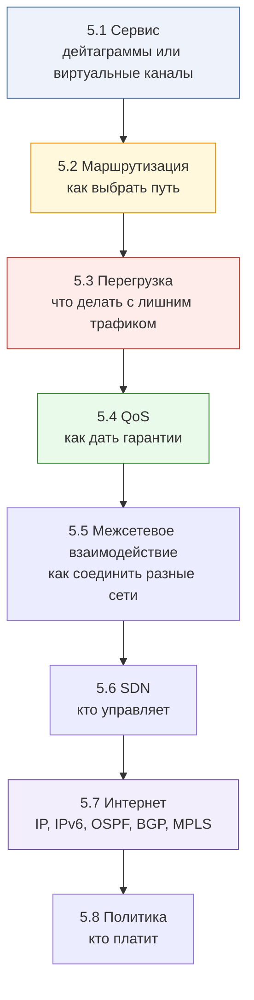
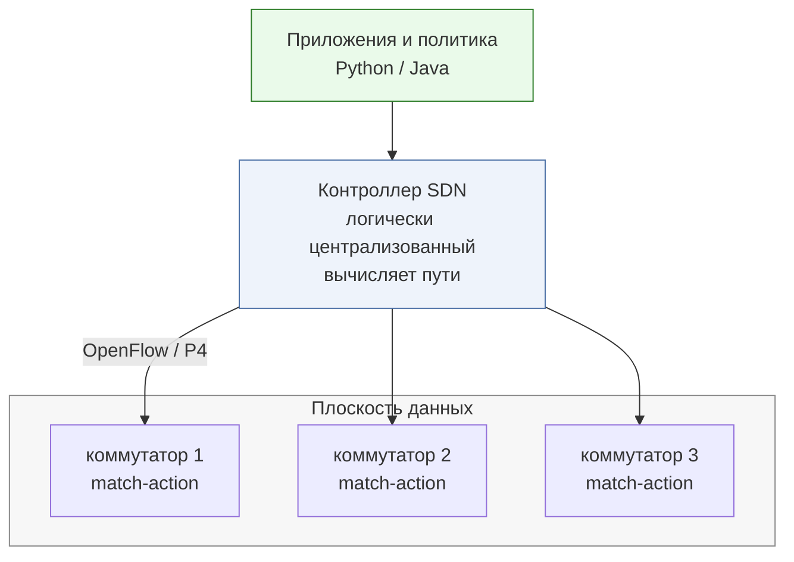

# Глава 5. Сетевой уровень

> Источник: Таненбаум, Фимстер, Кузеролл. *Компьютерные сети*, 6-е изд. — глава 5, страницы **412–563**.
> Все сокращения с расшифровками — в [[Словарь сокращений]].

**Связано:** [[Глава 4]] · [[Глава 6]] · [[Глава 5 — Маршрутизация, перегрузка и QoS]] — подробный разбор алгоритмов и расчётов · [[Глава 5 — Разбор пробелов]] · [[Глава 5 — Дополнение — SDN и NDP]] — SDN подробнее и NDP (чего нет в учебнике)

---

## О чём глава

Сетевой уровень — первый, который отвечает за доставку **от отправителя до получателя**, а не за один провод. Пакет проходит цепочку маршрутизаторов; каждый из них принимает пакет целиком, проверяет контрольную сумму и только потом пересылает дальше. Это коммутация пакетов с промежуточным хранением (store-and-forward).

Из этой простой обязанности вырастают четыре большие темы:

| Раздел | Вопрос | Ключевые понятия |
| --- | --- | --- |
| **5.1** | Какой сервис предложить транспортному уровню? | дейтаграммы против виртуальных каналов |
| **5.2** | Как выбрать путь? | Дейкстра, вектор расстояний, состояние линий, иерархия, широковещание, multicast, anycast |
| **5.3** | Что делать, когда трафика слишком много? | формирование, допуск, сброс нагрузки, RED, ECN |
| **5.4** | Как дать приложению гарантии? | WFQ, IntServ/RSVP, DiffServ |
| **5.5** | Как соединить разные сети? | туннелирование, фрагментация, MTU |
| **5.6** | Кто управляет сетью? | SDN, OpenFlow, P4, телеметрия |
| **5.7** | Как это сделано в интернете? | IPv4/IPv6, CIDR, NAT, ICMP, ARP, DHCP, MPLS, OSPF, BGP |
| **5.8** | Кто за это платит? | пиринг, приоритизация, сетевой нейтралитет |

> [!tip]- Две вещи, без которых глава рассыпается
> **1. Дейтаграммы или виртуальные каналы — это развилка.** От неё зависят адресация, память в маршрутизаторах, поведение при отказе и то, насколько легко обеспечить QoS. Всё остальное в главе — следствия.
> **2. Маршрутизация ≠ пересылка.** Маршрутизация заполняет таблицу; пересылка смотрит в неё для каждого пришедшего пакета. Дейкстра, Беллман — Форд и BGP — это про первое; поиск по таблице — про второе.

---

## 5.1 Вопросы разработки сетевого уровня

### 5.1.1 Коммутация с промежуточным хранением

Маршрутизатор — устройство с несколькими интерфейсами. Пакет приходит на входной интерфейс, **полностью принимается**, проверяется контрольная сумма, ищется выходная линия по таблице маршрутизации, и только затем пакет отправляется дальше. Отсюда две задержки: время передачи по линии и время ожидания в очереди.

### 5.1.2 Какой сервис предложить транспорту

К сервису предъявляют три требования:

1. Он не должен зависеть от технологии маршрутизатора.
2. Число, тип и топология маршрутизаторов не должны влиять на транспортный уровень.
3. Адреса должны быть едиными для всех сетей — LAN и WAN.

Дальше начинается спор двух лагерей.

| Лагерь | Позиция | Аргумент |
| --- | --- | --- |
| **Интернет** | Служба без установления соединения, best effort | Сеть ненадёжна по природе; хосты всё равно проверяют ошибки и управляют потоком. Сквозной принцип: не делать одну работу дважды |
| **Телефонные компании** | Служба с установлением соединения | Сто лет опыта; QoS и трафик реального времени проще гарантировать на соединении |

Книга отмечает: X.25 и Frame Relay были соединением, ARPANET и интернет — дейтаграммами. ATM пытался заменить IP, но проиграл. Сегодня идеи виртуальных каналов возвращаются в MPLS и туннелях — уже не вместо IP, а рядом с ним.

### 5.1.3 Дейтаграммная сеть

Каждый пакет несёт **полный адрес получателя** и передаётся независимо. Маршрутизатор хранит только пару «адресат → выходная линия». Если таблица изменилась между пакетами, пакеты одного сообщения могут пойти разными путями и прийти не по порядку — это нормально.

### 5.1.4 Сеть виртуальных каналов

Путь выбирается **один раз при установлении соединения** и записывается в таблицы всех маршрутизаторов. Каждый пакет несёт короткий **идентификатор виртуального канала**, а не полный адрес.

На каждом шаге идентификатор может меняться. Причина простая: два разных входящих канала могут использовать один и тот же номер, и только после коммутации становится ясно, куда их разводить. Маршрутизатор заменяет номер на новый — ровно так же, как это делает MPLS с метками.

### 5.1.5 Сравнение

| Вопрос | Дейтаграммы | Виртуальные каналы |
| --- | --- | --- |
| Установка канала | не требуется | требуется |
| Адресация | полный адрес в каждом пакете | короткий номер канала |
| Состояние в маршрутизаторах | не хранится | запись на каждый канал |
| Выбор маршрута | для каждого пакета | один раз при установке |
| Отказ маршрутизатора | теряются только пакеты в пути | все каналы через него обрываются |
| QoS | трудно | легко, если ресурсы зарезервированы |
| Борьба с перегрузкой | трудно | легко, если ресурсы зарезервированы |

> [!warning]- Почему «виртуальный канал» не равен «коммутации каналов»
> В телефонной сети полоса физически выделена на всё время разговора. Виртуальный канал — это **логическая** запись в таблице, а не отдельная физическая линия: по той же линии могут идти пакеты других соединений. Ресурсы при установке можно зарезервировать, но сам по себе VC телефонных гарантий не даёт.

---

## 5.2 Алгоритмы маршрутизации

Маршрутизация — выбор выходной линии. Пересылка — использование уже выбранной линии. Алгоритм должен быть корректным, простым, надёжным, устойчивым, справедливым и эффективным. Справедливость и эффективность часто конфликтуют: иногда выгоднее вообще остановить часть трафика, чем дать всем понемногу.

| Класс | Как работает | Примеры |
| --- | --- | --- |
| **Неадаптивные** (статические) | маршруты заданы заранее, на сбои не реагируют | статические записи |
| **Адаптивные** (динамические) | реагируют на топологию и/или нагрузку | RIP, OSPF, BGP |

### 5.2.1 Принцип оптимальности и входное дерево

**Принцип оптимальности:** если J лежит на оптимальном пути из I в K, то участок J → K тоже оптимален. Иначе его можно было бы заменить более коротким и улучшить весь путь — противоречие.

Из принципа следует, что все оптимальные маршруты к одному получателю образуют **входное дерево (sink tree)** с корнем в получателе. В дереве нет циклов, поэтому пакет доставляется за конечное число шагов. Если оптимальных путей несколько, получается **направленный ациклический граф (DAG)** — более общая форма дерева.

Реальные маршрутизаторы видят топологию по-разному и узнают об изменениях с задержкой, поэтому их деревья могут временно расходиться. Принцип оптимальности — эталон, с которым сравнивают алгоритмы, а не гарантия.

### 5.2.2 Алгоритм Дейкстры

Находит кратчайшие пути от одного узла до всех остальных. Работает на графе с **неотрицательными** весами. Каждому узлу присваивается метка: длина лучшего известного пути и предыдущий узел. Метка временная, пока не доказано, что она окончательная; затем она становится постоянной.

Сложность книжной реализации — `O(n²)` по числу узлов. Подробный расчёт на графе из книги — в [[Глава 5 — Маршрутизация, перегрузка и QoS]].

### 5.2.3 Лавинная адресация

Пакет отправляется по **всем линиям, кроме той, по которой пришёл**. Без ограничений это взрыв: дубликаты размножаются. Способы укрощения:

- **счётчик переходов** — пакет умирает через N шагов;
- **порядковые номера** — маршрутизатор помнит, какие пакеты уже видел;
- **возраст** — пакет удаляется, когда счётчик дойдёт до нуля.

Лавина полезна как эталон надёжности и как способ разослать информацию всем сразу. В ней нет проблемы «маршрутизатор знает только соседей»: она не требует таблиц.

### 5.2.4 Маршрутизация по вектору расстояний

Каждый маршрутизатор хранит таблицу «до каждого адресата — расстояние и выходная линия». Раз в T миллисекунд он отправляет соседям свой вектор. Получив вектор соседа X, маршрутизатор прибавляет стоимость линии до X и выбирает минимум. **Старая таблица в расчёте не участвует.**

Это распределённый алгоритм Беллмана — Форда; в интернете он известен как RIP.

**Проблема счёта до бесконечности.** Хорошие новости распространяются за один обмен, плохие — очень медленно. Если маршрутизатор A выключился, B сначала верит соседу C, что у того есть путь к A. Но путь C идёт через B. Расстояние растёт на единицу за обмен, пока не упрётся в «бесконечность». Причина: **маршрутизатор не знает, является ли он сам частью чужого пути**.

Лекарства — расщепление горизонта, «отравленный» ответ (poisoned reverse), ограничение бесконечности — по книге помогают плохо. Радикальное решение — перейти к состоянию линий.

### 5.2.5 Маршрутизация с учётом состояния линий

Пять шагов:

1. **Найти соседей** — пакет HELLO по каждой линии.
2. **Измерить стоимость** — обычно обратно пропорциональна пропускной способности; можно через ECHO.
3. **Собрать пакет состояния линий (LSP)** — идентификатор, порядковый номер, возраст, список соседей со стоимостями.
4. **Разослать LSP всем** — лавиной, с контролем дубликатов.
5. **Вычислить пути** — локально алгоритмом Дейкстры.

Тонкости рассылки:

- порядковый номер **32 бита**: при отправке раз в секунду переполнение через **137 лет**;
- если маршрутизатор перезагрузился и начал с нуля, его пакеты примут за старые — спасает поле **возраста**, которое уменьшается каждую секунду;
- широковещательную LAN представляют отдельным узлом графа, а роль этого узла играет **назначенный маршрутизатор (designated router)**.

Так работают IS-IS и OSPF. По книге различий между ними почти нет; главное — IS-IS может нести несколько протоколов сетевого уровня, а OSPF — нет.

| Свойство | Вектор расстояний | Состояние линий |
| --- | --- | --- |
| Что знает маршрутизатор | только расстояния от соседей | полную топологию |
| Что рассылается | весь вектор | LSP об изменениях |
| Скорость сходимости | медленная, плохие новости ползут | быстрая |
| Память и CPU | меньше | больше (`kn`) |
| Проблема петель | счёт до бесконечности | петель нет, топология общая |
| Примеры | RIP | OSPF, IS-IS |

### 5.2.6 Иерархическая маршрутизация

Большая сеть делится на **регионы** (области), регионы — на кластеры и т. д. Маршрутизатор знает детали только своей области; про чужие — только адреса и стоимость выхода.

Книжный расчёт: **720 маршрутизаторов**.

| Схема | Записей в таблице |
| --- | --- |
| Без иерархии | 720 |
| 24 региона по 30 | 30 локальных + 23 удалённых = **53** |
| 8 кластеров × 9 регионов × 10 | 10 + 8 + 7 = **25** |

Камоун и Клейнрок в 1979 году показали: оптимальное число уровней — `ln N`, а таблица занимает около `e ln N` записей. Плата за экономию — удлинение пути: пакет может идти через «неоптимальный» регион, потому что так лучше для большинства адресатов.

### 5.2.7 Широковещательная маршрутизация

| Метод | Идея | Цена |
| --- | --- | --- |
| **Рассылка копий** | отдельный пакет каждому | нужен список всех, дорого |
| **Многоадресная маршрутизация** | в пакете список адресатов или битовая карта | нужен список, но линии делятся |
| **Лавина** | всем, кроме входной линии | дубликаты |
| **Пересылка в обратном направлении (RPF)** | принять, только если пакет пришёл по линии, которая ведёт **к источнику** | нужен только маршрут к источнику |
| **Связующее дерево** | заранее выбрать дерево без циклов | нужно знать дерево |

Книжный пример: RPF от маршрутизатора I — **23 пакета за 5 переходов**; по входному дереву — **14 пакетов за 4 перехода**.

### 5.2.8 Многоадресная рассылка

Группа — это набор получателей. Для **плотных** групп подходит лавина с отсечением ветвей, где нет членов группы (MOSPF, DVMRP, сообщения PRUNE). Для **разреженных** — дерево с корнем в ядре (core-based tree): члены отправляют в ядро сообщения JOIN, а трафик идёт от источника через ядро. Так работает PIM.

Удалять ветви нужно потому, что широковещание доставляет пакет и тем, кто в группу не входит. Усечённое дерево для группы 1 в книжном примере использует 7 соединений вместо 10, для группы 2 — 5.

### 5.2.9 Произвольная рассылка (anycast)

Пакет идёт **ближайшему** члену группы. Неважно, какому именно, — важно, чтобы услуга была одинаковой. Примеры: корневые DNS-серверы, CDN, NTP. Отдельного алгоритма не нужно: anycast — это unicast до адреса, который одновременно принадлежит нескольким узлам.

---

## 5.3 Перегрузка

### 5.3.1 Почему она возникает

Перегрузка — это когда нагрузка временно превышает возможности сети. Пакеты встают в очередь, задержка растёт, буферы переполняются, пакеты теряются. Хуже того, потери запускают **повторные передачи**, которые добавляют трафик и ещё сильнее загружают сеть. В пределе получается **обвал перегрузки**: полезная пропускная способность падает почти до нуля.

Простейшая модель очереди — M/M/1. Средняя задержка:

`T = (1/μ) / (1 − ρ)`, где `ρ = λ/μ`.

Книжный пример: `λ = 950 000` пакетов/с, `μ = 1 000 000` пакетов/с. Тогда `ρ = 0,95`, и задержка составляет **20 мкс вместо 1 мкс** — в двадцать раз больше при загрузке 95 %. Если на пути **30 маршрутизаторов**, только очередь даёт **600 мкс**.

> [!danger]- Главная ловушка
> При загрузке 95 % очередь не «немного растёт», а **взрывается**: множитель `1/(1 − ρ)` равен 20. При 99 % — 100. Поэтому сети проектируют с запасом, а не «под 100 %».

### 5.3.2 Методы управления

Их удобно разложить по времени реакции:

| Когда действует | Метод | Суть |
| --- | --- | --- |
| Задолго | избыточная пропускная способность | просто построить сеть с запасом |
| Медленно | маршрутизация с учётом нагрузки | увести трафик с загруженных линий |
| При установке | управление допуском | не пускать новый поток, если ресурсов не хватит |
| При перегрузке | сброс нагрузки | отбрасывать часть пакетов |
| Постоянно | формирование трафика | сглаживать всплески |
| Раньше времени | RED | отбрасывать пакеты до полного заполнения буфера |
| Быстро | сдерживающие пакеты, ECN | прямо сообщить источнику |
| На каждом шаге | обратное давление | притормозить предыдущий узел |

**Сброс нагрузки.** Какой пакет выбросить, зависит от приложения. Для файлов старое важнее нового — **винная стратегия**. Для реального времени новое важнее старого — **молочная стратегия**. Маршрутизатор может сначала выбрасывать менее важные пакеты, если приложение их пометило.

**Формирование трафика.** Дырявое ведро пропускает пакеты с постоянной скоростью; всплеск оно сглаживает, но не использует свободную полосу. Маркерное ведро копит «разрешения» и позволяет всплеск до размера ведра.

Расчёт длительности всплеска:

`S = B / (M − R)`,

где `B` — ёмкость ведра, `M` — максимальная скорость, `R` — скорость поступления маркеров. Книжный пример: `B = 9600 Кбайт`, `M = 125 Мбайт/с`, `R = 25 Мбайт/с` → около **94 мс**.

**RED (Random Early Detection).** Маршрутизатор считает скользящее среднее длины очереди. Когда оно превышает порог, он **случайно** выбрасывает небольшую часть пакетов — до того, как буфер заполнится. Случайность важна: быстрые отправители с большей вероятностью заметят потерю и сбавят темп.

**ECN (Explicit Congestion Notification).** Вместо потери маршрутизатор ставит в заголовке IP пометку о перегрузке (два бита ECN). Получатель возвращает эту информацию отправителю в подтверждении, и тот снижает скорость. Пакет не теряется — сигнал доходит явно.

**Сдерживающие пакеты (choke packets).** Маршрутизатор отправляет источнику пакет «сбавь темп». Проблема: в перегруженной сети такие пакеты сами добавляют нагрузку.

---

## 5.4 QoS и QoE

### 5.4.1 Чего хотят приложения

Поток (flow) — последовательность пакетов от источника к получателю. У приложений четыре параметра:

- **пропускная способность**;
- **задержка**;
- **джиттер** — разброс задержки;
- **потери**.

Строгость требований по книге (илл. 5.27):

| Приложение | Пропускная способность | Задержка | Джиттер | Потери |
| --- | --- | --- | --- | --- |
| Электронная почта | низкая | низкая | низкая | средняя |
| Передача файлов | высокая | низкая | низкая | средняя |
| Веб-доступ | средняя | средняя | низкая | средняя |
| Удалённый доступ | низкая | средняя | средняя | средняя |
| Аудио по запросу | низкая | низкая | высокая | низкая |
| Видео по запросу | высокая | низкая | высокая | низкая |
| Телефония | низкая | высокая | высокая | низкая |
| Видеоконференции | высокая | высокая | высокая | низкая |

Важно: требования приложения **строже**, чем требования к сети. Потери можно исправить повторной передачей, джиттер — буфером у получателя. Но низкую пропускную способность и большую задержку приложение исправить не может.

QoE (Quality of Experience) — то, что в итоге почувствовал пользователь. Сеть может выполнить все формальные SLA и всё равно дать плохой опыт, если приложение плохо адаптируется.

### 5.4.2 Избыточное обеспечение

Самый простой способ дать QoS — построить сеть, где полосы хватает всем. Это дорого, но магистрали интернета исторически так и делали. Проблема в том, что запас не помогает при пиках и в узких местах доступа.

### 5.4.3 Планирование пакетов

Чтобы давать гарантии, нужно резервировать ресурсы: пропускную способность, буфер, CPU.

| Алгоритм | Как выбирает | Проблема |
| --- | --- | --- |
| **FIFO** | в порядке прихода | один поток может захватить всё |
| **Приоритетный** | сначала высокий приоритет | низкий может голодать |
| **Циклический (RR)** | по одному пакету из каждой очереди | зависит от размера пакета |
| **WFQ** | по времени окончания отправки | `O(log N)` на пакет |

**WFQ** даёт каждому потоку вес `W`. Время окончания отправки:

`F_i = max(A_i, F_{i−1}) + L_i / W`,

где `A_i` — время прибытия, `L_i` — длина пакета. Чем больше вес, тем быстрее поток получает обслуживание. Пакеты сортируются по `F_i`; пакет с меньшим `F_i` уходит раньше, даже если пришёл позже.

Гарантия: если вес потока `W` и суммарная полоса `C`, потоку достанется не меньше `R = W·C / Σw` — при условии, что он сам не превышает эту скорость `R`.

Упрощение WFQ — **DRR (Deficit Round Robin)**: `O(1)` на пакет вместо `O(log N)`, поэтому его и применяют на высоких скоростях.

### 5.4.4 Комплексное обслуживание (IntServ)

Идея: перед передачей поток **резервирует** ресурсы на всём пути. Сигнальный протокол — **RSVP**. Получатель отправляет запрос вверх по дереву, маршрутизаторы резервируют полосу и буфер, состояние хранится **на каждый поток**.

Плюс: настоящие гарантии. Минусы: огромное состояние в маршрутизаторах, сложность настройки, плохо масштабируется на миллионы потоков. Поэтому IntServ/RSVP применяют редко.

### 5.4.5 Дифференцированное обслуживание (DiffServ)

Идея: не различать потоки, а различать **классы**. Пакет получает метку DSCP (6 бит в поле Differentiated services), и каждый маршрутизатор обрабатывает его по классу — без состояния потока.

| Класс | Что даёт | Стандарт |
| --- | --- | --- |
| **EF** (Expedited Forwarding) | минимум задержки и потерь, «зелёная дорога» | RFC 3246 |
| **AF** (Assured Forwarding) | 4 класса приоритета × 3 класса сброса = **12 комбинаций** | RFC 2597 |
| **BE** (Best Effort) | обычный трафик | — |

Пограничный маршрутизатор проверяет, не превышает ли поток заявленный профиль, и при превышении понижает класс или выбрасывает пакеты. Внутри сети маршрутизаторы уже не считают потоки — только смотрят на метку.

> [!note]- IntServ против DiffServ одним предложением
> IntServ резервирует **на каждый поток** и потому даёт точные гарантии, но не масштабируется. DiffServ делит трафик на **классы** и масштабируется, но гарантии у него статистические, а не абсолютные.

---

## 5.5 Межсетевое взаимодействие

### 5.5.1 Почему это сложно

Сети различаются по:

- схеме адресации;
- максимальному размеру пакета;
- QoS;
- обработке ошибок;
- поддержке multicast;
- безопасности.

Соединить две одинаковые сети просто. Соединить Ethernet, Wi-Fi, MPLS и сотовую сеть — нет.

### 5.5.2 Объединение гетерогенных сетей

Два приёма:

- **объединение (concatenation)** — на стыке ставят общий протокол, который умеет и то и другое;
- **туннелирование** — пакет одной сети заворачивается в пакет другой и перевозится как полезная нагрузка.

Туннель помогает, когда сети совсем несовместимы. Но если отправитель и получатель в сетях разных типов, туннель не решает проблему конца-в-конец: нужен общий сетевой протокол.

### 5.5.3 Фрагментация

Если пакет больше MTU следующей сети, его надо разбить. Два подхода:

| Подход | Где собирают | Плюс | Минус |
| --- | --- | --- | --- |
| **Прозрачная** | на выходе из «узкой» сети | соседние сети не знают о фрагментации | нужно буферизовать и ждать все фрагменты |
| **Непрозрачная** | на конечном хосте | маршрутизаторы делают меньше | при потере одного фрагмента теряется весь пакет |

В IP используется **непрозрачная**. В заголовке есть:

- **Identification** — общий номер для всех фрагментов;
- **MF** — «есть ещё фрагменты»;
- **Fragment offset** — смещение в 8-байтных единицах.

Поэтому длина всех фрагментов, кроме последнего, кратна **8 байтам**, а поле смещения на 13 бит даёт максимум **8192 фрагмента**.

**Path MTU discovery.** Отправитель ставит бит **DF** («не фрагментировать»). Если маршрутизатор не может пропустить пакет, он удаляет его и отправляет ICMP-сообщение с указанием допустимого размера. Отправитель уменьшает пакет и повторяет. Так размер подбирается под весь путь, а не под первую сеть.

---

## 5.6 Программно-конфигурируемые сети (SDN)

Классический маршрутизатор сам решает, куда переслать пакет, и сам же хранит таблицу. В SDN эти функции разделены:

- **Плоскость управления** — программа, которая знает топологию и политику и вычисляет пути.
- **Плоскость данных** — коммутаторы, которые просто исполняют правила.

**OpenFlow** — самый известный протокол южного интерфейса: таблица «совпадение → действие». Совпадение по MAC, IP, порту; действие — переслать, удалить, отправить контроллеру. Позже появились **RMT** (реконфигурируемые таблицы сопоставления) и язык **P4**, позволяющие программировать сам конвейер обработки, а не только записи в таблице.

**Телеметрия.** SDN позволяет собирать не только агрегированную статистику (IPFIX), но и данные по каждому пакету — например, задержку на каждом транзитном участке (INT, In-band Network Telemetry). Обратная сторона — рост объёма данных и шифрование трафика, из-за которого оператор видит только метаданные.

---

## 5.7 Сетевой уровень интернета

Интернет — набор соединённых сетей (автономных систем). Иерархия: сети Tier 1 → провайдеры → региональные сети → LAN. Всё держится на IP с моделью **best effort**: сеть делает всё возможное, но ничего не гарантирует.

> [!quote]- 10 принципов из RFC 1958
> 1. Убедитесь, что прототип работает.
> 2. Упрощайте; при сомнении выбирайте простое.
> 3. Делайте чёткий выбор — один способ, а не пять.
> 4. Используйте модульность.
> 5. Учитывайте разнородность оборудования и приложений.
> 6. Избегайте жёстко зашитых параметров — пусть стороны договариваются.
> 7. Лучшее — враг хорошего.
> 8. Будьте строги при отправке и снисходительны при получении.
> 9. Продумывайте масштабируемость.
> 10. Помните о производительности и цене.

### 5.7.1 IPv4

Заголовок IPv4 — **20 байт** фиксированной части плюс необязательные опции.

| Поле | Размер | Смысл |
| --- | --- | --- |
| Version | 4 бита | 4 |
| IHL | 4 бита | длина заголовка в 32-битных словах; минимум 5, максимум 15 → **60 байт**, опции ≤ **40 байт** |
| Differentiated services | 8 бит | 6 бит класса + 2 бита ECN |
| Total length | 16 бит | вся дейтаграмма, максимум **65 535 байт** |
| Identification | 16 бит | общий номер фрагментов |
| DF / MF | по 1 биту | «не фрагментировать» / «есть ещё» |
| Fragment offset | 13 бит | смещение в 8-байтных блоках; максимум **8192** фрагмента |
| TTL | 8 бит | максимум 255 переходов; на каждом узле уменьшается |
| Protocol | 8 бит | TCP, UDP или другой протокол |
| Header checksum | 16 бит | проверяется и пересчитывается на каждом узле |
| Source / Destination | по 32 бита | адреса интерфейсов |
| Options | 0–40 байт | редко используются |

Опции: Security, Strict source routing, Loose source routing, Record route, Timestamp. Сегодня их почти не применяют.

### 5.7.2 IP-адреса

Адрес IPv4 — **32 бита**. Он принадлежит **интерфейсу**, а не хосту: маршрутизатор с четырьмя портами имеет четыре адреса.

Адрес делится на **префикс** (сеть) и **хост**. Префикс записывается как `128.208.2.0/24`: первые 24 бита — сеть, остальные 8 — хост. Маска подсети — это те же 24 единицы и 8 нулей: `255.255.255.0`. Операция AND даёт номер сети.

Иерархия позволяет маршрутизаторам хранить пути не к миллиарду хостов, а примерно к **300 000 префиксов**.

**CIDR.** Бесклассовая междоменная маршрутизация позволяет выделять блоки любого размера и агрегировать их.

Книжный пример: есть блок `194.24.0.0/19` (8192 адреса).

| Университет | Нужно адресов | Выделено | Префикс |
| --- | --- | --- | --- |
| Кембридж | 2048 | 194.24.0.0 – 194.24.7.255 | /21 |
| Оксфорд | 4096 | 194.24.16.0 – 194.24.31.255 | /20 |
| Эдинбург | 1024 | 194.24.8.0 – 194.24.11.255 | /22 |

Для удалённого маршрутизатора все три блока сворачиваются в один анонс `194.24.0.0/19` — одна запись вместо трёх.

**Самый длинный совпадающий префикс.** Если пакет подходит под `/19` и `/22`, выбирается `/22`: он точнее. Это позволяет держать в таблице и агрегат, и исключение из него.

**Классовая адресация** (до 1993 года):

| Класс | Первые биты | Сеть / хост | Диапазон |
| --- | --- | --- | --- |
| A | 0 | 8 / 24 | 1.0.0.0 – 127.255.255.255 |
| B | 10 | 16 / 16 | 128.0.0.0 – 191.255.255.255 |
| C | 110 | 24 / 8 | 192.0.0.0 – 223.255.255.255 |
| D | 1110 | multicast | 224.0.0.0 – 239.255.255.255 |
| E | 1111 | резерв | 240.0.0.0 – 255.255.255.255 |

Проблема классов — «сказка о трёх медведях»: класса A слишком много (16 млн), C слишком мало (256), B в самый раз (65 536), но большинству организаций и его много. Более половины сетей класса B имели меньше 50 хостов.

**Особые адреса:**

- `0.0.0.0` — «эта сеть» / «этот хост» при включении;
- `0.x.y.z` — хост в текущей сети;
- `255.255.255.255` — широковещание в текущей сети;
- `x.y.z.255` (при маске /24) — широковещание в удалённой сети;
- `127.x.y.z` — петля (loopback).

**NAT.** Один публичный адрес на фирму или квартиру. Внутри — приватные диапазоны:

| Диапазон | Размер |
| --- | --- |
| 10.0.0.0/8 | 16 777 216 |
| 172.16.0.0/12 | 1 048 576 |
| 192.168.0.0/16 | 65 536 |

NAT-блок заменяет внутренний адрес источника на публичный и **номер порта** — на индекс своей таблицы. По ответу он смотрит destination port и восстанавливает внутренний адрес и порт. Один публичный адрес обслуживает до **61 440** устройств (65 536 портов минус 4 096 зарезервированных).

Почему NAT критикуют:

- нарушает уникальность IP-адреса;
- нарушает сквозной принцип: входящее соединение невозможно, пока не было исходящего;
- превращает дейтаграммную сеть в состояние, как у виртуальных каналов;
- ломает протоколы, которые вставляют адрес в тело (FTP, H.323);
- нарушает независимость уровней: NAT лезет в порты TCP/UDP.

### 5.7.3 IPv6

Причина — адреса IPv4 закончились: последние блоки выделены **25 ноября 2019 года**. IPv6 использует **128-битные** адреса: `2^128 ≈ 3,4 × 10^38` (в книге округлено до `3 × 10^38`), около `7 × 10^23` адресов на квадратный метр Земли.

Заголовок IPv6 — **40 байт**, фиксированный. Книга говорит о семи полях вместо тринадцати у IPv4:

| Поле | Смысл |
| --- | --- |
| Version | 6 |
| Differentiated services | класс обслуживания + ECN |
| Flow label | метка потока для QoS |
| Payload length | длина данных после заголовка; до 65 535 |
| Next header | какой заголовок следующий (расширение или TCP/UDP) |
| Hop limit | аналог TTL, уменьшается на каждом узле |
| Source / Destination | по 16 байт |

Что убрали по сравнению с IPv4:

- **IHL** — заголовок фиксированный;
- **Protocol** — его роль играет Next header;
- **все поля фрагментации** — фрагментирует только источник;
- **контрольную сумму** — она есть на канальном и транспортном уровнях, а её расчёт был дорогим;
- **опции** — заменены расширенными заголовками.

Минимальный MTU для IPv6 — **1280 байт** (в IPv4 было 576), чтобы можно было передать 1024 байта данных и несколько заголовков.

**Расширенные заголовки:** Hop-by-hop options, Destination options, Routing, Fragment, Authentication, Encrypted security payload. Джамбограммы (jumbograms) через Hop-by-hop позволяют передавать больше 64 Кбайт.

**Запись адреса.** Восемь групп по четыре шестнадцатеричные цифры. Сокращения: ведущие нули можно опускать; одну группу нулей — заменять `::`; IPv4-адрес можно писать в конце: `::192.31.20.46`.

**Внедрение.** IPv6 стандартизован в 1998 году, но охватывает лишь около **25 %** интернета. Переход идёт через «островки» и туннели, двухстековые хосты поддерживают IPv4 и IPv6 одновременно.

### 5.7.4 Управляющие протоколы

**ICMP.** Сообщения об ошибках и тестах, вложенные в IP-пакеты:

| Тип | Когда используется |
| --- | --- |
| Destination unreachable | адресат недоступен или пакет с DF не проходит |
| Time exceeded | TTL дошёл до нуля |
| Parameter problem | ошибка в поле заголовка |
| Source quench | «сбавь темп»; сегодня почти не используется |
| Redirect | маршрутизатор предлагает другой путь |
| Echo / Echo reply | ping |
| Timestamp request/reply | измерение задержки |
| Router advertisement/solicitation | поиск маршрутизатора |

**traceroute** использует Time exceeded: отправляет пакеты с TTL 1, 2, 3… и получает адреса маршрутизаторов.

**ARP.** Превращает IP-адрес в MAC-адрес в пределах одной LAN. Хост рассылает широковещательный вопрос «кто владеет 192.32.65.5?», владелец отвечает своим MAC. Результат кэшируется. Gratuitous ARP — объявление своей пары адресов при настройке; если на него придёт ответ, значит, адрес уже занят. ARP-proxy позволяет маршрутизатору отвечать за хост в другой сети.

**DHCP.** Хост при включении не имеет IP-адреса. Он рассылает **DHCP DISCOVER**, сервер отвечает **DHCP OFFER** с адресом. Адрес выдаётся в **аренду**; перед окончанием хост просит продление. DHCP передаёт также маску, шлюз по умолчанию, DNS и серверы времени.

### 5.7.5 MPLS

MultiProtocol Label Switching — коммутация по меткам. Пакету на входе в сеть провайдера присваивается **20-битная метка**, и дальнейшая пересылка идёт по ней, а не по IP-адресу.

Заголовок MPLS (32 бита):

| Поле | Биты | Смысл |
| --- | --- | --- |
| Label | 20 | идентификатор |
| QoS | 3 | класс обслуживания |
| S | 1 | последняя метка в стеке |
| TTL | 8 | защита от петель |

Устройства:

- **LER** (Label Edge Router) — на границе: смотрит IP-адрес, выбирает путь и навешивает метку;
- **LSR** (Label Switched Router) — внутри: меняет метку и отправляет дальше.

Пакеты с одинаковым путём и классом обслуживания объединяются в **FEC** (Forwarding Equivalence Class) и получают одну метку. Стек меток позволяет вложить один путь в другой.

MPLS называет себя протоколом **уровня 2,5**: он не второй уровень (работает через несколько переходов) и не третий (пересылка по метке, а не по IP).

### 5.7.6 OSPF

OSPF — протокол **внутреннего шлюза (IGP)**, работающий по состоянию линий. Используется в корпоративных сетях; IS-IS — у провайдеров.

Ключевые понятия:

- **автономная система (AS)** — сеть под одним управлением;
- **область (area)** — часть AS; область **0** — магистральная (backbone);
- **внутренний маршрутизатор** — целиком в одной области;
- **пограничный маршрутизатор области (ABR)** — соединяет области и обязан быть в магистрали;
- **пограничный маршрутизатор AS (ASBR)** — соединяет с другими AS;
- **тупиковая область (stub)** — имеет только один выход, поэтому внешние маршруты ей не нужны;
- **DR/BDR** — назначенный и резервный маршрутизатор в широковещательной LAN.

Пять типов сообщений: HELLO, LINK STATE UPDATE, LINK STATE ACK, DATABASE DESCRIPTION, LINK STATE REQUEST.

OSPF умеет **ECMP** — несколько равных путей используются одновременно. Это лучше, чем отправлять всё по одному «лучшему».

### 5.7.7 BGP

BGP — протокол **внешнего шлюза (EGP)** между автономными системами. Его цель — не кратчайший путь, а **политика**: кому можно передавать трафик, а кому нет.

Экономика:

- **транзит** — клиент платит провайдеру за доступ ко всему интернету;
- **пиринг без взаиморасчётов** — две сети обмениваются трафиком своих клиентов бесплатно;
- **платный пиринг** — одна платит другой;
- **multihoming** — подключение к нескольким провайдерам для надёжности.

BGP — **протокол векторов маршрутов (path vector)**. Вместо расстояния он передаёт **путь AS**: последовательность автономных систем, через которые проходит маршрут. Маршрутизатор, передавая маршрут за пределы своей AS, добавляет её номер в начало. Если в пути встречается своя AS — это петля, маршрут отвергается.

Порядок выбора маршрута:

1. наибольший **local preference**;
2. наименьшая длина **AS path**;
3. **eBGP** предпочтительнее **iBGP**;
4. наименьший **MED** (от одной и той же соседней AS);
5. наименьшая стоимость IGP до next hop.

**Hot-potato routing** — «ранний выход»: пакет стараются как можно быстрее вывести из своей AS, даже если это удлиняет путь. Из-за этого маршруты туда и обратно часто несимметричны.

**Регулирование трафика:** AS path prepending (искусственно удлинить путь), разбиение префикса на более длинные (longest prefix match), настройка local preference.

### 5.7.8 Многоадресная рассылка в интернете

Адреса класса D: **28 бит** на группу, около **250 млн** групп. Диапазон `224.0.0.0/24` — локальная рассылка, маршрутизация не нужна: пакет идёт широковещанием по LAN, обрабатывают его только члены группы.

Примеры: `224.0.0.1` — все системы LAN, `224.0.0.2` — все маршрутизаторы LAN, `224.0.0.5` — все OSPF-маршрутизаторы LAN, `224.0.0.251` — все DNS-серверы LAN.

**IGMP** — протокол управления группами: хост сообщает маршрутизатору, в какие группы входит; маршрутизатор периодически спрашивает всех.

**PIM** — протокол многоадресной маршрутизации, не зависящий от unicast-протокола:

- **Dense Mode** — лавина с отсечением (RPF), для плотных групп;
- **Sparse Mode** — дерево с корнем в ядре (rendezvous point), для разреженных;
- **SSM** — источник задан явно.

Между AS многоадресная рассылка требует расширений BGP или туннелей.

---

## 5.8 Политика сетевого уровня

### 5.8.1 Пиринговые споры

Соединение сетей — это не только техника, но и деньги. Если одна сеть считает, что получает от пиринга слишком мало, она требует оплату. Переговоры могут зайти в тупик — это **пиринговый спор**.

В 2013 году потоковое видео настолько загрузило линии между транзитными провайдерами и городскими сетями доступа, что пропускной способности не хватало. Вопрос «кто должен платить за расширение?» решили так: крупные контент-провайдеры стали платить сетям доступа за прямое подключение — **платный пиринг**. Это не было блокировкой видео, хотя многие так восприняли.

### 5.8.2 Приоритизация и сетевой нейтралитет

Приоритизация нужна, чтобы интерактивный трафик не страдал от больших загрузок. Но она легко превращается в политический инструмент.

**Платная приоритизация** — когда одна сторона платит за то, чтобы её трафик шёл быстрее конкурентов того же типа. Пример: AT&T блокировала видеозвонки FaceTime.

Четыре правила сетевого нейтралитета:

1. не блокировать трафик;
2. не замедлять трафик;
3. не использовать платную приоритизацию;
4. не скрывать информацию о методах приоритизации.

Исключения — разумное управление сетью и безопасность. Где граница разумного, решают юристы и регулятор.

---

## 5.9 Резюме главы

- Сетевой уровень даёт транспортному службу двух типов: **дейтаграммы** или **виртуальные каналы**.
- Маршрутизация ищет пути; пересылка использует таблицу.
- Основные алгоритмы: **Дейкстра**, **вектор расстояний** (Беллман — Форд, RIP), **состояние линий** (OSPF, IS-IS).
- Большие сети делят на **области**; иерархия сокращает таблицы, но удлиняет пути.
- Широковещание: лавина, RPF, связующее дерево. Multicast: усечение дерева или ядро. Anycast: ближайший член группы.
- Перегрузка лечится запасом, маршрутизацией, допуском, сбросом, формированием, RED и ECN.
- QoS: WFQ, IntServ/RSVP (на поток), DiffServ (на класс).
- Интернет: IPv4/IPv6, CIDR, NAT, ICMP, ARP, DHCP, MPLS, OSPF, BGP.
- Политика: пиринг, приоритизация, сетевой нейтралитет.

---

## Что важно не перепутать

| Пара | Разница |
| --- | --- |
| Маршрутизация ↔ пересылка | выбор пути ↔ поиск в готовой таблице |
| Дейтаграмма ↔ виртуальный канал | полный адрес в каждом пакете ↔ короткий номер канала и состояние |
| Вектор расстояний ↔ состояние линий | знаю только расстояния соседей ↔ знаю всю топологию |
| Лавина ↔ RPF | всем подряд ↔ только по линии к источнику |
| Дырявое ведро ↔ маркерное ведро | ровная скорость, без всплесков ↔ всплеск до размера ведра |
| IntServ ↔ DiffServ | резервирование на каждый поток ↔ классы без состояния |
| OSPF ↔ BGP | внутри AS, кратчайший путь ↔ между AS, политика |
| NAT ↔ DHCP | трансляция адресов ↔ выдача адресов |
| ARP ↔ DNS | IP → MAC в LAN ↔ имя → IP |
| CIDR ↔ классовая адресация | префикс любой длины ↔ фиксированные A/B/C |
| IPv4 ↔ IPv6 | 20 байт, есть checksum, фрагментируют маршрутизаторы ↔ 40 байт, нет checksum, фрагментирует только источник |

## Числа главы

| Число | Что означает |
| --- | --- |
| **20 байт** | фиксированный заголовок IPv4 |
| **60 байт** | максимум заголовка IPv4 (IHL = 15) |
| **40 байт** | максимум опций IPv4 |
| **65 535 байт** | максимум дейтаграммы IPv4 |
| **8192** | максимум фрагментов (13 бит смещения) |
| **8 байт** | единица смещения фрагмента |
| **1280 байт** | минимальный MTU IPv6 |
| **40 байт** | фиксированный заголовок IPv6 |
| **137 лет** | переполнение 32-битного порядкового номера при отправке раз в секунду |
| **94 мс** | всплеск маркерного ведра в книжном примере |
| **20 мкс** | задержка при ρ = 0,95 вместо 1 мкс |
| **600 мкс** | то же на 30 маршрутизаторах |
| **12** | классов AF (4 × 3) |
| **720 → 53 → 25** | записей в таблице при иерархии |
| **23 / 5** | пакетов / переходов у RPF |
| **14 / 4** | пакетов / переходов у входного дерева |
| **61 440** | устройств за одним публичным NAT-адресом |
| **300 000** | префиксов в таблице маршрутизации интернета |
| **25 %** | доля IPv6 в интернете на момент книги |
