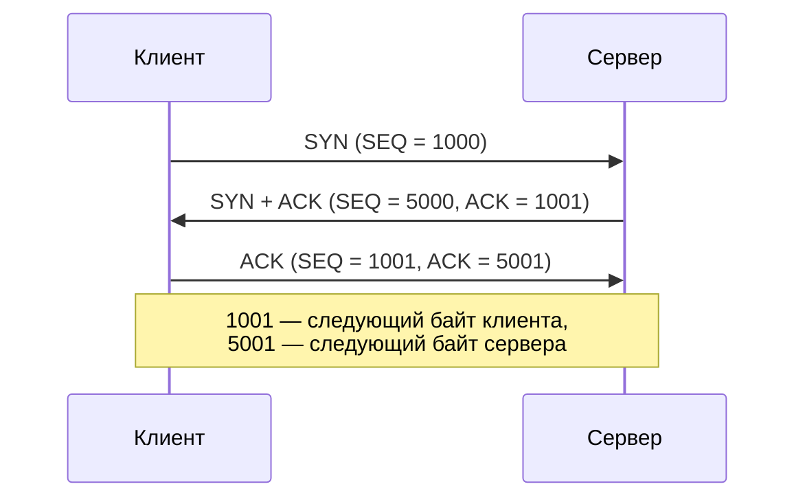
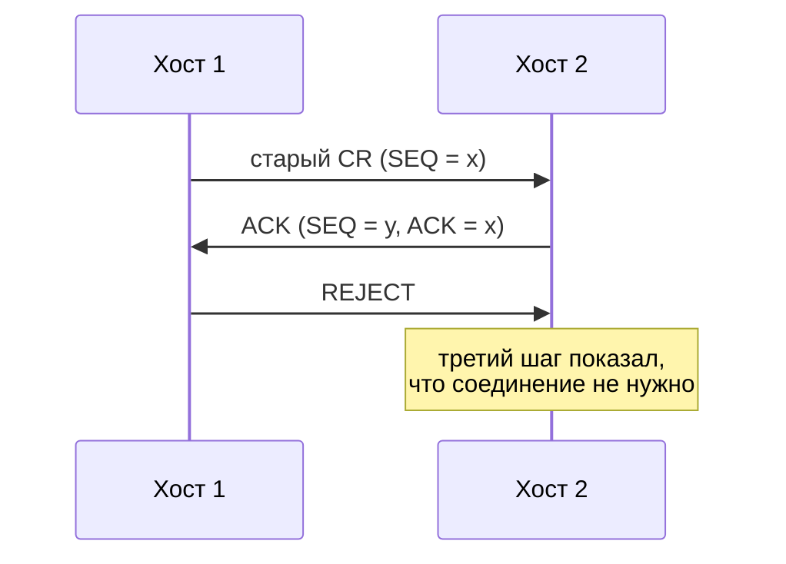
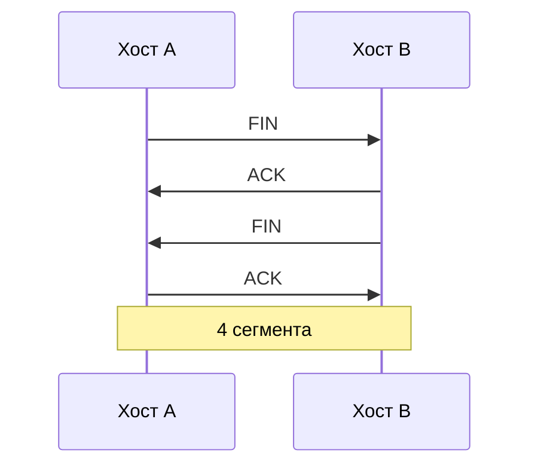
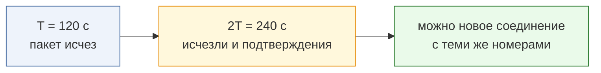

# Глава 6 — Разбор пробелов

> По результатам теста из [[Глава 6 — Соединения, окна и перегрузка]]: **11 верных из 15**.
> Блок B — **7 из 7**. Все четыре ошибки в блоке A: установление соединения, разрыв и TIME WAIT.

**Связано:** [[Глава 6]] · [[Глава 6 — Соединения, окна и перегрузка]]

---

## Сводка

| № | Тема | Что не так | Тип ошибки |
| --- | --- | --- | --- |
| 1 | ACK в SYN + ACK | подтверждён собственный номер сервера вместо номера клиента | путаница направлений |
| 3 | Старый дубликат CR | выбрано «молча игнорировать» вместо проверки через ACK и REJECT | пробел в понятии |
| 5 | Разрыв TCP | 2 и 1 вместо 4 и 3 | потеряна симметрия направлений |
| 6 | TIME WAIT | 120 с вместо 240 с | ошибка в числе |

Все четыре ошибки — про одно и то же: **у каждой стороны свой порядковый номер, а у каждого направления свой FIN**. Как только это разделение теряется, начинаются сдвиги на один сегмент и на одно время жизни.

Блок B прошёл идеально: окна, медленный старт, RTO, max-min и BDP держатся уверенно. Значит, чинить нужно не контроль перегрузки, а жизненный цикл соединения.

---

## 1. ACK в SYN + ACK: подтверждают чужой номер

Ты выбрал **5001**. Это правильный ACK — но для **третьего** сегмента, который клиент отправляет серверу. Во втором сегменте сервер подтверждает не свой номер, а номер клиента.

У каждой стороны своё пространство порядковых номеров. SYN занимает один номер, поэтому следующий байт после SYN идёт со сдвигом на единицу.

| Сегмент | SEQ | ACK | Чей номер подтверждается |
| --- | --- | --- | --- |
| 1. SYN клиента | 1000 | — | — |
| 2. SYN + ACK сервера | 5000 | **1001** | номер клиента |
| 3. ACK клиента | 1001 | **5001** | номер сервера |
| 4. DATA клиента | 1001 | 5001 | — |

Почему во втором сегменте именно **1001**? Потому что SYN клиента занял номер 1000, и сервер говорит: «следующий байт, который я жду от тебя, — 1001». Число 5001 здесь появиться не может: это номер из пространства сервера, а сервер не подтверждает сам себя.

> [!tip]- Правило одного вопроса
> Перед выбором ACK спроси: **чей номер я подтверждаю?**
> Сегмент идёт от сервера к клиенту — значит, ACK относится к номерам клиента.
> Сегмент идёт от клиента к серверу — значит, ACK относится к номерам сервера.
> Направление задаёт пространство номеров, а не наоборот.

> [!bug]- Почему 5001 выглядит правильным
> 5001 — это действительно «следующий байт после SYN сервера». Но его подтверждает **клиент** в третьем сегменте. Ты сделал правильное вычисление и применил его не к той стороне. Это не пробел в арифметике, а сдвиг направления.

---

## 2. Старый дубликат CR: не игнорировать, а проверить

Ты выбрал «молча игнорировать». Проблема в том, что принимающая сторона **не может отличить старый CR от нового** по самому сегменту: у обоих SEQ = x. Если игнорировать все «подозрительные» CR, сломается и нормальное установление соединения.

Поэтому получатель действует одинаково в обоих случаях: отвечает ACK и ждёт третий шаг. Если инициатор действительно хотел соединения, он подтвердит. Если нет — отправит REJECT, и получатель поймёт, что его обманул задержавшийся дубликат.

| Сценарий | Что происходит | Итог |
| --- | --- | --- |
| Нормальный | CR(x) → ACK(x, y) → ACK(y) | соединение установлено |
| Старый CR | CR(x) → ACK(x, y) → REJECT | дубликат отброшен |
| Старый CR и старый ACK | CR(x) → ACK(x, y), затем старый ACK(z) | соединение не установлено: подтверждён не y |

Третий шаг — это и есть проверка. Он нужен не для «надёжности» вообще, а для конкретного вопроса: **жив ли инициатор и хочет ли он соединения сейчас**.

> [!danger]- Почему «игнорировать» не работает
> Игнорирование не отличает старый CR от нового. В лучшем случае ты потеряешь легитимное соединение, в худшем — оставишь полуоткрытое состояние. В TCP старый SYN, пришедший на слушающий порт, вызывает SYN + ACK; если клиент не подтвердит, сервер будет ждать в SYN RCVD до тайм-аута. Именно поэтому нужны ограниченные очереди и SYN cookies — но они защищают от потока SYN, а не от старых дубликатов.

---

## 3. Разрыв TCP: два направления, поэтому 4 и 3

Ты выбрал **2 и 1**. Похоже, в голове осталась схема «клиент сказал FIN, сервер сказал ACK — всё». Но TCP закрывается **симметрично**: каждое направление закрывается отдельно.

Обычный разрыв:

| Шаг | Сегмент    | Что закрывается   |
| --- | ---------- | ----------------- |
| 1   | A → B: FIN | направление A → B |
| 2   | B → A: ACK | подтверждение FIN |
| 3   | B → A: FIN | направление B → A |
| 4   | A → B: ACK | подтверждение FIN |

Итого **4 сегмента**. Минимум **3**, если B объединяет ACK на FIN от A со своим FIN: `FIN + ACK` одним сегментом.

ACK и FIN можно совместить — тогда 3
Почему 2 и 1 невозможны:

- **2 сегмента** закрывают только одно направление. B всё ещё может отправлять данные A, даже если A закончил.
- **1 сегмент** не может закрыть соединение: FIN требует подтверждения. Без ACK отправитель не знает, дошёл ли FIN.

FIN занимает один байт пространства порядковых номеров — как SYN. Поэтому он подтверждается так же, как данные.

> [!tip]- Считай направления, а не сегменты
> Направлений два. В каждом нужен FIN и ACK. Базовая оценка — `2 × 2 = 4`. Один ACK можно совместить с встречным FIN, поэтому минимум — **3**. Всё остальное — производные от этой схемы.

> [!note]- Одновременное закрытие
> Если обе стороны отправляют FIN почти одновременно, каждая подтверждает чужой FIN. Получается четыре сегмента и состояние **CLOSING**. Это не отменяет правило: направлений два, и каждое закрывается отдельно.

---

## 4. TIME WAIT: не 120, а 240

Ты выбрал **120 с**. Это максимальное время жизни **пакета**, но TIME WAIT ждёт **двойное** время жизни — **240 с**.

Почему не хватает одного T:

1. Последний ACK может потеряться. Партнёр повторит FIN, и закрывающая сторона должна быть на месте, чтобы снова ответить ACK.
2. Старые пакеты этого соединения должны исчезнуть из сети до того, как тот же кортеж из четырёх элементов начнёт новое соединение с теми же номерами.

| Величина                            | Значение  | Что гарантирует                            |
| ----------------------------------- | --------- | ------------------------------------------ |
| T — максимальное время жизни пакета | **120 с** | пакет исчез из сети                        |
| TIME WAIT                           | **240 с** | исчезли и пакет, и его подтверждения       |
| CLOSE WAIT                          | —         | ждём, пока приложение закроет свою сторону |

> [!warning]- TIME WAIT ≠ CLOSE WAIT
> **CLOSE WAIT** — сторона получила FIN и ждёт, когда локальное приложение закроет соединение. **TIME WAIT** — сторона уже закрыла соединение и ждёт, пока из сети исчезнут старые пакеты. Это разные состояния и разные причины ожидания.

> [!note]- В реальных ОС
> В Linux TIME WAIT обычно около **60 с** (`TCP_TIMEWAIT_LEN`), а не книжные 240 с. В книге T = 120 с, поэтому книжное значение — **240 с**. Для теста по книге отвечай 240, но не удивляйся другому числу в `ss`.

---

## 5. Что было верно, но держится на одном числе

Эти ответы прошли, но их легко потерять при другой формулировке.

| № | Ответ | Что помнить |
| --- | --- | --- |
| 2 | SYN = 1 байт | иначе ACK на SYN не отличить от ACK первого байта данных |
| 4 | Две армии | согласие нельзя гарантировать конечным числом сообщений; таймер — практическое решение |
| 7 | 200 Кбит | `1 Мбит/с × 0,2 с`; это 25 Кбайт |
| 8 | Пробный сегмент | 1 байт плюс срочные данные — только эти исключения при нулевом окне |
| 9 | 5 RTT | `1 → 2 → 4 → 8 → 16 → 32` |
| 10 | 20 КБ | половина от 40 КБ |
| 11 | 3 дубликата ACK | быстрая повторная передача, не тайм-аут |
| 12 | 1200 мс | `800 + 4 × 100` |
| 13 | 3,2 раза | `10 / 3,16`; рост потерь с 1 % до 10 % |
| 14 | 2/3 | B уже занял 1/3 на общем участке |
| 15 | 40 Мбит | `1 Гбит/с × 0,04 с`; это 5 Мбайт, а не 5 Мбит |

---

## 6. Что делать дальше

1. Перечитать в [[Глава 6]] разделы **6.2.2** (установление), **6.2.3** (разрыв) и **6.5.5–6.5.7** (SYN, FIN, состояния).
2. Пройти заново вопросы **1, 3, 5 и 6** — уже с разбором, а не по памяти.
3. Нарисовать по памяти три схемы: SYN + ACK с номерами, старый CR с REJECT, разрыв в четыре сегмента.
4. Проверить себя на числах: **1001 / 5001**, **4 / 3**, **240 с**, **200 Кбит**, **40 Мбит**.
5. Если хочется глубже — в [[Глава 6 — Соединения, окна и перегрузка]] есть разбор с номерами и шпаргалка.

---

> [!note]- Итог
> Четыре ошибки — один корень: **соединение симметрично**. У каждой стороны свой номер, у каждого направления свой FIN, а TIME WAIT ждёт два времени жизни. Блок B — 7 из 7, значит, окна и перегрузка усвоены. Осталось навести порядок в жизненном цикле соединения: кто кого подтверждает, сколько направлений закрывается и почему ждать нужно дольше одного T.

> [!tip]- Пройти заново
> Интерактивная версия с уверенностью и JSON: [quiz.html](Квиз/quiz.html). Она не показывает ответы до конца, а в результатах отдельно подсвечивает ошибки с высокой уверенностью и случайные попадания.
