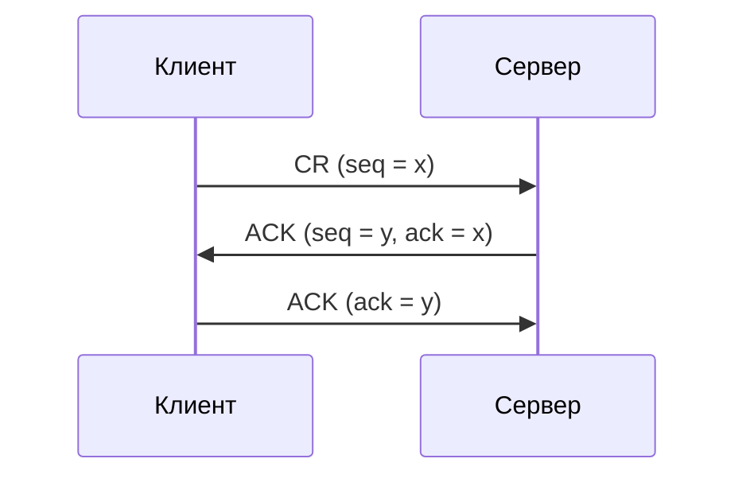
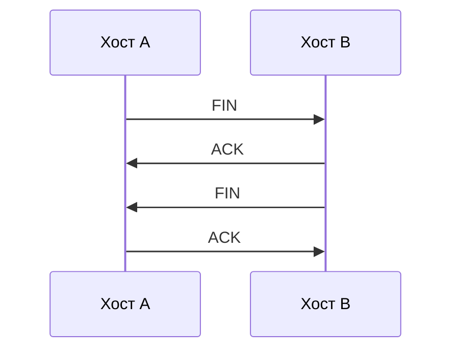

# Глава 6 — Соединения, окна и перегрузка

> Подробный разбор вычислительного ядра главы 6: разделы **6.2–6.5** и **6.7**.
> Здесь собраны расчёты, которые надо уметь делать, и числа, которые надо помнить.
> Обзор всей главы — в [[Глава 6]].

**Связано:** [[Глава 6]] · [[Глава 6 — Разбор пробелов]]

---

## Как устроен разбор

Глава 6 кажется набором протоколов: UDP, RPC, RTP, TCP, QUIC. На самом деле у неё три стержня.

1. **Как договориться о соединении** в сети, которая теряет и дублирует пакеты. Это тройное рукопожатие и проблема двух армий.
2. **Сколько данных держать в пути.** Это окна, буферы и произведение пропускной способности на задержку.
3. **С какой скоростью отправлять.** Это AIMD, медленный старт, быстрая повторная передача и контроль перегрузки.

---

# Часть 1. Соединение: как договориться

## 1.1 Почему две армии не могут победить

Две синие армии стоят по разные стороны долины. Белая армия в долине сильнее каждой по отдельности, но слабее их вместе. Синие могут победить только одновременным ударом. Связь — только через долину, где посыльного могут схватить.

Пусть командир 1-й армии отправляет: «Атакуем 29 марта на рассвете». Посыльный доставляет сообщение. Командир 2-й соглашается и отправляет подтверждение. Доходит ли оно?

Если подтверждение дошло, командир 2-й не знает, что оно дошло. Ему нужно подтверждение на подтверждение. И так до бесконечности. **Любое конечное число сообщений оставляет последнее неподтверждённым**, а значит, одна сторона не может быть уверена, что другая получила приказ.

Это не проблема плохого протокола. Это свойство ненадёжного канала: **гарантировать согласие конечным числом сообщений невозможно**. Поэтому в реальных протоколах ответственность перекладывают на приложение: каждая сторона сама решает, когда считать операцию завершённой, а таймеры закрывают то, что не удалось согласовать.

> [!tip]- Как это связано с TCP
> TCP не пытается «гарантировать» разрыв. Он отправляет FIN, ждёт ACK и по таймеру закрывает соединение, даже если подтверждение не пришло. Это практическое решение проблемы двух армий: не идеальное согласие, а разумный тайм-аут.

## 1.2 Тройное рукопожатие: зачем третий шаг

Нормальная последовательность:

Первый сегмент говорит: «Я хочу соединение, мой начальный номер x». Второй: «Я тебя услышал, подтверждаю x, мой номер y». Третий: «Я тебя услышал, подтверждаю y».

Двух шагов мало. Если бы сервер считал соединение установленным после первого сегмента, старый дубликат CR мог бы открыть соединение, которое никто не собирался открывать. Третий шаг проверяет, что клиент **действительно жив и действительно хочет** соединения.

Разберём три сценария.

| Сценарий | Что происходит | Почему это безопасно |
| --- | --- | --- |
| Нормальный | CR(x) → ACK(x, y) → ACK(y) | Обе стороны подтвердили номера друг друга |
| Старый CR | Сервер отвечает ACK, клиент отвечает REJECT | Сервер понимает, что это дубликат |
| Старый CR и старый ACK | Клиент отвечает REJECT с новым ACK | Соединение не устанавливается |

В TCP третий шаг часто несёт первые данные: `ACK(y + 1)` может идти вместе с `DATA`. Поэтому установка соединения и начало передачи иногда сливаются.

## 1.3 Разбор с номерами: SYN, ACK и байты

Пусть клиент выбрал начальный номер **1000**, сервер — **5000**.

| Шаг | Сегмент | SEQ | ACK | Что означает |
| --- | --- | --- | --- | --- |
| 1 | SYN | 1000 | — | Клиент хочет соединение; SYN занимает 1 байт |
| 2 | SYN + ACK | 5000 | 1001 | Сервер подтвердил SYN клиента |
| 3 | ACK | 1001 | 5001 | Клиент подтвердил SYN сервера |
| 4 | DATA | 1001 | 5001 | Первый байт данных имеет номер 1001 |

Почему в третьем сегменте `SEQ = 1001`, а не `1000`? Потому что SYN уже занял номер 1000. Следующий байт — 1001. То же с сервером: SYN занял 5000, первый байт данных сервера будет 5001.

Если клиент отправит 100 байт данных, они займут номера 1001–1100, а подтверждение будет **1101** — номер следующего ожидаемого байта. В TCP `ACK` означает не «последний полученный», а «следующий ожидаемый». Это важно: в старых учебных примерах с 4-битными номерами ACK иногда означает последний полученный — там счёт идёт по-другому.

## 1.4 Разрыв: четыре сегмента и 240 секунд

TCP закрывает каждое направление отдельно.

Обычно нужно **четыре** сегмента. Если B отправляет FIN вместе с ACK на FIN от A, получается **три**.

После последнего ACK сторона, которая закрывала первой, переходит в **TIME WAIT** и ждёт **двойное максимальное время жизни пакета**. В интернете T = 120 с, значит, TIME WAIT = **240 с**. Зачем так долго?

1. Чтобы последний ACK успел дойти, даже если он потерялся и был повторён.
2. Чтобы старые пакеты этого соединения исчезли из сети и не попали в новое соединение с теми же номерами.

Если FIN потерян, отправитель повторяет его. Если ответа нет за два максимальных времени жизни, соединение закрывается принудительно.

## 1.5 Состояния: нормальный путь

| Состояние | Кто в нём | Что ждёт |
| --- | --- | --- |
| CLOSED | обе стороны | начала работы |
| LISTEN | сервер | входящий SYN |
| SYN SENT | клиент | SYN + ACK |
| SYN RCVD | сервер | ACK клиента |
| ESTABLISHED | обе стороны | данных |
| FIN WAIT 1 | инициатор закрытия | ACK на свой FIN |
| FIN WAIT 2 | инициатор закрытия | FIN партнёра |
| CLOSE WAIT | получатель FIN | закрытия приложения |
| LAST ACK | получатель FIN | последнего ACK |
| CLOSING | обе стороны | ACK при одновременном закрытии |
| TIME WAIT | инициатор закрытия | исчезновения старых пакетов |

Запомнить проще по двум путям:

- **Клиент:** CLOSED → SYN SENT → ESTABLISHED → FIN WAIT 1 → FIN WAIT 2 → TIME WAIT → CLOSED.
- **Сервер:** CLOSED → LISTEN → SYN RCVD → ESTABLISHED → CLOSE WAIT → LAST ACK → CLOSED.

---

# Часть 2. Окно: сколько держать в пути

## 2.1 Stop-and-wait против скользящего окна

Пусть канал даёт **1 Мбит/с**, а RTT равно **200 мс**. Произведение пропускной способности на задержку:

`BDP = 1 Мбит/с × 0,2 с = 200 Кбит = 25 Кбайт`

Это столько данных помещается в пути «туда и обратно». Если протокол отправляет один сегмент и ждёт подтверждения, за 200 мс уходит один сегмент. При сегменте 1000 байт это **5 сегментов в секунду**, то есть 40 Кбит/с — всего 4 % от канала.

| Протокол | Что в пути | Скорость при RTT 200 мс |
| --- | --- | --- |
| Stop-and-wait | 1 сегмент | 5 сегментов/с |
| Окно 25 Кбайт | 25 сегментов по 1 Кбайт | 125 сегментов/с |
| Окно 200 Кбайт | 200 сегментов | 1000 сегментов/с |

Формула для окна: `window = c × r`, где `c` — скорость сети в сегментах/с, `r` — время цикла. Если окно меньше, канал простаивает; если больше — растёт очередь.

## 2.2 Динамическое выделение буферов: 4 бита, 8 запрошено, 4 выделено

Это самый подробный пример главы. У хоста A 4-битные порядковые номера, то есть номера 0–15. A просит у B **8 буферов**, B выделяет **4**. Данные идут от A к B, подтверждения и счётчики буферов — обратно.

| Шаг | A отправляет | B отвечает | Комментарий |
| --- | --- | --- | --- |
| 1 | request 8 buffers | — | A хочет 8 буферов |
| 2 | — | ack = 15, buf = 4 | B разрешает сегменты 0–3 |
| 3 | seq = 0, data = m0 | — | У A осталось 3 буфера |
| 4 | seq = 1, data = m1 | — | Осталось 2 |
| 5 | seq = 2, data = m2 | — | Сегмент потерян, но A думает, что остался 1 буфер |
| 6 | — | ack = 1, buf = 3 | B подтверждает 0 и 1, разрешает 2–4 |
| 7 | seq = 3, data = m3 | — | Остался 1 буфер |
| 8 | seq = 4, data = m4 | — | 0 буферов, A блокируется |
| 9 | seq = 2, data = m2 | — | Тайм-аут, повтор потерянного |
| 10 | — | ack = 4, buf = 0 | Всё подтверждено, но A всё ещё блокирован |
| 11 | — | ack = 4, buf = 1 | Теперь можно отправить 5 |
| 12 | — | ack = 4, buf = 2 | B нашёл ещё один буфер |
| 13 | seq = 5, data = m5 | — | Остался 1 буфер |
| 14 | seq = 6, data = m6 | — | 0 буферов, A снова блокирован |
| 15 | — | ack = 6, buf = 0 | A всё ещё блокирован |
| 16 | — | ack = 6, buf = 4 | Потенциальный тупик, если объявление потерялось |

В этом примере `ack` — номер **последнего полученного** сегмента, а не следующего ожидаемого. Поэтому `ack = 1` после сегментов 0 и 1. В TCP поле ACK означает следующий ожидаемый байт; не переносите счёт из примера на реальный TCP без поправки.

Что здесь важно:

- **Подтверждение и буферы разделены.** B может подтвердить приём, но не разрешить новую передачу: `ack = 4, buf = 0`.
- **Счётчик буферов уменьшается при отправке**, а не при подтверждении. Поэтому потерянный сегмент 2 «съел» буфер, хотя до B не дошёл.
- **Повтор по тайм-ауту** восстанавливает потерю, но не возвращает буфер автоматически.
- Если объявление окна потеряется, A может навсегда остаться с нулём буферов. Нужен **таймер настойчивости** и пробный сегмент.

## 2.3 TCP-окно: 4096 байт и нулевое окно

У получателя буфер **4096 байт**.

| Шаг | Отправитель | Получатель | Окно |
| --- | --- | --- | --- |
| 1 | отправляет 2048 байт (SEQ = 0) | принимает | 4096 |
| 2 | — | ACK = 2048, WIN = 2048 | 2048 свободно |
| 3 | отправляет 2048 байт (SEQ = 2048) | принимает | 2048 |
| 4 | — | ACK = 4096, WIN = 0 | Буфер полон |
| 5 | ждёт | приложение читает 2048 | — |
| 6 | — | ACK = 4096, WIN = 2048 | Можно снова отправлять |

При нулевом окне отправитель не должен передавать данные. Исключения:

1. **Срочные данные** с флагом URG.
2. **Пробный сегмент** размером 1 байт: он просит получателя повторить состояние окна.

Без пробного сегмента потерянное объявление окна могло бы заблокировать соединение навсегда.

## 2.4 Отложенные подтверждения, Нейгл и глупое окно

**Отложенное подтверждение.** Получатель ждёт до **500 мс**, надеясь, что данные придут вместе с подтверждением. Это снижает число пакетов, но увеличивает задержку.

**Алгоритм Нейгла.** Если приложение пишет маленькими порциями, отправляется только первый фрагмент. Остальные ждут подтверждения, затем уходят одним сегментом. В каждый момент в сети не больше одного маленького пакета.

**Синдром глупого окна.** Получатель читает по одному байту и объявляет окно в 1 байт. Отправитель отправляет 1 байт, окно снова закрывается. Решение Кларка: не объявлять окно, пока не освободится хотя бы половина буфера или не наберётся полный сегмент.

Посчитаем накладные расходы для telnet/SSH без всех этих механизмов. На каждый символ:

| Пакет | Размер |
| --- | --- |
| Символ + TCP + IP | 1 + 20 + 20 = 41 байт |
| Подтверждение | 20 + 20 = 40 байт |
| Обновление окна | 20 + 20 = 40 байт |
| Эхо | 1 + 20 + 20 = 41 байт |
| **Итого** | **162 байт** |

На 1 полезный байт приходится 161 байт накладных расходов. Отложенные подтверждения и алгоритм Нейгла сокращают это вдвое и больше.

## 2.5 Масштаб окна: почему 64 Кбайт мало

Поле Window size — 16 бит, максимум **65 535 байт**. На быстрой линии с большой задержкой этого не хватает.

Возьмём линию **OC-12 ≈ 600 Мбит/с** и RTT **50 мс**. BDP:

`600 Мбит/с × 0,05 с = 30 Мбит = 3,75 Мбайт`

Окно 64 Кбайт передаётся за:

`65 536 × 8 / 600 000 000 ≈ 0,87 мс`

То есть отправитель занят 0,87 мс из 50 мс, а **98 % времени ждёт** подтверждения. Канал используется менее чем на 2 %.

Решение — параметр **window scale**: сдвиг поля на 14 разрядов влево. Максимум становится `2^30` байт, то есть **1 Гбайт**. Этого хватает для большинства современных каналов.

## 2.6 Long fat network: 40 Мбит в пути

Трансконтинентальная линия: **1 Гбит/с**, RTT **40 мс**.

`BDP = 1 Гбит/с × 0,04 с = 40 Мбит = 5 Мбайт`

Чтобы канал не простаивал, окно получателя должно быть не меньше **5 Мбайт**. Передача половины мегабита по такой линии:

- передача данных: `0,5 Мбит / 1 Гбит/с = 0,5 мс`;
- ожидание ответа: 40 мс;
- эффективность: `0,5 / 40 = 1,25 %`.

Именно поэтому в long fat networks простые протоколы с остановкой и ожиданием бесполезны: скорость света ставит жёсткий предел.

---

# Часть 3. Перегрузка: как делить полосу

## 3.1 Max-min fairness: почему A получает 2/3

В сети четыре потока A, B, C, D, все каналы равны 1.

- B, C, D идут через канал R4–R5. Их трое, поэтому каждому по **1/3**.
- A и B идут через R2–R3. У B уже есть 1/3, значит, A может взять оставшиеся **2/3**.

| Поток | Каналы | Доля |
| --- | --- | --- |
| A | R1–R2–R3 | 2/3 |
| B | R2–R3 и R4–R5 | 1/3 |
| C | R4–R5 | 1/3 |
| D | R4–R5 | 1/3 |

Проверка max-min: можно ли увеличить долю A? Для этого надо отнять у B, C или D. У B доля 1/3, у A 2/3 — увеличение A возможно только за счёт потока с меньшей долей, а это запрещено. Можно ли увеличить B? Для этого надо отнять у C или D, у которых тоже 1/3; после отнятия их доля станет меньше B, а это нарушает критерий. Значит, распределение max-min.

Обратите внимание: на некоторых каналах полоса простаивает. Max-min не требует использовать всё; он требует, чтобы нельзя было улучшить худший поток.

## 3.2 AIMD: почему сложение и деление пополам

Пусть два пользователя делят канал ёмкостью 8. Прямая равнодоступности — `x = y`. Прямая эффективности — `x + y = 8`.

- **Аддитивное увеличение:** `(x, y) → (x + 1, y + 1)`. Движение под 45°.
- **Мультипликативное уменьшение:** `(x, y) → (x/2, y/2)`. Движение к началу координат по лучу.

Если увеличивать аддитивно, а уменьшать тоже аддитивно, точка колеблется вдоль прямой, параллельной `x = y`, и может остаться несправедливой. Если увеличивать и уменьшать мультипликативно, точка колеблется вдоль луча из начала координат и тоже не приходит к равенству.

Только **AIMD** сходится: увеличение под 45° тянет к прямой эффективности, а деление пополам возвращает к началу координат, и последовательность точек сжимается к пересечению `x = y` и `x + y = 8`, то есть к `(4, 4)`.

| Закон | Увеличение | Уменьшение | Сходится к справедливости? |
| --- | --- | --- | --- |
| AIAD | +1 | −1 | Нет |
| MIMD | ×2 | ×1/2 | Нет |
| MIAD | ×2 | −1 | Нет |
| **AIMD** | **+1** | **×1/2** | **Да** |

На практике TCP не достигает точки `(4, 4)` точно: окно растёт до потери, затем делится пополам, и график пилит вокруг справедливого значения. Важен предел, к которому сходится последовательность.

## 3.3 Медленный старт: 1 → 32 за пять RTT

Пусть `cwnd = 1 КБ`, `ssthresh = 32 КБ`, потерь нет.

| RTT | cwnd, КБ | Режим |
| --- | --- | --- |
| 0 | 1 | старт |
| 1 | 2 | удвоение |
| 2 | 4 | удвоение |
| 3 | 8 | удвоение |
| 4 | 16 | удвоение |
| 5 | 32 | достигли порога |
| 6 | 33 | линейный рост |
| 7 | 34 | линейный рост |
| 8 | 35 | линейный рост |
| 9 | 36 | линейный рост |
| 10 | 37 | линейный рост |
| 11 | 38 | линейный рост |
| 12 | 39 | линейный рост |
| 13 | 40 | потеря |

После потери при `cwnd = 40 КБ`:

- `ssthresh = 40 / 2 = 20 КБ`;
- `cwnd = 1 КБ`;
- снова медленный старт до 20 КБ;
- затем линейный рост.

Если потеря обнаружена по трём дубликатам ACK, TCP не сбрасывает окно до 1, а использует быстрое восстановление: `cwnd` остаётся около нового порога и растёт линейно. Именно это отличает Reno от Tahoe.

## 3.4 RTO: формула Джейкобсона на числах

Пусть `SRTT = 800 мс`, `RTTVAR = 100 мс`.

`RTO = 800 + 4 × 100 = 1200 мс`

Теперь пришло новое измерение `R = 1000 мс`. Обновляем:

`SRTT = 7/8 × 800 + 1/8 × 1000 = 700 + 125 = 825 мс`

`|SRTT − R| = |825 − 1000| = 175 мс`

`RTTVAR = 3/4 × 100 + 1/4 × 175 = 75 + 43,75 = 118,75 мс`

`RTO = 825 + 4 × 118,75 = 825 + 475 = 1300 мс`

Здесь `RTTVAR` считается по **уже обновлённому** `SRTT` — так формулы идут в книге: сначала `SRTT`, затем `RTTVAR`. В RFC 6298 порядок обратный, и тогда `RTTVAR` считался бы от старого `SRTT = 800`, а RTO получился бы 1325 мс. Разница небольшая, но важно понимать, откуда она берётся.

Если бы RTO оказался меньше **1 с**, его всё равно подняли бы до 1 с. Это защита от слишком частых повторных передач на быстрых каналах.

**Алгоритм Карна:** если сегмент передавался повторно, его подтверждение нельзя однозначно привязать к первой или второй передаче. Поэтому RTT по таким сегментам не обновляют, а RTO увеличивают экспоненциально.

## 3.5 Потери и пропускная способность: корень из p

Модель Падхая и др.:

`throughput ∝ 1 / √p`

где `p` — вероятность потери.

| Потеря p | `1 / √p` | Относительная скорость |
| --- | --- | --- |
| 0,01 (1 %) | 10 | 1,00 |
| 0,04 (4 %) | 5 | 0,50 |
| 0,10 (10 %) | 3,16 | 0,32 |

То есть рост потерь с 1 % до 10 % снижает скорость примерно в **3,2 раза**, а не в 10. Но при 10 % TCP уже почти не работает: книга говорит, что соединение «перестаёт работать». В беспроводных сетях 802.11 потери фреймов 10 % — обычное дело, поэтому нужен канальный повтор.

## 3.6 Почему канальный повтор не конфликтует с TCP

В беспроводной сети работают два механизма:

- **канальный:** повтор фрейма при ошибке передачи, микросекунды–миллисекунды;
- **транспортный:** снижение окна при потере, миллисекунды–секунды.

Разница — **три порядка**. 802.11 успевает восстановить фрейм задолго до того, как TCP заметит потерю. Поэтому оба механизма могут сосуществовать: канальный лечит ошибки, транспортный — перегрузку.

Если канал спутниковый с большой задержкой, этот трюк не работает: пока канальный уровень повторяет, TCP уже истёк по таймеру. Тогда нужны FEC или контроль перегрузки по задержке.

## 3.7 BBR: 40 % против 16 потоков

BBR не ждёт потерь. Он оценивает пропускную способность узкого места как максимальную скорость доставки за **6–10 RTT** и держит в пути примерно BDP.

В эксперименте BBR-отправитель занял **40 %** канала, а 16 TCP-соединений получили меньше **4 %** каждое. Верхняя оценка `40 + 16 × 4 = 104` уже превышает 100 %, значит, на самом деле каждому из 16 соединений досталось около **3,75 %**. BBR действительно забирает непропорционально много. Причина — BBR не реагирует на потери и не уступает конкурентам так, как AIMD.

Это не значит, что BBR плох. Он лучше работает на каналах с большими буферами и потерями, но вопрос справедливости с TCP ещё открыт.

---

# Часть 4. Производительность: где теряется скорость

## 4.1 Сколько байт в заголовках

| Стек | Заголовки |
| --- | --- |
| TCP/IP | 20 + 20 = **40 байт** |
| IPv4 + UDP + RTP | 20 + 8 + 12 = **40 байт** |
| IPv6 + UDP + RTP | 40 + 8 + 12 = **60 байт** |
| ROHC для IPv4/UDP/RTP | **1–3 байта** |

ROHC сжимает 40 байт до 1–3 байт, то есть в 13–40 раз. Экономия особенно важна для VoIP по медленным каналам: 40 байт заголовков на 20 байт полезной нагрузки — это 67 % накладных расходов.

## 4.2 Переполнение 32-битного номера

Пространство номеров TCP — `2^32` байт = **4 294 967 296 байт** = **34 359 738 368 бит**.

| Скорость | Время полного круга |
| --- | --- |
| 56 Кбит/с | 613 566 с ≈ **7,1 суток** |
| 10 Мбит/с | 3436 с ≈ **57 минут** |
| 1 Гбит/с | **34,4 с** |
| 10 Гбит/с | **3,4 с** |

Максимальное время жизни пакета в интернете — **120 с**. При 1 Гбит/с номера проходят круг за 34 с, то есть старые пакеты ещё могут быть в сети, когда номера начнут повторяться. Отсюда PAWS и метки времени.

## 4.3 Почему скорость выше 1 Гбит/с не помогает

Файл **1 Мбит**, линия **4000 км**, RTT **40 мс**.

| Скорость | Передача данных | Полное время | Что ограничивает |
| --- | --- | --- | --- |
| 1 Мбит/с | 1 с | ≈ 1,04 с | скорость линии |
| 100 Мбит/с | 10 мс | ≈ 50 мс | задержка |
| 1 Гбит/с | 1 мс | ≈ 41 мс | задержка |
| 10 Гбит/с | 0,1 мс | ≈ 40,1 мс | задержка |

После 1 Гбит/с дальнейший рост скорости почти не меняет время: 40 мс задержки доминируют. Именно поэтому в long fat networks важнее окно и выборочный повтор, а не ещё более быстрая линия.

## 4.4 Почему копирования и прерывания дороги

Если 20 % инструкций обращаются к памяти и промахиваются, а промах стоит в 10 раз дороже попадания:

`0,8 × 1 + 0,2 × 10 = 2,8`

Среднее время инструкции растёт в **2,8 раза**. Это не гипотетика: входящий пакет часто копируется из сетевой карты в буфер ядра, затем в буфер сетевого уровня, затем транспортного, затем приложения — до четырёх копий.

Переключения контекста тоже дороги. В идеале их два: пользователь → ядро и ядро → получатель. Если сетевой менеджер работает в пользовательском пространстве, добавляются ещё два: ядро → менеджер → ядро → получатель, итого **четыре**.

## 4.5 Тест полосы: почему нужно четыре соединения

Одно TCP-соединение не заполняет быстрый канал: мешают медленный старт, размер окна и потери. Поэтому тесты используют **четыре параллельных соединения**. Этого обычно достаточно, чтобы исчерпать канал доступа; некоторые инструменты позволяют увеличивать число соединений для очень быстрых линий.

Клиентский тест может врать по трём причинам:

1. Одно соединение не успевает разогнаться.
2. Узкое место — Wi-Fi или CPU клиента, а не канал провайдера.
3. Начало теста попадает на медленный старт.

## 4.6 QoE: после 50 Мбит/с важнее не скорость

Для потокового видео качество определяется:

- задержкой запуска;
- частотой повторной буферизации;
- разрешением.

Когда скорость выше **50 Мбит/с**, эти параметры зависят уже не от полосы, а от задержки, джиттера и потерь. Поэтому современные измерения переходят от speedtest к пассивному наблюдению за QoE.

---

# Часть 5. Шпаргалка с числами

| Число | Что означает |
| --- | --- |
| **8 байт** | заголовок UDP |
| **12 байт** | минимальный заголовок RTP |
| **20 байт** | фиксированный заголовок TCP |
| **65 495 байт** | максимум данных TCP |
| **536 / 556 байт** | MSS по умолчанию / обязательный минимум |
| **65 535 байт** | поле Window size |
| **2^30 байт** | максимум окна с масштабом |
| **11** | состояний TCP |
| **120 / 240 с** | максимальное время жизни пакета / TIME WAIT |
| **1 с** | минимальный RTO |
| **7/8 и 3/4** | α и β в формулах SRTT и RTTVAR |
| **4** | множитель RTTVAR в RTO |
| **3** | дубликата ACK для быстрой повторной передачи |
| **500 мс** | максимум отложенного ACK |
| **200 Кбит** | BDP при 1 Мбит/с и RTT 200 мс |
| **5 сегментов/с** | stop-and-wait при RTT 200 мс |
| **4 из 8** | буферов в примере динамического окна |
| **10 с** | буфер потокового видео |
| **5 %** | полоса RTCP |
| **1 % / 10 %** | нормальная / смертельная потеря для TCP |
| **6–10 RTT** | окно оценки BBR |
| **40 %** | доля BBR в эксперименте |
| **40 / 60 байт** | заголовки IPv4/IPv6 + UDP + RTP |
| **1–3 байта** | ROHC |
| **34 с / 57 мин / 7 суток** | переполнение номеров при 1 Гбит/с / 10 Мбит/с / 56 Кбит/с |
| **40 Мбит = 5 Мбайт** | BDP при 1 Гбит/с и RTT 40 мс |
| **1,25 %** | эффективность 0,5 Мбит на такой линии |
| **9 Кбайт** | jumbo frame |
| **50 Мбит/с** | порог QoE для видео |
| **4** | параллельных TCP-соединения в тесте |
| **2,8×** | замедление при 20 % промахов памяти |
| **4** | переключения контекста в худшем случае |
| **> 90 %** | попаданий в последнюю запись соединения |

---

# Часть 6. Тест

> [!info]- Как проходить
> Вопросы и варианты — ниже. Ответы в файле не спрятаны: сначала ответь сам, потом разберём результаты в чате. Разбор ошибок попадёт в [[Глава 6 — Разбор пробелов]].

> [!tip]- Интерактивная версия в браузере
> Открой [quiz.html](Квиз/quiz.html) — это автономная страница: 15 вопросов, отметка уверенности после каждого ответа, разбор и JSON в конце. Ответы не показываются до завершения.
> Чтобы результаты сохранялись автоматически, запусти из корня репозитория:
> `python3 "DevOpsNotes/Networks/Таненбаум/Глава 6/Квиз/server.py"`
> Сервер откроет `http://127.0.0.1:8765/`, а после прохождения запишет `Квиз/results/latest.json`. Если сервер не запущен, в конце есть кнопки «Скачать JSON» и «Скопировать JSON».
> Подробнее — в [README](Квиз/README.md).

### Блок A. Соединения и окна

**1.** Клиент отправляет SYN с SEQ = 1000. Сервер отвечает SYN + ACK с SEQ = 5000. Какое значение ACK будет во втором сегменте?

- A) 1000
- B) 1001
- C) 5000
- D) 5001

**2.** Зачем сегмент SYN занимает один байт пространства порядковых номеров?

- A) Чтобы SYN можно было отличить от данных по номеру
- B) Чтобы подтверждение SYN не совпало с подтверждением первого байта данных
- C) Чтобы ускорить установление соединения
- D) Чтобы разрешить одновременное открытие соединения

**3.** Приходит старый дубликат CR с SEQ = x. Что делает принимающая сторона по схеме тройного рукопожатия?

- A) Молча игнорирует его
- B) Отправляет ACK и ждёт подтверждения; если инициатор отказывается — соединение не устанавливается
- C) Сразу устанавливает соединение
- D) Отправляет RST

**4.** Что доказывает проблема двух армий?

- A) Что тройное рукопожатие всегда надёжно
- B) Что по ненадёжному каналу нельзя конечным числом сообщений гарантировать согласие
- C) Что TCP не может разорвать соединение
- D) Что нужен таймер повторной передачи

**5.** Сколько сегментов обычно нужно для разрыва TCP и сколько минимально?

- A) 2 и 1
- B) 3 и 2
- C) 4 и 3
- D) 5 и 4

**6.** Через сколько закрывается состояние TIME WAIT, если максимальное время жизни пакета равно 120 с?

- A) 60 с
- B) 120 с
- C) 240 с
- D) 480 с

**7.** Канал 1 Мбит/с, RTT 200 мс. Чему равен BDP?

- A) 20 Кбит
- B) 200 Кбит
- C) 1 Мбит
- D) 5 Мбит

**8.** Получатель объявил окно 0. Что может отправить отправитель?

- A) Ничего и никогда
- B) Только 1-байтный пробный сегмент (и срочные данные)
- C) Полный сегмент
- D) RST

### Блок B. Перегрузка, TCP и производительность

**9.** `cwnd = 1 КБ`, `ssthresh = 32 КБ`, потерь нет. Через сколько RTT окно достигнет порога при медленном старте?

- A) 4
- B) 5
- C) 6
- D) 8

**10.** Потеря обнаружена при `cwnd = 40 КБ`. Чему равен новый `ssthresh`?

- A) 10 КБ
- B) 20 КБ
- C) 40 КБ
- D) 80 КБ

**11.** Что означает получение трёх дубликатов ACK?

- A) Перегрузка уже подтверждена
- B) Вероятна потеря следующего сегмента; можно выполнить быструю повторную передачу
- C) Получатель закрыл окно
- D) Нужно сбросить соединение

**12.** `SRTT = 800 мс`, `RTTVAR = 100 мс`. Чему равен RTO по формуле Джейкобсона?

- A) 800 мс
- B) 900 мс
- C) 1200 мс
- D) 4000 мс

**13.** Пропускная способность TCP растёт обратно пропорционально корню из вероятности потерь. Во сколько раз она упадёт при росте потерь с 1 % до 10 %?

- A) В 1,5 раза
- B) В 3,2 раза
- C) В 10 раз
- D) В 100 раз

**14.** Три потока B, C и D делят канал 1 поровну, каждому по 1/3. Поток A конкурирует с B на следующем участке. Сколько получит A по max-min?

- A) 1/3
- B) 1/2
- C) 2/3
- D) 1

**15.** Линия 1 Гбит/с, RTT 40 мс. Какой минимальный размер окна нужен, чтобы полностью использовать канал?

- A) 4 Мбит
- B) 5 Мбит
- C) 40 Мбит
- D) 400 Мбит

---

> Дальше: ответы разбираются в чате, а ошибки — в [[Глава 6 — Разбор пробелов]]. Пройти заново с уверенностью и JSON можно в [quiz.html](Квиз/quiz.html).
