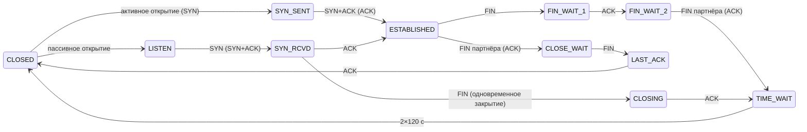

# Глава 6. Транспортный уровень

> [!info] Источник
> Таненбаум, Фимстер, Уэзеролл. *Компьютерные сети*, 6-е изд. — стр. 563–683.
> PDF: [[Tanenbaum_E_Fimster_N_Uezeroll_D_Kompyuternye_seti_6_e_izd_Klassika.pdf#page=563]]
> Сокращения — [[Словарь сокращений]] · Заголовки протоколов — [[Заголовки протоколов]] · Вырезки — [[Самое важное]]

> [!check] Проверено
> - Дата: 2026-11-08
> - Окружение: книга 6-е изд. (рус. перевод, Питер 2023), PDF
> - Источники: стр. 563–683 книги; формулы таймеров и контроль перегрузки сверены с текстом
> - Проверенные команды: —
> - Не проверено: —

**Связано:** [[Глава 5]] · [[Глава 7]]

## Оглавление главы

6.1 Транспортные службы (563) · 6.2 Элементы транспортных протоколов (575) · 6.3 Контроль перегрузки (599) · 6.4 UDP (611) · **6.5 TCP (623)** · 6.6 QUIC и BBR (654) · 6.7 Производительность (658)

Сетевой уровень доставляет пакет **хосту**, транспортный — **процессу**; транспорт живёт на хостах и делает службу надёжнее сети (стр. 563–565). Два окна, которые нельзя смешивать: окно получателя ограничивает буфер, окно перегрузки — сеть; действует **min(cwnd, rwnd)** (стр. 644).

## 6.1 Транспортные службы (стр. 563–575)

Примитивы (илл. 6.2): LISTEN, CONNECT, SEND, RECEIVE, DISCONNECT. Единица — **сегмент** (устар. **TPDU**); сегмент → пакет → фрейм (стр. 565–567).

Сокеты Беркли (4.2BSD, 1983; в Windows — winsock) (стр. 569–571): сервер — SOCKET → BIND → LISTEN → ACCEPT; клиент — SOCKET → CONNECT. **LISTEN не блокирует** (только выделяет очередь), блокирует ACCEPT; при соединении создаётся новый сокет, сервер продолжает слушать.

## 6.2 Элементы транспортных протоколов (стр. 575–599)

Отличия от канального уровня (стр. 575–577): явный адрес получателя; сложное установление; сеть может хранить пакеты (задержавшиеся дубликаты).

- **Адресация** (стр. 577–580): конечная точка транспорта — **TSAP** (в TCP/IP — порт), сети — **NSAP** (IP-адрес). Соединение = пара (TSAP, TSAP). Как найти TSAP: фиксированные порты (`/etc/services`), portmapper, inetd — порождает демона по запросу.
- **Установление соединения** (стр. 580–586): дубликаты делают безвредными ограничением жизни пакета **T = 120 с** (интернет) + начальный номер по часам. **Тройное рукопожатие** CR(x) → ACK(x, y) → ACK(y): третий шаг отвергает старые дубликаты (ответившая сторона ждёт подтверждения и получает REJECT). В TCP: SYN → SYN+ACK → ACK; SYN занимает **1 байт** пространства номеров. Начальный номер псевдослучаен (защита от подделки); **PAWS** — метка времени против зацикливания номеров. **SYN flood** ⇒ **SYN cookies** (состояние закодировано в номере; не работает с параметрами TCP).
- **Разрыв соединения** (стр. 586–590): асимметричный опасен потерей данных; **симметричный** — проблема **двух армий**: гарантировать согласие по ненадёжному каналу невозможно. TCP: каждая сторона FIN → ACK; обычно 4 сегмента, ACK+FIN объединяют ⇒ 3. После закрытия — ожидание **2T = 240 с** (TIME WAIT). Полуоткрытые соединения лечатся таймером бездействия.
- **Контроль ошибок и поток** (стр. 590–596): checksum сквозная (видит повреждения внутри маршрутизаторов); ARQ + скользящее окно. **BDP**: канал 1 Мбит/с, RTT 200 мс ⇒ 25 КБайт в пути; stop-and-wait даёт 5 сегментов/с независимо от полосы (стр. 592). Окно должно быть ≥ c×r (стр. 595). Потеря объявления нулевого окна застревает обе стороны ⇒ таймер настойчивости + пробный сегмент.
- **Мультиплексирование** (стр. 596–597): прямое — много соединений через один NSAP (порты); обратное — одно соединение по нескольким путям (SCTP).
- **Восстановление после сбоев** (стр. 597–599): 8 комбинаций стратегии клиента vs порядок ACK/запись на сервере — каждая приводит к ошибке. Вывод: **восстановление уровня N возможно только уровнем N+1**; «доставлено» ≠ «обработано».

## 6.3 Контроль перегрузки (стр. 599–611)

Хорошее распределение полосы: эффективно, справедливо, сходится. Метрика Клейнрока: `Power = Load / Delay` — максимум мощности = рабочая точка (стр. 600–601). **Max-min fairness** (стр. 601–602): нельзя увеличить долю одного потока, не урезав меньший; пример — A получает 2/3, B/C/D по 1/3.

Управление потоком (буфер получателя) ≠ контроль перегрузки (сеть) (стр. 604–605). Сигналы: XCP (явный, точный), TCP+ECN (явный, неточный), FAST TCP (задержка), TCP/CUBIC (потери) (стр. 605–606). **AIMD** (Чиу — Джейн, 1989) — единственная комбинация «+1 аддитивно, ×½ мультипликативно», сходящаяся к справедливости и эффективности (стр. 606–608). Побочный эффект — **привязка к RTT**: скорость = W/RTT, близкие соединения получают больше.

Беспроводные сети (стр. 608–611): TCP считает потери сигналом перегрузки, но в радио потери — норма (в 802.11 ≥ 10 %). Средняя скорость пропорциональна `1/√p`; при 10 % потерь TCP почти не работает. Решение — **скрыть потери на канальном уровне** (802.11 повторяет фреймы; канальный таймер на порядки быстрее транспортного). Спутники — FEC или контроль по задержке.

## 6.4 UDP (стр. 611–623)

UDP (RFC 768) — транспорт без соединения. Заголовок **8 байт**: Source port, Destination port, UDP length, Checksum (см. [[Заголовки протоколов]]). Максимум данных 65 515. Checksum с **пseudozagоловком** (IP-адреса, протокол 17) — нарушает иерархию, но ловит доставку не тому хосту; в UDP она необязательна (0 = нет, все единицы = настоящая сумма 0) (стр. 611–613).

UDP не делает: поток, перегрузку, повторы, порядок. Делает: демультиплексирование по портам и (опционально) проверку ошибок. Достаточно для DNS.

**RPC** (стр. 613–616): клиентская/серверная заглушки, **маршалинг**; проблемы — указатели, слабая типизация, неидемпотентные операции (повтор дублирует действие). Для идемпотентных операций (DNS) UDP-повтор безопасен.

**RTP** (RFC 3550) поверх UDP (стр. 616–622): заголовок 12 Б — Ver, P, X, CC, M (маркер talkspurt), Payload type, Sequence number, Timestamp, SSRC/CSRC. Доставку не гарантирует; получатель сглаживает джиттер буфером и **задержкой воспроизведения** (потоковое видео ~10 с, видеосвязь — минимальная); опоздавшие пакеты пропускаются. **RTCP** — обратная связь (потери, джиттер, синхронизация), ≤ 5 % полосы (стр. 619–621).

## 6.5 TCP (стр. 623–654)

TCP (RFC 793, 1981): надёжный **байтовый поток** (границы сообщений не сохраняются), полнодуплексный, двухточечный; сегменты ~1460 Б данных (1500 MTU Ethernet) (стр. 623–626).

Сокет = (IP, порт); соединение = пара сокетов. Порты < 1024 — well-known (IANA, > 700): 22 SSH, 25 SMTP, 80 HTTP, 110 POP-3, 143 IMAP, 443 HTTPS (стр. 624–625).

### Заголовок TCP (стр. 628–631)

20 байт (см. [[Заголовки протоколов]]): Sequence number (номер **первого байта** данных, 32 бита), Acknowledgement number (**следующий ожидаемый** байт, накопительное подтверждение), Header length, флаги **CWR, ECE, URG, ACK, PSH, RST, SYN, FIN**, Window size, Checksum (с псевдозаголовком), Urgent pointer, Options (0–40 Б). Опции: **MSS** (по умолчанию 536; обязаны принимать 556), **window scale** (×2¹⁴ ⇒ окно до 1 ГБ), **timestamps** (RTT + PAWS), **SACK** (диапазоны полученных байтов).

### Соединение и разрыв (стр. 631–636)

Установка: LISTEN → SYN (x, MSS) → SYN+ACK (y, ack=x+1) → ACK (y+1). Никто не слушает ⇒ **RST**. Одновременное открытие даёт **одно** соединение.

Разрыв: FIN → ACK → FIN → ACK (4 сегмента; объединение ⇒ 3); после закрытия — TIME WAIT 2T = **240 с**. Одновременное закрытие — состояние CLOSING.

**11 состояний TCP** (илл. 6.38–6.39): CLOSED, LISTEN, SYN RCVD, SYN SENT, ESTABLISHED, FIN WAIT 1, FIN WAIT 2, TIME WAIT, CLOSING, CLOSE WAIT, LAST ACK. Путь клиента: CLOSED → SYN SENT → ESTABLISHED → FIN WAIT 1 → FIN WAIT 2 → TIME WAIT → CLOSED; сервера: CLOSED → LISTEN → SYN RCVD → ESTABLISHED → CLOSE WAIT → LAST ACK → CLOSED.



### Окно и таймеры (стр. 636–643)

Окно подтверждает доставку и объявляет место в буфере. Пример: буфер 4096; передали 2048 ⇒ ACK+окно 2048; передали ещё 2048 ⇒ окно 0. При нулевом окне разрешены URG и **пробный сегмент** (window probe). **Отложенные ACK** — до 500 мс. **Нейгл**: первый маленький сегмент сразу, остальные — до ACK (отключение — TCP_NODELAY). **Синдром глупого окна** (Кларк, 1982): получатель не объявляет окно, пока не освободится половина буфера или полный сегмент. Вне порядка — буферизация, подтверждение непрерывного префикса.

Таймеры (стр. 640–643): **RTO** по Джейкобсону — `SRTT = ⅞·SRTT + ⅛·R`, `RTTVAR = ¾·RTTVAR + ¼·|SRTT − R|`, **RTO = SRTT + 4·RTTVAR** (α = 7/8, β = 3/4; минимум 1 с). **Алгоритм Карна**: RTT по повторным передачам не измеряется; при повторе RTO растёт экспоненциально. Прочие: persistence (нулевое окно), keepalive, TIME WAIT.

### Контроль перегрузки (стр. 643–654)

```
эффективное окно = min(cwnd, окно получателя)
slow start: cwnd × 2 за RTT (старт с 4 MSS, RFC 3390), пока cwnd < ssthresh
AIMD: после ssthresh — +1 MSS за RTT
```

| Событие | Реакция TCP |
| --- | --- |
| Тайм-аут | ssthresh = cwnd/2, cwnd = 1, slow start |
| Три дубликата ACK | быстрая повторная передача, ssthresh = cwnd/2 |
| Быстрое восстановление (Reno) | cwnd не падает до 1, растёт линейно у нового порога |

График окна — пилообразный. **Tahoe** — всегда сброс к 1; **Reno** — быстрое восстановление; **NewReno** — частичные ACK при нескольких потерях; **SACK** — точный выбор повторов; **ECN** — ECE у получателя, CWR у отправителя (стр. 647–653).

**CUBIC** (стр. 653–654): рост окна — кубическая функция времени с последней перегрузки (быстро → плато → снова быстро); не привязан жёстко к RTT; по умолчанию в Linux с 2.6.19 и в Windows.

## 6.6 QUIC и BBR (стр. 654–658)

**QUIC** поверх UDP (стр. 655): мультиплексирование потоков без **head-of-line blocking**; шифрование каждого пакета на транспортном уровне; **идентификатор соединения** выживает при смене сети (Wi-Fi ↔ мобильная); меньше задержек на установление.

**BBR** (стр. 655–657): не ждёт потерь (борется с **bufferbloat**); оценивает BDP — пропускную способность узкого места (максимум за 6–10 RTT) и RTT — и пейсит отправку. Проблема справедливости: BBR забирал 40 % полосы против 16 TCP-потоков (< 4 % каждому).

## 6.7 Производительность (стр. 658–676)

- Тест полосы: одно TCP-соединение не заполняет канал и попадает на slow start ⇒ **минимум 4 параллельных соединения** (Speedtest, FCC) (стр. 660–661). QoE видео: выше **50 Мбит/с** важнее время старта, ретранслирование буфера, разрешение (стр. 662).
- Правила Могула (1993) (стр. 663–665): CPU важнее линии; меньше пакетов (128-байтные сегменты — накладные ×32); меньше копирований (2,8× замедление при 20 % промахов памяти); меньше переключений контекста (2 — норма, 4 — худший случай); предупреждать перегрузку; избегать тайм-аутов.
- Быстрый путь обработки (стр. 666–669): заголовок из прототипа; поиск соединения по хешу от 4-ки; попадание в последнюю запись > 90 %; таймеры — timing wheel за O(1).
- Сжатие заголовков (стр. 670–672): IPv4+UDP+RTP = 40 Б (IPv6 — 60 Б); **ROHC** (RFC 5795) сжимает до 1–3 Б.
- **Long fat networks** (стр. 672–676): переполнение 32-битного номера — 34 с при 1 Гбит/с (пакет живёт 120 с); BDP трансконтинентальной гигабитной линии = 5 МБайт (окно меньше ⇒ простой; 0,5 Мбит занимает 0,5 мс + 40 мс ожидания = 1,25 % эффективности); go-back-n повторит до 5 МБайт; выше ~1 Гбит/с время передачи определяет задержка, не скорость. Принцип: проектировать ради скорости, не ради экономии полосы (jumbo 9 КБ, IPv6 jumbograms > 64 КБ).
