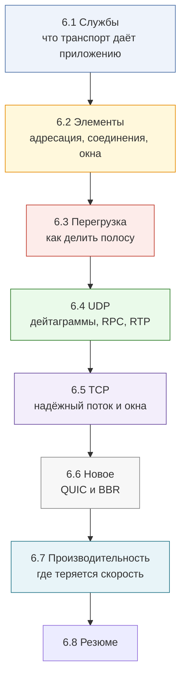
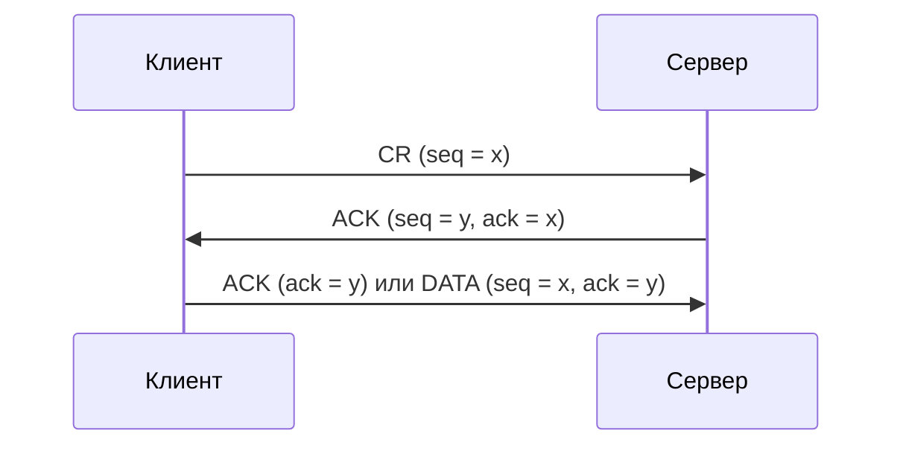
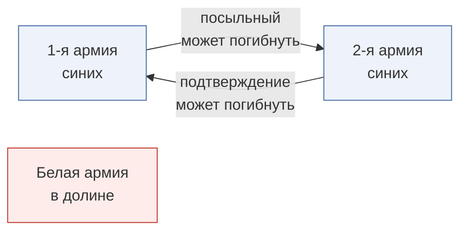
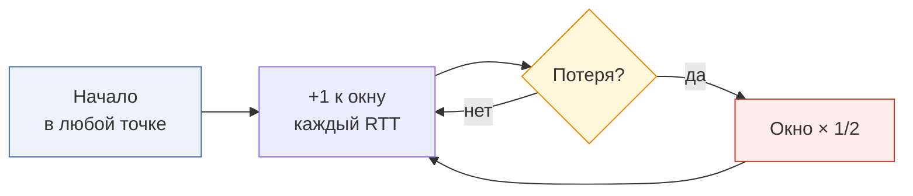
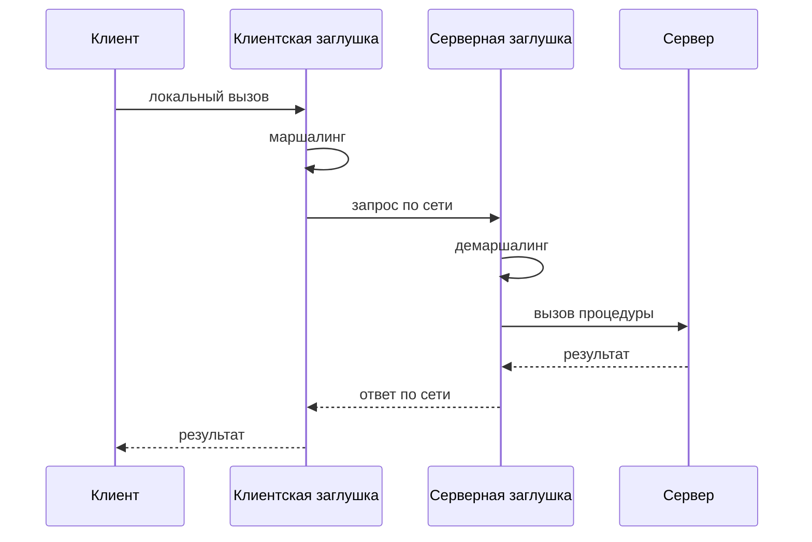
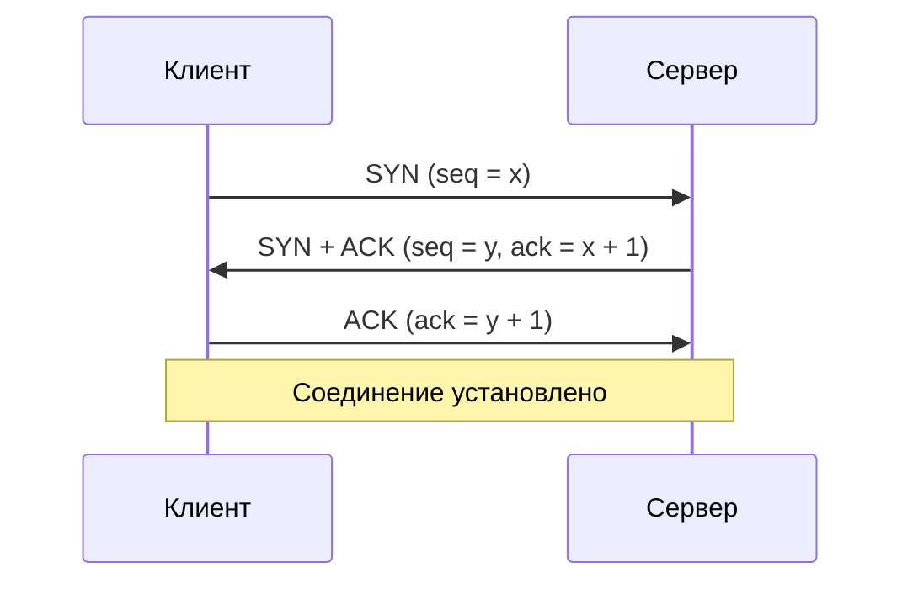
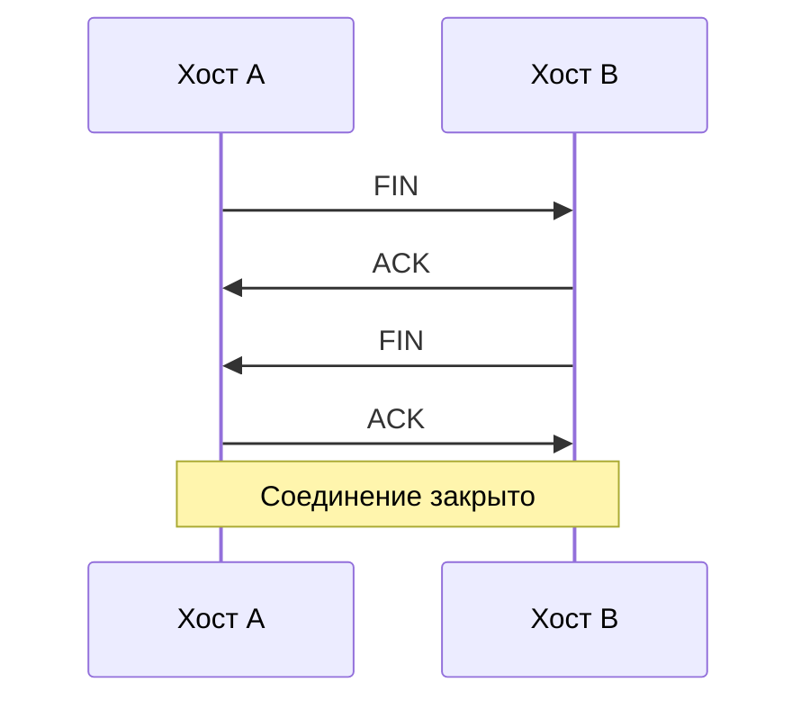
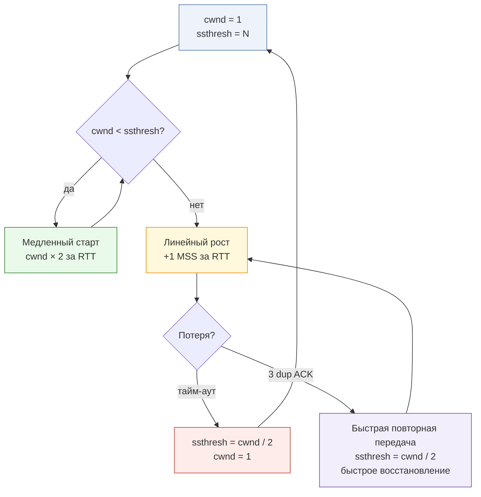

# Глава 6. Транспортный уровень

> Источник: Таненбаум, Фимстер, Кузеролл. *Компьютерные сети*, 6-е изд. — глава 6, страницы **563–683**.
> Все сокращения с расшифровками — в [[Словарь сокращений]].

**Связано:** [[Глава 5]] · [[Глава 6 — Соединения, окна и перегрузка]] — расчёты и тест · [[Глава 6 — Разбор пробелов]]

---

## О чём глава

Сетевой уровень доставляет пакет **хосту**. Транспортный уровень — **процессу** на этом хосте. Разница кажется маленькой, но из неё вырастает всё: порты, соединения, повторные передачи, окна и контроль перегрузки.

У главы две большие задачи:

1. **Сделать ненадёжную сеть пригодной для приложения.** Сеть теряет, дублирует, задерживает и перемешивает пакеты. Транспорт прячет это за надёжным потоком байтов.
2. **Решить, с какой скоростью отправлять.** Слишком медленно — канал простаивает. Слишком быстро — сеть перегружается, и полезная пропускная способность падает.

| Раздел | Вопрос | Ключевые понятия |
| --- | --- | --- |
| **6.1** | Что транспорт даёт приложению? | примитивы, сокеты, порты |
| **6.2** | Из чего состоит транспортный протокол? | адресация, установление и разрыв, окна, мультиплексирование, сбои |
| **6.3** | Как делить пропускную способность? | max-min fairness, AIMD, беспроводные сети |
| **6.4** | Что такое UDP? | дейтаграммы, RPC, RTP |
| **6.5** | Как работает TCP? | заголовок, окно, таймеры, slow start, контроль перегрузки |
| **6.6** | Что приходит на смену TCP? | QUIC, BBR |
| **6.7** | Почему сеть бывает медленной? | QoE, копирования, заголовки, long fat networks |
| **6.8** | Что запомнить? | сводка |

> [!tip]- Две вещи, без которых глава рассыпается
> **1. Транспорт ≠ сеть.** Сеть доставляет пакет хосту, транспорт — процессу. Порты есть только на концах; маршрутизаторы не знают, что такое TCP-соединение.
> **2. Окон два, а не одно.** Окно получателя ограничивает буфер, окно перегрузки — сеть. Работает меньшее из них. Если смешать эти два окна, весь разговор о TCP превращается в кашу.

---

## 6.1 Транспортные службы

### 6.1.1 Что транспорт даёт верхним уровням

Транспортная подсистема (transport entity) может жить в ядре операционной системы, в библиотеке, в пользовательском процессе или даже в сетевой плате. В интернете чаще всего встречаются первые два варианта.

Транспортный уровень может предоставлять службу с установлением соединения и без него. Соединение проходит три фазы: установление, передача данных, разъединение. Адресация и управление потоком похожи на сетевые.

Зачем нужны два уровня, если службы так похожи? Причина в том, **где выполняется код**. Сетевой уровень работает на маршрутизаторах, которыми управляет оператор связи. Транспортный — на хостах пользователя. Если сеть теряет пакеты, транспорт обнаруживает это и повторяет передачу. Если сетевое соединение оборвалось, транспорт может установить новое и спросить удалённую сторону, какие данные дошли. Так транспорт делает службу надёжнее, чем сеть под ним.

Второй аргумент — независимость от технологии. Сетевые примитивы в Ethernet и в сети с установлением соединения разные. Транспортный интерфейс скрывает их за одним набором вызовов: меняется сеть, а приложение остаётся.

### 6.1.2 Примитивы транспортных служб

В книге сначала вводится простой гипотетический набор примитивов.

| Примитив | Отправляемый пакет | Смысл |
| --- | --- | --- |
| **LISTEN** | нет | Блокировать сервер, пока кто-нибудь не попытается соединиться |
| **CONNECT** | CONNECTION REQUEST | Активно устанавливать соединение |
| **SEND** | DATA | Отправить данные |
| **RECEIVE** | нет | Блокировать, пока не придут данные |
| **DISCONNECT** | DISCONNECTION REQUEST | Разорвать соединение |

Сообщение транспортного уровня называется **сегментом**; старое название — **TPDU** (Transport Protocol Data Unit). Сегмент вкладывается в пакет сетевого уровня, пакет — в фрейм канального. Получатель последовательно снимает заголовки: фрейм → пакет → сегмент → данные.

В простой схеме клиент вызывает CONNECT, сервер ждёт в LISTEN. Приходит CONNECTION REQUEST, сервер разблокируется и отвечает CONNECTION ACCEPTED. После этого стороны обмениваются данными через SEND и RECEIVE. Каждый сегмент подтверждается, потому что сеть ненадёжна.

### 6.1.3 Сокеты Беркли

Реальный интерфейс интернета — сокеты, появившиеся в Berkeley UNIX 4.2BSD в 1983 году. В Windows их аналог называется winsock.

| Примитив | Значение |
| --- | --- |
| **SOCKET** | Создать новый сокет |
| **BIND** | Связать локальный адрес с сокетом |
| **LISTEN** | Объявить о желании принимать соединения; задать очередь |
| **ACCEPT** | Пассивно установить входящее соединение |
| **CONNECT** | Активно установить соединение |
| **SEND** | Отправить данные |
| **RECEIVE** | Получить данные |
| **CLOSE** | Разорвать соединение |

Сервер выполняет SOCKET → BIND → LISTEN → ACCEPT. Клиент — SOCKET → CONNECT. Важная деталь: **LISTEN не блокирует**, он только выделяет очередь. Блокирует **ACCEPT**. Когда приходит запрос, создаётся новый сокет с теми же свойствами, и сервер может обрабатывать соединение в отдельном процессе или потоке, продолжая слушать исходный порт.

### 6.1.4 Пример: файл-сервер

В книге приведён простой клиент и сервер на сокетах. Сервер слушает порт **8080**, читает файл блоками по **4096 байт**, очередь входящих соединений — **10**. Клиент переводит имя хоста в IP-адрес через `gethostbyname`, создаёт сокет, вызывает `connect`, отправляет имя файла и читает ответ.

Код иллюстративный: в нём нет обработки всех ошибок и ограничений безопасности. Но он показывает главное — сетевое взаимодействие выглядит как работа с файловым дескриптором: `read` и `write` вместо `send` и `receive`.

---

## 6.2 Элементы транспортных протоколов

Транспортные протоколы похожи на протоколы канального уровня, но работают в других условиях. На канальном уровне два маршрутизатора соединены физической линией. На транспортном — целой сетью. Отсюда три отличия:

1. Нужно **явно указывать адрес получателя**: выходная линия больше не ведёт к единственному соседу.
2. **Установление соединения сложнее**: противоположная сторона не всегда рядом и не всегда готова.
3. Сеть **может хранить пакеты**: задержавшийся дубликат способен появиться спустя долгое время.

### 6.2.1 Адресация

Конечная точка транспортного уровня называется **TSAP** (Transport Service Access Point). В интернете это **порт**. Конечная точка сетевого уровня — **NSAP** (Network Service Access Point); пример — IP-адрес.

Один хост может иметь один NSAP и много TSAP. Соединение задаётся парой TSAP: `(TSAP клиента, TSAP сервера)`. IP-адреса в этой паре нет, потому что он уже содержится в NSAP.

Как процесс узнаёт нужный TSAP?

| Способ | Как работает | Когда используется |
| --- | --- | --- |
| **Фиксированный адрес** | Порт закреплён за службой навсегда, список лежит в `/etc/services` | HTTP, SMTP, SSH |
| **Сопоставитель портов** | Служба регистрирует имя и TSAP; клиент спрашивает portmapper | Службы, которые меняют порт |
| **Обрабатывающий сервер** | Один процесс слушает порт и порождает нужный сервер по запросу | Редко используемые службы |

В UNIX список соответствий «имя службы → порт» хранится в `/etc/services`. Например, почтовый сервер по умолчанию использует TCP-порт 25.

### 6.2.2 Установление соединения

Установить соединение мешают **задержавшиеся дубликаты**. Представьте перевод денег в банк. Клиент отправил запрос, сеть задержала пакеты, клиент повторил перевод по другому маршруту, получил подтверждение и закрыл соединение. Потом первая порция пакетов выходит из «укрытия» и банк выполняет перевод ещё раз. Банк не может отличить дубликат от нового запроса.

Полностью исключить дубликаты нельзя, но можно сделать их безвредными. Для этого вводят период **T**, который в несколько раз больше максимального времени жизни пакета. В интернете максимальное время жизни — **120 с**. Порядковые номера не должны повторяться в течение T. Начальный номер выбирается по часам, а не с нуля, чтобы после перезагрузки не попасть в «запретную зону» старых номеров.

Второй элемент — **тройное рукопожатие**.

Нормальный случай: хост 1 выбирает номер `x` и отправляет CONNECTION REQUEST. Хост 2 подтверждает `x` и объявляет свой номер `y`. Хост 1 подтверждает `y`. Только после этого соединение считается установленным.

Что даёт третий шаг? Он подтверждает, что хост 1 действительно хочет соединения, а не что до него добрался старый дубликат. Если приходит старый CR, хост 2 отвечает ACK и ждёт подтверждения. Хост 1, который не инициировал соединение, отвечает REJECT — и хост 2 понимает, что его обманули.

| Сценарий | Что происходит | Итог |
| --- | --- | --- |
| Нормальный | CR(x) → ACK(x, y) → ACK(y) | Соединение установлено |
| Старый дубликат CR | Хост 2 отвечает ACK, хост 1 отвечает REJECT | Дубликат отброшен |
| Дубликат CR и дубликат ACK | Хост 1 отвечает REJECT с новым ACK | Соединение не установлено |

В TCP всё то же самое, но с флагами. Клиент отправляет **SYN** с начальным номером `x`. Сервер отвечает **SYN + ACK** с номером `y` и подтверждением `x + 1`. Клиент отправляет **ACK** с подтверждением `y + 1`. Сегмент SYN занимает **один байт** пространства порядковых номеров — иначе подтверждение SYN было бы неотличимо от подтверждения первого байта данных.

Начальный номер TCP выбирается псевдослучайно, а не по простому таймеру: иначе злоумышленник может угадать его и подделать соединение. Для защиты от повторного использования номеров на высоких скоростях применяется **PAWS** (Protection Against Wrapped Sequence numbers, RFC 1323): к номеру добавляется метка времени.

> [!danger]- SYN flood
> Сервер, получив SYN, запоминает состояние и ждёт третий сегмент. Злоумышленник может засыпать его SYN-сегментами и не завершать рукопожатие — очередь переполнится, и новые клиенты не пройдут. Защита — **SYN cookies**: сервер не хранит состояние, а кодирует его в начальный номер криптографической функцией. Когда приходит ACK, номер можно проверить и восстановить состояние. Ограничение: SYN cookies не работают с дополнительными параметрами TCP.

### 6.2.3 Разрыв соединения

Есть два стиля разрыва.

| Стиль | Смысл | Пример |
| --- | --- | --- |
| **Асимметричный** | Одна сторона разрывает — соединение исчезает | Телефон: положил трубку — разговор закончен |
| **Симметричный** | Каждое направление закрывается отдельно | TCP: FIN в одну сторону, потом в другую |

Асимметричный разрыв опасен потерей данных. Хост 1 отправил сегмент, хост 2 отправил DISCONNECT раньше, чем сегмент дошёл, — данные потеряны.

Симметричный разрыв требует договорённости: «я закончил, а ты?». Здесь и появляется **проблема двух армий**. Две синие армии в долине, белая армия больше каждой по отдельности. Победить можно только одновременно, а связь — только через долину, где посыльного могут схватить. Любое конечное число подтверждений не даёт гарантии: последнее сообщение может потеряться, и одна сторона не будет знать, что другая его получила.

Вывод: **гарантировать согласие по ненадёжному каналу невозможно**. На практике ответственность перекладывают на пользователя: каждая сторона сама решает, когда закрывать. Используется тройное рукопожатие с таймерами.

| Сценарий | Что происходит | Итог |
| --- | --- | --- |
| Нормальный | DR → DR → ACK | Обе стороны закрыли соединение |
| Потерян последний ACK | Инициатор ждёт, затем закрывает по таймеру | Соединение закрыто |
| Потерян ответный DR | Инициатор повторяет DR | Соединение закрыто после повтора |
| Потеряны DR и последующие | Одна сторона закрывает по таймеру, другая может остаться в полуоткрытом состоянии | Нужен таймер бездействия |

Полуоткрытое соединение — когда одна сторона считает соединение живым, а другая уже закрыла. Лечится правилом: если по соединению долго нет сегментов, оно автоматически разрывается. Чтобы проверить партнёра, можно отправлять пустые сегменты, но злоупотреблять этим нельзя.

TCP использует симметричный разрыв. Каждая сторона отправляет **FIN**, получает **ACK**, и только после закрытия обоих направлений соединение исчезает. Обычно нужно **четыре сегмента**; если ACK и FIN объединить, хватает трёх. После закрытия TCP ждёт **двойное максимальное время жизни пакета** — в интернете это **240 с** при T = 120 с.

### 6.2.4 Контроль ошибок и управление потоком данных

Контроль ошибок отвечает за доставку без искажений. Управление потоком согласует скорости отправителя и получателя. Механизмы те же, что на канальном уровне:

1. Контрольная сумма обнаруживает искажения.
2. Порядковый номер и подтверждение образуют **ARQ** — автоматический повторный запрос.
3. Окно ограничивает число сегментов «в полёте».
4. **Скользящее окно** объединяет всё это и поддерживает двустороннюю передачу.

Разница в том, что контрольная сумма транспортного уровня проверяет сегмент **на всём пути**, а не на одном канале. Это сквозная проверка. Повреждение может возникнуть внутри маршрутизатора, и канальная сумма его не увидит.

Производительность зависит от **произведения пропускной способности на задержку** (bandwidth-delay product, BDP). Пример из книги: канал **1 Мбит/с**, RTT **200 мс**. В пути может находиться `1 Мбит/с × 0,2 с = 200 Кбит`, то есть **25 Кбайт**. Протокол с остановкой и ожиданием отправит один сегмент за 200 мс — это всего **5 сегментов в секунду**, сколько бы полосы ни было. Поэтому транспортные протоколы используют большое скользящее окно.

Буферы можно организовывать по-разному.

| Схема | Плюс | Минус |
| --- | --- | --- |
| Цепочка буферов фиксированного размера | Простое управление | Неэффективно для маленьких сегментов |
| Цепочка буферов переменного размера | Экономия памяти | Сложное управление |
| Один большой циклический буфер | Не зависит от размера сегментов | Хорош только при постоянной нагрузке |

В TCP буферизация **отделена от подтверждений**. Получатель может подтвердить байты и одновременно сообщить, сколько места у него осталось. Это и есть поле **Window size**.

Пример из книги: 4-битные порядковые номера, хост A просит 8 буферов, получает 4. A отправляет сегменты 0, 1, 2; сегмент 2 теряется. Приходит ACK на 1 и разрешение на 3 буфера. A отправляет 3 и 4, после чего блокируется: счётчик буферов равен нулю. По таймеру A повторяет 2. Потом приходит ACK на 4 с нулём буферов, затем разрешение на 1, потом на 2. A отправляет 5 и 6 и снова блокируется. Если потеряется последнее объявление окна, обе стороны могут застрять — нужен таймер настойчивости и пробный сегмент.

Если буферы перестают быть узким местом, ограничителем становится сеть. Если сеть может обработать `c` сегментов в секунду, а время цикла равно `r`, окно должно быть не меньше `c × r`. При меньшем окне отправитель будет простаивать; при большем — создаст очередь.

### 6.2.5 Мультиплексирование

На транспортном уровне мультиплексирование нужно в двух случаях.

| Вид | Что делает | Пример |
| --- | --- | --- |
| **Прямое** | Много транспортных соединений идут через один сетевой адрес; получатель различает их по портам | Все соединения хоста через один IP |
| **Обратное** | Одно транспортное соединение распределяется по нескольким сетевым путям | SCTP с несколькими интерфейсами |

Обратное мультиплексирование может увеличить пропускную способность в `k` раз при `k` путях, но требует, чтобы приложение умело собирать данные из нескольких потоков.

### 6.2.6 Восстановление после сбоев

Сбой маршрутизатора или обрыв сети транспорт переживает повторной передачей. Сбой **хоста** сложнее: после перезагрузки транспортная подсистема не помнит, на чём остановилась.

Пусть клиент отправляет файл серверу с остановкой и ожиданием. Сервер получил половину файла и перезагрузился. Клиент может быть в одном из двух состояний: у него есть один неподтверждённый сегмент (`S1`) или нет (`S0`). Сервер может сначала отправить подтверждение, а потом записать сегмент, или наоборот. Клиент может всегда повторять последний сегмент, никогда не повторять, повторять только в `S0` или только в `S1`.

Получается **восемь комбинаций**, и для каждой находится последовательность событий, приводящая к ошибке.

| Стратегия клиента    | Пример плохой последовательности | Результат |
| -------------------- | -------------------------------- | --------- |
| Всегда повторять     | AWC                              | Дубликат  |
| Никогда не повторять | AC(W)                            | Потеря    |
| Повторять в S0       | C(AW)                            | Потеря    |
| Повторять в S1       | AC(W)                            | Потеря    |

`A` — отправка ACK, `W` — запись, `C` — сбой. Скобки означают, что после сбоя событие уже не произойдёт.

Вывод книги: **восстановление после сбоя уровня N может выполнить только уровень N + 1**, и только если на этом уровне сохранено достаточно состояния. Транспортный уровень может восстановить соединение после сбоя сети, но не после сбоя хоста. Сквозное подтверждение «доставлено» не означает «приложение обработало»: подтверждение приходит раньше, чем удалённая база данных успевает обновиться.

> [!warning]- Сквозной принцип
> Не стоит делать работу на нижнем уровне, если её всё равно придётся повторять на верхнем. Проверка ошибок, подтверждения и восстановление после сбоя приложения — задачи верхнего уровня. Транспорт даёт надёжную доставку, но не гарантирует, что получатель успел обработать данные.

---

## 6.3 Контроль перегрузки

Перегрузка возникает, когда транспортные подсистемы отправляют в сеть больше, чем она успевает обработать. Обнаруживает её сетевой уровень — очереди растут на маршрутизаторах. Но лечит её транспорт: только он может снизить скорость отправки.

### 6.3.1 Выделение требуемой пропускной способности

Хорошее распределение полосы должно быть **эффективным**, **справедливым** и **быстро сходящимся**.

С ростом нагрузки полезная пропускная способность (goodput) сначала растёт линейно, потом замедляется. Задержка сначала постоянна, потом резко возрастает. Точка, где задержка начинает быстро расти, находится **ниже** пропускной способности сети. Клейнрок в 1979 году предложил метрику **мощность**:

`Power = Load / Delay`

Максимум мощности — лучшая рабочая точка. Если зайти дальше, очередь растёт, потери увеличиваются, а полезная пропускная способность падает. Это и есть перегрузка.

**Max-min fairness** означает: нельзя увеличить долю одного потока, не уменьшив долю другого потока с меньшей или равной долей. Пример из книги: четыре потока A, B, C, D, все каналы равны 1. Три потока B, C, D делят канал R4–R5 и получают по **1/3**. Поток A конкурирует с B на участке R2–R3; у B уже есть 1/3, поэтому A получает **2/3**.

| Поток | Узкое место           | Доля |
| ----- | --------------------- | ---- |
| A     | R2–R3, вместе с B     | 2/3  |
| B     | R4–R5, вместе с C и D | 1/3  |
| C     | R4–R5                 | 1/3  |
| D     | R4–R5                 | 1/3  |

Часть полосы на других каналах простаивает, но отдать её нельзя: это уменьшит долю более медленного потока.

Справедливость можно считать по-разному: на уровне соединений, на уровне пар хостов или на уровне всех соединений одного хоста. Идеального ответа нет. TCP позволяет открывать несколько соединений, и приложения этим пользуются — например, BitTorrent.

Алгоритм должен **сходиться** к рабочей точке. В книге показан пример: сначала поток 1 занимает весь канал; через секунду появляется поток 2 и делит пополам; ещё через три секунды появляется поток 3, которому нужно только 20 %, и потоки 1 и 2 получают по 40 %; на девятой секунде поток 2 уходит, и поток 1 забирает 80 %. Суммарная загрузка всё время около 100 %.

### 6.3.2 Регулирование скорости отправки

Скорость ограничивают две разные причины.

| Причина                 | Где узкое место  | Что регулирует  |
| ----------------------- | ---------------- | --------------- |
| **Управление потоком**  | Буфер получателя | Окно получателя |
| **Контроль перегрузки** | Сеть             | Окно перегрузки |

В книге это показано на примере водопровода: тонкая труба и маленькое ведро — это управление потоком; широкая труба и узкое горлышко — это перегрузка. Отправителю в обоих случаях кажется, что вода проливается, но лечить нужно разные вещи.

Обратная связь бывает явной и неявной, точной и неточной.

| Протокол         | Сигнал                                 | Явный? | Точный? |
| ---------------- | -------------------------------------- | ------ | ------- |
| **XCP**          | Скорость, которую следует использовать | Да     | Да      |
| **TCP с ECN**    | Предупреждение о перегрузке            | Да     | Нет     |
| **FAST TCP**     | Сквозная задержка                      | Нет    | Да      |
| **Compound TCP** | Потери и задержка                      | Нет    | Да      |
| **CUBIC TCP**    | Потери                                 | Нет    | Нет     |
| **TCP**          | Потери                                 | Нет    | Нет     |

Если сигнал явный и точный, отправитель просто выставляет рекомендованную скорость. В остальных случаях он действует наугад: нет сигнала — увеличивай, есть — уменьшай. Правило увеличения и уменьшения называется **законом управления**.

Чиу и Джейн в 1989 году показали, что **AIMD** (Additive Increase, Multiplicative Decrease) сходится к эффективному и справедливому распределению. Идея:

- **аддитивное увеличение** — прибавлять по одной единице за шаг;
- **мультипликативное уменьшение** — при перегрузке уменьшать в два раза.

На графике «полоса пользователя 1 — полоса пользователя 2» прямая равнодоступности идёт под 45°, прямая эффективности отсекает сумму, равную ёмкости. Если оба увеличивают аддитивно, рабочая точка колеблется вдоль аддитивной прямой. Если оба уменьшают мультипликативно, — вдоль мультипликативной. Только комбинация «аддитивно вверх, мультипликативно вниз» сходится к точке пересечения справедливости и эффективности.

TCP использует AIMD не только из-за сходимости, но и из-за устойчивости: увеличиваться надо мягко, а уменьшаться — агрессивно, потому что войти в перегрузку проще, чем выйти.

У AIMD есть побочный эффект: **привязка к RTT**. Окно задаётся в байтах, а скорость равна `W / RTT`. Соединение с близким хостом получает большую полосу, чем удалённое, при прочих равных. Это не «нечестность» реализации, а свойство алгоритма.

### 6.3.3 Проблемы беспроводных сетей

TCP считает потерю пакета сигналом перегрузки. В беспроводной сети потери бывают обычным делом: помехи, замирания, столкновения. Если реагировать на каждую потерю снижением скорости, TCP «задушит» канал.

Исследования Падхая и др. (1998) показали: пропускная способность растёт обратно пропорционально **корню** из скорости потерь. Для быстрых TCP-соединений средняя потеря около **1 %**; при **10 %** соединение практически перестаёт работать. В 802.11 потери фреймов **10 % и выше** — норма.

Решение — **скрыть потери на канальном уровне**. 802.11 повторяет передачу фрейма несколько раз, и только после этого потеря становится видна транспорту. Транспортный таймер срабатывает на порядки позже канального: микросекунды и миллисекунды против миллисекунд и секунд. Пока TCP узнает о потере, Wi-Fi уже успеет восстановить фрейм.

Но это работает не всегда. Спутниковые каналы имеют большую задержку; там помогает **FEC** (прямое исправление ошибок) или контроль перегрузки по задержке, а не по потерям. Вторая проблема — **переменная пропускная способность**: беспроводной канал меняется при перемещении узлов и изменении отношения сигнал/шум. TCP может не успевать за изменениями, и тогда нужен специальный транспортный протокол, например для ячеистых сетей.

---

## 6.4 Транспортные протоколы интернета: UDP

### 6.4.1 Основы UDP

UDP (User Datagram Protocol, RFC 768) — транспортный протокол **без установления соединения**. Он просто передаёт дейтаграммы между приложениями и позволяет им строить собственные протоколы.

Заголовок UDP — **8 байт**.

| Поле             | Размер | Смысл                    |
| ---------------- | ------ | ------------------------ |
| Source port      | 16 бит | Порт отправителя         |
| Destination port | 16 бит | Порт получателя          |
| UDP length       | 16 бит | Длина заголовка и данных |
| Checksum         | 16 бит | Контрольная сумма        |

Минимальная длина — 8 байт, максимальная — **65 515 байт** (меньше 65 535 из-за ограничений IP). Порты — это «почтовые ящики»: по порту назначения операционная система решает, какому процессу отдать данные. Порт отправителя нужен, чтобы отправить ответ тому же процессу.

Контрольная сумма считается по заголовку, данным и **псевдозаголовку**. В IPv4 псевдозаголовок содержит IP-адреса отправителя и получателя, нулевой байт, номер протокола **17** и длину UDP. В IPv6 он выглядит похоже, но с другими адресами. Псевдозаголовок нарушает иерархию: UDP использует поля IP, но зато позволяет обнаружить пакет, доставленный не тому хосту.

Контрольная сумма в UDP **необязательна**: если она не считается, поле равно нулю. Настоящая нулевая сумма кодируется всеми единицами. Отключать проверку стоит только ради производительности, например для оцифрованной речи.

Чего UDP **не делает**:

- не управляет потоком;
- не контролирует перегрузку;
- не повторяет передачу при потере;
- не восстанавливает порядок.

Что он делает: демультиплексирует процессы по портам и, при желании, проверяет ошибки. Для DNS этого достаточно: запрос и ответ — два коротких сообщения, без установки и разрыва соединения.

### 6.4.2 Вызов удалённой процедуры

RPC (Remote Procedure Call) делает сетевой вызов похожим на локальный. Клиент вызывает **клиентскую заглушку** (client stub), которая упаковывает параметры и отправляет их по сети. На сервере **серверная заглушка** (server stub) распаковывает параметры и вызывает настоящую процедуру. Результат возвращается тем же путём.

Упаковка параметров называется **маршалингом**. Заглушки скрывают от программиста сокеты, таймеры и повторные передачи.

У RPC есть подводные камни:

| Проблема | Почему | Обход |
| --- | --- | --- |
| Указатели | Адресные пространства клиента и сервера разные | Передавать копию значения, а не адрес |
| Слабая типизация | Нельзя определить размер массива или число аргументов `printf` | Ограничить язык описания интерфейса |
| Глобальные переменные | После переноса процедуры они уже не общие | Передавать всё явно |
| Неидемпотентные операции | Повтор может выполнить действие дважды | Использовать TCP или защиту от дублей |

UDP хорошо подходит для RPC: запрос и ответ помещаются в один пакет, ответ служит неявным подтверждением. Нужен таймер на повтор, разбор больших сообщений и метка для сопоставления параллельных запросов. Для идемпотентных операций (DNS) повторы безопасны; для изменения счётчика — нет.

### 6.4.3 Транспортные протоколы реального времени

RTP (Real-Time Transport Protocol, RFC 3550) работает поверх UDP и мультиплексирует несколько потоков реального времени в один поток пакетов. Он не гарантирует доставку: пакеты могут теряться, задерживаться и приходить не по порядку.

Заголовок RTP — **12 байт** плюс расширения.

| Поле | Смысл |
| --- | --- |
| **Ver.** | Версия, сейчас 2 |
| **P** | Есть заполнение до кратности 4 |
| **X** | Есть расширение заголовка |
| **CC** | Число сотрудничающих источников (0–15) |
| **M** | Маркер, смысл зависит от приложения |
| **Payload type** | Алгоритм кодирования |
| **Sequence number** | Номер пакета, увеличивается на 1 |
| **Timestamp** | Момент создания первого слова пакета |
| **SSRC** | Идентификатор источника синхронизации |
| **CSRC** | Идентификаторы смешанных источников |

RTP не повторяет потерянные пакеты: к моменту повтора пакет уже не нужен. Вместо этого получатель буферизует данные и воспроизводит их через **задержку воспроизведения** (playback point). Буфер сглаживает **джиттер** — колебания задержки. Для потокового видео буфер может быть около **10 с**, для видеоконференции — маленьким, иначе разговор станет невыносимым.

Если пакет опаздывает, приложение либо пропускает его, либо ставит паузу. В реальном времени чаще пропускают. Задержку воспроизведения можно менять между сегментами речи (talkspurts), которые RTP помечает битом **M**.

Рядом с RTP работает **RTCP** — протокол управления. Он передаёт обратную связь о задержке, джиттере, потерях и пропускной способности, синхронизирует потоки и позволяет называть источники. Чтобы не забивать канал, RTCP ограничивает себя примерно **5 %** полосы медиапотока.

> [!note]- Где живёт RTP
> RTP работает в пользовательском пространстве и связан с приложением, поэтому выглядит как прикладной протокол. Но он предоставляет общие транспортные функции и не зависит от конкретного приложения. Книга называет его «транспортным протоколом, который случайно оказался на прикладном уровне».

---

## 6.5 Транспортные протоколы интернета: TCP

### 6.5.1 Основы TCP

TCP (Transmission Control Protocol, RFC 793, сентябрь 1981) обеспечивает **надёжный сквозной поток байтов** по ненадёжной интерсети. Он адаптируется к разным топологиям, пропускной способности, задержкам и размерам пакетов.

TCP-подсистема обычно находится в ядре. Она принимает поток от процесса, делит его на сегменты, обычно по **1460 байт** данных (чтобы вместе с заголовками IP и TCP поместиться в Ethernet), и отправляет их в виде IP-дейтаграмм. На приёме она собирает байты обратно в поток.

IP не гарантирует доставку, порядок и скорость. TCP сам выбирает скорость, следит за таймерами, повторяет потерянные сегменты и восстанавливает порядок.

### 6.5.2 Модель службы TCP

Сокет TCP — это пара `(IP-адрес, 16-битный порт)`. Порт — это TSAP. Соединение задаётся парой сокетов; номера виртуальных каналов не используются.

Порты **ниже 1024** зарезервированы за стандартными службами и доступны только привилегированным пользователям. Их называют **well-known ports**. Список ведёт IANA; на момент книги их больше **700**.

| Порт | Протокол | Назначение |
| --- | --- | --- |
| 20, 21 | FTP | Передача файлов |
| 22 | SSH | Удалённый вход |
| 25 | SMTP | Электронная почта |
| 80 | HTTP | Веб |
| 110 | POP-3 | Почта |
| 143 | IMAP | Почта |
| 443 | HTTPS | HTTP через TLS |
| 543 | RTSP | Управление медиа |
| 631 | IPP | Печать |

Порты **1024–49 151** можно регистрировать в IANA, но приложения часто выбирают свои. Демоны, которые нужны редко, не держат в памяти постоянно: в UNIX есть **inetd**, который слушает несколько портов и запускает нужный демон при первом соединении.

TCP-соединение **полнодуплексное** и **двухточечное**. Широковещание и multicast не поддерживаются. TCP — это **поток байтов**, а не поток сообщений: границы записей не сохраняются. Если приложение записало четыре блока по 512 байт, получатель может увидеть четыре по 512, две по 1024 или одну на 2048 байт.

### 6.5.3 Протокол TCP

Ключевое свойство TCP: **у каждого байта есть 32-битный порядковый номер**. Это не номер сегмента, а номер байта в потоке. Порядковые номера используются для указания позиции окна и для подтверждений.

Сегмент TCP состоит из **20-байтного** фиксированного заголовка, необязательных параметров и данных. Максимум данных — `65 535 − 20 − 20 = 65 495` байт. На практике размер ограничен **MSS** (Maximum Segment Size) и **MTU** канала. Типичный MTU Ethernet — **1500 байт**, отсюда MSS около 1460 байт. Современные реализации делают **path MTU discovery**, чтобы не фрагментировать пакеты.

### 6.5.4 Заголовок TCP-сегмента

| Поле | Размер | Смысл |
| --- | --- | --- |
| Source port | 16 бит | Порт отправителя |
| Destination port | 16 бит | Порт получателя |
| Sequence number | 32 бита | Номер первого байта данных |
| Acknowledgement number | 32 бита | Номер **следующего ожидаемого** байта |
| Header length | 4 бита | Длина заголовка в 32-битных словах |
| Reserved | 4 бита | Не используются |
| Flags | 8 бит | CWR, ECE, URG, ACK, PSH, RST, SYN, FIN |
| Window size | 16 бит | Сколько байтов можно отправить после подтверждённого |
| Checksum | 16 бит | Контрольная сумма заголовка, данных и псевдозаголовка |
| Urgent pointer | 16 бит | Смещение срочных данных |
| Options | 0–40 байт | MSS, window scale, timestamps, SACK |

Поле **Acknowledgement number** — накопительное: оно подтверждает все байты до указанного номера. Если пришли сегменты 0, 1, 2, 4, 5, 6, 7, получатель подтвердит только байты до конца сегмента 2. Когда придёт 3, он сможет подтвердить всё до конца 7.

Флаги:

| Флаг | Смысл |
| --- | --- |
| **CWR** | Congestion Window Reduced — отправитель уменьшил окно |
| **ECE** | ECN-Echo — получатель сообщает о перегрузке |
| **URG** | Есть срочные данные |
| **ACK** | Поле подтверждения действительно |
| **PSH** | Отдать данные приложению сразу |
| **RST** | Сбросить соединение |
| **SYN** | Установить соединение |
| **FIN** | Отправитель закончил передачу |

Важные параметры:

- **MSS** — максимальный размер сегмента, который готов принять хост. По умолчанию **536 байт**; все хосты обязаны принимать **556 байт** (536 + 20).
- **Window scale** — сдвиг поля окна до 14 разрядов влево, что даёт максимум `2^30` байт, то есть **1 Гбайт**.
- **Timestamps** — измерение RTT и защита **PAWS** от повторного использования номеров.
- **SACK** — выборочное подтверждение диапазонов, которые уже получены, хотя и не по порядку.

### 6.5.5 Установка TCP-соединения

Сервер выполняет LISTEN и ACCEPT и пассивно ждёт. Клиент выполняет CONNECT, отправляет SYN с начальным номером, MSS и, возможно, данными. Если на порту никто не слушает, сервер отвечает **RST**.

SYN занимает один байт пространства номеров. При одновременном открытии обе стороны отправляют SYN, и устанавливается **одно** соединение, а не два: оно идентифицируется парой конечных точек.

Начальный номер должен медленно меняться и не повторяться. В TCP он псевдослучайный, чтобы злоумышленник не мог угадать и подделать соединение. **SYN cookies** позволяют не хранить состояние до завершения рукопожатия.

### 6.5.6 Разрыв TCP-соединения

TCP-соединение полнодуплексное, но разрывается как два независимых симплексных соединения. Сторона отправляет **FIN**, получает **ACK**, и это направление закрыто. Второе направление может работать ещё долго.

Обычно нужно **четыре сегмента**, но ACK и FIN можно объединить, и тогда хватает трёх. Если ответ на FIN не приходит за **два максимальных времени жизни пакета**, отправитель закрывает соединение сам. Вторая сторона заметит отсутствие ответов и тоже отключится.

### 6.5.7 Модель управления TCP-соединением

В TCP **11 состояний**.

| Состояние | Смысл |
| --- | --- |
| **CLOSED** | Соединения нет |
| **LISTEN** | Сервер ждёт входящий SYN |
| **SYN RCVD** | Пришёл SYN, отправлен SYN + ACK |
| **SYN SENT** | Отправлен SYN, ждём ответ |
| **ESTABLISHED** | Нормальная передача данных |
| **FIN WAIT 1** | Отправлен FIN, ждём ACK |
| **FIN WAIT 2** | Свой FIN подтверждён, ждём FIN партнёра |
| **TIME WAIT** | Ждём, пока из сети исчезнут старые пакеты |
| **CLOSING** | Обе стороны одновременно закрывают соединение |
| **CLOSE WAIT** | Партнёр прислал FIN, ждём закрытия приложения |
| **LAST ACK** | Отправлен последний ACK, ждём исчезновения пакетов |

Нормальный путь клиента: CLOSED → SYN SENT → ESTABLISHED → FIN WAIT 1 → FIN WAIT 2 → TIME WAIT → CLOSED. Путь сервера: CLOSED → LISTEN → SYN RCVD → ESTABLISHED → CLOSE WAIT → LAST ACK → CLOSED.

### 6.5.8 Раздвижное окно TCP

Окно решает две задачи: подтверждает доставку и сообщает, сколько места осталось в буфере получателя.

Пример из книги: буфер получателя **4096 байт**. Отправитель передаёт **2048 байт**, получатель подтверждает и объявляет окно **2048**. Отправитель передаёт ещё 2048, получатель подтверждает и объявляет окно **0**. Отправитель останавливается.

При нулевом окне разрешены только два исключения:

1. **Срочные данные** (URG).
2. **Пробный сегмент** (window probe) — 1 байт, чтобы получатель повторил информацию об окне.

Отправитель не обязан отправлять данные сразу, а получатель не обязан подтверждать мгновенно. **Отложенные подтверждения** (delayed ACK) задерживают ответ до **500 мс** в надежде, что данные придут вместе с подтверждением. Это снижает нагрузку, но может увеличить задержку.

**Алгоритм Нейгла** запрещает отправлять много маленьких сегментов: первый отправляется сразу, остальные буферизуются до подтверждения. Это уменьшает число пакетов, но в интерактивных играх и на веб-страницах может мешать; отключается параметром `TCP_NODELAY`.

**Синдром глупого окна** (silly window syndrome, Кларк, 1982) — обратная проблема: получатель читает по одному байту и объявляет окно в 1 байт. Решение: не объявлять маленькое окно, пока не освободится хотя бы половина буфера или не наберётся полный сегмент. Отправитель, в свою очередь, не должен отправлять слишком маленькие сегменты.

При приходе сегментов не по порядку получатель буферизует их и подтверждает только непрерывный префикс. Это **накопительное подтверждение**. Повторная передача пропущенного сегмента заполняет дыру, и окно сдвигается сразу на несколько сегментов.

### 6.5.9 Управление таймерами в TCP

Главный таймер — **RTO** (Retransmission TimeOut). Он запускается при отправке сегмента и останавливается при получении подтверждения. Если время истекло, сегмент передаётся повторно.

В TCP задержка ответа сильно варьируется, поэтому RTO вычисляется динамически. Используются две сглаженные переменные:

- **SRTT** — сглаженное время кругового обхода;
- **RTTVAR** — сглаженное отклонение.

Формулы Джейкобсона:

`SRTT = α × SRTT + (1 − α) × R`

`RTTVAR = β × RTTVAR + (1 − β) × |SRTT − R|`

`RTO = SRTT + 4 × RTTVAR`

Обычно **α = 7/8**, **β = 3/4**: старые значения весят больше, поэтому оценка сглаживается. Множитель 4 выбран так, чтобы менее 1 % пакетов опаздывали больше чем на четыре среднеквадратичных отклонения; заодно умножение на 4 делается сдвигом. Минимальное значение RTO — **1 с**.

Есть и другие таймеры:

| Таймер | Зачем |
| --- | --- |
| **Повторной передачи (RTO)** | Повторить потерянный сегмент |
| **Настойчивости (persistence)** | Не застрять, если потерялось объявление нулевого окна |
| **Проверки активности (keepalive)** | Узнать, жив ли партнёр при долгом простое |
| **TIME WAIT** | Не дать старым пакетам попасть в новое соединение |

**Алгоритм Карна**: не обновлять оценку RTT по сегментам, которые были переданы повторно. Иначе нельзя понять, к какой передаче относится подтверждение. При повторной передаче RTO увеличивается экспоненциально.

### 6.5.10 Контроль перегрузки в TCP

TCP поддерживает **окно перегрузки** (congestion window, `cwnd`) — сколько байтов отправитель может держать в сети. Скорость примерно равна `cwnd / RTT`.

Одновременно существует **окно получателя** (receiver window). Отправитель использует меньшее из двух:

`эффективное окно = min(cwnd, window получателя)`

Это ключевая формула главы. Окно получателя защищает буфер, окно перегрузки — сеть.

TCP использует **AIMD** и потери как сигнал. Алгоритм состоит из трёх частей.

**1. Медленный старт (slow start).** В классической схеме начальное `cwnd` — 1 MSS; современный TCP начинает с окна до **4 MSS** (RFC 3390). На каждое подтверждение окно увеличивается на 1 MSS, поэтому за один RTT оно **удваивается**: 1 → 2 → 4 → 8 → 16 → 32. Это экспоненциальный рост, несмотря на название.

**2. Порог медленного старта (ssthresh).** Пока `cwnd < ssthresh`, работает медленный старт. Когда `cwnd` достигает порога, рост становится линейным: **+1 MSS за RTT**. Это и есть аддитивное увеличение.

**3. Реакция на потерю.**

| Событие | Что делает TCP |
| --- | --- |
| **Тайм-аут** | `ssthresh = cwnd / 2`, `cwnd = 1`, снова медленный старт |
| **Три дубликата ACK** | Быстрая повторная передача пропущенного сегмента, `ssthresh = cwnd / 2` |
| **Быстрое восстановление** | `cwnd` не падает до 1, а держится около нового порога и растёт линейно |

Три дубликата ACK — эвристика: пакеты могут приходить не по порядку, но в интернете это редкость. Если пришли три одинаковых подтверждения, вероятно, следующий сегмент потерян, и ждать тайм-аут не нужно.

Версия **TCP Tahoe** после любой потери начинает медленный старт с `cwnd = 1`. Версия **TCP Reno** добавляет быстрое восстановление и не сбрасывает окно так сильно. График окна становится **пилообразным**.

Дополнительные механизмы:

- **SACK** — получатель сообщает диапазоны полученных байтов, отправитель точнее выбирает, что повторять.
- **ECN** — маршрутизатор помечает пакет вместо сброса; получатель передаёт сигнал через ECE, отправитель подтверждает через CWR и снижает окно.
- **NewReno** — частичные подтверждения помогают восстановиться после потери нескольких пакетов.

### 6.5.11 CUBIC TCP

В сетях с большим произведением пропускной способности на задержку AIMD растёт слишком медленно: чтобы увеличить окно до нужного размера, требуется много RTT. **CUBIC** делает рост функцией **времени с момента последней перегрузки**, а не просто числа подтверждений.

Окно растёт как кубическая функция: сначала быстро, затем выходит на «плато» около размера, достигнутого перед перегрузкой, после чего снова ускоряется. Это позволяет быстрее вернуться к прежней скорости и не зависеть от RTT так сильно, как классический AIMD.

CUBIC стал по умолчанию в Linux начиная с версии **2.6.19** и используется в современных версиях Windows.

---

## 6.6 Транспортные протоколы и контроль перегрузки

### 6.6.1 QUIC

QUIC (Quick UDP Internet Connections) работает **поверх UDP** и решает несколько проблем TCP:

- **мультиплексирование потоков** в одном соединении: потеря одного объекта не блокирует остальные;
- **шифрование** на транспортном уровне, причём каждый пакет шифруется независимо;
- **идентификатор соединения**, который сохраняется при смене сети — например, при переключении с Wi-Fi на мобильную сеть;
- меньше задержек на установление соединения.

До стандартизации QUIC уже использовался больше чем в половине соединений между Chrome и сервисами Google. Главная идея — убрать **head-of-line blocking**, из-за которого TCP задерживает все потоки, пока не восстановится один потерянный сегмент.

### 6.6.2 BBR

Классические алгоритмы считают потерю сигналом перегрузки. Если буферы на пути огромные, отправитель успевает заполнить их и создать большую очередь, прежде чем потеряет пакет. Это **bufferbloat**: задержка растёт, а пропускная способность не увеличивается.

**BBR** (Bottleneck Bandwidth and RTT) не ждёт потерь. Он оценивает **пропускную способность узкого места** и **RTT** и выбирает рабочую точку, равную их произведению. Пропускная способность оценивается как максимальная скорость доставки за **6–10 RTT**.

BBR минимизирует задержку: он держит в сети примерно BDP и отправляет со скоростью узкого места. Google использует его в своей магистрали и приложениях.

Но с справедливостью есть проблема. В эксперименте BBR-отправитель забирал **40 %** полосы, а 16 конкурирующих TCP-соединений получали меньше **4 %** каждое. BBR часто занимает фиксированную долю, независимо от числа конкурентов.

### 6.6.3 Будущее TCP

TCP не решает некоторые задачи приложений:

- сохранить границы сообщений;
- работать с группами связанных сообщений;
- управлять сетевыми путями.

Из-за этого появились SCTP и SST. Но у каждой попытки изменить TCP есть два лагеря: «пользователям нужны новые возможности» и «если ничего не сломано, не чини». TCP, вероятно, будет развиваться вместе с интернетом.

---

## 6.7 Вопросы производительности

### 6.7.1 Проблемы производительности

Производительность падает по нескольким причинам:

- **временная нехватка ресурсов** — перегрузка;
- **структурный дисбаланс** — гигабитная линия подключена к слабому хосту;
- **синхронная перегрузка** — например, широковещательный шторм, когда тысячи хостов одновременно отвечают на ошибочный пакет;
- **неправильные буферы** — слишком маленькое окно ограничивает поток;
- **неправильные таймеры** — слишком короткий RTO даёт лишние повторы, слишком длинный увеличивает задержку;
- **джиттер** — для аудио и видео важна не только средняя скорость.

### 6.7.2 Оценка производительности сети

Обычно измеряют пропускную способность («скорость») сети доступа. Speedtest и подобные инструменты заливают канал трафиком и считают среднее. Но по мере роста скоростей этот подход даёт всё менее осмысленные результаты: одно TCP-соединение не заполняет гигабитный канал, а узкое место может быть не в сети доступа.

### 6.7.3 Оценка пропускной способности сетей доступа

Традиционный тест: отправить максимум данных за время и разделить объём на время. Проблемы:

- одно TCP-соединение часто не исчерпывает канал;
- начало теста попадает на **медленный старт**, и результат занижается;
- клиентский тест упирается в Wi-Fi, CPU или другие ограничения устройства.

Рекомендация — использовать **несколько параллельных TCP-соединений**. Исследования показали, что обычно достаточно **четырёх**. Speedtest и тест FCC используют минимум четыре соединения.

### 6.7.4 Оценка QoE

Для видео скорость перестаёт быть главным показателем, когда превышает **50 Мбит/с**. Важнее:

- как быстро начинается воспроизведение;
- требует ли видео повторной буферизации;
- какое разрешение.

Это **QoE** (Quality of Experience). Его измеряют пассивным наблюдением за трафиком, а не только тестом скорости. QoE субъективен и часто требует обратной связи от пользователя.

### 6.7.5 Проектирование хостов для быстрых сетей

Правила Могула (1993):

1. **Скорость CPU важнее скорости сети.** В быстрых сетях основное время уходит на обработку в операционной системе и протоколе. Удвоение CPU часто даёт почти удвоение пропускной способности, а удвоение скорости линии — не даёт, если узкое место в хосте.
2. **Меньше пакетов — меньше накладных расходов.** При 128-байтных сегментах затраты на обработку заголовков в 32 раза выше, чем при 4096-байтных. Каждый пакет — прерывание, сброс конвейера, промахи кэша.
3. **Меньше операций с данными.** Пакет часто копируется три-четыре раза, прежде чем попадёт приложению. Если 20 % инструкций обращаются к памяти и промахиваются, среднее время вырастает в `0,8 × 1 + 0,2 × 10 = 2,8` раза.
4. **Меньше переключений контекста.** В идеале — два: пользователь → ядро и ядро → получатель. Если сетевой менеджер работает в пользовательском пространстве, переключений становится **четыре**.
5. **Лучше предотвратить перегрузку, чем восстанавливаться.** Потери, очередь и повторные передачи обходятся дороже, чем аккуратное управление.
6. **Избегать тайм-аутов.** Таймер должен срабатывать с небольшим запасом, а не слишком рано.

### 6.7.6 Быстрая обработка сегментов

Накладные расходы складываются из затрат на сегмент и затрат на байт. Ключ — **быстрый путь** для нормального случая.

Если соединение в ESTABLISHED, никто не закрывает его, сегмент полный, флаги не выставлены и номер ожидаемый, обработка сводится к нескольким проверкам. Заголовок копируется из **прототипа**, отличающиеся поля перезаписываются, контрольная сумма считается во время копирования данных.

Поиск соединения идёт по хеш-таблице от двух IP-адресов и двух портов. Если сначала проверять последнюю использованную запись, доля попаданий превышает **90 %**.

Таймеры хранят в отсортированном связанном списке или в **циклическом расписании** (timing wheel): массив слотов, по одному на такт. Это позволяет добавлять и удалять таймеры за `O(1)`, если максимальная задержка известна заранее.

### 6.7.7 Сжатие заголовков

В беспроводных и медленных каналах заголовки занимают слишком много места. Для VoIP через IPv4, UDP и RTP нужно **40 байт** заголовков: 20 IP + 8 UDP + 12 RTP. В IPv6 — ещё больше: 40 + 8 + 12 = **60 байт**.

Сжатие заголовков использует предсказуемость: многие поля не меняются от пакета к пакету, а порядковые номера растут по известному закону. **ROHC** (Robust Header Compression, RFC 5795) сжимает 40 байт IP/UDP/RTP до **1–3 байт** и устойчив к потерям в беспроводном канале.

### 6.7.8 Протоколы для протяжённых сетей с высокой пропускной способностью

**Long fat networks** — сети с большой пропускной способностью и большой задержкой. У них несколько проблем.

**1. Переполнение 32-битных порядковых номеров.** При 56 Кбит/с полный круг занимает больше недели, при 10 Мбит/с — **57 минут**, при 1 Гбит/с — **34 секунды**. А максимальное время жизни пакета в интернете — **120 секунд**. Старые пакеты ещё блуждают по сети, а номера уже пошли по второму кругу.

**2. Произведение пропускной способности на задержку.** Для трансконтинентальной гигабитной линии с RTT **40 мс** BDP равно **40 Мбит**, то есть **5 Мбайт**. Окно получателя должно быть не меньше этой величины, иначе канал простаивает. Передача половины мегабита по такой линии занимает **0,5 мс**, ещё **40 мс** уходит на ожидание подтверждения — эффективность всего **1,25 %**.

**3. Простые схемы повторной передачи.** Протокол с возвращением на N блоков при ошибке повторяет не только потерянный пакет, но и до **5 Мбайт** следующих. Нужен выборочный повтор.

**4. Задержка важнее скорости.** Для файла 1 Мбит по линии 4000 км при скорости выше 1 Гбит/с время передачи определяется не скоростью, а задержкой 40 мс. Дальнейшее увеличение скорости почти ничего не даёт.

**5. Скорости растут быстрее, чем производительность обработки.** В 1970-х ARPANET работал на 56 Кбит/с при 1 MIPS; сегодня — 1 Гбит/с при 1000 MIPS. В расчёте на байт инструкций стало более чем в десять раз меньше. Протоколы должны быть проще.

Главный принцип: **проектируй ради скорости, а не ради экономии полосы**. Поля должны быть достаточно большими и выровнены по границам слов. Пакеты — большими: jumbo frames до **9 Кбайт**, IPv6 jumbograms больше **64 Кбайт**. Обратную связь лучше заменить резервированием ресурсов или скоростным протоколом, а не медленным разгоном окна.

---

## 6.8 Резюме главы

- Транспортный уровень даёт приложению связь **процесс-процесс** и скрывает ненадёжность сети.
- Соединение устанавливается **тройным рукопожатием**, потому что старые дубликаты могут появиться в любой момент.
- Разрыв соединения — проблема **двух армий**: гарантировать согласие по ненадёжному каналу невозможно.
- Надёжность обеспечивают **ARQ** и **скользящее окно**; размер окна должен покрывать **BDP**.
- **Управление потоком** защищает буфер получателя, **контроль перегрузки** — сеть.
- **AIMD** сходится к эффективному и справедливому распределению; TCP использует его с медленным стартом и быстрым восстановлением.
- **UDP** — минимальный транспорт: порты и необязательная контрольная сумма.
- **TCP** — надёжный поток байтов с окнами, таймерами и контролем перегрузки.
- **QUIC** и **BBR** пытаются обойти ограничения TCP: мультиплексирование без head-of-line blocking и контроль перегрузки по пропускной способности.
- Производительность ограничивают не только линии, но и **копирования**, **прерывания**, **контекстные переключения** и **размеры заголовков**.

---

## Что важно не перепутать

| Пара | Разница |
| --- | --- |
| Транспорт ↔ сеть | процесс-процесс ↔ хост-хост |
| Порт ↔ IP-адрес | TSAP ↔ NSAP |
| Соединение ↔ сокет | пара конечных точек ↔ одна конечная точка |
| Установление ↔ разрыв | три рукопожатия ↔ два независимых FIN |
| Асимметричный ↔ симметричный разрыв | одна сторона закрывает всё ↔ каждое направление отдельно |
| Две армии ↔ тройное рукопожатие | невозможность гарантии ↔ защита от старых дубликатов |
| Управление потоком ↔ контроль перегрузки | буфер получателя ↔ сеть |
| Окно получателя ↔ окно перегрузки | сколько влезет в буфер ↔ сколько выдержит сеть |
| ARQ ↔ FEC | повторная передача ↔ исправление на месте |
| Стоп-и-ожидание ↔ скользящее окно | один сегмент в полёте ↔ несколько |
| SRTT ↔ RTTVAR | среднее RTT ↔ отклонение RTT |
| RTO ↔ RTT | таймер повторной передачи ↔ измеренное время обхода |
| Тайм-аут ↔ три дубликата ACK | медленное восстановление ↔ быстрое восстановление |
| Tahoe ↔ Reno | сброс до 1 ↔ быстрое восстановление |
| Медленный старт ↔ AIMD | экспоненциальный разгон ↔ линейный рост + деление пополам |
| Накопительное ACK ↔ SACK | подтверждает префикс ↔ сообщает диапазоны |
| UDP ↔ TCP | дейтаграммы без соединения ↔ надёжный поток |
| RTP ↔ RTCP | медиаданные ↔ обратная связь и синхронизация |
| QUIC ↔ TCP | поверх UDP, потоки и шифрование ↔ поверх IP, один поток |
| CUBIC ↔ BBR | потеря как сигнал ↔ оценка пропускной способности и RTT |
| BDP ↔ окно | сколько данных помещается в путь ↔ сколько разрешено отправить |
| PAWS ↔ SYN cookie | защита от старых номеров ↔ защита от SYN flood |
| TIME WAIT ↔ CLOSE WAIT | ждём исчезновения старых пакетов ↔ ждём закрытия приложения |
| Throughput ↔ goodput | всё, что прошло по линии ↔ полезные данные, дошедшие до приложения |

## Числа главы

| Число | Что означает |
| --- | --- |
| **8 байт** | заголовок UDP |
| **65 515 байт** | максимальная длина UDP-сегмента |
| **12 байт** | минимальный заголовок RTP |
| **20 байт** | фиксированный заголовок TCP |
| **65 495 байт** | максимум данных TCP |
| **536 байт** | MSS по умолчанию |
| **556 байт** | минимум, который обязаны принимать все хосты |
| **65 535 байт** | максимум поля Window size |
| **2^30 байт ≈ 1 Гбайт** | максимум окна с window scale |
| **11** | состояний TCP |
| **120 с** | максимальное время жизни пакета в интернете |
| **240 с** | TIME WAIT (2 × 120) |
| **4 мкс** | период старого таймера начальных номеров |
| **1 с** | минимальный RTO |
| **7/8** | α в формуле SRTT |
| **3/4** | β в формуле RTTVAR |
| **4** | множитель RTTVAR в RTO |
| **3** | дубликата ACK для быстрой повторной передачи |
| **500 мс** | максимум отложенного ACK |
| **4096 байт** | буфер в примере с окном |
| **2048 байт** | половина этого буфера |
| **200 Кбит = 25 Кбайт** | BDP при 1 Мбит/с и RTT 200 мс |
| **5 сегментов/с** | скорость stop-and-wait при RTT 200 мс |
| **4 из 8** | буферов выделено в примере динамического окна |
| **10 с** | типичный буфер потокового видео |
| **5 %** | доля полосы, которую занимает RTCP |
| **1 %** | средняя потеря для быстрого TCP |
| **10 %** | потеря, при которой TCP почти не работает |
| **6–10 RTT** | окно оценки пропускной способности в BBR |
| **40 %** | доля BBR в эксперименте с 16 TCP-потоками |
| **40 байт** | IPv4 + UDP + RTP |
| **60 байт** | IPv6 + UDP + RTP |
| **1–3 байта** | сжатый заголовок ROHC |
| **34 с** | переполнение 32-битного номера при 1 Гбит/с |
| **57 мин** | то же при 10 Мбит/с |
| **больше недели** | то же при 56 Кбит/с |
| **40 Мбит = 5 Мбайт** | BDP при 1 Гбит/с и RTT 40 мс |
| **1,25 %** | эффективность передачи 0,5 Мбит на такой линии |
| **9 Кбайт** | jumbo frame |
| **50 Мбит/с** | порог, выше которого QoE видео зависит не от скорости |
| **4** | параллельных TCP-соединения для теста полосы |
| **2,8×** | замедление при 20 % промахов памяти |
| **4** | переключения контекста в худшем случае |
| **> 90 %** | попаданий в последнюю запись соединения |
